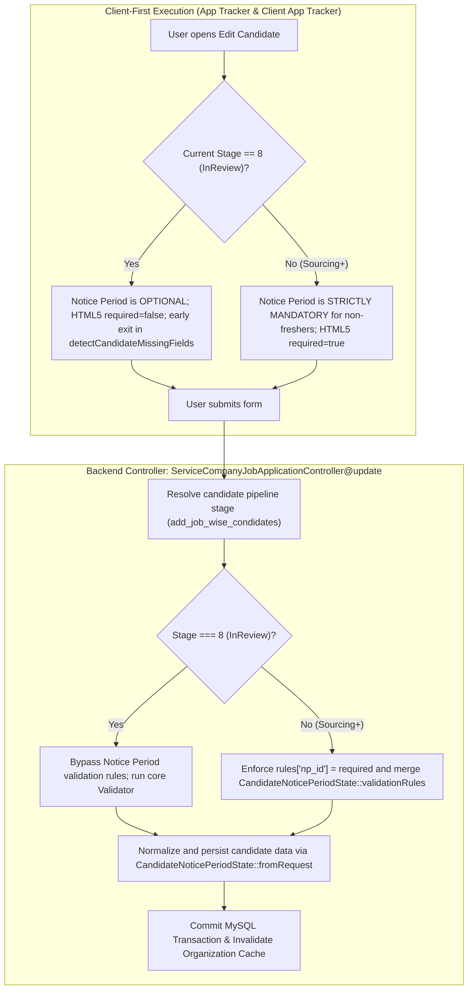

# Candidate Edit: InReview Stage Notice Period Validation Decoupling

## Metadata
- **Date:** 2026-11-13
- **Module:** Candidate Management / Job Applications (`ServiceCompanyJobApplicationController`, `create.blade.php`, `clientcreate.blade.php`, `CandidateStagePreservationAndNoticePeriodValidationTest`)
- **Type:** Pipeline Stage Validation Decoupling & InReview Candidate Edit Optimization
- **Tenancy:** Multi-tenant organization isolation (`company_id`)
- **Architectural Scope:** CQRS (MySQL write authoritative, Elasticsearch read sync, Redis cache invalidation)

---

## Executive Summary

1. **Targeted InReview Stage (Stage 8) Notice Period Validation Removal:**
   - In both **App Tracker** (`resources/views/service_company/job-applications/create.blade.php`) and **Client App Tracker** (`resources/views/service_company/job-applications/clientcreate.blade.php`), Notice Period validation dependency is specifically removed for the **InReview stage (master_status_id = 8)**.
   - When editing a candidate in the InReview stage, users can submit and save candidate profile updates (e.g. name, contact number, notes) without being blocked by Notice Period requirements.

2. **Strict Preservation for All Other Pipeline Stages (Rule 7 Compliance):**
   - **Crucial Constraint:** For all other recruitment pipeline stages (Sourcing=1, Screening=2, Evaluation=3, Interview, Negotiation, Offered, Joined, Rejected), Notice Period validation remains **100% strictly enforced and unaltered**.
   - For non-InReview stages, non-freshers must supply Notice Period & Joining Details (`np_id` / `ddl_np_id` / LWD).
   - Pipeline progression via `checkCandidateSourcingMissingFields` continues to strictly enforce Notice Period when promoting a candidate from InReview to Sourcing.

3. **Backend Validation Logic (`ServiceCompanyJobApplicationController@update`):**
   - If `$isSourcingOrAbove` ($targetStage !== 8):
     - Sets `$rules['np_id'] = ['required']` for non-freshers.
     - Merges `CandidateNoticePeriodState::validationRules($request->input('serving_notice_period'), false)`.
     - Validates that non-freshers have non-empty `np_id` in `CandidateNoticePeriodState::fromRequest($request)`.
   - If `!$isSourcingOrAbove` ($targetStage === 8, InReview stage):
     - Notice Period validation dependency is completely removed: `$validator = Validator::make($request->all(), $rules, $messages);`.
     - `CandidateNoticePeriodState::validationRules(...)` is bypassed, preventing false failures caused by database default `serving_notice_period_mode = 0`.
     - If the user optionally provides notice details, they continue to be safely normalized and stored into `job_applications`.

4. **Frontend Logic & UX Parity:**
   - `detectCandidateMissingFields`: When `activeStageId === 8`, exits early after checking required Full Name and Primary Contact Number. For non-InReview stages, `addMissing('np_id')` is enforced.
   - `syncNoticePeriodComponent`: Detects `isStageInReview` and only applies HTML5 `.required = true` on sub-inputs (`noticeDateInput`, `noticeDaysSelect`) when `!isStageInReview`.
   - Option buttons in the card allow toggle-off/deselect if clicked again.
   - Guarded `$snp_mode` initialization: If `serving_notice_period_mode == 0` from MySQL defaults but `empty($application->np_id)`, defaults to `null` so InReview candidates are not falsely marked as having selected mode 0.

---

## Architecture & Data Flow

---

## File Changes Matrix

| File Path | Type | Summary of Changes |
| :--- | :--- | :--- |
| `app/Http/Controllers/ServiceCompany/ServiceCompanyJobApplicationController.php` | Controller | In `update()`: Branch validator so that when `$isSourcingOrAbove` is false (InReview stage 8), Notice Period validation rules are completely bypassed. For Sourcing and higher stages, strictly enforce `$rules['np_id'] = ['required']` and `CandidateNoticePeriodState::validationRules`. |
| `resources/views/service_company/job-applications/create.blade.php` | Blade & JS View | In `syncNoticePeriodComponent`: Guard HTML5 `.required` attributes with `!isStageInReview`. Guard `$snp_mode` initialization against MySQL default 0 when `np_id` is empty. Allow toggle-off deselect on option click. |
| `resources/views/service_company/job-applications/clientcreate.blade.php` | Blade & JS View | 100% parity with `create.blade.php`: In `syncNoticePeriodComponent`, guard `.required` with `!isStageInReview`; guard `$snp_mode` initialization against MySQL default 0; allow toggle-off deselect. |
| `tests/Feature/CandidateStagePreservationAndNoticePeriodValidationTest.php` | Feature Test | Added `test_controller_update_bypasses_notice_period_validation_for_in_review_stage` asserting that `update()` bypasses Notice Period for InReview while strictly enforcing it for Sourcing and above. |

---

## 15.6" Screen Fit
- The Notice Period card layout adheres to Rule 14 and Rule 20.
- Labels with `(Optional)` fit comfortably within the 1366×768 and 1920×1080 viewports with zero horizontal overflow.
- Inputs and options maintain responsive wrapping.

---

## Verification Evidence
- `php artisan test --filter=CandidateStagePreservationAndNoticePeriodValidationTest`: **5 passed (30 assertions)**
- `php artisan test --filter=CandidateCommentsAndNoticePeriodRegressionTest`: **6 passed (64 assertions)**
- `php artisan test --filter=CandidateCareerApplyNoticePeriodTest`: **2 passed (10 assertions)**
- `php artisan test --filter=CandidateNoticePeriodStateTest`: **7 passed (20 assertions)**
- `php -l`: **0 syntax errors** across all modified PHP and Blade files.
