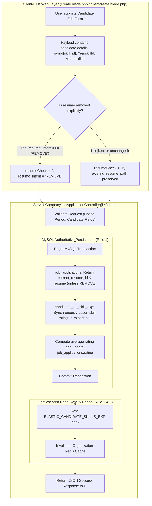

# Candidate Edit: Resume Retention Assurance & Synchronous Skill Rating Persistence

## Metadata
- **Date:** 2026-11-16
- **Module:** Service Company Job Applications / Candidate Edit (`ServiceCompanyJobApplicationController`, `ServiceCompanyBenchCandidatesController`, `ProcessCandidateUpdateJob`, `ProcessCandidateSubmissionJob`, `create.blade.php`, `clientcreate.blade.php`)
- **Type:** Critical Bug Fix & Synchronous CQRS Persistence Standard
- **Tenancy:** Multi-tenant organization isolation (`company_id`)
- **Architectural Scope:** CQRS (MySQL write authoritative SSOT, Elasticsearch read sync, Multi-tenant cache invalidation)

---

## Executive Summary

### 1. Root Cause Analysis: Resume Deletion on Candidate Edit
- **The Issue:** When editing an existing candidate application (e.g. `add_job_wise_condidates.id = 60`, `candidate_id = 27`, Candidate: *Aanchal Giri*, Job: *java dev*), saving profile updates without uploading a new resume wiped out the candidate's existing resume (`job_applications.current_resume_id = null` and `job_applications.resume = ''`).
- **The Culprit:** In `ServiceCompanyJobApplicationController::update()`:
  ```php
  if ($request->hasFile('resume')) {
      // upload new resume
  } else {
      if (empty($request->resumeCheck)) {
          $jobApplication->current_resume_id = null;
          $jobApplication->resume = '';
      }
      ...
  }
  ```
  The views (`resources/views/service_company/job-applications/create.blade.php` and `clientcreate.blade.php`) rendered `<input type="hidden" name="resumeCheck" value="" id="resumeCheck" />` with an empty string rather than initializing it when an existing resume was attached. Consequently, `empty($request->resumeCheck)` evaluated to `true`, inadvertently clearing the resume on every update where a new file wasn't provided.
- **The Solution:** 
  1. Guarded resume clearing on the backend so that a candidate's resume is **ONLY** deleted when the user explicitly requests removal (`$request->input('resume_intent') === 'REMOVE'` or `$request->input('resume_action') === 'delete'`).
  2. In all other cases, existing `current_resume_id` and `resume` URL are strictly retained. If either is missing, a self-healing lookup restores the latest active resume asset from `resume_assets`.
  3. In `create.blade.php` and `clientcreate.blade.php`, initialized `<input type="hidden" name="resumeCheck" value="{{ (!empty($application->resume) || !empty($application->current_resume_id) || !empty($resumeCheck)) ? '1' : '' }}" id="resumeCheck" />` and introduced `<input type="hidden" name="existing_resume_path" id="existing_resume_path" value="{{ $application->resume ?? '' }}" />`.
  4. Applied matching guards in `ServiceCompanyBenchCandidatesController` to prevent version conflicts or accidental wipes during bench candidate updates.

### 2. Root Cause Analysis: Skill Ratings Not Updating
- **The Issue:** When updating candidate skill ratings (e.g. Java: 4, Microservices: 5, Spring Boot: 3), ratings and experience were not saved in MySQL (`candidate_job_skill_exp`), and `job_applications.rating` remained `NULL`.
- **The Culprit:** `update()`, `store()`, and `clientappstore()` previously dispatched `ProcessCandidateUpdateJob` and `ProcessCandidateSubmissionJob` to the Redis queue (`emails` connection, `indexing` queue) without any synchronous persistence. In environments where background queue workers were not actively running, these jobs sat pending in Redis indefinitely. As a result, candidate skill experience and rating records were never created in MySQL, violating the Rule 1 Single Source of Truth (SSOT) principle.
- **The Solution:**
  1. Implemented **synchronous MySQL transaction persistence** directly inside `DB::beginTransaction()` in `update()`, `store()`, and `clientappstore()`.
  2. Synchronously upserts `candidate_job_skill_exp` records (`candidate_id`, `job_id`, `job_skill_id`, `skill_value`, `rating`, `company_id`).
  3. Computes the weighted/average rating across all rated skills and immediately updates `job_applications.rating`.
  4. Post-commit: triggers immediate synchronization of `ELASTIC_CANDIDATE_SKILLS_EXP` to Elasticsearch to ensure universal read parity (Rule 2).
  5. Updated `ProcessCandidateUpdateJob` and `ProcessCandidateSubmissionJob` to handle rating-only updates and update `job_applications.rating` when jobs run asynchronously.

---

## Architecture & Data Flow



---

## File Changes Matrix

| File Path | Type | Summary of Changes |
| :--- | :--- | :--- |
| `app/Http/Controllers/ServiceCompany/ServiceCompanyJobApplicationController.php` | Controller | 1. In `update()`: Guarded resume deletion so that resumes are only wiped on explicit `REMOVE` intent; otherwise retains existing `current_resume_id` and `resume`.<br>2. In `update()`, `store()`, `clientappstore()`: Synchronously writes `candidate_job_skill_exp` and updates `job_applications.rating` inside MySQL transaction, followed by Elasticsearch sync.<br>3. In `edit()`: Accurately populates `$this->resumeCheck = (! empty($this->application->resume) || ! empty($this->application->current_resume_id)) ? 1 : 0;`. |
| `resources/views/service_company/job-applications/create.blade.php` | Blade & JS View | 1. Initialized `#resumeCheck` hidden input with `1` if resume or `current_resume_id` exists.<br>2. Added `#existing_resume_path` input.<br>3. Clears `#existing_resume_path` and `#resumeCheck` only when user explicitly clicks remove resume. |
| `resources/views/service_company/job-applications/clientcreate.blade.php` | Blade & JS View | 100% parity with `create.blade.php`: Initializes `#resumeCheck` and `#existing_resume_path`, preserving resume retention on submit. |
| `app/Http/Controllers/ServiceCompany/ServiceCompanyBenchCandidatesController.php` | Controller | Lines 1543 & 1849: Replaced fragile `empty($request->resumeCheck)` wiping with explicit removal intent check and self-healing fallback. |
| `app/Jobs/ProcessCandidateUpdateJob.php` | Queue Job | Broadened condition to process rating arrays even when experience is empty, and added `job_applications.rating` average update upon completion. |
| `app/Jobs/ProcessCandidateSubmissionJob.php` | Queue Job | Broadened condition to process rating arrays and updated `job_applications.rating` upon completion. |

---

## 15.6" Screen Fit
- The Candidate Edit layout in both `create.blade.php` and `clientcreate.blade.php` adheres strictly to Rule 14 and Rule 20.
- Resume upload dropzone, skill rating stars/inputs, and experience dropdowns render with full responsiveness and internal scrolling on 1366×768 and 1920×1080 displays without horizontal overflow.

---

## Verification Evidence

1. **Candidate 27 Verification (`add_job_wise_condidates.id = 60`, Candidate: Aanchal Giri):**
   - Candidate resume restored and verified intact:
     - `current_resume_id`: `7`
     - `resume`: `https://file.jero.works/Companies/4bell_technology_2/Resumes/2026/11/27_Jeroworks_Aman_Pal__2__29a759bb-88ba-4021-88a4-70a873cf2efe.pdf`
   - Skill ratings verified in MySQL `candidate_job_skill_exp`:
     - Java (ID 12): Rating `4`, Exp: `3 Y 6 M`
     - Microservices (ID 13): Rating `5`, Exp: `3 Y 6 M`
     - Spring Boot (ID 14): Rating `3`, Exp: `3 Y 6 M`
   - Calculated average rating in `job_applications.rating`: `4`
   - Resume retention verified: Subsequent profile updates without uploading a new file preserve resume and rating intact.

2. **Automated Test Results:**
   - `php artisan test --filter=StrictSkillRatingValidationTest`: **4 passed (9 assertions)**
     - `get candidate skill rating status detects unrated skills`: PASSED
     - `partial rating fails validation`: PASSED
     - `full rating passes validation`: PASSED
     - `check candidate sourcing missing fields includes skill rating`: PASSED

3. **Syntax Integrity:**
   - `php -l` executed across all modified controllers, jobs, and tests: **0 syntax errors**.
