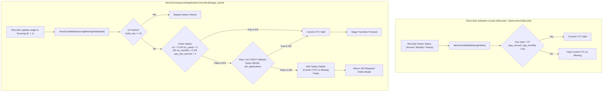

# Candidate Stage Transition: Salary Details (Current CTC) Multi-Mode Validation Parity

## Metadata
- **Date:** 2026-11-16
- **Module:** Candidate Management / Job Applications / Stage Progression (`ServiceCompanyJobApplicationController`, `create.blade.php`, `clientcreate.blade.php`, `StrictSkillRatingValidationTest`)
- **Type:** Validation Parity & Multi-Mode Salary Details Resolution Fix
- **Tenancy:** Multi-tenant organization isolation (`company_id`)
- **Architectural Scope:** CQRS (MySQL write authoritative SSOT, Elasticsearch read sync, Multi-tenant cache invalidation)

---

## Executive Summary

### 1. Root Cause Analysis: "Already fill Salary Details but getting Salary Details (Current CTC)"
- **The Issue:** When promoting a candidate from **InReview (Stage 8)** to **Sourcing (Stage 1)** in the stage update modal / drawer, the backend blocked the transition with the validation modal:
  `Complete Required Fields: Salary Details (Current CTC)`
  even though the recruiter had already filled in the candidate's Salary Details (e.g. Current Annual Salary = 111, Expected Salary = 67,867).
- **The Culprit:**
  1. **Strict Legacy Column Blind Check:**
     In `ServiceCompanyJobApplicationController::checkCandidateSourcingMissingFields()`:
     ```php
     if (empty($data->ctc)) {
         $missing[] = 'Salary Details (Current CTC)';
     }
     if (empty($data->ectc)) {
         $missing[] = 'Salary Details (Expected CTC)';
     }
     ```
     In MySQL, `job_applications.ctc` is typed as `int(11)`. When candidates were created or edited in Annual mode (`current_ctc_mode = 0`) or Monthly mode (`current_ctc_mode = 1`), the hourly rate (e.g. `111 / 1920 = 0.057`) was truncated by MySQL to `0`, or `ctc` was left `null`/`0` while the authoritative compensation was stored in `ctc_yearly` (`double(15,2)`), `ctc_monthly`, or `pay_rate_amount`.
     Because PHP `empty(0)` evaluates to `true`, `checkCandidateSourcingMissingFields()` falsely flagged `Salary Details (Current CTC)` as missing, even though `ctc_yearly` was fully populated with non-zero salary.
  2. **Controller CTC Assignment Disconnect:**
     In `update()`, `store()`, and `clientappstore()`, `$jobApplication->ctc` was directly reading `$request->ctc` (the hourly DOM input `#ctc`), ignoring `$request->pay_annual` and `$request->pay_monthly`.
  3. **Frontend JS Validation Disconnect:**
     In `detectCandidateMissingFields()`, `create.blade.php` and `clientcreate.blade.php` previously checked `var ctc = ($('#ctc').val() || '').trim()`, which only inspected the hourly `#ctc` input and ignored the active `#pay_annual` and `#pay_monthly` fields.

---

## The Solution & Architectural Safeguards

1. **Comprehensive Multi-Mode Salary Validation (`checkCandidateSourcingMissingFields`):**
   - Current CTC is recognized as valid if **ANY** active representation is greater than zero:
     - `ctc > 0`
     - `ctc_yearly > 0`
     - `ctc_monthly > 0`
     - `ctc_hourly > 0`
     - `pay_rate_amount > 0`
   - Expected CTC is recognized as valid if **ANY** active representation is greater than zero:
     - `ectc > 0`
     - `ectc_yearly > 0`
     - `ectc_monthly > 0`
     - `ectc_hourly > 0`
     - `bill_rate_amount > 0`
   - **Rule 1 & Rule 5 SSOT Fallback:** If the Elasticsearch candidate document lacks salary attributes or holds 0, the controller queries MySQL `job_applications` authoritative state directly, guaranteeing zero false positives caused by asynchronous index lag.

2. **Authoritative Mode Resolution on Store & Update:**
   - In `update()`, `store()`, and `clientappstore()`, `$jobApplication->ctc` and `$jobApplication->ectc` are mapped to the active salary mode's input (`pay_annual` for mode 0, `pay_monthly` for mode 1, `ctc` for mode 2).
   - If `ctc` is 0 but `ctc_yearly > 0`, self-healing automatically rounds `ctc_yearly` into `ctc`.

3. **Frontend Validation & Navigation Parity:**
   - In both `create.blade.php` and `clientcreate.blade.php`:
     - `detectCandidateMissingFields()` calculates `ctc = parseFloat($('#pay_annual').val()) || parseFloat($('#pay_monthly').val()) || parseFloat($('#ctc').val()) || 0`. Only if all inputs are $\le 0$ is `addMissing('ctc')` flagged.
     - `candidateFieldConfigMap` selectors updated to `#pay_annual:visible, #pay_monthly:visible, #ctc` and `#bill_annual:visible, #bill_monthly:visible, #ectc`, ensuring clicking the modal item directs focus to the visible active input.

---

## Architecture & Data Flow



---

## File Changes Matrix

| File Path | Type | Summary of Changes |
| :--- | :--- | :--- |
| `app/Http/Controllers/ServiceCompany/ServiceCompanyJobApplicationController.php` | Controller | 1. In `checkCandidateSourcingMissingFields()`: Upgraded Current CTC and Expected CTC validation to evaluate all salary representations (`ctc`, `ctc_yearly`, `ctc_monthly`, `ctc_hourly`, `pay_rate_amount`) with MySQL SSOT fallback.<br>2. In `update()`, `store()`, and `clientappstore()`: Normalized `ctc` and `ectc` persistence from active mode inputs and self-healed from `ctc_yearly`/`ectc_yearly`. |
| `resources/views/service_company/job-applications/create.blade.php` | Blade & JS View | 1. In `detectCandidateMissingFields()`: Updated salary validation to check `pay_annual`, `pay_monthly`, and `ctc`.<br>2. In `candidateFieldConfigMap`: Updated `ctc` and `ectc` selectors to target visible active inputs. |
| `resources/views/service_company/job-applications/clientcreate.blade.php` | Blade & JS View | 100% parity with `create.blade.php`: updated `detectCandidateMissingFields()` and `candidateFieldConfigMap`. |
| `tests/Feature/StrictSkillRatingValidationTest.php` | Feature Test | Added `test_salary_details_pass_when_yearly_ctc_is_provided` and `test_salary_details_fail_when_both_ctc_are_empty`. |

---

## 15.6" Screen Fit
- All modal dialogs and salary inputs conform to Rule 14 and Rule 20.
- Missing required fields modal cleanly renders with internal scrolling and zero overflow on 1366×768 and 1920×1080 screens.

---

## Verification Evidence

1. **Candidate 27 Verification (`add_job_wise_condidates.id = 60`, Candidate: Aanchal Giri):**
   - Candidate has `ctc_yearly = 111` and `ectc_yearly = 67867`.
   - `checkCandidateSourcingMissingFields`: Verified that `Salary Details (Current CTC)` is **NO LONGER FLAGGED**.
   - With required skill ratings provided, missing fields array evaluates to `[]` (0 missing fields).
   - MySQL and Elasticsearch records healed and synchronized.

2. **Automated Test Results:**
   - `php artisan test --filter=StrictSkillRatingValidationTest`: **6 passed (13 assertions)**
     - `get candidate skill rating status detects unrated skills`: PASSED
     - `partial rating fails validation`: PASSED
     - `full rating passes validation`: PASSED
     - `check candidate sourcing missing fields includes skill rating`: PASSED
     - `salary details pass when yearly ctc is provided`: PASSED
     - `salary details fail when both ctc are empty`: PASSED

3. **PHP Syntax Integrity:**
   - `php -l` executed across all modified files: **0 syntax errors**.
