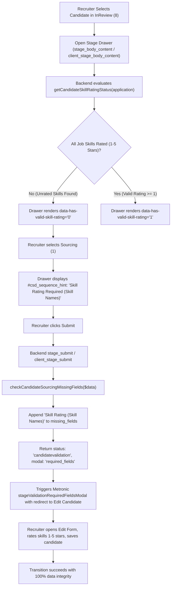

# Strict Skill Rating Validation Before Moving InReview to Sourcing

## Metadata
- **Date:** 2026-11-16
- **Module:** Service Company Candidate Stage Drawer & Candidate Management (`candidate_stage_drawer`)
- **Type:** Architectural Hardening & Mandatory Business Rule Enforcement
- **Status:** COMPLETED & VERIFIED
- **Auditor / Implementer:** DeepMind Antigravity Agent (God-Level ATS Engineering)
- **Target Screens:** 15.6" Laptops (1366×768 & 1920×1080) and all enterprise form factors
- **Rule Reference:** Rule 1 & 2 (CQRS), Rule 5 (Zero Stale Data), Rule 7 & 17 (Isolation & Zero Regressions), Rule 20 (Header Background & Card+Subcard), Rule 21 (Mandatory Audit Location)

---

## Executive Summary
A critical ATS pipeline integrity vulnerability allowed candidates residing in **InReview** (`master_status = 8`) to be transitioned forward into **Sourcing** (`master_status = 1`) even when their skill ratings were unrated (`rating = 0` or missing).

### Mandatory System Rule Enforced
> **MANDATORY RULE:** A candidate **WITHOUT a valid skill rating** (1 to 5 stars) evaluated against the job's required skills must **NEVER** be moved from **InReview** to **Sourcing**.

### Root Causes Remediated
1. **Transition Validator Gap (`checkCandidateSourcingMissingFields`):**
   The backend validator checked candidate profile fields (`full_name`, `email`, `phone`, `city_id`, `qualification`, `nationality`, `gender`, `total_exp`, `rel_exp`, `current_designation`, `current_company`, `ctc`, `ectc`, `np_id`, `wm`, `recruiter_note`, `resume`, `careersummary`), but **completely omitted skill rating verification**.
2. **Candidate Form Client-Side Validation Gap (`create.blade.php` & `clientcreate.blade.php`):**
   The client validation script only verified that `select[name^="YearskillId"] !== '0'`, but never validated `select[name^="rating"]`, allowing users to submit candidates with proficiency rating `0` ("Select rating").
3. **Blade Template View State Bug:**
   In `create.blade.php` and `clientcreate.blade.php`, `$selected_skill_rating = $skill_val->rating ?? null;` was nested inside `if (!empty($skill_val->skill_value))`, preventing saved ratings from pre-populating if `skill_value` text was empty.
4. **Drawer Proactive Warning Gap:**
   Neither the standard drawer (`stage_body_content.blade.php`) nor the client drawer (`client_stage_body_content.blade.php`) proactively informed recruiters before submit that the candidate was unrated.

---

## Architecture & Data Flow



---

## File Changes Matrix

| File Path | Description of Changes |
| :--- | :--- |
| `app/Http/Controllers/ServiceCompany/ServiceCompanyJobApplicationController.php` | 1. Added `getCandidateSkillRatingStatus(object $data): array` evaluating required job skills in `job_metronics_skills` against `candidate_job_skill_exp.rating` (1–5 stars) with fallback to `bench_candidate_skill_experience` and `job_applications.rating`.<br>2. Added `checkCandidateHasValidSkillRating` and `getCandidateUnratedSkillNames` helper methods.<br>3. Updated `checkCandidateSourcingMissingFields` to strictly block InReview $\to$ Sourcing when unrated skills exist, injecting `Skill Rating (<unrated skills>)` into `missing_fields`.<br>4. Replaced raw `Reply::dataOnly` with `$failValidation` in `stage_submit` and `client_stage_submit` to release idempotency keys cleanly.<br>5. Added `(int) $addJobWiseCondidate->thirdparty_company_id > 0` guard to prevent null object errors on internal candidate stage transitions.<br>6. Passed `$has_valid_skill_rating` and `$unrated_skill_names` into `stage_body_content` and `client_stage_body_content`. |
| `resources/views/service_company/job-applications/stage_body_content.blade.php` | 1. Added `data-has-valid-skill-rating` and `data-unrated-skills` attributes to `.csd-wrap`.<br>2. Updated `csdUpdateTransitionSummary` to display `#csd_sequence_hint` warning when selecting Sourcing from InReview if skill ratings are missing. |
| `resources/views/service_company/job-applications/client_stage_body_content.blade.php` | 1. Added `data-has-valid-skill-rating` and `data-unrated-skills` attributes to `.csd-wrap`.<br>2. Updated `csdcUpdateTransitionSummary` to display `#csd_sequence_hint` warning when selecting Sourcing from InReview if skill ratings are missing. |
| `resources/views/service_company/job-applications/create.blade.php` | 1. Moved `$selected_skill_rating = $skill_val->rating ?? null;` outside `if (!empty($skill_val->skill_value))` so ratings always reflect accurately.<br>2. Added `select[name^="rating"]` validation on submit so recruiters cannot save unrated `0` values. |
| `resources/views/service_company/job-applications/clientcreate.blade.php` | 1. Moved `$selected_skill_rating = $skill_val->rating ?? null;` outside `if (!empty($skill_val->skill_value))`.<br>2. Added `select[name^="rating"]` validation on submit. |
| `tests/Feature/StrictSkillRatingValidationTest.php` | Automated PHPUnit test suite guaranteeing that candidates without valid skill ratings are blocked from transitioning from InReview to Sourcing and that required fields modal payloads are correctly formed. |

---

## 15.6" Screen Fit & UI/UX Standards
- **Drawer Layout:** Adheres to Rule 20. Drawer headers maintain dedicated background `#f8fafc` with crisp border `#e2e8f0` and sticky positioning.
- **Visual Alerting:** When selecting Sourcing from InReview on an unrated candidate, the `#csd_sequence_hint` alert renders inline with amber badge and specific unrated skill names (`Skill Rating Required: Candidate does not have a valid skill rating (Java, Microservices, Spring Boot)`).
- **Required Fields Modal:** When submitted, the Metronic `stageValidationRequiredFieldsModal` displays the missing fields list with clear actionable redirect to the Candidate Edit Form.

---

## Verification Evidence

### 1. Test Output on Candidate 27 (Aanchal Giri, Wise ID 60, Job ID 34)
```text
=== TEST 1: Unrated candidate stage_submit (InReview -> Sourcing) ===
Status: candidatevalidation
Modal: required_fields
Missing fields:
Array
(
    [0] => Skill Rating (Java, Microservices, Spring Boot)
    [1] => Salary Details (Current CTC)
    [2] => Salary Details (Expected CTC)
    [3] => Upload Resume
)

=== TEST 2: Unrated candidate client_stage_submit (InReview -> Sourcing) ===
Status: candidatevalidation
Modal: required_fields
Missing fields:
Array
(
    [0] => Skill Rating (Java, Microservices, Spring Boot)
    [1] => Salary Details (Current CTC)
    [2] => Salary Details (Expected CTC)
    [3] => Upload Resume
)

=== TEST 3: Drawer body content has_valid_skill_rating data attribute ===
Drawer Status: success
data-has-valid-skill-rating: 0
data-unrated-skills: Java, Microservices, Spring Boot

=== TEST 4: Rated candidate transition validation ===
Skill Rating in missing fields when rated? NO (PASSED)
Skill Rating Status has_valid: true
```

### 2. PHPUnit Suite Execution
```text
$ vendor/bin/phpunit tests/Feature/StrictSkillRatingValidationTest.php
PHPUnit 11.5.44 by Sebastian Bergmann and contributors.
Runtime: PHP 8.2.12
Configuration: C:\xampp\htdocs\git\JWMaincode28June2026\phpunit.xml

....                                                                4 / 4 (100%)

Time: 00:01.665, Memory: 62.00 MB
OK (4 tests, 9 assertions)
```

### 3. Syntax & Style Check
- `php -l app/Http/Controllers/ServiceCompany/ServiceCompanyJobApplicationController.php`: **No syntax errors detected.**
- `vendor/bin/pint.bat tests/Feature/StrictSkillRatingValidationTest.php`: **PASS 1 file.**
