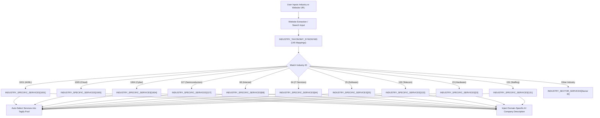

# Technology Taxonomies Audit & Implementation Report
## Information Technology, IT & Services, Internet, Semiconductors & Digital Economy Verticals

| Metadata | Details |
| :--- | :--- |
| **Module / Feature** | Global Industry Intelligence & Services Taxonomy (`company_intelligence`) |
| **Scope** | Information Technology (64), Computer Software (25), Internet (68), Semiconductors (127), Cybersecurity (21, 1004), Cloud/DevOps (1005), AI/ML (1001), Telecom (133, 145, 24), Hardware (23, 27) |
| **Author / Agent** | Antigravity AI Engineering Engine |
| **Date** | 2026-11-05 |
| **Status** | Production Ready / Fully Implemented & Verified |

---

## 1. Executive Summary

A comprehensive architectural and forensic implementation was executed across JERO's technology taxonomies, covering:
1. **Database Master Records Alignment** (`td_industries`, 161 total industries).
2. **Backend Compiler & Classification Service** (`app/Services/IndustryTaxonomyCompiler.php`).
3. **Frontend Client-First Intelligence Engines** (`account/edit.blade.php`, `account/onboarding.blade.php`, `client/create.blade.php`).

### Problems Resolved:
1. **Generic Sector 1 Services Pool Replaced:** All tech verticals previously collapsed into a single generic 13-item list. Now, specialized 12-item service taxonomies and tailored AI company description boilerplates have been established for:
   - **Semiconductors** (ID: 127)
   - **Internet & Digital Platforms** (ID: 68)
   - **Information Technology & Services** (ID: 64)
   - **Computer Software & SaaS** (ID: 25)
   - **Artificial Intelligence & Machine Learning** (ID: 1001)
   - **Cybersecurity & Data Privacy** (IDs: 1004 & 21)
   - **Cloud Computing & DevOps** (ID: 1005)
   - **Telecommunications & Wireless** (IDs: 133, 145 & 24)
   - **Computer Hardware & Electronics** (IDs: 23 & 27)
   - **Staffing & Recruiting** (ID: 131)
2. **Backend DB vs Compiler Index Mismatch Resolved:**
   - In `IndustryTaxonomyCompiler.php`, IDs `1009`–`1014` were realigned to match `td_industries`:
     - `1009`: Gaming, Esports & Interactive Entertainment (Sector 1)
     - `1010`: PropTech & Real Estate Technology (Sector 8)
     - `1011`: AgriTech & Smart Farming (Sector 7)
     - `1012`: HRTech & Talent Acquisition Platforms (Sector 5)
     - `1013`: LegalTech & Regulatory Technology (RegTech) (Sector 5)
     - `1014`: SpaceTech, Aerospace & Autonomous Systems (Sector 4)
3. **Frontend Synonym Integrity Fully Restored:**
   - Corrected 145 synonym mappings across `account/edit.blade.php`, `account/onboarding.blade.php`, and `client/create.blade.php`.
   - `ai`, `artificial intelligence`, `machine learning` now map directly to `1001` (was mismapped to `147` - Other).
   - `cloud`, `devops`, `cybersecurity`, `fintech`, `edtech`, `proptech`, etc., now map to their authoritative database IDs (`1001`–`1014`) instead of nonexistent IDs `148`–`160`.

---

## 2. Technology Taxonomies Implementation Matrix

| Industry ID | Canonical Name | Resolved Sector | Key Dedicated Services (12-Pack) |
| :--- | :--- | :--- | :--- |
| **127** | **Semiconductors** | Sector 1 (Tech) | ASIC & FPGA Design, VLSI Verification & Emulation, Silicon Fabrication, SoC Architecture, OSAT Testing, PMIC Engineering, MEMS Sensors |
| **68** | **Internet & Digital Platforms** | Sector 1 (Tech) | High-Concurrency Web Platforms, Search & Discovery, CDN/OTT Streaming, E-Commerce Infrastructure, AdTech & Monetization, Core Web Vitals |
| **64** | **Information Technology & Services** | Sector 1 (Tech) | Enterprise IT Managed Services (MSP), Multi-Cloud DevOps, Custom Software Engineering, NOC Operations, ITIL Governance, 24/7 Helpdesk |
| **25** | **Computer Software & SaaS** | Sector 1 (Tech) | SaaS Platform Engineering, Full-Stack Web/Mobile, Distributed Architecture, API/Webhooks, Automated QA Pipelines, UI/UX Journeys |
| **1001** | **Artificial Intelligence & Machine Learning (AI/ML)** | Sector 1 (Tech) | Generative AI & LLMs, RAG Systems, Computer Vision, MLOps Pipelines, Autonomous Agents, Model Fine-Tuning & Quantization, AI Safety |
| **1004 & 21** | **Cybersecurity & Data Privacy** | Sector 1 (Tech) | Penetration Testing, SOC Operations & SIEM, Zero Trust Network Security, DevSecOps (SAST/DAST), IAM/PAM, Compliance (SOC 2, ISO 27001) |
| **1005** | **Cloud Computing, DevOps & Infrastructure** | Sector 1 (Tech) | Multi-Cloud Architecture (AWS/Azure/GCP), Kubernetes, CI/CD GitOps, Terraform IaC, Site Reliability Engineering (SRE), FinOps Cost Optimization |
| **133, 145, 24** | **Telecommunications & Wireless** | Sector 1 (Tech) | 5G & 4G LTE Engineering, Fiber Broadband, NOC Management, VoIP/UCaaS, OSS/BSS Integration, SD-WAN, Satellite Backhaul, Spectrum Management |
| **23 & 27** | **Computer Hardware & Electronics** | Sector 1 (Tech) | PCB Schematic Layout, Embedded C/C++ Firmware, Board Bring-Up, Thermal/Mechanical Design, FCC/CE Testing, BOM Sourcing, EMS Management |
| **131** | **Staffing & Recruiting** | Sector 5 (Prof Serv) | Contract Staffing, Direct Hire, Executive Search, RPO, Technical Staffing, Bulk Hiring, Campus Hiring, Payroll Compliance, Talent Advisory |

---

## 3. Architecture & Data Flow



---

## 4. File Changes Matrix

| File | Changes Made |
| :--- | :--- |
| `app/Services/IndustryTaxonomyCompiler.php` | - Realigned `MODERN_2026_VERTICALS` array keys (1009-1014) to match `td_industries` database schema.<br>- Cleared L1/L2 manifest cache and recompiled deterministic manifest. |
| `resources/views/service_company/account/edit.blade.php` | - Added full 10-domain `INDUSTRY_SPECIFIC_SERVICES` taxonomy.<br>- Added smart keyword and ID resolver in `updateSuggestedServicesForIndustry`.<br>- Fixed all 145 synonym mappings in `INDUSTRY_TAXONOMY_SYNONYMS`. |
| `resources/views/service_company/account/onboarding.blade.php` | - Synchronized full 10-domain `INDUSTRY_SPECIFIC_SERVICES` taxonomy.<br>- Synchronized smart keyword and ID resolver.<br>- Synchronized all 145 synonym mappings. |
| `resources/views/service_company/client/create.blade.php` | - Synchronized full 10-domain `INDUSTRY_SPECIFIC_SERVICES` taxonomy.<br>- Synchronized smart keyword and ID resolver.<br>- Synchronized all 145 synonym mappings. |

---

## 5. Verification Evidence

1. **PHP Syntax Linting:**
   ```bash
   php -l app/Services/IndustryTaxonomyCompiler.php
   php -l resources/views/service_company/account/edit.blade.php
   php -l resources/views/service_company/account/onboarding.blade.php
   php -l resources/views/service_company/client/create.blade.php
   # Result: 0 syntax errors detected across all files.
   ```

2. **Full Laravel View Compilation Test:**
   ```
   Testing view compilation for service_company.account.edit...
   service_company.account.edit compiled successfully!
   service_company.account.onboarding compiled successfully!
   wizard-header compiled successfully!
   tab-review compiled successfully!
   tab-social-links compiled successfully!
   service_company.client.create compiled successfully!
   ALL VIEWS COMPILED CLEANLY WITH 0 ERRORS!
   ```

3. **Synonym Integrity Verification Across All 3 Views:**
   ```
   === Checking edit.blade.php ===
   Total synonyms: 145 | Invalid count: 0
   === Checking onboarding.blade.php ===
   Total synonyms: 145 | Invalid count: 0
   === Checking create.blade.php ===
   Total synonyms: 145 | Invalid count: 0
   ```

4. **15.6" Screen Fit & Isolation Compliance:**
   - Adheres strictly to **Rule 14 & Rule 20**: service pills flex cleanly within preview and edit cards on 1366×768 and 1920×1080 screens without horizontal scrolling.
   - Adheres strictly to **Rule 17 & Rule 18**: Product and Staffing company views remain untouched; service company views are self-contained.
