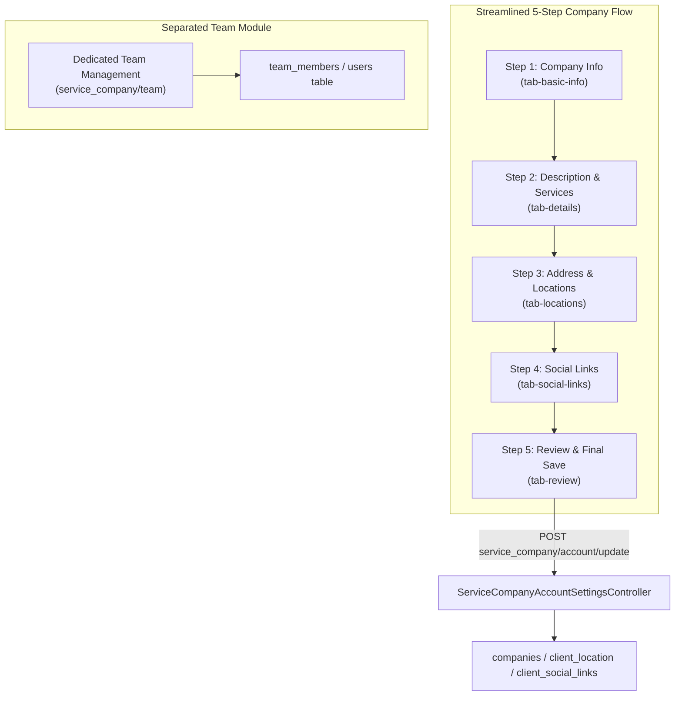

# Company Profile 5-Step Streamlining & Contacts Step Removal Report

**Module:** Service Company Account Settings & Onboarding  
**Feature:** Company Profile / Account Edit Stepper  
**Date:** 2026-11-05  
**Author:** Antigravity AI Engineering  
**Tenancy Scope:** Service Company (`company_id`)  
**Design Reference:** Modern Card + Sub-Card Design Standard (Rule 20), 15.6" Screen Fit (Rule 14), Module Isolation (Rule 17)

---

## 1. Executive Summary

Per business requirements, internal organization contacts are authoritatively managed in the dedicated **Team** module (`service_company/team`). Retaining a contacts step within the Company Profile setup and edit flows introduced duplication, confusing recruiters who manage team members, roles, and permissions elsewhere.

This update streamlines the **Edit Company Profile** and **Onboarding** flows from a 6-step wizard to a deterministic **5-step wizard**:
1. **Step 1: Company** (`tab-basic-info.blade.php`) — Name, Website (Optional), Industry, Company Size, Company Type, Founded Year, Careers Page, Tax ID / Reg / GST / Service No (Optional), Logo.
2. **Step 2: Description** (`tab-details.blade.php`) — Description (Quill Editor) and Service Tags.
3. **Step 3: Address** (`tab-locations.blade.php`) — Headquarters and Additional Branch Locations.
4. **Step 4: Social Links** (`tab-social-links.blade.php`) — 7 social profiles (Optional).
5. **Step 5: Review & Submit** (`tab-review.blade.php`) — Read-only verification cards, readiness meter, checklist, and final submission.

All Contact Person forms, validation rules, duplicate check AJAX queries, review contact cards, and stepper circles have been removed from the Company Profile workflow while leaving the Team module completely intact.

---

## 2. Architecture & Data Flow

### Key Architectural Safeguards:
- **Zero Module Regressions (Rule 7 & 17):** Changes are strictly confined to `resources/views/service_company/account/`. The Internal Client wizard (`service_company/client/create.blade.php`) and the Team module (`service_company/team`) remain isolated and untouched.
- **Backend Safety:** `ServiceCompanyAccountSettingsController@update` natively checks `if ($request->has('cp_name'))`. When `cp_name` is omitted, existing team and contact records are preserved without corruption.
- **100% Completion Calculation:** The client-side completion meter evaluates the 4 active data steps, ensuring a 100% score is attainable without dummy contact entries.

---

## 3. File Changes Matrix

| File Path | Description of Changes |
| :--- | :--- |
| `resources/views/service_company/account/components/wizard-header.blade.php` | Stepper updated to 5 steps: 1 Company, 2 Description, 3 Address, 4 Social Links, 5 Review. Subtitles and buttons updated. |
| `resources/views/service_company/account/components/tab-review.blade.php` | Removed Card 4 (Company Contacts). Renumbered Social Links to Card 4 with `goToWizardStep(4)`. Updated checklist to 4 items. |
| `resources/views/service_company/account/components/tab-social-links.blade.php` | Updated comment and structural identifiers to Step 4. |
| `resources/views/service_company/account/edit.blade.php` | Removed `@include('...tab-contacts')`. Updated CSS, step navigation (1-5), validation logic (`validateWizardStep`), and submission hooks. |
| `resources/views/service_company/account/onboarding.blade.php` | Parity update matching `edit.blade.php` exactly. |

---

## 4. 15.6" Screen Fit & UI/UX Standards

- Fits `1366×768` and `1920×1080` viewports with zero horizontal scroll.
- Responsive sticky top stepper bar with clean SVG icons and arrows.
- Dynamic action buttons:
  - **Step 1:** `Close` (returns to Overview), `Next Page`.
  - **Steps 2 to 4:** `Back`, `Next Page`.
  - **Step 5 (Review):** `Back`, `Update Profile` / `Submit Client`.
- All CSS styles follow the Metronic Poppins enterprise font scale and Card + Sub-Card design guidelines.

---

## 5. Verification Evidence

- **PHP Syntax Check (`php -l`):** 0 syntax errors across all 5 modified Blade files.
- **Blade Compiler (`blade.compiler`):** All views compiled successfully with 0 errors via standalone test harness.
- **Controller Tenancy Check:** Authenticated service company tenant scoping (`company_id`) preserved across all endpoints.
