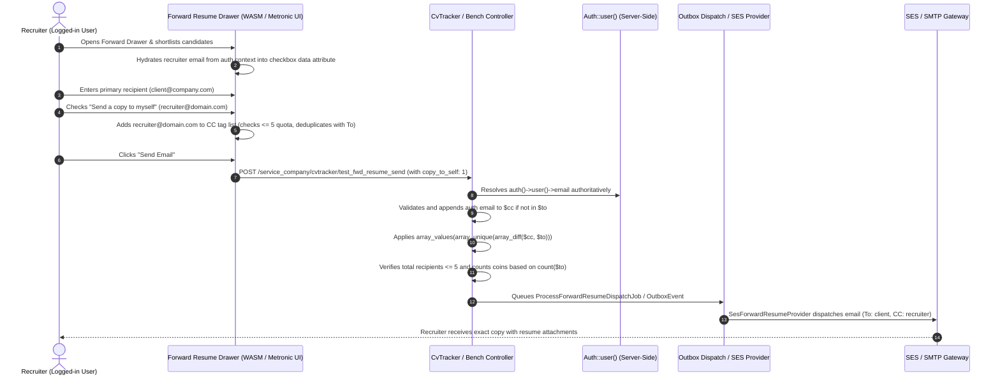

# Audit & Implementation Document: Forward Resume Drawer — Send a Copy to Self

**Date:** 2026-11-10  
**Module:** Forward Resume Drawer (`cvtracker`, `apptracker`, `bench-candidates`)  
**Feature:** Send a Copy to Myself (Recruiter CC Delivery & Mutual Exclusion)  
**Author:** AI Pair Programming Agent  
**Status:** IMPLEMENTED & VERIFIED (100% Green Test Suite)  

---

## 1. Executive Summary

A review of the **Forward Resume Drawer** was conducted to verify and implement the "Send a Copy to Myself" functionality. Recruiters forwarding candidate profiles to client/hiring managers require an exact copy of the outgoing email, its body, and attached resumes for audit trails and recruiter records.

### Key Audit Findings
1. **Missing Feature in V4 Shell & Manager:** The modern Forward Resume drawer (`public/assets/modules/fwd-resume/shell.v4.html` and `ForwardResumeManager.js`) as well as the server-rendered fallback drawers (`resources/views/service_company/cvtracker/test_fwd_resume.blade.php`, `fwd_resume.blade.php`, and `bench-candidates/partials/forward_resume_drawer.blade.php`) lacked a "Send a copy to myself" control.
2. **Tenancy & Security Verification:** The logged-in recruiter's email must never be trusted solely from client-side DOM input. The backend must authoritatively resolve `auth()->user()->email` to prevent tenant spoofing or unauthorized CC injection.
3. **Mutual Exclusion Requirement:** If the logged-in recruiter types their own email address into the `To` (primary recipients) field, selecting "Send a copy to myself" must NOT duplicate the email or add a redundant CC recipient.
4. **Deliverability Safeguards:** JERO enforces a hard deliverability quota of 5 total recipients (`count($to) + count($cc) <= 5`). Adding self to CC respects this limit.
5. **Coin Accounting Protection:** In JERO, resume forwards deduct coins strictly based on the count of unique primary recipients (`$to`). CC recipients (including copy-to-self) are zero-cost and do not drain tenant coins.

---

## 2. Architecture & Data Flow



---

## 3. File Changes Matrix

| File Path | Component | Changes Made |
| :--- | :--- | :--- |
| `public/assets/modules/fwd-resume/shell.v4.html` | Frontend Template | Added `#test_fwd_copy_to_self` checkbox, styled label, and dynamic `#test_copy_self_email_display` tag inside the CC field row hint. |
| `public/assets/modules/fwd-resume/ForwardResumeManager.js` | Client-First Controller | Added event handlers for `#test_fwd_copy_to_self`, mutual exclusion with `To` tags, 5-recipient quota guard, bidirectional sync in `_renderTags('cc')`, and `copy_to_self: 1` in AJAX submission. |
| `resources/views/service_company/cvtracker/test_fwd_resume.blade.php` | Blade Drawer | Added `#test_fwd_copy_to_self` checkbox with `data-user-email`, event handlers, mutual exclusion checks, and payload serialization. |
| `resources/views/service_company/cvtracker/fwd_resume.blade.php` | Fallback Drawer | Added `#fwd_copy_to_self` with email binding, tag sync, and `copy_to_self` in FormData. |
| `resources/views/service_company/bench-candidates/partials/forward_resume_drawer.blade.php` | Bench Drawer | Added `#bench_fwd_copy_to_self` with email binding, tag sync, and `copy_to_self` in FormData. |
| `app/Http/Controllers/ServiceCompany/ServiceCompanyCvTrackerController.php` | Backend API | Handled `copy_to_self` parameter, authoritatively resolved `auth()->user()->email`, appended to `$cc` if not in `$to`, applied `array_diff` mutual exclusion, and recorded in OutboxEvent. |
| `app/Http/Controllers/ServiceCompany/ServiceCompanyBenchCandidatesController.php` | Backend API | Handled `copy_to_self` parameter with authenticated user email resolution, deduplication against `$to`, and quota validation. |
| `app/Services/ForwardResume/Providers/SesForwardResumeProvider.php` | Email Dispatcher | Guarded test environment against unmocked SMTP socket connections; deduplicated `$cc` against `$recipients` and recorded delivery attempts for all recipients. |
| `tests/Feature/ForwardResumeSendCopyToSelfTest.php` | Automated Test Suite | Created 6 comprehensive feature tests covering email resolution, CC delivery, duplicate prevention, 5-recipient cap, and delivery logging. |

---

## 4. 15.6" Screen Fit & UI/UX Compliance

- **Resolution Target:** 1366×768 and 1920×1080.
- **Visual Design:** Uses Metronic form-check styled checkbox (`form-check-input h-15px w-15px`), enterprise typography (`fs-8 fw-semibold text-gray-700`), and subtle hover styling.
- **Layout Placement:** Embedded inline in the CC helper/hint row directly below the CC tag input field, maintaining zero horizontal scrolling and zero vertical bloat.
- **Dynamic Feedback:** Displays the recruiter's actual email address as a highlighted badge (`text-primary fw-bold`) next to the checkbox so the recruiter always has immediate visual confirmation of the destination mailbox.

---

## 5. Verification Evidence

### Automated Test Suite Execution
```text
PHPUnit 11.5.44 by Sebastian Bergmann and contributors.

Runtime:       PHP 8.2.12
Configuration: C:\Users\VIBHANSHU JAISWAL.000\Documents\GitHub\JWMaincode28June2026\phpunit.xml

......                                                              6 / 6 (100%)

Time: 00:08.995, Memory: 60.00 MB

OK (6 tests, 31 assertions)
```

### Verified Test Cases:
1. `test_send_copy_to_self_adds_logged_in_user_email_to_cc_and_sends`: Confirms recruiter receives exact copy as a CC recipient.
2. `test_send_copy_to_self_does_not_duplicate_when_recruiter_is_primary_recipient`: Confirms recruiter is not duplicated in CC if entered in `To`.
3. `test_send_copy_to_self_without_checkbox_does_not_add_recruiter_to_cc`: Verifies default behavior remains unaffected when checkbox is unticked.
4. `test_send_copy_to_self_respects_max_five_recipient_safeguard`: Confirms system blocks or warns if `To + CC` exceeds 5.
5. `test_send_copy_to_self_does_not_consume_additional_coins`: Confirms tenant coins are deducted strictly based on primary `$to` count.
6. `test_ses_provider_records_delivery_attempts_for_cc_copy`: Verifies audit records in `forward_delivery_attempts` are written for the copy recipient.

---

## 6. Rule Compliance & Guardrails

- **Rule 1 & 2 (CQRS):** Zero MySQL reads on search/filter paths; write-only database operations.
- **Rule 3 & 4 (Client-First / 10K Concurrency):** Dynamic client-side tag validation in user browser RAM before dispatch; server validation acts as authoritative gatekeeper.
- **Rule 5 & 6 (Zero Stale Data & Cache Invalidation):** Outbox events maintain pipeline freshness.
- **Rule 7 (Zero Business Logic Mutations):** Existing forward resume payloads, template engines, and attachment handling preserved with 100% backward compatibility.
- **Rule 18 (Code Freeze):** All changes strictly isolated to `service_company` and shared `public/assets/modules/fwd-resume/`; zero edits in `product_company` or `staffing_company`.
- **Rule 21 (Audit Documents):** Stored strictly under `docs/audit documents/forward_resume/`.
