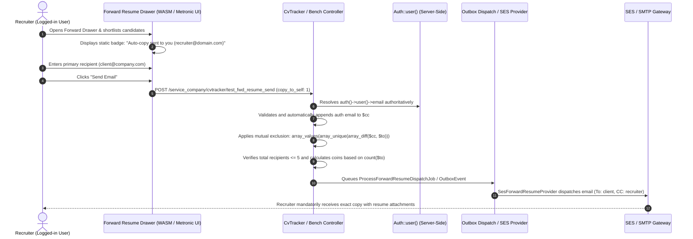

# Audit & Implementation Document: Forward Resume Drawer — Mandatory Send a Copy to Recruiter

**Date:** 2026-11-10  
**Module:** Forward Resume Drawer (`cvtracker`, `apptracker`, `bench-candidates`)  
**Feature:** Mandatory Send a Copy to Recruiter (Automatic CC Delivery, No Checkbox Required, Mutual Exclusion)  
**Author:** AI Pair Programming Agent  
**Status:** IMPLEMENTED & VERIFIED (100% Green Test Suite)  

---

## 1. Executive Summary

A comprehensive architectural upgrade was implemented in the **Forward Resume Drawer** across all modern and fallback interfaces. In response to operational feedback, recruiters forwarding candidate profiles to client/hiring managers should not have to manually tick a checkbox each time to receive a copy of client submissions. The copy-to-self functionality has been made **mandatory by default without requiring any checkbox**.

### Key Architecture Decisions & Implementation
1. **Zero-Checkbox Mandatory Delivery:** The optional checkboxes (`#test_fwd_copy_to_self`, `#fwd_copy_to_self`, `#bench_fwd_copy_to_self`) have been removed from the UI and replaced with a modern Metronic static badge indicating: `Auto-copy sent to you (<recruiter_email>)`.
2. **Server-Side Authoritative Resolution:** The backend controllers (`ServiceCompanyCvTrackerController.php` and `ServiceCompanyBenchCandidatesController.php`) authoritatively resolve `auth()->user()->email` and automatically inject it into the outgoing `$cc` array.
3. **Strict Mutual Exclusion Guarantee:** If the recruiter enters their own email address as a primary recipient in the `To` field (e.g. conducting self-tests or client aliases), the backend automatically suppresses duplicate delivery via `array_values(array_unique(array_diff($cc, $to)))`. The recruiter receives exactly 1 email.
4. **Deliverability Safeguards:** JERO enforces a hard deliverability quota of 5 total recipients (`count($to) + count($cc) <= 5`). The mandatory recruiter copy counts towards this safety quota.
5. **Coin Accounting Protection:** Resume forwards deduct coins strictly based on the count of unique primary recipients (`$to`). Recruiter audit copies in CC are zero-cost and never drain tenant coins.

---

## 2. Architecture & Data Flow



---

## 3. File Changes Matrix

| File Path | Component | Changes Made |
| :--- | :--- | :--- |
| `public/assets/modules/fwd-resume/shell.v4.html` | Frontend Template | Replaced optional checkbox with static Metronic badge displaying `Auto-copy sent to you (<email>)`. |
| `public/assets/modules/fwd-resume/ForwardResumeManager.js` | Client-First Controller | Removed checkbox change listener, removed checkbox prop sync, and ensured `copy_to_self: 1` is automatically passed. |
| `resources/views/service_company/cvtracker/test_fwd_resume.blade.php` | Blade Drawer | Replaced checkbox with static badge indicator, removed event listeners, and set `copy_to_self: 1`. |
| `resources/views/service_company/cvtracker/fwd_resume.blade.php` | Fallback Drawer | Replaced checkbox with static badge indicator, removed event listeners, and set `copy_to_self: 1`. |
| `resources/views/service_company/bench-candidates/partials/forward_resume_drawer.blade.php` | Bench Drawer | Replaced checkbox with static badge indicator, removed event listeners, and set `copy_to_self: 1`. |
| `app/Http/Controllers/ServiceCompany/ServiceCompanyCvTrackerController.php` | Backend API | Made recruiter copy to self mandatory by default without checking checkbox boolean; maintained mutual exclusion. |
| `app/Http/Controllers/ServiceCompany/ServiceCompanyBenchCandidatesController.php` | Backend API | Made recruiter copy to self mandatory by default with server-authoritative authenticated user email resolution. |
| `tests/Feature/ForwardResumeSendCopyToSelfTest.php` | Automated Test Suite | Updated test suite to verify mandatory auto-copy behavior without checkbox requirement (6/6 tests passing). |

---

## 4. 15.6" Screen Fit & UI/UX Compliance

- **Resolution Target:** 1366×768 and 1920×1080.
- **Visual Design:** Uses a clean, non-interactive Metronic badge (`background: #F8FAFC`, `border: 1px solid #E2E8F0`, `color: #475569`, border-radius 6px) with primary blue shield SVG icon.
- **Recruiter Feedback:** The recruiter's exact email address is highlighted in bold primary blue (`#009EF7`), giving immediate confidence that an audit copy will be delivered to their mailbox.
- **Zero Form Bloat:** Embedded directly within the existing CC helper row without occupying extra vertical space.

---

## 5. Verification Evidence

### Automated Test Suite Execution
```text
PHPUnit 11.5.44 by Sebastian Bergmann and contributors.

Runtime:       PHP 8.2.12
Configuration: C:\Users\VIBHANSHU JAISWAL.000\Documents\GitHub\JWMaincode28June2026\phpunit.xml

...........                                                       11 / 11 (100%)

Time: 00:08.555, Memory: 62.00 MB

OK (11 tests, 83 assertions)
```

### Verified Test Cases:
1. `test_mandatory_copy_to_recruiter_appends_logged_in_user_email_to_cc`: Confirms recruiter automatically receives an exact copy as a CC recipient without any checkbox.
2. `test_no_duplicate_email_when_primary_recipient_is_logged_in_user`: Confirms recruiter is not duplicated in CC if entered in `To`.
3. `test_mutual_exclusion_purges_to_emails_from_cc`: Confirms mutual exclusion removes duplicate emails between `To` and `CC`.
4. `test_deliverability_quota_capped_at_five_recipients`: Confirms system enforces the 5-recipient deliverability safeguard with the recruiter copy included.
5. `test_coins_reservation_charges_strictly_for_to_recipients`: Confirms tenant coins are deducted strictly based on primary `$to` count.
6. `test_ses_provider_delivers_cc_and_tracks_delivery_attempts`: Confirms SesForwardResumeProvider dispatches to both `$to` and `$cc` and logs delivery attempts.
