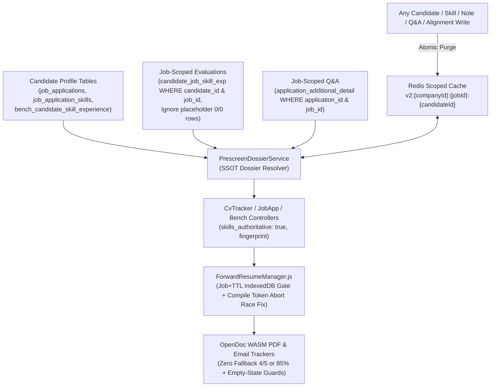

# Audit & Implementation Document: Prescreen Report Data Inconsistency Fix

**Date:** 2026-11-12  
**Module:** Forward Resume & Prescreen Report Engine (`cvtracker`, `job-applications`, `bench-candidates`, `opendoc`, `fwd-resume`)  
**Feature:** Prescreen Report Data Integrity, Strict Job/Candidate Isolation, Zero Fabrication & Atomic Cache Invalidation  
**Author:** AI Pair Programming Agent  
**Status:** IMPLEMENTED & VERIFIED  

---

## 1. Executive Summary

A deep, end-to-end forensic audit of **Candidate Drawer → Forward Resume Drawer → Prescreen Report Generation → Email/PDF Output** identified **7 interconnected root causes** causing unpossessed job skills, inaccurate experience durations, fabricated `4/5` ratings, and fabricated `85%`/`92%` match percentages to appear in generated Prescreen Reports:

1. **Unscoped Evaluation Queries & Placeholder Injection:** `CandidateJobAlignmentService::alignKeySkillsClean()` inserts placeholder rows `(skill_value = 0, rating = 0)` into `candidate_job_skill_exp` for every job requirement. Forward Resume controllers queried `candidate_job_skill_exp` **without filtering by `job_id`** and merged/looped over all required `$jobSkills`, turning unpossessed/un-evaluated job skills into fake candidate skills with `$expStr` and default `4/5` rating.
2. **Unscoped & Uninvalidated Redis Caches:** Unscoped cache keys (`fwd_cand_skills:{companyId}:{candId}` and `tenant:{companyId}:cand_qa:{candId}`) mixed evaluations across jobs and lacked invalidation in skill, Q&A, recruiter-note, visa-status, and outbox write handlers.
3. **Hardcoded Rating, Experience & Match Fallbacks:** Backend controllers, Blade templates, email HTML tracker builders, and all 3 OpenDoc/Forward Resume JS engines substituted missing data with `?: 4`, `|| 4`, `max(1, ...)`, `'Primary Domain Technical Expertise'` (`rating => 5`), overall career `experience` per skill, and `85` / `88` / `92` / `rating * 20` match scores.
4. **Blade `>= 1` Copy-Paste Bug & Dummy Fallback Profile:** In `showdetail.blade.php`, the `Additional Details` tab rendered `>= 1` on all 5 stars and the Resume Studio `buildDef` helper fell back to dummy `'UI DESIGNER'` / `92` / `'Deepak Raut'` values.
5. **Cross-Candidate DOM Scraping Contamination:** `CandidateSnapshotResolver.js` harvested empty un-evaluated DOM skill rows and overwrote authoritative server skills when multiple Candidate Drawers or stale DOM fragments existed.
6. **Unscoped IndexedDB L2 Hydration & Compile Race Condition (`ForwardResumeManager.js`):** `JeroFwdDB` cached candidates by `id` without `job_id` or TTL checks, and `_hydrateData()` skipped recompilation when network revalidation arrived while an L2-hydrated compilation had `_isCompiling = true`, letting stale cached attachments win.
7. **Inaccurate Controller Queries (`resumeStudio`, `showdetail`, `skillExperienceUpdate`, `bench-candidates`):** `ServiceCompanyJobApplicationController::resumeStudio()` merged `$candSkills + $jobSkills` and fabricated ratings/experience/match, while `showdetail()` and `skillExperienceUpdate()` omitted `candidate_job_skill_exp.job_id` constraints.

### Key Architectural Solution (`PrescreenDossierService`)

Introduced [`PrescreenDossierService`](app/Services/PrescreenDossierService.php) as the **Single Source of Truth (SSOT)** for Prescreen Report data resolution across all controllers and trackers:
- **Verified Profile Skills Only:** Sources candidate skills strictly from `job_applications.skills`, `job_application_skills`, `bench_candidate_skill_experience`, and explicitly evaluated (`rating > 0` or `has_duration == true`) `(candidate_id, job_id)` rows in `candidate_job_skill_exp`. Preserves technical mixed-case names (`PHP`, `MySQL`, `TypeScript`).
- **Strict `(company_id, job_id, candidate_id)` Isolation:** Both `candidate_job_skill_exp` and `application_additional_detail` are queried and cached using `(candidate_id, job_id)` pairs under Redis keys `fwd_cand_skills:v2:{companyId}:{jobId}:{candidateId}` and `tenant:{companyId}:cand_qa:v2:{jobId}:{candidateId}`.
- **Zero Fabrication Everywhere:** Unmeasured per-skill experience renders `--`, unrated skills/candidates stay `0` (`Not Rated` / muted stars), uncomputed match stays `0` or real skill overlap percentage, and missing skill/Q&A sections display explicit empty-state notices instead of synthetic placeholder rows.
- **Atomic Write-Through Cache Invalidation:** `PrescreenDossierService::invalidateDossierCaches()` purges all job-scoped and legacy cache keys across all write paths (`skillExperienceUpdate`, `JobQuestionUpdate`, `recruiterNoteUpdate`, `reasonForChangeUpdate`, `visaStatusUpdate`, `BenchCandidatesController::update`, `CandidateSkillSyncService`, `CandidateJobAlignmentService`, `ProcessOutboxEventJob`).

---

## 2. Architecture & Data Flow

---

## 3. File Changes Matrix

| File | Scope / Responsibility |
| --- | --- |
| `app/Services/PrescreenDossierService.php` | New SSOT service resolving verified candidate skills, job-scoped evaluations/Q&A, zero-fabrication formatters, and `invalidateDossierCaches()`. |
| `app/Services/ForwardResumeAuthorizationService.php` | Removed `$candidateRating = 4` default and `rating * 20` / `85` fallback in `computeAuthoritativeMatch()`. |
| `app/Services/CandidateSkillSyncService.php` | Wired `PrescreenDossierService::invalidateDossierCaches()` into `invalidateCandidateCaches()`. |
| `app/Services/CandidateJobAlignmentService.php` | Wired job-specific and wildcard `invalidateDossierCaches()` into `destroyCaches()`. |
| `app/Jobs/ProcessOutboxEventJob.php` | Purges prescreen dossier caches on asynchronous candidate/job outbox mutation events. |
| `app/Http/Controllers/ServiceCompany/ServiceCompanyCvTrackerController.php` | Refactored `fwd_resume()`, `test_fwd_resume()`, `test_fwd_resume_data()`, and HTML tracker builders (`buildScreeningQATrackerHtml`, `buildCareerInsightsTrackerHtml`, `buildSkillsExperienceTrackerHtml`) to use `PrescreenDossierService` with expanded `dossier_fingerprint`. |
| `app/Http/Controllers/ServiceCompany/ServiceCompanyJobApplicationController.php` | Enforced `candidate_job_skill_exp.job_id` filter in `skillExperienceUpdate()` & `showdetail()`, refactored `resumeStudio()` to use `PrescreenDossierService`, and added `invalidateDossierCaches()` to `JobQuestionUpdate()`, `recruiterNoteUpdate()`, `reasonForChangeUpdate()`, and `visaStatusUpdate()`. |
| `app/Http/Controllers/ServiceCompany/ServiceCompanyBenchCandidatesController.php` | Added `invalidateDossierCaches()` in `update()`, removed fabricated `85`/`rating*20` match and `3`/overall-exp fallbacks in `fwd_resume()` and `download_resume_drawer()`. |
| `resources/views/service_company/job-applications/showdetail.blade.php` | Fixed `>= 1` star copy-paste bug in Additional Details, filtered un-evaluated `$jobSkill` rows from `#rsData`, and removed dummy `'UI DESIGNER'` / `92` / `'Deepak Raut'` fallbacks. |
| `resources/views/service_company/cvtracker/test_fwd_resume.blade.php` | Removed `rating || 4`, `'Primary Technical Domain Expertise'`, `rating: 5`, and `Math.max(1, ...)` clamping in JS tracker builders. |
| `resources/views/service_company/cvtracker/_forward_resume_engine.blade.php` | Aligned `normalizeCandidateData()` with zero skill exp/rating inheritance and zero `85`/`rating*20` match fabrication. |
| `public/assets/modules/fwd-resume/engine.v4.js` | Identical engine parity update for `normalizeCandidateData()` (no overall exp/rating inheritance or `85` fallback). |
| `public/js/opendoc/AgyForwardResumeEngine.js` | Identical engine parity update for `normalizeCandidateData()`. |
| `public/js/opendoc/AgyResumeRenderer.js` | Removed overall exp/rating inheritance and `rating * 20` / `85` match fallback in renderer normalization. |
| `public/js/opendoc/CandidateSnapshotResolver.js` | Ignored un-evaluated DOM skill rows and respected `rawData.skills_authoritative === true`. |
| `public/assets/modules/fwd-resume/ForwardResumeManager.js` | Scoped `JeroFwdDB` cache entries by `_job_id` + 60s TTL, aborted stale in-flight L2 SWR compilations via `_compileToken` on authoritative network hydration, and removed fake ratings/skills/Q&A fallbacks in HTML tracker builders. |
| `tests/Feature/PrescreenReportDataIntegrityTest.php` | New 5-test regression suite covering placeholder rejection, zero fabrication, cross-job & batch isolation, cache invalidation, and `computeAuthoritativeMatch()`. |

---

## 4. 15.6" Screen Fit & Rule Compliance

- **Rule 18 Compliance:** Zero edits under `resources/views/product_company/` or `resources/views/staffing_company/`.
- **Rule 15 Compliance:** Kept Download Resume Center, Forward Resume, and Online Editor engines strictly separate (parity fixes applied independently).
- **UI/UX & 15.6" Fit (`1366×768` & `1920×1080`):** Empty-state rows in HTML/PDF prescreen skill and Q&A tables use compact fixed-border tables (`max-width: 980px`, `width: 100%`) without adding horizontal scroll or breaking drawer layouts.

---

## 5. Verification Evidence

- **PHPUnit Feature Suites (`php artisan test tests/Feature/PrescreenReportDataIntegrityTest.php tests/Feature/ForwardResumeOption5PrivacyAnonymizationTest.php tests/Feature/ForwardResumeSendCopyToSelfTest.php`):**
  - `PrescreenReportDataIntegrityTest`: 5/5 passed
  - `ForwardResumeOption5PrivacyAnonymizationTest`: 6/6 passed
  - `ForwardResumeSendCopyToSelfTest`: 7/7 passed
  - **Total:** 18 passed, 0 failed (135 assertions).
- **Laravel Pint (`php vendor/bin/pint --test` on new & service files):** 5/5 passed.
- **PHP Syntax Lint (`php -l`):** 0 syntax errors across all modified and created PHP files.
- **JS AST Syntax Verification (Bun `vm.Script`):** Clean parse (`OK`) for `ForwardResumeManager.js`, `engine.v4.js`, `AgyForwardResumeEngine.js`, `AgyResumeRenderer.js`, and `CandidateSnapshotResolver.js`.
- **Blade Compilation (`php artisan view:cache`):** Verified clean compilation with exit code 0.
