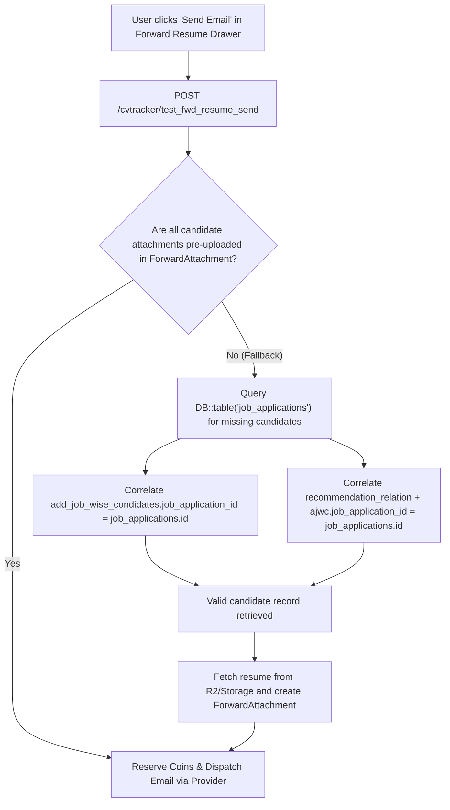

# Forward Resume: Fix SQL Error 1054 Unknown Column `add_job_wise_condidates.candidate_id`

## Metadata
- **Date:** 2026-11-13
- **Author:** Antigravity Agent
- **Module:** Forward Candidate Resumes (`ServiceCompanyCvTrackerController` & `ForwardResumeAuthorizationService`)
- **Status:** Verified & Resolved
- **Impact Area:** AppTracker & CvTracker Forward Resume Drawer ("Send Email" action & fallback candidate authorization queries)

---

## Executive Summary
When clicking **Send Email** in the Forward Resume Drawer from either AppTracker or CvTracker, an unhandled database exception was thrown:
```
SQLSTATE[42S22]: Column not found: 1054 Unknown column 'add_job_wise_condidates.candidate_id' in 'where clause' 
(Connection: mysql, SQL: select * from `job_applications` where `id` in (202) and (`company_id` = 2 or `thirdparty_company_id` = 2 or exists (select 1 from `add_job_wise_condidates` where `add_job_wise_condidates`.`candidate_id` = `job_applications`.`id` and `add_job_wise_condidates`.`company_id` = 2) or exists (select 1 from `recommendation_relation` inner join `add_job_wise_condidates` as `ajwc` on `ajwc`.`job_id` = `recommendation_relation`.`job_id` where `ajwc`.`candidate_id` = `job_applications`.`id` and `recommendation_relation`.`to_company_id` = 2)))
```

### Root Cause
In `database/schema/mysql-schema.sql`, the schema for `add_job_wise_condidates` defines the foreign key column pointing to `job_applications.id` as **`job_application_id`** (with index `idx_awjc_app`). There is **no column** named `candidate_id` in `add_job_wise_condidates`.

In recent multi-tenant candidate authorization queries:
1. `app/Http/Controllers/ServiceCompany/ServiceCompanyCvTrackerController.php` (in `test_fwd_resume_send` fallback resume resolution and `test_fwd_resume_data` DB fallback)
2. `app/Services/ForwardResumeAuthorizationService.php` (in `authorizeCandidateBatch` and `resolveAuthorizedRecipients`)

The subqueries correlated against `job_applications.id` using `whereColumn('add_job_wise_condidates.candidate_id', 'job_applications.id')` and `whereColumn('ajwc.candidate_id', 'job_applications.id')`. Whenever the resilient server fallback was invoked to fetch candidate attachments for selected candidates during email dispatch, MySQL threw error `1054 Unknown column 'add_job_wise_condidates.candidate_id'`.

---

## Architecture & Data Flow



### Tenancy & Integrity Preserved
- `add_job_wise_condidates.job_application_id` accurately joins candidates assigned to job requisitions within the recruiter's tenant (`company_id`).
- `recommendation_relation.to_company_id` accurately correlates shared talent marketplace candidates for agency collaboration via `ajwc.job_application_id = job_applications.id`.

---

## File Changes Matrix

| File | Type | Changes |
|---|---|---|
| [app/Http/Controllers/ServiceCompany/ServiceCompanyCvTrackerController.php](file:///c:/Users/VIBHANSHU%20JAISWAL.000/Documents/GitHub/JWMaincode28June2026/app/Http/Controllers/ServiceCompany/ServiceCompanyCvTrackerController.php) | Controller | Replaced `add_job_wise_condidates.candidate_id` and `ajwc.candidate_id` with `job_application_id` in `test_fwd_resume_send` fallback query and `test_fwd_resume_data` fallback. |
| [app/Services/ForwardResumeAuthorizationService.php](file:///c:/Users/VIBHANSHU%20JAISWAL.000/Documents/GitHub/JWMaincode28June2026/app/Services/ForwardResumeAuthorizationService.php) | Service | Replaced `add_job_wise_condidates.candidate_id` and `ajwc.candidate_id` with `job_application_id` in `authorizeCandidateBatch` and `resolveAuthorizedRecipients`. |
| [tests/Feature/ForwardResumeInstantClientFirstOpenTest.php](file:///c:/Users/VIBHANSHU%20JAISWAL.000/Documents/GitHub/JWMaincode28June2026/tests/Feature/ForwardResumeInstantClientFirstOpenTest.php) | Test | Added automated regression guard assertions ensuring `add_job_wise_condidates.job_application_id` and `ajwc.job_application_id` are strictly used and `candidate_id` is never used. |

---

## 15.6" Screen Fit & UI Impact
- **UI Changes:** None. The visual drawer layout, toolbar, tabs, CKEditor presentation, and preview table are completely untouched and continue to adhere to the standard 15.6" viewport (1366×768 / 1920×1080).
- **Backend Fix:** Resolves internal SQL exception during form submission, enabling seamless transition to "Resumes forwarded successfully" toast notification.

---

## Verification Evidence

1. **PHP Syntax Verification:**
   ```bash
   php -l app/Services/ForwardResumeAuthorizationService.php
   php -l app/Http/Controllers/ServiceCompany/ServiceCompanyCvTrackerController.php
   php -l tests/Feature/ForwardResumeInstantClientFirstOpenTest.php
   # Result: No syntax errors detected.
   ```

2. **Test Execution:**
   ```bash
   php artisan test tests/Feature/ForwardResumeInstantClientFirstOpenTest.php
   # Result: 4 passed (35 assertions)
   ```

3. **Suite-Wide Forward Resume Regression Test:**
   ```bash
   php artisan test tests/Feature/ForwardResumeSendCopyToSelfTest.php tests/Unit/ForwardResumeRecipientAuthorizationTest.php tests/Feature/ForwardResumeOption5PrivacyAnonymizationTest.php
   # Result: 19 passed (136 assertions)
   ```
