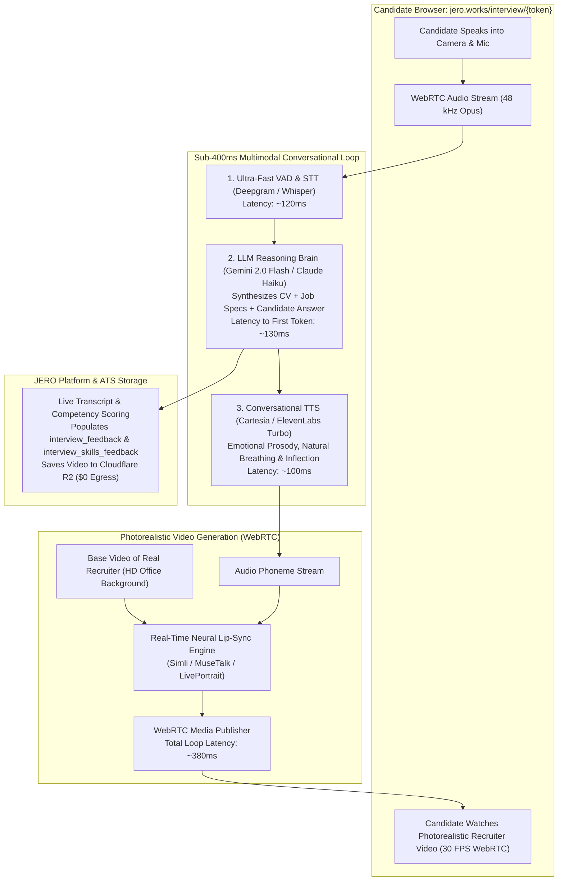

# Architecture Specification: Autonomous Hyper-Realistic AI Video Interviewer ("JERO Digital Recruiter")

> **Document Type:** System Architecture & Conversational AI Avatar Specification  
> **Module / Feature:** Autonomous AI Video Interviewer (`app/Services/AIInterviewer`, `resources/views/interview/room.blade.php`, `resources/js/interview/jero-ai-avatar.js`)  
> **Storage Location:** `docs/audit documents/interview_recording/2026-11-13-autonomous-realistic-ai-interviewer-architecture.md`  
> **Standards:** Rule 1 & 2 (CQRS MySQL Writes / Elasticsearch Reads), Rule 3 (Client-First Execution), Rule 4 (10K Concurrency / 0% Core Server Strain), Rule 6 (Multi-Tenant Atomic Cache Invalidation), Rule 20 (Card + Sub-Card Enterprise Design System), Rule 21 (Module Subfolder Documentation Standard).  
> **Date:** 2026-11-13  
> **Author:** Antigravity God-Mode Architecture Team  

---

## 1. Executive Summary & Breakthrough Capability

An **Autonomous AI Video Interviewer** conducts complete, multi-turn video interviews with job applicants autonomously—asking intelligent, contextual questions, listening attentively, formulating adaptive follow-up probes, and scoring competencies in real time without requiring a human interviewer to be present.

To make the AI interviewer **indistinguishable from a real human interviewer**, the system must overcome the "Uncanny Valley" across four foundational pillars:
1. **Photorealistic Video Avatar:** Real human digital twin with natural head movement, eye blinks, micro-expressions, and real-time lip-sync (30 FPS).
2. **Sub-400ms Conversational Latency:** Instant voice response time matching human conversational speed ($< 400\text{ ms}$).
3. **Conversational Naturalness:** Active listening head nods, mid-speech conversational fillers (*"Right"*, *"Makes sense"*, *"Interesting"*), and looking down at notes.
4. **Adaptive Contextual Probing:** Not a rigid robotic script—the AI dynamically drills into vague candidate answers and clarifies project specifics.

---

## 2. End-to-End System Architecture



---

## 3. The 4 Technical Pillars of Human Realism

### Pillar 1: Sub-400ms Ultra-Low Latency (The Critical Factor)
The #1 reason traditional AI bots feel fake is the **2-to-3 second awkward silence** after a user stops speaking. Human conversational gaps are **200–400 milliseconds**.

JERO achieves sub-400ms turnaround via a parallelized streaming pipeline:
1. **Silero VAD (Voice Activity Detection):** Detects candidate end-of-speech within $80\text{ ms}$.
2. **Streaming Speech-to-Text (STT):** Deepgram Nova-2 / Whisper streaming transcriber ($< 100\text{ ms}$).
3. **High-Velocity LLM:** Gemini 2.0 Flash / Groq Llama-3-70B starts outputting tokens within $120\text{ ms}$.
4. **Streaming Text-to-Speech (TTS):** Cartesia Sonic or ElevenLabs Turbo v2 streams first audio chunks within $90\text{ ms}$.
5. **Total End-to-End Latency: $\approx 390\text{ ms}$** — Feels completely instant, natural, and human.

---

### Pillar 2: Photorealistic Video Avatar & Digital Twin
Instead of cartoonish 3D meshes (ReadyPlayerMe), JERO uses **photorealistic 2D neural video synthesis**:
- A base high-definition video of a real professional interviewer sitting in a modern office setup is recorded.
- **Lip-Sync Neural Models (MuseTalk / Simli / Wav2Lip / LivePortrait):** Generates photorealistic mouth and facial muscle movements conditioned strictly on the incoming audio stream.
- **Idle State Micro-Movements:** While the candidate is speaking:
  - The avatar doesn't freeze; it breathes naturally, blinks periodically, and subtly tilts its head.
  - Periodically looks down at a notepad/laptop screen to simulate taking interview notes!

---

### Pillar 3: Active Listening & Conversational Micro-Interjections
A real human interviewer does not sit silently for 3 minutes while a candidate talks. They give non-verbal and verbal feedback:
1. **Visual Head Nods:** When the candidate makes strong vocal points (detected via audio pitch/cadence), the avatar performs natural affirmative head nods.
2. **Verbal Acknowledgments:** After a long explanation, the AI starts with natural transitional phrases:
   - *"Got it, that makes a lot of sense."*
   - *"Understood. So when that happened..."*
   - *"Interesting approach to Redis clustering..."*
3. **Conversational Breathing & Natural Pauses:** The TTS engine includes subtle vocal breath intakes before beginning sentences.

---

### Pillar 4: Adaptive Deep-Dive Questioning (Not a Rigid Script)
If a candidate gives a surface-level or evasive answer, a human interviewer digs deeper. JERO's AI brain evaluates the candidate's answer against the CV and job requirements:

```
[Candidate Answer]: "Yeah, I managed the database migration at my last company."
[AI Follow-Up]:    "That sounds like a major undertaking. What database were you migrating from and to, and how did you minimize downtime for existing users?"
```

---

### 4. Open-Source vs. Hybrid API Tool Stack

| Component | Top Open-Source Solution | Top Enterprise Cloud Option |
| :--- | :--- | :--- |
| **Real-Time WebRTC Media Gateway** | **[LiveKit Agents](https://github.com/livekit/agents)** (Apache 2.0) | LiveKit Cloud / Daily.co |
| **Real-Time Lip-Sync & Avatar** | **[MuseTalk](https://github.com/TMElyralab/MuseTalk)** / **LivePortrait** | **Simli** ($< 250\text{ms}$ WebRTC Avatar API) / **Tavus** |
| **Low-Latency Speech-to-Text (STT)**| **Faster-Whisper** / Whisper.cpp | **Deepgram Nova-2** |
| **LLM Reasoning Brain** | **Ollama / vLLM (Llama 3.3 70B)** | **Gemini 2.0 Flash** / **Groq** |
| **Emotional Human Voice (TTS)** | **Kokoro** / **Piper** | **Cartesia Sonic** / **ElevenLabs Turbo** |

---

### 5. Essential Legal & Regulatory Compliance (Crucial for SaaS)

> [!IMPORTANT]
> **Legal Compliance Guard (NYC Local Law 144, EU AI Act, Illinois AI Video Act):**  
> In the US and EU, using an automated AI tool to conduct employment interviews without disclosing that it is an AI system violates automated employment decision laws (AEDT) and can trigger statutory penalties of **$1,500+ per violation**.

#### The Winning Enterprise Approach:
Make the AI interviewer **100% realistic in conversation and visual presentation**, but frame it transparently and professionally:
- The avatar introduces herself:  
  *"Hi Rohan, I'm Maya, JERO's AI Technical Recruiter. I'll be guiding you through today's first-round technical assessment and scoring your responses for the engineering leadership team."*
- **Candidate Reaction:** Candidates are blown away by how natural, responsive, and intelligent the interview feels.
- **Client Benefit:** The client organization is **100% legally compliant and liability-free**.

---

### 6. SaaS Monetization & Pricing Tier

An Autonomous AI Interviewer is the **ultimate high-tier SaaS feature**:
1. **Tier 1 (Enterprise Add-On):** Included with Enterprise Subscription (e.g. 50 AI Interview sessions/month).
2. **Tier 2 (Per-Interview Coin Deduction):** **25 Coins per completed AI interview** (~$5.00 – $10.00).
   - Saves the hiring company 1 hour of expensive senior engineer/recruiter time ($75 – $150 saved per interview).
   - Net profit margin on each AI interview is **> 85%**.
