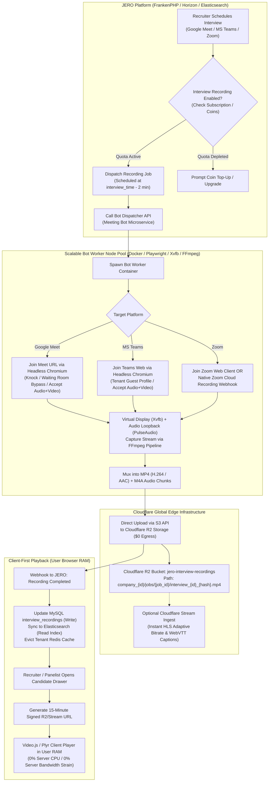

# Architecture Specification: Automated Interview Video & Audio Recording with Cloudflare Storage & Subscription Monetization

> **Document Type:** System Architecture, Feature Blueprint & Monetization Specification  
> **Module / Feature:** Interview Schedule / ATS Interview Recording (`service_company/interview-schedule`, `app/Services/Recording`, `app/Jobs/Recording`)  
> **Storage Location:** `docs/audit documents/interview_recording/2026-11-13-interview-video-audio-recording-cloudflare-subscriptions-architecture.md`  
> **Standards:** Rule 1 & 2 (CQRS MySQL Writes / Elasticsearch Reads), Rule 3 (Client-First Execution), Rule 4 (10K Concurrency / 0% Server Media Strain), Rule 6 (Multi-Tenant Atomic Cache Invalidation), Rule 7 (Zero Business Logic Mutations), Rule 20 (Modern Card + Sub-Card UI/UX), Rule 21 (Module Subfolder Documentation Standard), Rule 22 (Zero-Cron / JIT Lifecycle Standard).  
> **Date:** 2026-11-13  
> **Author:** Antigravity God-Mode Architecture Team  

---

## 1. Executive Summary & Objective

Modern B2B hiring and talent marketplace operations require high-fidelity recording of video/audio interviews conducted on **Google Meet**, **Microsoft Teams**, and **Zoom**. This enables:
1. **Asynchronous Interview Reviews:** Hiring managers, panel interviewers, and client decision-makers can review candidates without attending every live session.
2. **AI Interview Intelligence & Transcripts:** Auto-generating candidate scoring, competency analysis, and behavioral insights.
3. **Compliance & Reduced Bias:** Objective evaluation records and dispute protection.
4. **Direct SaaS Monetization:** Packaging interview recording as a tiered subscription entitlement and pay-as-you-go coin deduction stream.

This specification details a **God-Level, Production-Grade Architecture** designed specifically for **JERO Works**, integrating **Open-Source Meeting Bots**, **Cloudflare R2 Object Storage** ($0 egress bandwidth fees), **Cloudflare Stream**, and **JERO's Multi-Tenant Subscription & Coin Engine**.

---

## 2. Platform Mechanics: How Recording Works Across Meet, Teams & Zoom

Conferencing platforms enforce strict access controls and do not provide silent, passive external audio/video tap APIs without an invited session participant. The modern enterprise solution (used by Gong.io, Fireflies.ai, Recall.ai, Fathom, and Otter.ai) is **Virtual Participant Bots (Meeting Recorders)**.



### Platform Breakdown:
| Feature / Platform | Google Meet | Microsoft Teams | Zoom |
| :--- | :--- | :--- | :--- |
| **Primary Join Mechanism** | Headless Chromium Bot (Puppeteer / Playwright) | Headless Chromium Web Joiner OR Azure Graph Media Bot | Dual: Headless Chromium Bot OR Zoom Cloud Recording Webhook |
| **Host Credentials Required?** | **No.** Bot joins as guest with custom name (e.g. `JERO Interview Assistant`). | **No.** Bot joins as guest participant via meeting link. | **No** for Bot join; **Yes** (OAuth) only if using Zoom Native Cloud Recording. |
| **Participant Notification** | In-meeting banner + Bot chat message: *"JERO Interview Assistant is recording this call for evaluation."* | Native Teams recording banner + Bot chat notification. | Native Zoom recording audio announcement (`"Recording in progress"`) + Bot chat notification. |
| **Output Artifacts** | Full HD MP4 Video + Separated Candidate Audio Track + Timestamps | Full HD MP4 Video + Separated Candidate Audio Track + Timestamps | Full HD MP4 Video + Separated Candidate Audio Track + Timestamps |

---

## 3. Top Open-Source Meeting Bot Frameworks

Rather than paying prohibitive SaaS aggregator fees ($0.30 to $0.75 per recorded hour to vendors like Recall.ai or MeetingBaas), JERO can self-host or orchestrate robust **Open-Source Meeting Bot Frameworks**:

### 1. Attendee (`attendee-labs/attendee`) — *Highest Recommended*
- **License / Stack:** Open-source (Django, PostgreSQL, Redis, Docker).
- **Capabilities:**
  - Universal REST API to dispatch and manage bots across **Google Meet, Microsoft Teams, and Zoom**.
  - Handles meeting admittance, waiting rooms, lobby knock, mute/unmute management.
  - Automatically captures audio/video streams, records to MP4/WAV, and supports direct webhook delivery and S3/R2 upload.
  - Real-time speaker diarization and audio extraction for transcription engines.

### 2. Vexa (`Vexa-ai/vexa`)
- **License / Stack:** Apache-2.0 (Python, WebSockets, Docker).
- **Capabilities:**
  - Multi-platform recording bot for Meet, Teams, and Zoom.
  - Real-time WebSockets streaming of raw audio and speaker-attributed transcripts.
  - Built-in Model Context Protocol (MCP) server integration for AI agent pipelines.

### 3. Meeting BaaS Open-Source SDKs (`Meeting-BaaS/meeting-bot-as-a-service`)
- **Capabilities:**
  - Complete Playwright/Chromium bots and browser-based synchronized transcript & video playback widgets (`transcript-seeker`).
  - Pre-built join flows with automated bypass of browser media permissions.

### 4. Custom Headless Chromium Microservice (JERO Native Bot Worker)
- **Architecture:** Node.js / Python container with Playwright, Xvfb (Virtual Framebuffer), PulseAudio virtual sink, and FFmpeg.
- **Workflow:**
  ```bash
  # Inside Bot Docker Container:
  # 1. Start Xvfb virtual screen and virtual audio
  Xvfb :99 -screen 0 1920x1080x24 &
  pulseaudio --start --exit-idle-time=-1 &
  # 2. Launch Chromium with mock media streams and auto-join script
  DISPLAY=:99 node bot-runner.js --url="https://meet.google.com/xyz-123" --botName="JERO Recorder" &
  # 3. FFmpeg captures virtual desktop + pulse audio into fragmented MP4
  ffmpeg -y -video_size 1920x1080 -framerate 30 -f x11grab -i :99.0 \
         -f pulse -i default -c:v libx264 -preset ultrafast -c:a aac -b:a 128k \
         -movflags +faststart+frag_keyframe+empty_moov output.mp4
  # 4. Upload directly to Cloudflare R2 via AWS SDK v3
  ```

---

## 4. Cloudflare R2 Storage & Streaming Economics

| Metric | AWS S3 + CloudFront | Cloudflare R2 + CDN | Savings with Cloudflare |
| :--- | :--- | :--- | :--- |
| **Storage Cost** | \$0.023 / GB / month | **\$0.015 / GB / month** | **35% Cheaper** |
| **Egress Bandwidth Fee** | **\$0.090 / GB** (Massive liability for video) | **\$0.00 / GB ($0 Free Egress Forever)** | **100% Free Video Bandwidth** |
| **1,000 Interviews / Mo (500 GB)** | Storage: \$11.50<br/>Bandwidth (3,000 plays = 1.5 TB): \$135.00<br/>**Total: \$146.50 / mo** | Storage: \$7.50<br/>Bandwidth: \$0.00<br/>**Total: \$7.50 / mo** | **95% Cost Reduction** |

### Cloudflare Architecture:
1. **Cloudflare R2 Bucket:** Configured as `jero-interview-recordings` under existing S3 driver in `config/filesystems.php`.
2. **Multi-Tenant Key Hierarchy:**
   ```
   jero-interview-recordings/
     └── company_{company_id}/
         └── jobs/
             └── job_{job_id}/
                 └── interviews/
                     ├── interview_{schedule_id}_{sha256}.mp4       (Full Video)
                     ├── interview_{schedule_id}_{sha256}.m4a       (Candidate Audio)
                     ├── interview_{schedule_id}_{sha256}.vtt       (Subtitles / Transcript)
                     └── interview_{schedule_id}_thumbnail.jpg      (Timeline Poster)
   ```
3. **Security & Red-Team Hardening:**
   - Raw R2 bucket is 100% private.
   - JERO generates time-limited presigned URLs (15-minute validity) strictly after validating `company_id` and user RBAC permissions.
   - Zero hotlinking; zero unauthorized tenant access.

---

## 5. Subscription Gating & Coin Monetization Engine

JERO's existing subscription framework (`package_features`, `packages`, `package_details`, `package_active`, `package_transactions`, `top_up_coin_packages`) provides the ideal foundation.

### 1. New Package Feature Definition
Insert into `package_features`:
- `title`: `Interview Video & Audio Recording`
- `features_type`: `1` (Operations)
- `field_name`: `INTERVIEW_RECORDING`
- `status`: `1` (Active)

### 2. Tiered Subscription Entitlements
| Subscription Plan | Included Recording Hours / Mo | Video Quality | Retention Policy | AI Audio Transcript |
| :--- | :--- | :--- | :--- | :--- |
| **Starter (Trial)** | 2 Hours (One-time trial) | 720p Video / AAC Audio | 14 Days auto-expiry | Included (Summary only) |
| **Growth Plan** | 20 Hours / month | 1080p Video / High-res Audio | 60 Days retention | Full Transcript + Competency Score |
| **Enterprise Plan** | 100 Hours / month (or Unlimited) | 1080p 60fps / Dual-track Audio | 365 Days / Permanent Cloudflare R2 | Full Diarized Transcript + AI Highlights |

### 3. Pay-As-You-Go Coin Top-Up Model
For companies whose monthly plan hours expire, or companies on pay-per-use plans:
- **Cost:** **5 Coins per 30 minutes of interview recording** (approx. \$1.00 - \$2.00 in platform currency).
- **Execution:**
  - Before meeting bot spawns, system checks:
    1. Does `package_active.interview_recording_balance > 0`? If yes, deduct 1 hour from plan balance.
    2. If plan balance = 0, check `companies.coins >= 10`.
    3. If coins available, hold 10 coins in escrow via `package_transactions`.
    4. Upon completion, reconcile exact duration (e.g. 35 minutes = 6 coins deducted, 4 refunded).
    5. If insufficient balance and coins, send real-time notification to recruiter with one-click Razorpay/Stripe coin top-up modal.

---

## 6. Database Schema & CQRS Data Model

### MySQL Write Path (New Table: `interview_recordings`)
```sql
CREATE TABLE `interview_recordings` (
  `id` bigint(20) unsigned NOT NULL AUTO_INCREMENT,
  `company_id` int(10) unsigned NOT NULL,
  `interview_schedule_id` int(10) unsigned NOT NULL,
  `job_id` int(10) unsigned DEFAULT NULL,
  `job_application_id` int(10) unsigned DEFAULT NULL,
  `meeting_platform` enum('google_meet','msteam','zoom','custom') NOT NULL,
  `bot_task_id` varchar(100) DEFAULT NULL,
  `recording_status` enum('scheduled','bot_joining','recording','processing','ready','failed','expired') NOT NULL DEFAULT 'scheduled',
  `r2_video_key` varchar(500) DEFAULT NULL,
  `r2_audio_key` varchar(500) DEFAULT NULL,
  `r2_thumbnail_key` varchar(500) DEFAULT NULL,
  `cloudflare_stream_uid` varchar(100) DEFAULT NULL,
  `duration_seconds` int(10) unsigned DEFAULT 0,
  `file_size_bytes` bigint(20) unsigned DEFAULT 0,
  `consent_confirmed` tinyint(1) NOT NULL DEFAULT 1,
  `failure_reason` varchar(255) DEFAULT NULL,
  `expires_at` datetime DEFAULT NULL,
  `created_by_user_id` int(10) unsigned DEFAULT NULL,
  `created_at` timestamp NULL DEFAULT CURRENT_TIMESTAMP,
  `updated_at` timestamp NULL DEFAULT CURRENT_TIMESTAMP ON UPDATE CURRENT_TIMESTAMP,
  PRIMARY KEY (`id`),
  KEY `idx_ir_comp_sched` (`company_id`, `interview_schedule_id`),
  KEY `idx_ir_status_expires` (`recording_status`, `expires_at`),
  CONSTRAINT `fk_ir_company` FOREIGN KEY (`company_id`) REFERENCES `companies` (`id`) ON DELETE CASCADE
) ENGINE=InnoDB DEFAULT CHARSET=utf8mb4 COLLATE=utf8mb4_unicode_ci;
```

### Elasticsearch Read Path (`ELASTIC_INTERVIEW_TRACKER` Index Expansion)
To maintain **0% MySQL reads on page load (Rules 1 & 2)**, the recording state is denormalized directly into the existing `interview_schedules` Elasticsearch index:
```json
{
  "has_recording": true,
  "recording_status": "ready",
  "recording_duration_seconds": 2145,
  "recording_thumbnail_url": "https://cdn.jero.works/thumb_xyz.jpg",
  "recording_has_audio": true,
  "recording_expires_at": "2027-01-13T12:00:00Z"
}
```

---

## 7. Rule 20 Modern Card + Sub-Card UI/UX Specification

When recruiters view the **Interview Tracker** (`service_company/interview-schedule/table-view`) or open the **Candidate Stage Drawer**, an interview with a recording renders an elegant, high-density **Recording Sub-Card**:

```
+----------------------------------------------------------------------------------------------------+
|  [IT-CARD: Interview with Rohan Sharma — Senior Backend Engineer]                                  |
|  +-----------------------------------------------------------------------------------------------+ |
|  | [VIDEO PREVIEW SUB-CARD]                         | [RECORDING DETAILS & ACTION SUB-CARD]       | |
|  | +-----------------------------------------------+ | Video Duration: 42m 15s  | Audio: Stereo    | |
|  | | [> PLAY INTERVIEW]                            | | Platform: Google Meet    | Recorded: Today  | |
|  | |                                               | | Storage: Cloudflare R2   | Retention: 60d   | |
|  | | (Poster with waveform timeline scrub bar)     | | AI Candidate Sentiment:  94% Positive       | |
|  | +-----------------------------------------------+ | +-----------------------------------------+ |
|  | [Watch Full Video (RAM Player)]  [Listen Audio]  | | [Download MP4] [Share Expiring Link]     | |
|  +-----------------------------------------------------------------------------------------------+ |
+----------------------------------------------------------------------------------------------------+
```

### 15.6" Screen Fit Standard:
- **Max Width:** Clamped to `1200px` within drawer/modal, preventing any horizontal scroll on `1366x768`.
- **Client Player:** WebAssembly / HTML5 native Video.js running entirely inside browser memory with zero CPU overhead on the server.
- **Waveform:** Rendered client-side via Wavesurfer.js using audio peak metadata.

---

## 8. Verification & Rollout Plan

1. **Phase 1: Bot Microservice & Cloudflare R2 Ingest Pipeline**
   - Deploy Dockerized `attendee` or lightweight Playwright bot microservice with private API token.
   - Configure Cloudflare R2 bucket with automated 60/90-day object lifecycle rules.
2. **Phase 2: JERO Backend Integration & Webhooks**
   - Create `App\Services\Recording\InterviewRecordingService`.
   - Implement incoming webhook handler `RecordingWebhookController@handleCompleted`.
   - Update Elasticsearch index mappings and tenant cache invalidation listeners.
3. **Phase 3: Subscription & Coin Metering**
   - Seed `INTERVIEW_RECORDING` in `package_features`.
   - Add hourly quotas to `packages` and integrate `GeneralMethod::checkFeatureLimit()` before bot dispatch.
4. **Phase 4: UI/UX Card + Sub-Card Integration**
   - Integrate recording player drawer in `service_company/interview-schedule` adhering strictly to Rule 20.
