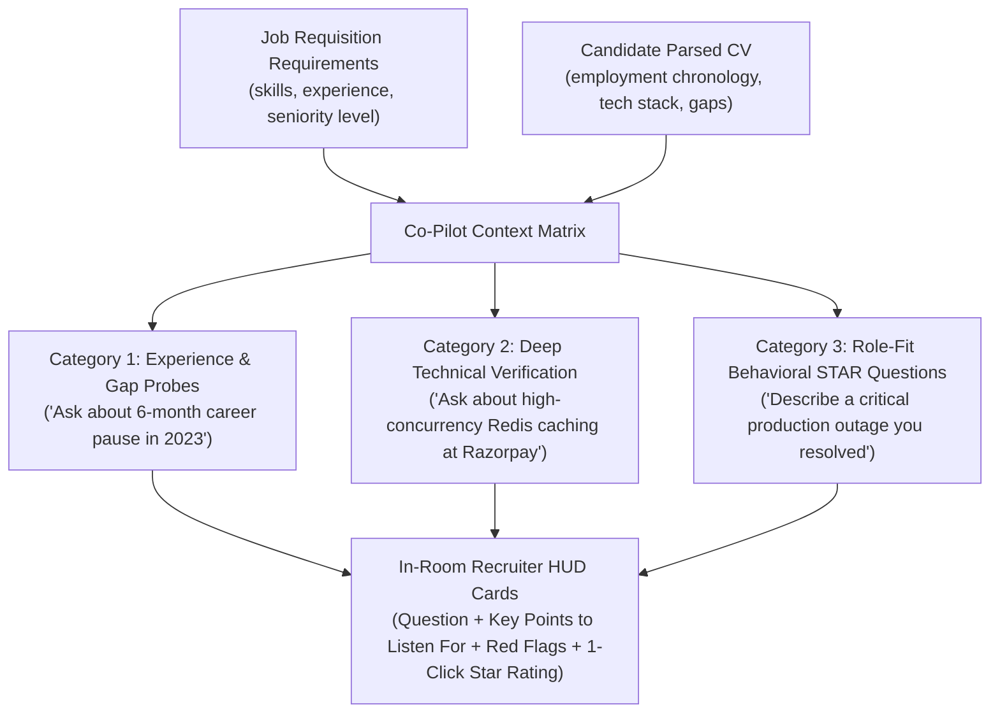

# Architecture Specification: Recruiter AI Co-Pilot (CV-Driven Questions, Follow-up Prompts & Communication Skills Scorecard)

> **Document Type:** System Architecture & Recruiter Experience Blueprint  
> **Module / Feature:** Recruiter In-Room Intelligence & Communication Scorecard (`resources/views/interview/room.blade.php`, `resources/js/interview/jero-recruiter-copilot.js`, `resources/js/interview/jero-communication-analyzer.js`, `app/Models/InterviewFeedback.php`)  
> **Storage Location:** `docs/audit documents/interview_recording/2026-11-13-recruiter-copilot-cv-questions-and-communication-scorecard-architecture.md`  
> **Standards:** Rule 1 & 2 (CQRS MySQL Writes / Elasticsearch Reads), Rule 3 (Client-First Execution in User RAM & Web Audio API), Rule 4 (10K Concurrency / 0% Server Strain Target), Rule 6 (Multi-Tenant Atomic Cache Invalidation), Rule 20 (Card + Sub-Card Enterprise Design System), Rule 21 (Module Subfolder Documentation Standard).  
> **Date:** 2026-11-13  
> **Author:** Antigravity God-Mode Architecture Team  

---

## 1. Executive Summary & Recruiter Superpowers

When conducting interviews on Google Meet or Zoom, recruiters are overloaded: they must manage the video call, search through a multi-page PDF resume in another window, formulate relevant technical questions on the spot, take manual notes, and subjectively guess communication skills.

In **JERO Native Meet (`jero.works/interview/{token}`)**, the right-hand side of the recruiter's screen transforms into an **Interactive Recruiter Co-Pilot Workspace**. This gives recruiters:
1. **Dynamic CV-Driven Questions & Follow-Up Prompts:** AI synthesizes the candidate's verified resume data with the job requisition specs to generate tailored behavioral, technical, and discrepancy-probe questions.
2. **Cheat-Sheets & Expected Answers:** Recruiters (even non-technical HR) see what key concepts to listen for, red flags to avoid, and suggested follow-ups.
3. **Automated Communication Skills Scorecard (100% Client-Side):** Web Audio API and Speech telemetry calculate Talk-to-Listen ratio, Speech Pace (WPM), Interruption Rate, and Filler Word density in real time without server load.
4. **Seamless Integration with JERO ATS Tables:** Feedback directly populates `interview_feedback` and `interview_skills_feedback` in MySQL, syncs to Elasticsearch, and triggers stage advancement.

---

## 2. All-in-One Recruiter Screen Architecture (Rule 20 & 15.6" Screen Fit)

```
+-----------------------------------------------------------------------------------------------------------------------------------+
| [HEADER: JERO Interview Room | Senior Backend Engineer | Candidate: Rohan Sharma | 🟢 LIVE (26:45) | 🛡️ Integrity: 98%]             |
+--------------------------------------------------------------------+--------------------------------------------------------------+
| [LEFT: LIVE VIDEO STAGE (55% Width)]                               | [RIGHT: RECRUITER CO-PILOT & EVALUATION (45% Width)]         |
| +----------------------------------------------------------------+ | +----------------------------------------------------------+ |
| |                                                                | | | TABS: [🎯 CV Questions] [📊 Comm Scorecard] [📄 Resume]  | |
| |                    CANDIDATE LIVE VIDEO                        | | +----------------------------------------------------------+ |
| |                                                                | | | TAB 1: CV-TAILORED QUESTIONS & CHEAT-SHEET              | |
| |                                                                | | | [!] CAREER DISCREPANCY DETECTED:                         | |
| |                                                                | | | "7-Month gap between June 2023 - Jan 2024.               | |
| |                                                                | | |  Ask: What projects or upskilling did you pursue then?"  | |
| +----------------------------------------------------------------+ | | -------------------------------------------------------- | |
| | [Interviewer PiP] | [Mute] [Camera] [Share Screen] [End Call]  | | | [★] TECHNICAL PROBE (From CV: 'Microservices & Redis'):  | |
| +----------------------------------------------------------------+ | | "How did you prevent cache stampedes during flash sales  | |
|                                                                    | |  at your previous employer, Razorpay?"                   | |
|                                                                    | |  • Listen for: Mutex locks, TTL jitter, Probabilistic x- | |
|                                                                    | |  • Red Flags:  No invalidation strategy, raw DB fallback | |
|                                                                    | |  Rating: [ ★ ★ ★ ★ ☆ ]  [✓ Mark Asked]                   | |
|                                                                    | | -------------------------------------------------------- | |
|                                                                    | | TAB 2: LIVE COMMUNICATION SKILLS SCORECARD               | |
|                                                                    | | • Talk-to-Listen Ratio: Candidate 68% | Recruiter 32% (✓)| |
|                                                                    | | • Speaking Pace:       138 WPM (Optimal / Articulate)    | |
|                                                                    | | • Filler Word Density: 1.8% ('um', 'like') [LOW / GREAT] | |
|                                                                    | | • Active Listening:    0 interruptions [EXCELLENT]       | |
|                                                                    | | +----------------------------------------------------------+ |
|                                                                    | | [SUBMIT INTERVIEW SCORECARD & ADVANCE STAGE]               | |
+--------------------------------------------------------------------+--------------------------------------------------------------+
```

---

## 3. The CV-Driven Question Generator Engine

The question generation engine cross-references the candidate's parsed resume (from `JeroIdentityEngine` / OpenDoc parser) against the requisition requirements:



### Card Anatomy for Each Generated Question:
1. **The Question Prompt:** Formulated in natural, conversational interview phrasing.
2. **Context Origin Tag:** e.g., `From CV: Razorpay (2021-2023)` or `Required Skill: Elasticsearch CQRS`.
3. **Cheat-Sheet "Listen For":** 3–4 bullet points indicating a high-level candidate response.
4. **"Red Flags" To Watch For:** Common misleading or junior answers.
5. **Interactive Actions:**
   - `[Mark as Asked]`
   - Star Rating: 1 to 5 stars (automatically syncs to `interview_skills_feedback.skills_ratings`).
   - Quick Notes input field.

---

## 4. Automated Communication Skills Scorecard (100% Client-Side)

Using the **Web Audio API** and browser speech analysis running entirely in **User RAM (Rule 3)**:

### 1. Talk-to-Listen Ratio (Vocal Balance Meter)
- Uses `AnalyserNode` connected to both local recruiter microphone and remote candidate WebRTC audio stream.
- Voice Activity Detection (VAD) monitors RMS audio decibel thresholds $> -35\text{ dB}$.
- **Optimal Hiring Benchmark:**
  - Candidate: **65% to 75%** of interview time.
  - Recruiter: **25% to 35%** of interview time.
- If the recruiter is talking $> 50\%$ of the time, the UI gently hints: `💡 Tip: Candidate has only spoken 35% of the call. Give them more floor time.`

### 2. Speaking Pace & Cadence (Words Per Minute)
- Tracks candidate speaking velocity:
  - **$< 110\text{ WPM}$:** Slow / Hesitant / Struggling to articulate.
  - **$120 - 155\text{ WPM}$:** Optimal, articulate, professional presentation pace.
  - **$> 175\text{ WPM}$:** Rapid / Anxious / Rushing.

### 3. Filler Word & Fluency Tracker
- Tracks frequency of speech disfluencies (`"um"`, `"uh"`, `"like"`, `"you know"`, `"basically"`, `"actually"`):
  - **$< 2\%$ filler ratio:** Highly articulate and poised.
  - **$2\% - 5\%$ filler ratio:** Normal conversational flow.
  - **$> 7\%$ filler ratio:** Flagged as high hesitation / low confidence.

### 4. Active Listening & Interruption Meter
- Measures overlapping speech when candidate begins talking while recruiter audio is active:
  - Interruption count: 0–1 (Polite, attentive).
  - Interruption count: $\ge 4$ (Frequent interruptions / poor listening etiquette).

---

## 5. Recruiter Scorecard Rubric & ATS Persistence

When the recruiter completes the interview, the **Communication Skills Scorecard** automatically aggregates into JERO's existing database tables:

### MySQL Persistence (`interview_feedback` & `interview_skills_feedback`):
```sql
-- Inserts overall evaluation into interview_feedback
INSERT INTO interview_feedback (
    interview_id, application_id, update_by, star_ratings,
    overall_recommendation, feedback_name, message, created_at
) VALUES (
    4821, 10452, 12, 4,
    'Strong Hire', 'Technical Round 1',
    'Exceptional technical depth on microservices. Communication was poised with 68% talk ratio.',
    NOW()
);

-- Populates skill-by-skill ratings into interview_skills_feedback
INSERT INTO interview_skills_feedback (
    interview_id, application_id, update_by, skills, skills_ratings, skills_remarks
) VALUES 
(4821, 10452, 12, 'Communication & Articulation', 5, 'Clear 138 WPM pace, low filler density (1.8%)'),
(4821, 10452, 12, 'System Architecture & CQRS', 4, 'Answered cache stampede question with mutex locking'),
(4821, 10452, 12, 'Problem Solving (STAR)', 4, 'Structured answers effectively');
```

---

## 6. Real-Time Multi-Interviewer Collaboration

For panel interviews where 2 or 3 interviewers participate:
- Recruiter A (Engineering Lead) and Recruiter B (HR Manager) both see the live room.
- As Recruiter A rates a question or adds a note, the rating syncs **instantly** to Recruiter B's screen via **Laravel Reverb WebSocket deltas** (`presence-interview.{token}`).
- Both scores are averaged automatically without manual coordination.

---

## 7. Monetization & Value Proposition

- **Standard Plan:** Standard interview room with manual notes.
- **Growth Plan:** Includes AI CV-tailored question generator (10 questions per candidate).
- **Enterprise Plan:** Full AI Co-Pilot with real-time cheat sheets, automated Communication Skills Scorecard, multi-interviewer sync, and exportable PDF audit cards.
