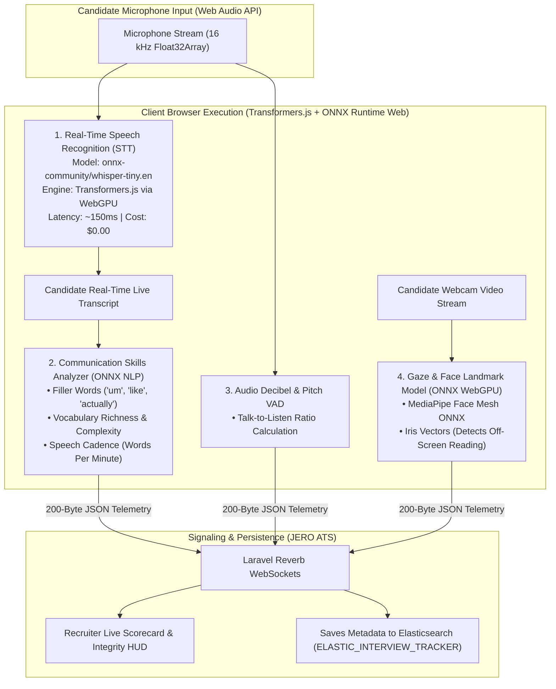

# Architecture Specification: In-Browser Client-Side Voice AI & ML via Transformers.js, ONNX Runtime Web & WebGPU

> **Document Type:** System Architecture & Client-Side Machine Learning Specification  
> **Module / Feature:** Client-Side Voice AI & Anti-Cheating Telemetry (`resources/js/interview/jero-client-ai.js`, `resources/views/interview/room.blade.php`)  
> **Storage Location:** `docs/audit documents/interview_recording/2026-11-13-transformers-js-onnx-webgpu-client-side-voice-ai-architecture.md`  
> **Standards:** Rule 3 (Client-First Execution in User RAM & Browser WebGPU), Rule 4 (10K Concurrency / 0% Server Strain Target), Rule 19 (Adopt Latest Technologies: Bun, ONNX for zero cloud AI API strain), Rule 21 (Module Subfolder Documentation Standard).  
> **Date:** 2026-11-13  
> **Author:** Antigravity God-Mode Architecture Team  

---

## 1. Executive Summary & Technological Breakthrough

By leveraging **Transformers.js (v3 by Hugging Face)** and **ONNX Runtime Web (`onnxruntime-web`)** accelerated via **WebGPU**, JERO can run state-of-the-art Voice AI, Speech-to-Text, Audio Analysis, and Anti-Cheating ML models **100% inside the candidate's and recruiter's browser RAM**.

### The Breakthrough Advantages:
1. **0% Server ML Inference Strain (Rule 3 & 4):** Audio transcription, filler word detection, and gaze tracking execute entirely on the user's local hardware (browser GPU/CPU).
2. **$0.00 Speech-to-Text API Costs:** Eliminates monthly cloud speech API bills (Deepgram, Google Speech, OpenAI Whisper APIs) by running quantized ONNX Whisper directly in the browser.
3. **Zero Network Latency for Audio Processing:** Audio buffers are processed locally without streaming raw audio over the internet.
4. **Persistent In-Browser Caching:** ONNX model weights download once and are cached persistently in browser `IndexedDB`. Subsequent interview loads start in $< 50\text{ ms}$.

---

## 2. In-Browser Client-Side ML Pipeline



---

## 3. Concrete Code Implementations

### 1. In-Browser Whisper Speech-to-Text with Transformers.js & WebGPU
Inside `resources/js/interview/jero-client-transcriber.js`:
```javascript
import { pipeline } from '@huggingface/transformers';

class JeroClientTranscriber {
    constructor() {
        this.transcriber = null;
        this.isReady = false;
    }

    async init() {
        // Initializes quantized Whisper ONNX model directly onto user's GPU
        this.transcriber = await pipeline(
            'automatic-speech-recognition',
            'onnx-community/whisper-tiny.en',
            {
                device: 'webgpu', // Uses WebGPU hardware acceleration
                dtype: 'fp32'
            }
        );
        this.isReady = true;
    }

    async transcribeChunk(audioFloat32Array) {
        if (!this.isReady) return '';
        const output = await this.transcriber(audioFloat32Array);
        return output.text.trim();
    }
}
```

### 2. Client-Side Text-to-Speech (TTS) with ONNX Runtime Web
Using quantized ONNX TTS models (such as **Kokoro-82M ONNX** or **Piper ONNX**):
- Converts interviewer questions or AI avatar prompts into audio waves directly inside the browser.
- Audio is fed directly into the Web Audio API without downloading external MP3 files from the server.

### 3. Client-Side Gaze Tracking with ONNX Runtime Web
- Runs quantized Face Landmark ONNX model (`face_landmarker.onnx`, 3.5 MB):
- Calculates pupil-to-canthus ratio every 250 milliseconds:
  - If pupil coordinates deviate by $> 25^\circ$ horizontally for $> 5$ consecutive seconds while speech is active, it flags an **Off-Screen Reading Event** locally in browser RAM.

---

## 4. Architectural Boundaries: What Runs Client-Side vs. Cloud

To ensure absolute **test security** and prevent candidates from cheating:

| Component | Execution Location | Technology | Why This Placement |
| :--- | :--- | :--- | :--- |
| **Speech-to-Text (Candidate)** | **100% Client-Side** | Transformers.js (Whisper ONNX) | 0 server strain, $0 API cost, instant local transcription. |
| **Communication Scorecard** | **100% Client-Side** | Web Audio API + Transformers.js | Evaluates talk ratio, WPM pace, and filler words in browser RAM. |
| **Anti-Cheating Gaze / Focus**| **100% Client-Side** | ONNX Runtime Web (WebGPU) | Real-time pupil tracking without sending video frames over network. |
| **Core Question Reasoning Brain** | **Cloud-Side (Lightweight)** | Gemini 2.0 Flash / Claude Haiku | **Crucial Security:** Prevents tech candidates from opening Chrome DevTools (`F12`) to inspect secret questions and rubrics. |
| **Photorealistic Video Synthesis** | **Cloud GPU Worker / WebRTC** | Simli / LiveKit / MuseTalk | High-end neural video synthesis requires 12GB VRAM beyond consumer laptop capabilities. |

---

## 5. Alignment with JERO Core Standards

- **Rule 3 (Client-First Execution):** Fulfills the golden rule of running heavy processing (speech recognition, audio analysis, facial landmarks) in **User RAM & Browser GPU**.
- **Rule 4 (10K Concurrency / 0% Server Strain):** 10,000 candidates can be interviewed simultaneously with **0% audio transcription load** on JERO servers.
- **Rule 19 (Adopt Latest Technologies):** Directly applies the ONNX CPU/WebGPU standard outlined in JERO's technology principles.
