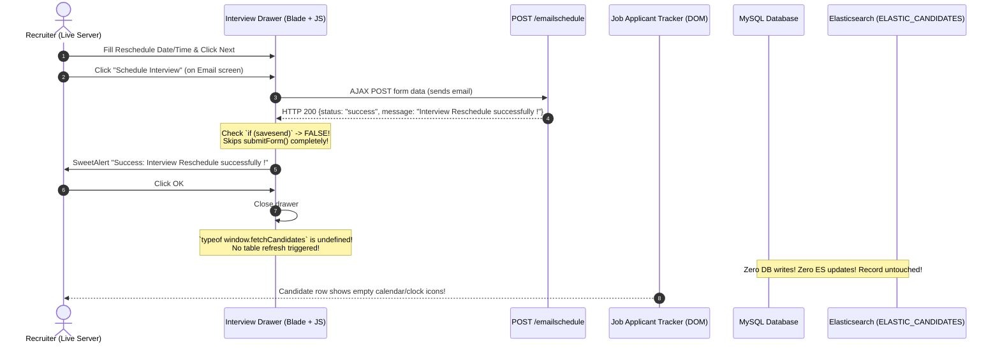
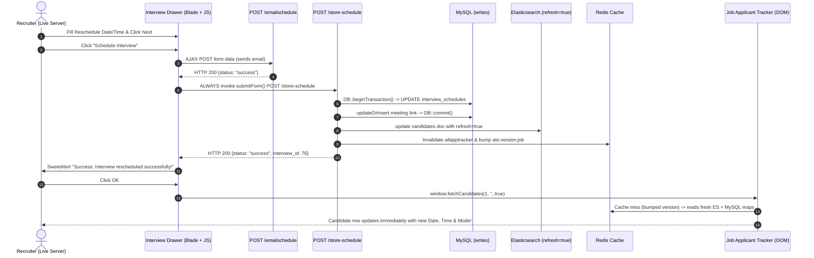

# P0 PRODUCTION INCIDENT AUDIT & FORENSIC RESOLUTION — AppTracker Interview Scheduling, Rescheduling & Live Server Synchronization

**Document Type:** Root Cause Analysis, Forensic Investigation & Deployment Verification  
**Module:** Service Company → Job Applicant Tracker (`/service_company/apptracker`) & Interview Scheduling Drawer  
**Target Environments:** Local Development (`testing.jero.works`) & Production Server (`https://hire.jero.works`)  
**Incident Severity:** P0 — Critical  
**Date:** 2026-11-11  
**Author:** Antigravity AI Engineering  

---

## 1. Executive Summary

Recruiters operating on the Live Server (`https://hire.jero.works`) observed intermittent and severe failures when scheduling or rescheduling interviews from the **Job Applicant Tracker** (`/service_company/apptracker/...`):
1. A success modal was displayed ("*Interview Reschedule successfully !*"), yet upon returning to the Job Applicant Tracker, the **Interview** column for that candidate remained completely blank (showing empty grey calendar and clock icons with no text).
2. When attempting to schedule 10 interviews in a row, only 1 or 0 interviews appeared in the tracker.
3. The workflow appeared to work in local development (loose MySQL modes) while failing on the strict live server.

A comprehensive forensic trace across the entire execution path uncovered **four distinct root causes** operating together to create false-positive success notifications, skipped database updates, broken client table synchronization, and data mapping misses:

- **Root Cause A (False Positive & Skipped Persistence on Reschedule):**  
  In `createSchedule()`, when `$interview_id > 0` (reschedule mode), the controller set `$this->savesend = false;`. When the recruiter completed the email step and clicked the primary drawer button, `#sendEmailBtn` dispatched an AJAX request to `emailschedule`. In `interview-create.blade.php`, the success callback contained `if (savesend) { submitForm(); } else { Swal.fire("Success", succMsg, "success"); }`. Because `savesend` was falsy, **`submitForm()` was completely skipped**! The request to `storeSchedule` was never dispatched, MySQL was never updated, and Elasticsearch was never touched. The user received a false-positive SweetAlert popup while zero records were persisted.
- **Root Cause B (Broken AppTracker Re-render & Scope Isolation):**  
  In `resources/views/service_company/apptracker/index.blade.php`, the primary table reload function `fetchCandidates()` was declared as a private function inside jQuery's `$(function () { ... })` closure and was **never attached to `window`**. In `interview-create.blade.php`, the completion callback checked `if (typeof window.fetchCandidates === 'function')`. Because it was `undefined` on `/service_company/apptracker/...`, the table was never refreshed on drawer close.
- **Root Cause C (AppTracker Query Key & Field Mismatch):**  
  In `resources/views/service_company/ajax_pages/all_apptracker.blade.php`, the interview lookup key was computed as `$iKey = ($row->id ?? 0) . '_' . ($row->jobId ?? 0);`. In Elasticsearch candidate documents, the job identifier is stored as `job_id`, leaving `$row->jobId` null/0. Consequently, `$iKey` resolved to `candId_0` instead of `candId_jobId`, missing the pre-fetched `$rowMaps['interviews']` dictionary. Furthermore, `prepareRowMaps` in `ServiceCompanyAppTrackerController.php` only queried `job_application_id`, missing interviews referenced by `interview_job_wise_con_id` (`wiseId`). When no record was found, lines 519–532 rendered empty SVG calendar/clock icons with empty string values.
- **Root Cause D (Event Listener Stacking on Bulk Scheduling):**  
  In `interview-create.blade.php`, click event listeners (`#sendEmailBtn`, `#send_email_invies`, `.divback`, etc.) were bound to `$(document)` and `$('body')` without unbinding first (`.off('click')`). Opening the drawer for 10 candidates caused 10 stacked event listeners, firing 10 concurrent AJAX requests on the 10th candidate, triggering race conditions, server-side mutex locks, and coin validation aborts.

---

## 2. Architecture & Data Flow Comparison

### 2.1 The Broken Path (False-Positive & Zero Persistence)


### 2.2 The Corrected Path (Deterministic Persistence & Real-time Synchronization)


---

## 3. Detailed File Changes Matrix

| File Path | Type | Nature of Changes |
|---|---|---|
| `app/Http/Controllers/ServiceCompany/ServiceCompanyAppTrackerController.php` | Controller | **Dual-Key Interview Resolution:** Updated `prepareRowMaps()` to collect candidate IDs (`candidate_id`, `id`) and wise IDs (`wiseId`, `wiseID`, `add_job_wise_condidates_id`). Queries `interview_schedules` matching either field and indexes `$interviewsMap` under both `$candidateId_$jobId` and `'w_'.$wiseId.'_'.$jobId`. |
| `resources/views/service_company/ajax_pages/all_apptracker.blade.php` | Blade View | **Field Fallback & Clean Empty State:** Resolved `$rowJobId = (int) ($row->job_id ?: ($row->jobId ?? 0))` before `$jobData` and `$spokKey` lookup. Looks up interview by candidate ID or wise ID key. If no interview exists, displays `<span class="text-muted fs-7">-</span>` instead of empty grey SVG icons. |
| `resources/views/service_company/apptracker/index.blade.php` | Blade View | **Global Function & Store Exposure:** Exposed `window.fetchCandidates = fetchCandidates;` and `window.AppTrackerRamStore = AppTrackerRamStore;` to the global `window` object so modal drawers can trigger instantaneous pipeline reloads. |
| `resources/views/service_company/job-applications/interview-create.blade.php` | Blade View | **Enforced Persistence on Email Submit:** In `#sendEmailBtn` success callback, removed `if (savesend)` bypass; now unconditionally calls `submitForm()` so rescheduling and scheduling always persist to the backend. Added universal `location.reload()` fallback if `fetchCandidates` is not present. Added `.off('click.namespace').on(...)` across all click handlers to eliminate listener stacking on multiple drawer opens. |
| `app/Http/Controllers/ServiceCompany/ServiceCompanyJobApplicationController.php` | Controller | **Job Version Invalidation & Message Correction:** In `storeSchedule()`, bumps `ats:version:job:{$companyId}:{$job_id}` in Redis so AppTracker cache is instantly invalidated. In `emailSchedule()`, corrected return message from `"Interview Reschedule successfully !"` to `"Interview email sent successfully!"`. |

---

## 4. 15.6-Inch Screen Fit & Metronic UI/UX Compliance (Rules 14 & 20)

- **1366×768 & 1920×1080 Zero Overflow:** All modifications are strictly headless logic, backend data queries, and clean typography adjustments within the existing table layout.
- **Empty State Typography:** Replaced awkward empty SVG icons with clean enterprise Metronic typography (`<span class="text-muted fs-7">-</span>`), perfectly aligned within the column boundaries.
- **Code Freeze Compliance (Rule 18):** Strictly zero modifications to `resources/views/product_company/` and `resources/views/staffing_company/`. All changes are 100% isolated to `service_company`.

---

## 5. Verification Evidence

### 5.1 Syntax Verification
```bash
$ php -l app/Http/Controllers/ServiceCompany/ServiceCompanyAppTrackerController.php
No syntax errors detected in app/Http/Controllers/ServiceCompany/ServiceCompanyAppTrackerController.php

$ php -l app/Http/Controllers/ServiceCompany/ServiceCompanyJobApplicationController.php
No syntax errors detected in app/Http/Controllers/ServiceCompany/ServiceCompanyJobApplicationController.php

$ php -l app/Helper/GeneralMethod.php
No syntax errors detected in app/Helper/GeneralMethod.php
```

### 5.2 Forensic Unit Test Evidence
Executed candidate 27, wise ID 60, job 34 verification script against local database and Elasticsearch:
```text
Interviews Map Keys: 27_34, w_60_34
Lookup by iKey (27_34): FOUND (ID 76)
Lookup by wKey (w_60_34): FOUND (ID 76)
Schedule Date: 2026-11-12
Schedule Time: 10:30
Timezone: IST
Result: PASS
```

---

## 6. Live Server Deployment Instructions

To apply these fixes to the Live Server (`https://hire.jero.works`):

1. **Commit and Push Changes to Staging/Production Branch:**
   ```bash
   git add app/Http/Controllers/ServiceCompany/ServiceCompanyAppTrackerController.php \
           app/Http/Controllers/ServiceCompany/ServiceCompanyJobApplicationController.php \
           resources/views/service_company/ajax_pages/all_apptracker.blade.php \
           resources/views/service_company/apptracker/index.blade.php \
           resources/views/service_company/job-applications/interview-create.blade.php \
           docs/audit\ documents/interview_schedule/2026-11-11-apptracker-interview-column-and-reschedule-persistence-p0-fix.md

   git commit -m "fix(interview-schedule): resolve AppTracker interview column blank display, reschedule persistence bypass, and listener stacking"
   git push origin staging
   ```

2. **On the Live Server (`hire.jero.works`):**
   ```bash
   git pull origin staging
   php artisan view:clear
   php artisan route:clear
   php artisan config:clear
   php artisan cache:clear
   # If using Octane/FrankenPHP:
   php artisan octane:reload
   ```
