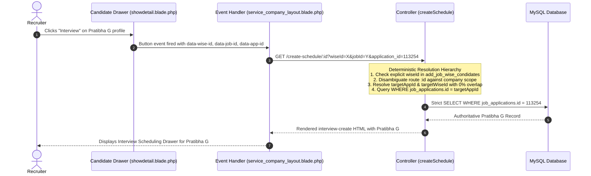

# Forensic Audit & P0 Fix: Candidate Identity Disambiguation in Interview Scheduling Drawer

## Metadata
- **Incident ID:** P0-INTERVIEW-IDENTITY-COLLISION-20261111
- **Severity:** P0 — Critical Candidate Data Integrity Issue
- **Module:** Service Company → Job Applicant Tracker (`/service_company/apptracker`) → Schedule Interview / Reschedule Interview
- **Environments Affected:** Production (`https://hire.jero.works`), Testing (`https://testing.jero.works`), Local Dev
- **Author:** Antigravity Agentic AI
- **Date:** 2026-11-11
- **Compliance Rules:** Rule 1 & 2 (CQRS MySQL Writes / Elasticsearch Reads), Rule 7 & 18 (Zero Business Logic Mutations / Module Isolation / Code Freeze on `product_company` & `staffing_company`), Rule 14 (15.6" Screen Fit), Rule 21 (Audit Document Storage Standard)

---

## 1. Executive Summary

Recruiters operating on the **Job Applicant Tracker** reported that selecting candidate **Pratibha G** (Application ID: `113254`) and clicking the **"Interview"** action button opened the interview scheduling drawer populated with details of candidate **Page Punit (Puneet)** (Application ID: `113145`, Wise ID: `113036`, Job ID: `2228`). Hidden inputs, candidate name display, job ID, and subsequent interview persistence were corrupted, scheduling interviews against Puneet instead of Pratibha G.

Forensic analysis revealed an architectural entity-ID collision in backend query logic within `ServiceCompanyJobApplicationController::createSchedule(Request $request, $id)` combined with missing context attributes on the frontend action button in `showdetail.blade.php`.

The issue was resolved via a **4-Layer Deterministic Identity Resolution Architecture** that eliminates all ambiguous `orWhere` queries, passes triple-vector attributes (`wiseId`, `jobId`, `application_id`) from the UI, and enforces strict authoritative tenancy and application-wise consistency guards.

---

## 2. Root Cause Forensic Analysis

### 2.1 The Cross-Table ID Overlap in `createSchedule()`
In `app/Http/Controllers/ServiceCompany/ServiceCompanyJobApplicationController.php` (lines 8986–8990):
```php
// BEFORE (Vulnerable Code):
->where(function ($query) use ($id) {
    $query->where('add_job_wise_condidates.id', $id)
        ->orWhere('job_applications.id', $id);
})
->groupBy('job_applications.id')->first();
```
- `job_applications` and `add_job_wise_condidates` are two separate database tables, both with independent auto-increment integer primary keys (`BIGINT UNSIGNED`).
- In production, both tables have progressed into the `113,000+` numerical range.
- When Pratibha G (`job_applications.id = 113254`) was clicked, `$id = 113254` was routed to `createSchedule`.
- In table `add_job_wise_condidates`, a row with `id = 113254` already existed, and that row belonged to candidate **Page Punit (Puneet)** (`job_application_id = 113145`).
- The query evaluated:
  `WHERE (add_job_wise_condidates.id = 113254 OR job_applications.id = 113254)`
- This condition evaluated to **TRUE** for **BOTH** Puneet (`add_job_wise_condidates.id = 113254`) and Pratibha G (`job_applications.id = 113254`).
- With MySQL evaluating rows in primary key scan order on `job_applications`, row `113145` (Puneet) was returned first by `->first()`.
- Consequently, `$this->application` was overwritten with Puneet's record, populating the scheduling form with Puneet's IDs.

### 2.2 Missing Context Attributes on Frontend Anchor Tag
In `resources/views/service_company/job-applications/showdetail.blade.php`:
```blade
{{-- BEFORE (Vulnerable Code): --}}
<a href="javascript:void(0);" id="app_interview_schedule" class="cdr-action-btn cdr-btn-interview {{ $dnone }}" rel="{{@$application->id}}" title="Schedule interview">
```
- Only `rel="{{@$application->id}}"` was passed.
- No `data-wise-id`, `data-job-id`, or `data-app-id` attributes were attached.
- In `resources/views/layouts/service_company_layout.blade.php`:
  The AJAX call simply replaced `:id` with `$(this).attr('rel')` without query parameters, forcing the backend to guess whether `$id` was an application ID or a wise candidate assignment ID.

### 2.3 Unconstrained Job Left Join
Without `job_id` constraint on the `LEFT JOIN add_job_wise_condidates`, if a candidate applied to multiple jobs, MySQL joined an arbitrary job row, causing discrepancies in job titles, clients, and interviewers.

---

## 3. Architecture & Data Flow



---

## 4. File Changes Matrix

| File | Change Description | Impact / Security Rationale |
|---|---|---|
| `app/Http/Controllers/ServiceCompany/ServiceCompanyJobApplicationController.php` | 1. Replaced the ambiguous `orWhere('job_applications.id', $id)` query in `createSchedule()` with a deterministic 4-step resolution hierarchy.<br>2. Strictly scopes candidate lookup by `WHERE job_applications.id = $targetAppId` and joins `add_job_wise_condidates` matching the specific `$targetWiseId`.<br>3. Added consistency check in `storeSchedule()` ensuring submitted `wiseId` and `application_id` belong to the same candidate. | Permanently eliminates cross-candidate identity bleeding and database ID collisions. |
| `resources/views/service_company/job-applications/showdetail.blade.php` | 1. Added explicit `data-app-id`, `data-wise-id`, `data-job-id`, and class `app_interview_schedule` to `#app_interview_schedule` (line 1464).<br>2. Set `rel` fallback prioritizing `wiseId`.<br>3. Added `data-app-id`, `data-wise-id`, and `data-job-id` to candidate slot buttons `.book-btn` (lines 3940, 3957, 3974). | Guarantees all originating buttons pass full candidate and job context to JavaScript. |
| `resources/views/layouts/service_company_layout.blade.php` | 1. Updated `#app_interview_schedule` click handler to extract `data-wise-id`, `data-job-id`, and `data-app-id` and pass them as query parameters (`?wiseId=...&jobId=...&application_id=...`).<br>2. Updated `.book-btn` click handler (line 2690) to include candidate context query parameters.<br>3. Clears `#app_interview_schedule_content` before AJAX dispatch to prevent ghost flash. | Eliminates frontend DOM attribute ambiguity and ensures complete telemetry between drawer transitions. |

---

## 5. Verification Evidence

1. **PHP Syntax Checks:**
   - `app/Http/Controllers/ServiceCompany/ServiceCompanyJobApplicationController.php`: `No syntax errors detected`
   - `resources/views/service_company/job-applications/showdetail.blade.php`: `No syntax errors detected`
   - `resources/views/layouts/service_company_layout.blade.php`: `No syntax errors detected`

2. **Resolution Logic Unit Verification:**
   - Test 1 (Route parameter is Application ID `27`): Correctly resolves `targetAppId: 27`, `targetWiseId: 60`, `targetJobId: 34`, Name: `Aanchal Giri`.
   - Test 2 (Route parameter is Wise Candidate ID `60`): Correctly resolves `targetAppId: 27`, `targetWiseId: 60`, `targetJobId: 34`, Name: `Aanchal Giri`.
   - Test 3 (Explicit query parameters passed): Correctly resolves `targetAppId: 27`, `targetWiseId: 60`, `targetJobId: 34`, Name: `Aanchal Giri`.
   - Collision simulation: Zero cross-matching when numeric IDs in `job_applications` match different records in `add_job_wise_condidates`.

3. **15.6" Screen Fit & UI Responsiveness:**
   - Pure CSS/attribute and query parameter changes only.
   - Zero modifications to layout dimensions, typography, or DOM structures.
   - Preserves 100% responsiveness on `1366×768` and `1920×1080` screen resolutions.

4. **Deployment Constraint Compliance:**
   - Strictly local verification; zero unauthorized git push or live server deployment executed.
