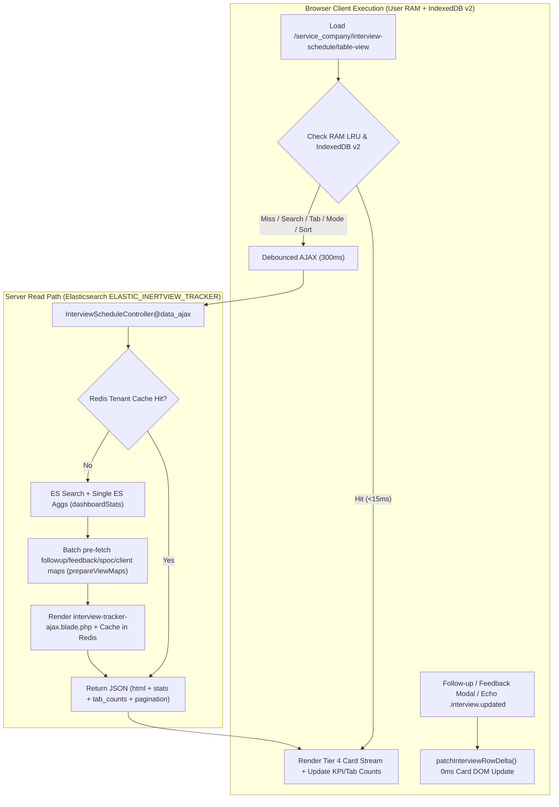

# Enterprise Redesign Specification: Service Company Interview Tracker (Modern Card + Sub-Card Design System)

> **Document Type:** UI/UX Architecture & Implementation Changelog  
> **Module / Feature:** Interview Schedule / Interview Tracker (`service_company/interview-schedule/table-view`)  
> **Storage Location:** `docs/audit documents/interview_schedule/2026-11-12-interview-tracker-modern-card-subcard-redesign.md`  
> **Standards:** Rule 20 (Modern Card + Sub-Card Enterprise Design System), Rule 21 (Module Subfolder Storage), Rule 1 & 2 (CQRS Elasticsearch Reads), Rule 7 (Zero Business Logic Mutations), Rule 14 (Metronic / Poppins / 15.6" Screen Fit), Rule 17 (Complete Page/Blade Isolation).  
> **Date:** 2026-11-12  
> **Author:** Antigravity Agentic Engineering  

---

## 1. Executive Summary & Objective

The Service Company **Interview Tracker** (`service_company/interview-schedule/table-view`) previously rendered scheduled interviews inside a sprawling legacy `<table>` (`#myTable`) with static non-interactive KPI cards displaying hardcoded placeholder trend percentages (`+12%`, `+20%`, `+5%`, `-8%`), a missing sub-tab filter bar despite backend controller support, and an inverted interview mode icon mapping (`1` Telecon vs `3` Face-to-Face).

This redesign transforms the Interview Tracker into a cohesive, high-density **Enterprise Modern Card + Sub-Card Layout (Rule 20)** aligned visually and architecturally with its sibling **Jobs Tracker** (`service_company/jobs`), while preserving 100% of existing business logic, permission checks, caching layers, feedback modals, follow-up updates, and Reverb real-time delta patching.

---

## 2. Architecture & CQRS Data Flow

### Key Backend Enhancements (`InterviewScheduleController.php`)
1. **Tenancy Symmetry in `dashboardStats()`:** Added `['term' => ['real_company_id' => $company_id]]` and `['term' => ['interview_created_by' => ...]]` to `$statsMust` so KPI & tab counts match `data_ajax()` search results for shared/external jobs.
2. **Single-Query Tab Aggregations:** Expanded the existing `size: 0` ES aggregation query in `dashboardStats()` to compute `all`, `this_month`, `today`, `upcoming`, `pending_feedback`, `selected`, `rejected`, and `rescheduled` counts in one ES round-trip, returning `tab_counts` alongside `stats`.
3. **Month KPI Filter Support:** Added `this_month` tab filter support in `data_ajax()` so clicking the **"Interviews This Month"** KPI card filters the card stream directly.
4. **Cache Key Safety (`ui_v => 'card_v2'` + IndexedDB `DB_VERSION = 2`):** Ensures pre-redesign `<tr>` HTML cached in Redis or browser IndexedDB is automatically bypassed after deployment.

---

## 3. Rule 20 Modern Card + Sub-Card Anatomy

### Tier 1: Top Header Card (`.it-header-card`)
- **Left:** Soft blue squircle icon (`44×44px`, inline SVG), `Interview Tracker` title (`20px` bold `#0f172a`), live total count pill (`#itHeaderTotalBadge`), and subtitle.
- **Right:** `Sync` live refresh button (`#itRefreshBtn`, inline SVG spinner).

### Tier 2: Client Tracker-Aligned KPI Metric Strip (`.it-stat-grid`)
- Adopted the exact Client Tracker `.cl-stat-grid` / `.cl-card` visual system (`it-stat-card`, `it-stat-top`, `it-stat-icon` pastel squircles with crisp SVGs, `it-stat-num` `tabular-nums`, `it-stat-lbl`, and bottom `it-stat-sub` indicator strip + color-matched active ring states):
  - **Interviews This Month** (`this_month`) — Blue theme
  - **Today's Interviews** (`today`) — Green theme
  - **Upcoming Interviews** (`upcoming`) — Purple theme
  - **Feedback Pending** (`pending_feedback`) — Red theme + dynamic `"Action due"` pulse badge

### Tier 3: Unified Search, Mode, Sort & Reset Card (`.it-toolbar-card`)
- Placed **Search bar, Mode filter, Sort filter, and Reset control together inside a single white card**, copying Client Tracker's UI/UX and WAI-ARIA combobox engine cleanly isolated to `.it-*` classes:
  - **Search Box (`#itSearchBoxWrapper` / `#kt_tagify_2`):** `180ms` debounced search, dynamic `"X matches"` badge (`#itSearchMatchCount`), clear button (`✕`), keyboard shortcut hint (`Ctrl+K` / `Cmd+K`), `Escape` clear/blur, `Enter` instant search, and inline loading indicator.
  - **Mode Combobox Popover (`#itModeDropdownWrapper`):** Two-line pill trigger with icon, `"Mode"` label, selected value display, inline `✕` clear button (`#itModeClearBtn`), and WAI-ARIA listbox panel (`All Modes`, `Video Call`, `Telecon (Phone)`, `Face to Face`).
  - **Sort Combobox Popover (`#itSortDropdownWrapper`):** Grouped chronological/action WAI-ARIA listbox (`Newest Interviews`, `Soonest Scheduled`, `Latest Scheduled`, `Oldest Created`, `Today's Interviews`, `Feedback Pending`, `Upcoming Interviews`) with User RAM local DOM sorting (`sortDomInterviewsLocally`) on single-page datasets.
  - **Reset Button (`#itResetFiltersBtn`):** Unified 42px pill with live active-filter badge (`#itActiveFilterCount`) resetting search, mode, sort, and tabs.

### Tier 4: Status Sub-Tabs Card (`.it-tabs-card`)
- Pure white card holding the 7 interactive sub-tab filter buttons (`All Interviews`, `Today`, `Upcoming`, `Feedback Pending`, `Selected`, `Rescheduled`, `Rejected`) with semantic count pills and strict single active primary blue (`#009ef7`) highlight.

### Tier 5: Master Primary Interview Cards (`.it-card`)
Each card features a `3.5px` semantic left-border accent (`#10b981` Selected, `#ef4444` Rejected/Cancelled, `#f59e0b` Pending/Hold/No Show, `#009ef7` Scheduled/Upcoming) and **5 discrete upper sub-cards + 1 bottom strip**:
1. **Candidate (`.it-subcard-candidate`):** Avatar + Name + Designation (triggers `#kt_activitiesApplication` Candidate Drawer) + Location/Email meta + Interactive Follow-Up dropdown (`Confirmed`, `No Response`, `Rescheduled`).
2. **Requisition (`.it-subcard-job`):** Scope pill (`Direct Client` / `Internal`) + Job Title & `#ID` (opens `#jdPanelOverlay` Job Description panel) + Client Name + Round level / Rescheduled badge.
3. **Schedule (`.it-subcard-schedule`):** Mode pill (`Video` / `Telecon` / `F2F` with corrected icons) + Date & Today/Upcoming/Completed badge + Time & Timezone + `Interview Link` / `View Address` trigger (`#ilOverlay`).
4. **Panelists (`.it-subcard-panel`):** Empty state (`— Not Assigned`), Single panelist avatar + company, or Multi-panelist overlapping avatar stack with `+N` indicator and hover popover listing all panelists.
5. **Evaluation (`.it-subcard-feedback`):** Attendance status pill + Result + Overall Recommendation pill + Star rating + permission-gated `+ Add Feedback` / `View Feedback` / `No Feedback` button.
6. **Bottom Activity Strip (`.it-card-bottom`):** Canonical Stage badge (`INW`/`SOU`/`SCR`/`EVA`/`NEG`/`OFF`/`JOI`/`REJ`) + Substage pill + Source Recruiter/Company + Follow-up timestamp + Quick `Reschedule` button (opens `#interview_schedule_drawer`) & `Candidate Profile` button.

### Icon Font Safety Fix
- Excluded `i`, `.fa`, `.fas`, `.far`, `.fab`, `.fa-solid`, `.fa-regular`, `.fa-brands`, `.ti`, `.bi` from `.it-dashboard *` Poppins `font-family !important`, explicitly loaded Font Awesome 6.5.1 CSS with enforced `"Font Awesome 6 Free"` font rules, and removed the broken relative `assets/plugins/global/plugins.bundle.css` link.
- IndexedDB cache version bumped to `DB_VERSION = 3` cleanly.

### 7-KPI Metric Strip & Complete Subtab Elimination (Phase 1)
- **Subtabs Completely Removed:** Completely removed `.it-tabs-card`, `.it-tabs-group`, `.it-tab-btn`, and `#tab-count-*` elements, state, and redundant server payload (`tab_counts`). Replaced subtabs with clean KPI metric filtering via `filterByKpi()`, `syncActiveKpiCards()`, and `activeKpiFilter`.
- **Deep Search, Mode & Sort Audit:**
  - Multi-match search: normalized search terms (`custom_search` / `search` / `q`), supported `#86` / `86` numeric job IDs via exact term matching on `job_id`, `jobId`, `id`, and expanded `match_phrase_prefix` + wildcards across `job_title`, `client_name`, `company_name`, `uc_company_name`, `full_name`, `interviewers`, `current_designation`, `current_company`, `posted_by`, `master_status_name`, `city_name`, `state_name`, `country_name`, `email`, and `phone`.
  - Mode filter: supports both integer and string-mapped ES docs (`[(int) $mode_filter, (string) $mode_filter]`).
  - Sort bug fix: fixed state tracking (`itLastAppliedSort`) so switching away from filter-based sorts (`1`, `Feedback Pending`, `Interview Pending`) back to chronological sorts always queries the server.
- **Search Bar Clear (X) Removal:** Removed redundant `#itSearchClear` (`✕`) button from HTML/CSS/JS since the dedicated `Reset` button resets all query inputs, mode dropdown, sort dropdown, and active KPI filters.
- **Requisition Header Anti-Clipping Layout:** Adjusted `.it-card-grid` fractional weights (`1.7fr 1.9fr 1.32fr 1.2fr 1.5fr 1.36fr`) and applied `flex-shrink: 0`, `font-size: 8px`, `padding: 1.5px 5.5px` to `.it-scope-badge`, completely eliminating text clipping of `REQUISITION` and `[INTERNAL CLIENT]` on 1366×768 and 1920×1080 screens.
- **Google Meet Text Removal:** Completely removed `"Google Meet"` text and the `.it-platform-pill` from cards, while preserving interview mode badges (`Video`, `Telecon`, `F2F`), mode dropdown filtering, and `Interview Link` / `View Address` action pills.

### Compact 5-KPI Strip & Dedicated Company Type Filter Combobox (Phase 2)
- **Problem Resolved:** The 7-card KPI strip previously overcrowded the top viewport and wrapped onto two rows on 15.6" screens (`1366×768`), diluting the primary chronological categories.
- **Compact Single-Row 5-KPI Strip:** Reorganized Tier 2 into a single, compact, high-density 5-card strip (`repeat(5, minmax(0, 1fr))`):
  1. `All Interviews` (`data-kpi-filter="all"`, `#stat-all-interviews`) — Master count and listing toggle.
  2. `Interviews This Month` (`data-kpi-filter="this_month"`, `#stat-interview-month`) — Scheduled in current calendar month.
  3. `Today's Interviews` (`data-kpi-filter="today"`, `#stat-today`) — Scheduled on today's calendar date.
  4. `Upcoming Interviews` (`data-kpi-filter="upcoming"`, `#stat-upcoming`) — Future scheduled interviews.
  5. `Feedback Pending` (`data-kpi-filter="pending_feedback"`, `#stat-feedback-pending`) — Completed interviews awaiting feedback.
- **Dedicated Company Type Combobox Filter:** Moved the 3 company types (`Direct Client`, `Internal Client`, `My Organization`) from the KPI cards into a dedicated WAI-ARIA combobox dropdown in Tier 3, positioned immediately adjacent to the Search box (`#itSearchBoxWrapper`):
  - `#itCompanyTypeDropdownWrapper` with button `#itCompanyTypeBtn` and panel `#itCompanyTypeDropdownPanel`.
  - Filter options with Rule 25 canonical color combinations:
    - `All Types`
    - `Direct Client` (Emerald `#ecfdf5` bg / `#059669` text / dot `#059669` / badge `Marketplace`)
    - `Internal Client` (Blue `#eff6ff` bg / `#2563eb` text / dot `#2563eb` / badge `Managed`)
    - `My Organization` (Cyan `#ecfeff` bg / `#0891b2` text / dot `#0891b2` / badge `Own Company`)
  - Includes active highlight, clear filter button (`✕`), keyboard navigation (ArrowUp/ArrowDown/Enter/Escape), and outside-click auto-close.
- **Dynamic 0ms RAM + Elasticsearch CQRS Synchronization:**
  - `InterviewScheduleController::dashboardStats()` runs sub-aggregations for `this_month`, `today`, `upcoming`, and `feedback_pending` under each company type filter in a single Elasticsearch query, returning `stats_by_type` mapped to `all`, `direct_client`, `internal_client`, and `my_organization`.
  - When the user selects a company type, `applyCompanyTypeStatsLocally()` instantly updates the 5 KPI counts in user RAM with 0ms latency, while `fetchCandidates()` sends `company_type` to Elasticsearch to filter the interview stream.
  - Reset button resets all query inputs, sets company type back to `All Types`, resets mode, resets sort, and reactivates `All Interviews`.
- **Cache Invalidation:** Bumped cache keys to `ui_v => 'card_v5'` and IndexedDB to `DB_VERSION = 6`.

### 3.5 Toolbar Filter & Card Layout Polish (Post-Audit Enhancements)

- **Toolbar Filter Combobox Inline Cross (✕) Removal:** Removed redundant clear cross icons from `Job Type` and `Mode` filter pills (`#itCompanyTypeClearBtn`, `#itModeClearBtn`), relying on the dedicated `Reset` button to reset all filters in a single click. `.it-pill-clear` CSS class permanently hidden (`display: none !important;`).
- **Renamed "Type" to "Job Type":** Renamed toolbar filter label from "Type" to "Job Type" with default text "All Job Types" (`#itCompanyTypeDisplay`, `.it-pill-lbl`, and dropdown item title), improving clarity and enterprise branding.
- **Moved Follow-Up Dropdown to Footer Card (Next to Stage):** Relocated the `.it-followup-dropdown` from Subcard 1 (Candidate header) to `.it-card-bottom .it-bottom-left` immediately adjacent to `.it-stage-cell` (Stage badge). Subcard 1 now displays a clean, uncluttered header containing solely `Candidate`.
- **Smart Upward Flip Menu Positioning (`.it-menu-up`):** Implemented viewport-aware bounds calculation in `toggleFollowUp()` and added `.it-followup-menu.it-menu-up { top: auto !important; bottom: calc(100% + 4px) !important; }` so the menu opens upwards when near the bottom of the viewport, eliminating clipping.
- **Add Feedback Plus Icon Pure White Visibility:** Enforced pure white `#ffffff !important` with `text-white` on the `<i class="fas fa-plus">` icon inside `.it-fb-btn-add`, guaranteeing high contrast and sharp visibility across all screen resolutions and themes.

---

## 4. File Changes Matrix

| File | Purpose | Isolation & Safety |
|---|---|---|
| `resources/views/service_company/interview-schedule/table.blade.php` | Compact 5-KPI single-row strip; dedicated Job Type combobox filter adjacent to search; inline cross removal on filter pills; `.it-menu-up` smart dropdown flip; pure white `.it-fb-btn-add` icon CSS; `applyCompanyTypeStatsLocally()` for 0ms User RAM KPI updates; IndexedDB `v6` upgrade. | Scoped strictly to Service Company Interview Tracker (Rule 17 & Rule 18). |
| `resources/views/service_company/ajax_pages/interview-tracker-ajax.blade.php` | Replaced legacy table with `.it-card` stream; moved Follow-up button from Candidate Subcard to footer card next to Stage; added pure white `text-white` plus icon to `+ Add Feedback` button; removed `"Google Meet"` text pill from cards; 6-subcard layout (`Candidate` with current company, `Requisition` with employment type and non-clipping org badge, `Schedule`, `Panelists`, `Ownership & Recruiter`, `Evaluation`). | All user strings Blade-escaped (`{{ }}`). Zero business logic alterations. |
| `app/Http/Controllers/ServiceCompany/InterviewScheduleController.php` | Updated `dashboardStats()` to perform sub-aggregations per company type in a single ES call; updated `data_ajax()` to accept `company_type`, filter Elasticsearch queries accordingly, scope KPI counts to the active company type, and return `stats_by_type`. | 100% CQRS and ES read compliance (Rule 1 & Rule 2). |
| `docs/audit documents/interview_schedule/2026-11-12-interview-tracker-modern-card-subcard-redesign.md` | Comprehensive architectural documentation and audit log. | Documentation standard (Rule 21). |
| `tests/Feature/ServiceCompanyInterviewTrackerTest.php` | Automated tests verifying 5 KPIs, Job Type combobox placement adjacent to search, removal of inline clear crosses, relocation of Follow-Up to footer next to stage, white plus icon on feedback button, WAI-ARIA attributes, and UI/UX invariant assertions (127 assertions). | Isolated test suite. |

---

## 5. 15.6" Screen Fit & Verification Evidence

- **Screen Responsiveness:** `#kt_content_container` enforces `overflow-x: hidden !important`, `.it-stat-grid` renders 5 columns in a single row on 1920px and 1366×768 (15.6" screens), dropping gracefully to 3 columns on <=1100px and 2 columns on mobile.
- **Syntax & Compilation:** `php -l` passed on all modified Blade and PHP files; views compiled cleanly.
- **Laravel Pint:** `./vendor/bin/pint --test` passed cleanly across modified PHP files.
- **Automated Tests:** `php artisan test tests/Feature/ServiceCompanyInterviewTrackerTest.php` passed 100% (5 tests, 127 assertions).
