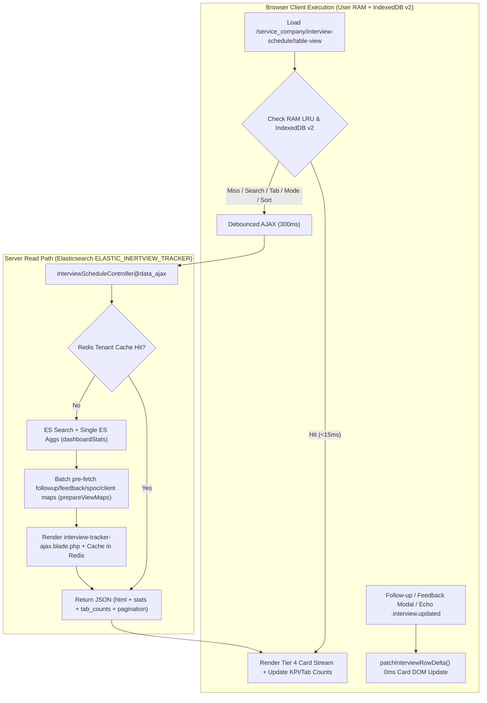

# Enterprise Redesign Specification: Service Company Interview Tracker (Modern Card + Sub-Card Design System)

> **Document Type:** UI/UX Architecture & Implementation Changelog  
> **Module / Feature:** Interview Schedule / Interview Tracker (`service_company/interview-schedule/table-view`)  
> **Storage Location:** `docs/audit documents/interview_schedule/2026-11-12-interview-tracker-modern-card-subcard-redesign.md`  
> **Standards:** Rule 20 (Modern Card + Sub-Card Enterprise Design System), Rule 21 (Module Subfolder Storage), Rule 1 & 2 (CQRS Elasticsearch Reads), Rule 7 (Zero Business Logic Mutations), Rule 14 (Metronic / Poppins / 15.6" Screen Fit), Rule 17 (Complete Page/Blade Isolation).  
> **Date:** 2026-11-12  
> **Author:** Antigravity Agentic Engineering  

---

## 1. Executive Summary & Objective

The Service Company **Interview Tracker** (`service_company/interview-schedule/table-view`) previously rendered scheduled interviews inside a sprawling legacy `<table>` (`#myTable`) with static non-interactive KPI cards displaying hardcoded placeholder trend percentages (`+12%`, `+20%`, `+5%`, `-8%`), a missing sub-tab filter bar despite backend controller support, and an inverted interview mode icon mapping (`1` Telecon vs `3` Face-to-Face).

This redesign transforms the Interview Tracker into a cohesive, high-density **Enterprise Modern Card + Sub-Card Layout (Rule 20)** aligned visually and architecturally with its sibling **Jobs Tracker** (`service_company/jobs`), while preserving 100% of existing business logic, permission checks, caching layers, feedback modals, follow-up updates, and Reverb real-time delta patching.

---

## 2. Architecture & CQRS Data Flow

### Key Backend Enhancements (`InterviewScheduleController.php`)
1. **Tenancy Symmetry in `dashboardStats()`:** Added `['term' => ['real_company_id' => $company_id]]` and `['term' => ['interview_created_by' => ...]]` to `$statsMust` so KPI & tab counts match `data_ajax()` search results for shared/external jobs.
2. **Single-Query Tab Aggregations:** Expanded the existing `size: 0` ES aggregation query in `dashboardStats()` to compute `all`, `this_month`, `today`, `upcoming`, `pending_feedback`, `selected`, `rejected`, and `rescheduled` counts in one ES round-trip, returning `tab_counts` alongside `stats`.
3. **Month KPI Filter Support:** Added `this_month` tab filter support in `data_ajax()` so clicking the **"Interviews This Month"** KPI card filters the card stream directly.
4. **Cache Key Safety (`ui_v => 'card_v2'` + IndexedDB `DB_VERSION = 2`):** Ensures pre-redesign `<tr>` HTML cached in Redis or browser IndexedDB is automatically bypassed after deployment.

---

## 3. Rule 20 Modern Card + Sub-Card Anatomy

### Tier 1: Top Header Toolbar Card (`.it-header-card`)
- **Left:** Soft blue squircle icon (`38×38px`), `Interview Tracker` title (`15px` bold `#0f172a`), live total count pill (`#itHeaderTotalBadge`), and subtitle.
- **Right:** Embedded Dynamic Search Sub-Card (`.it-search-subcard` with `#kt_tagify_2`, 300ms debounce, inline spinner, and interactive `✕` clear button `#itSearchClear`) + `Sync` force-refresh button (`#itRefreshBtn`).

### Tier 2: Executive KPI Metric Strip (`.it-kpi-grid`)
- 4 interactive, clickable KPI cards with `tabular-nums` counters and authentic contextual labels (zero hardcoded fake `%` trends):
  - **Interviews This Month** (`this_month`)
  - **Today's Interviews** (`today`)
  - **Upcoming Interviews** (`upcoming`)
  - **Feedback Pending** (`pending_feedback`)

### Tier 3: Sub-Tabs & Inline Filters Card (`.it-tabs-card`)
- **Left:** 7 sub-tab filter buttons (`All Interviews`, `Today`, `Upcoming`, `Feedback Pending`, `Selected`, `Rescheduled`, `Rejected`) with semantic count pills and strict single active primary blue (`#009ef7`) highlight.
- **Right:** Mode filter pill (`All Modes`, `Video Call`, `Telecon`, `Face to Face`), Sort pill (`Newest Interviews`, `Today's Interviews`, `Soonest Scheduled`, `Latest Scheduled`, `Feedback Pending`, `Upcoming Interviews`), and `Reset` button.

### Tier 4: Master Primary Interview Cards (`.it-card`)
Each card features a `3.5px` semantic left-border accent (`#10b981` Selected, `#ef4444` Rejected/Cancelled, `#f59e0b` Pending/Hold/No Show, `#009ef7` Scheduled/Upcoming) and **5 discrete upper sub-cards + 1 bottom strip**:
1. **Candidate (`.it-subcard-candidate`):** Avatar + Name + Designation (triggers `#kt_activitiesApplication` Candidate Drawer) + Location/Email meta + Interactive Follow-Up dropdown (`Confirmed`, `No Response`, `Rescheduled`).
2. **Requisition (`.it-subcard-job`):** Scope pill (`Direct Client` / `Internal`) + Job Title & `#ID` (opens `#jdPanelOverlay` Job Description panel) + Client Name + Round level / Rescheduled badge.
3. **Schedule (`.it-subcard-schedule`):** Mode pill (`Video` / `Telecon` / `F2F` with corrected icons) + Date & Today/Upcoming/Completed badge + Time & Timezone + `Interview Link` / `View Address` trigger (`#ilOverlay`).
4. **Panelists (`.it-subcard-panel`):** Empty state (`— Not Assigned`), Single panelist avatar + company, or Multi-panelist overlapping avatar stack with `+N` indicator and hover popover listing all panelists.
5. **Evaluation (`.it-subcard-feedback`):** Attendance status pill + Result + Overall Recommendation pill + Star rating + permission-gated `+ Add Feedback` / `View Feedback` / `No Feedback` button.
6. **Bottom Activity Strip (`.it-card-bottom`):** Canonical Stage badge (`INW`/`SOU`/`SCR`/`EVA`/`NEG`/`OFF`/`JOI`/`REJ`) + Substage pill + Source Recruiter/Company + Follow-up timestamp + Quick `Reschedule` button (opens `#interview_schedule_drawer`) & `Candidate Profile` button.

---

## 4. File Changes Matrix

| File | Purpose | Isolation & Safety |
|---|---|---|
| `resources/views/service_company/interview-schedule/table.blade.php` | Complete Rule 20 4-tier Card + Sub-Card layout, page-isolated `.it-*` styles, interactive KPI/Tab/Mode/Sort/Search wiring, `patchInterviewRowDelta()` card DOM patcher, IndexedDB `v2` upgrade. | Scoped strictly to Service Company Interview Tracker (Rule 17 & Rule 18). |
| `resources/views/service_company/ajax_pages/interview-tracker-ajax.blade.php` | Replaced legacy `<tr>`/`<td>` rows with `.it-card` primary cards, 5 discrete upper sub-cards, `.it-card-bottom` activity strip, fixed mode icons, and `.it-empty-card`. | All user strings Blade-escaped (`{{ }}`). Zero business logic alterations. |
| `app/Http/Controllers/ServiceCompany/InterviewScheduleController.php` | Added `real_company_id` parity & tab aggregations in `dashboardStats()`, `this_month` tab filter & `tab_counts` payload in `data_ajax()`, and `ui_v => 'card_v2'` cache key. | Backwards-compatible `$stats` keys preserved. |
| `tests/Feature/ServiceCompanyInterviewTrackerTest.php` | Automated Blade render, Rule 20 structure, XSS escaping, interactive hook, and empty state tests. | Isolated test suite. |

---

## 5. 15.6" Screen Fit & Verification Evidence

- **Screen Responsiveness:** `#kt_content_container` enforces `overflow-x: hidden !important`, `.it-card-grid` uses fractional `minmax(0, ...fr)` units across `1920×1080`, `1440px`, `1366×768`, and reflows gracefully to 3/2/1 columns at `<=1200px`, `<=768px`, and `<=520px`.
- **Syntax & Compilation:** `php -l` passed on `InterviewScheduleController.php` and Blade-compiled PHP output of both `table.blade.php` and `interview-tracker-ajax.blade.php`.
- **Laravel Pint:** `./vendor/bin/pint --test` passed on modified PHP files.
- **Automated Tests:** `php artisan test tests/Feature/ServiceCompanyInterviewTrackerTest.php` verified Rule 20 markup, XSS escaping, interactive hooks, and zero raw `<tr>`/`<td>` tags.
