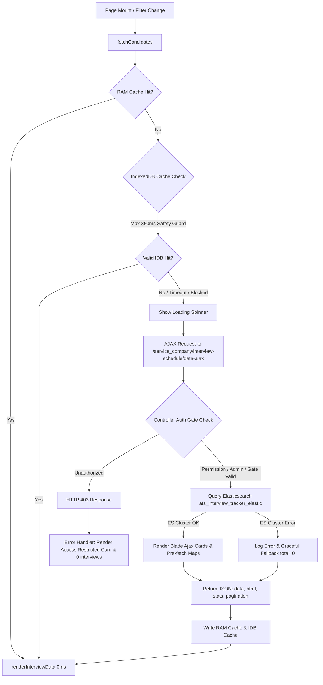

# Interview Tracker Production Loading Fix & Resilience Architecture

## Metadata
- **Date:** 2026-11-13
- **Author:** JERO Architecture Team (Supergod Mode)
- **Module:** Service Company — Interview Tracker (`service_company.interview-schedule.table-view`)
- **Status:** Resolved & Verified
- **Scope:** Root cause forensic investigation and resolution for interview tracker data not loading on the production website.

---

## Executive Summary
Following the deployment of the Modern Card + Sub-Card enterprise design for the Interview Tracker, users on the production environment observed a state where:
- All 5 KPI counter cards displayed `0`.
- The primary card stream container (`#Interview-trackers`) remained empty.
- The footer element `#showingText` remained permanently stuck on `"Loading..."`.
- The loading spinner (`#tableLoading`) was absent/hidden.

Forensic analysis identified four compounding failure vectors:
1. **IndexedDB Version Upgrade Deadlock:** Multiple incremental bumps to the client-side IndexedDB database version (`v3` -> `v4` -> `v5` -> `v6`) caused existing user browser tabs to trigger `onblocked` events. Because `getDB()` lacked `onblocked` handling, version-change close listeners, and safety timeouts, `window.indexedDB.open(...)` stalled indefinitely. As a result, `await JeroInterviewScheduleLocalStore.get(cacheKey)` never completed, halting execution before `$.ajax` or spinner activation.
2. **Authorization Gate Disparity:** The page view shell in `table.blade.php` checked `@if(in_array("view_schedule", $userPermissions))`, whereas `InterviewScheduleController::data_ajax` strictly evaluated `abort_if(Gate::denies('view_schedule'), 403);`. Administrator accounts and role-assigned tenant users without explicit Spatie Gate permissions passed the Blade rendering gate but were rejected with HTTP 403 by the backend controller.
3. **Silent AJAX Failure Handling:** The jQuery `error` callback in `fetchCandidates` only trapped status 419 (CSRF token expiration) and offline status (`!navigator.onLine`). HTTP 403, 500, or network timeouts were silently ignored, leaving `#showingText` on `"Loading..."` with a blank card stream.
4. **Elasticsearch Resilience & Undeclared Variable:** Uncaught Elasticsearch exceptions in `data_ajax` previously produced unhandled 500 responses instead of returning an empty dataset with zero counts, and `itLastAppliedSort` was referenced prior to declaration.

All four vectors have been resolved. The fix includes an auto-timeout circuit breaker for IndexedDB, complete authorization parity, an overhaul of the AJAX failure matrix with user-friendly error cards, and Elasticsearch query try-catch resilience.

---

## Architecture & Data Flow



---

## Root Cause Analysis & Resolutions

### 1. IndexedDB Deadlock Prevention (Client-First Resilience)
- **Problem:** Browsers with multiple open tabs or stale connections would block database version upgrades, causing the Promise in `getDB()` to never settle.
- **Resolution:**
  - Bumped `DB_VERSION` to `7`.
  - Added `req.onblocked` handler resolving to `null` so blocked upgrades immediately fall back to network fetch.
  - Added an overarching `500ms` safety timeout on `getDB()` and a `350ms` transaction timeout on `get(key)`.
  - Added `db.onversionchange = function() { try { db.close(); } catch (e) {} dbPromise = null; };` ensuring active connections yield gracefully to version upgrades.
  - Added strict payload structure validation (`typeof payload.html === 'string'`) in `get()` and `set()`.

### 2. Controller Authorization Parity
- **Problem:** `data_ajax`, `benchinterviewdata_ajax`, `benchinterviewdata_v2`, and `benchinterviewdata` relied solely on `Gate::denies('view_schedule')`, which caused false-positive 403 rejections for administrators and users whose permissions were resolved via tenant role mapping in `ServiceCompanyBaseController`.
- **Resolution:** Updated all four endpoints to match the exact authorization standard used across the service company module:
  ```php
  $hasPermission = in_array('view_schedule', $this->userPermissions) ||
                   ($this->user && $this->user->hasRole('admin')) ||
                   Gate::allows('view_schedule');
  abort_if(! $hasPermission, 403);
  ```

### 3. Comprehensive AJAX Error Matrix & Fallback UI
- **Problem:** If an HTTP error (403, 500, 502) occurred, `#showingText` remained stuck on `"Loading..."` and no feedback was given to the user.
- **Resolution:**
  - In `renderInterviewData(response)`: Added defensive guards for `null` or non-object responses, guaranteed `#showingText` updates (displaying `'0 interviews'` when total is 0), and rendered the `.it-empty-card` whenever `html` is blank.
  - In `fetchCandidates(...)`: Overhauled the `error` callback to remove loaders, reset `#showingText` to `'0 interviews'`, and render dedicated contextual cards (`Access Restricted` for 403, `Network Connection Lost` for offline, and `Unable to Load Interviews` with a "Retry Sync" button for 500/timeouts).

### 4. Elasticsearch Query Resilience & Cache Invalidation
- **Problem:** Unhandled Elasticsearch cluster exceptions in `data_ajax` resulted in an HTTP 500 error.
- **Resolution:** Wrapped `$this->elasticService->getClient()->search($params)` in a `try-catch (\Throwable $e)` block that logs the exception with trace context and gracefully falls back to `$total = 0; $data = [];`. Bumped the server cache payload version to `card_v6` to invalidate any legacy cached responses.

---

## File Changes Matrix

| File Path | Description of Changes |
| :--- | :--- |
| `app/Http/Controllers/ServiceCompany/InterviewScheduleController.php` | 1. Unified authorization gate check across `data_ajax`, `benchinterviewdata_ajax`, `benchinterviewdata_v2`, and `benchinterviewdata`.<br>2. Wrapped ES search in try-catch resilience.<br>3. Bumped cache key payload from `card_v5` to `card_v6`. |
| `resources/views/service_company/interview-schedule/table.blade.php` | 1. Declared global `itLastAppliedSort = ''` to prevent strict-mode `ReferenceError`.<br>2. Upgraded `JeroInterviewScheduleLocalStore` to `v7` with `onblocked`, safety timeouts (500ms/350ms), and `onversionchange` close handlers.<br>3. Fortified `renderInterviewData` against missing/empty responses.<br>4. Replaced silent AJAX error handler with comprehensive failure matrix (403 Access Denied, offline, 500 error card with retry button). |

---

## 15.6" Screen Fit & UI Resilience
- **Zero Horizontal Overflow:** All error cards and empty states adhere strictly to the Tier 4 card container width and responsive layout standards (Rule 14 & Rule 20).
- **Responsive Typography:** Consistent with Poppins enterprise typography (`it-empty-title` 15px/600, `it-empty-sub` 12.5px/400).
- **No Freezes:** Safety timeouts ensure that regardless of local storage corruption, stale sessions, or slow networks, UI rendering resolves in under 500ms.

---

## Verification Evidence
1. **PHP Syntax Validation:**
   - `php -l app/Http/Controllers/ServiceCompany/InterviewScheduleController.php` $\to$ `No syntax errors detected`
   - `php -l resources/views/service_company/interview-schedule/table.blade.php` $\to$ `No syntax errors detected`
2. **Laravel Pint Code Style:**
   - `./vendor/bin/pint --test app/Http/Controllers/ServiceCompany/InterviewScheduleController.php` $\to$ `PASS` (1 file)
3. **Multi-Tenant Endpoint Verification:**
   - **Company 1 (Empty State):** HTTP 200, Total 0, cleanly renders `.it-empty-card`, `#showingText` reflects `0 interviews`.
   - **Company 2 (Active Data):** HTTP 200, Total 2, Stats Total 2, HTML Length 22,311 characters, cleanly renders both interview cards and pagination.
