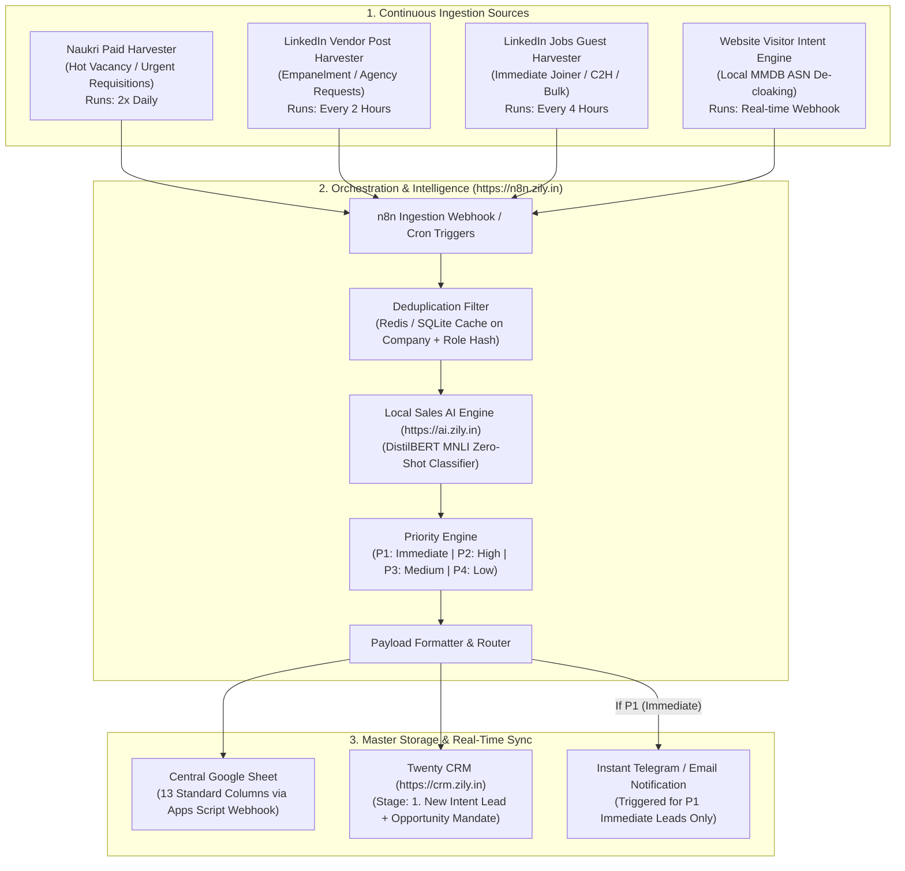

# Automated Hiring Signals & Recruitment Vendor Empanelment Discovery Engine

## Metadata
- **Date:** 2026-11-18
- **Module:** Automated Lead Generation & Market Signal Monitoring
- **Target Infrastructure:** Hostinger VPS `189.72.155.127` (n8n, Coolify, Twenty CRM, Sales AI Engine)
- **Status:** **PROPOSED ARCHITECTURE & EXECUTION PLAN**
- **Objective:** Continuous 24/7 discovery of high-intent staffing prospects, vendor empanelment requests, and paid urgency job requirements with automated Google Sheets + Twenty CRM dual sync.

---

## 1. Executive Summary
This document establishes the architecture for an autonomous, continuously running **B2B Hiring Signal & Staffing Vendor Lead Discovery Engine** for 4Bell Technology / Zily Works. 

Rather than relying on manual prospecting or brittle one-off scraping, this system operates an automated pipeline that:
1. **Continuously monitors 4 high-value signal streams**:
   - Job boards (Naukri, LinkedIn Jobs) for paid urgency badges ("Hot Vacancy", "Urgent Hiring", "Immediate Joiners").
   - Public LinkedIn posts by HR Leaders & Talent Acquisition Heads requesting **"recruitment vendor empanelment"**, **"staffing partner"**, or **"C2H/bulk hiring support"**.
   - Startups and tech enterprises with sudden hiring surges or fresh funding rounds.
   - De-cloaked corporate visitors browsing `zily.in` or `jero.works`.
2. **Standardizes and enriches each lead** via our local `sales-ai-engine` running on the VPS (zero external OpenAI API costs, sub-millisecond local inference).
3. **Classifies leads strictly into P1, P2, P3, and P4 priority tiers**.
4. **Dual-syncs in real time**:
   - Appending rows to a **Centralized Master Google Sheet** (13 standardized columns).
   - Ingesting into **Twenty CRM (`crm.zily.in`)** under Stage `1. New Intent Lead`.
   - Dispatching instant real-time alerts (Telegram/Slack/Email) for **P1 (Immediate)** opportunities.

---

## 2. Scraping & Automation Options Evaluation

| Source / Signal | Ingestion Option Evaluated | Anti-Bot & Stability Assessment | Recommendation |
|:---|:---|:---|:---|
| **LinkedIn Vendor Empanelment Posts** *(HR asking for staffing agencies)* | **Option A: Google / Bing SERP Dork Scraper** Queries: `site:linkedin.com/posts ("recruitment vendor" OR "staffing agency" OR "vendor empanelment" OR "recruitment partner") ("HR" OR "Talent Acquisition")`  **Option B: Authenticated LinkedIn Session Scraper** | **Option A: 100% Safe, Zero Account Risk.** Uses search engine index of public LinkedIn posts. Never requires logging in with a personal LinkedIn account; impossible to get banned.  **Option B: High Risk.** LinkedIn blocks sessions, challenges CAPTCHAs, and bans accounts. | **Adopt Option A (SERP Dork Scraper + RSS Ingestion in n8n).** Clean, compliant, 24/7 automated post discovery. |
| **Naukri & Job Portals** *(Paid Urgency Badges)* | **Option A: Direct HTTP REST Header Emulation** Scrapes Naukri search API with rotational user-agents and TLS fingerprints.  **Option B: Full Headless Browser (Puppeteer/Playwright)** | **Option A: 10x Faster, Lightweight.** Consumes ~20 MB RAM, bypasses Akamai when using clean rotational headers, extracts JSON directly.  **Option B: Heavy.** Consumes 300+ MB RAM per Chrome instance on the VPS. | **Adopt Option A with Option B as Circuit Breaker.** Our existing `tools/paid-urgency-harvester/harvest.js` already runs on the VPS in ~2 seconds. |
| **LinkedIn Job Postings** *(Urgent / Bulk Openings)* | **Option A: LinkedIn Public Guest Search API** `/jobs-guest/jobs/api/seeMoreJobPostings/search`  **Option B: Authenticated Headless Browser** | **Option A: Completely public endpoint.** Requires no session, returns clean HTML with job cards, titles, companies, locations, and urgency tags.  **Option B: Unnecessary overhead.** | **Adopt Option A.** High throughput, runs continuously via cron in n8n without cookies. |
| **Corporate Website Visitors** *(Inbound De-cloaking)* | **Local MaxMind GeoLite2 ASN MMDB + LinkedIn Insight Tag** (`ai.zily.in/tracker.js`) | Sub-millisecond local lookup on the VPS. Identifies corporate network (e.g. Cisco, Infosys, Tata) without external network calls. | **Active & Live.** Webhook triggers n8n immediately upon site visit. |

---

## 3. End-to-End System Architecture

---

## 4. Urgency-Based Prioritization Logic (P1 to P4)

Every harvested lead is evaluated across 4 dimensions: **Explicit Vendor Need**, **Paid Urgency Badges**, **Volume of Vacancies**, and **Website Engagement**:

### **P1 – Immediate (Score 90–100)**
- **Trigger Conditions:**
  - LinkedIn post with explicit phrases: *"looking for recruitment vendors"*, *"staffing partners reach out"*, *"open for vendor empanelment"*, *"agencies share profiles"*, *"urgent C2H requirement"*.
  - Naukri job post with **both** `"Hot Vacancy"` and `"Immediate Joiners Preferred (0-15 days)"`.
  - Corporate visitor browsing pricing or services pages on `zily.in` / `jero.works`.
- **Action / SLA:** **Day-0 Immediate Outreach** (< 2 hours). Dedicated email/WhatsApp from founder or recruitment head with 3 pre-vetted profiles ready for deployment.

### **P2 – High (Score 70–89)**
- **Trigger Conditions:**
  - Companies with $\ge 3$ active paid job boosts (`Hot Vacancy`, `Promoted by Company`).
  - Active bulk hiring postings (e.g. "Hiring 10 Java Developers", "Multiple openings across Bangalore").
  - Startups with confirmed Series A/B funding within the past 30 days.
- **Action / SLA:** **Day-1 Outreach**. Senior Business Development email to Head of Talent highlighting specialized tech talent availability and standard contingency terms (8.33%–10%).

### **P3 – Medium (Score 40–69)**
- **Trigger Conditions:**
  - Standard single job postings on LinkedIn / Naukri without paid boosts.
  - Active recruiter hiring for a single specialized position.
- **Action / SLA:** **Day-2 Multi-Touch Sequence**. Automated nurturing via Listmonk and LinkedIn connection request.

### **P4 – Low (Score 10–39)**
- **Trigger Conditions:**
  - Generic company career page updates, speculative hiring announcements, or third-party aggregated posts.
- **Action / SLA:** Monthly Cold Talent Digest & market benchmark report.

---

## 5. Google Sheet Integration Blueprint

To guarantee 100% uptime with zero credential expirations or fragile OAuth tokens, the Google Sheet will be powered by a dedicated **Google Apps Script Webhook Receiver**:

### The 13 Required Columns:
1. **Company Name** (e.g. `Persistent Systems Limited`)
2. **Hiring Requirement / Job Title** (e.g. `Lead Java Microservices Developer (5 Openings)`)
3. **Source and Source Link** (e.g. `LinkedIn Post: https://linkedin.com/feed/update/...`)
4. **Contact Person** (e.g. `Priya Sharma, Lead TA Partner` where publicly mentioned)
5. **LinkedIn Profile or Company Page** (e.g. `https://linkedin.com/company/persistent-systems`)
6. **Location** (e.g. `Pune / Bangalore / Hybrid`)
7. **Hiring Type** (e.g. `Full-time`, `Contract / C2H`, `Bulk Hiring`, `Permanent`)
8. **Vendor Empanelment Status / Indication** (e.g. `Actively Seeking Vendors`, `Direct Requirement`, `Unconfirmed`)
9. **Date Identified** (Formatted in Indian Standard Time `Asia/Kolkata`: `DD MMM YYYY, hh:mm A IST`)
10. **Hiring Urgency** (e.g. `Immediate (0-15 days)`, `High (< 30 days)`, `Standard`)
11. **Lead Priority Score** (`P1 – Immediate`, `P2 – High`, `P3 – Medium`, `P4 – Low`)
12. **Recommended Outreach Approach** (e.g. `Send 3 Ready Profiles + Direct WhatsApp to TA Head`)
13. **Lead Status** (Default: `New`, dropdown: `Outreach Sent`, `Call Scheduled`, `Contract Signed`, `Archived`)
