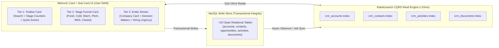

# Forensic Audit: HubSpot CRM vs. Dedicated B2B Staffing CRM Architecture

## Metadata
- **Date:** 2026-11-18
- **Document Type:** Competitive Architecture Audit & Product Requirement Specification
- **Module:** `lead_generation` / `crm`
- **Target Product:** Dedicated B2B Staffing & Recruitment CRM (Decoupled Sibling to JERO ATS)
- **Author:** Antigravity Super God-Mode Engineering

---

## Executive Summary

HubSpot CRM is the recognized global standard for inbound B2B sales automation. However, HubSpot is designed as a **horizontal generalist CRM** built primarily for selling software subscriptions (SaaS) and physical goods. When applied to **B2B Staffing & Recruitment Agencies**, HubSpot suffers from severe structural deficiencies: it lacks native understanding of candidate submittals, job requisition fulfillment, staffing fee models (contingency vs. C2H margin), vendor empanelment (VMS/MSP), legal document tracking (MSAs/NDAs), and contract renewal cycles.

This audit evaluates HubSpot CRM across its core hubs (Sales Hub, Marketing Hub, Operations Hub) and specifies:
1. **The Core HubSpot Superpowers to Adopt** (Features that deliver massive sales velocity).
2. **Staffing-Specific Differentiators** (Features HubSpot completely lacks that will make our CRM 10x superior for staffing).
3. **Bloat to Eliminate** (Enterprise complexity to avoid to keep the CRM lightweight and fast).
4. **1:1 Component Transformation Map** (Mapping JERO ATS trackers directly to CRM trackers).

---

## 1. HubSpot Feature Audit & Classification Matrix

```mermaid
quadrantChart
    title Feature Value vs. Staffing Specificity Matrix
    x-axis Low Staffing Fit --> High Staffing Fit
    y-axis Low Sales Value --> High Sales Value
    quadrant-1 MUST BUILD (Core Differentiators)
    quadrant-2 ADOPT FROM HUBSPOT (Core Sales Tools)
    quadrant-3 EXCLUDE AS BLOAT (Ignore)
    quadrant-4 SPECIALIZED (Secondary Automations)
    "Hiring Urgency Ingestion": [0.95, 0.95]
    "Documentation Pending Radar": [0.90, 0.90]
    "Document Renewal Tracker": [0.88, 0.88]
    "Staffing Commercials (8.33% / C2H)": [0.92, 0.92]
    "1-Click Handoff to JERO ATS": [0.98, 0.95]
    "Universal 360 Activity Stream": [0.45, 0.95]
    "Kanban Deal Pipeline": [0.40, 0.90]
    "Meeting Booking Links": [0.35, 0.85]
    "Quick Email Snippets & Templates": [0.30, 0.80]
    "Smart Task Work Queue": [0.35, 0.78]
    "B2C Social Media Auto-Poster": [0.05, 0.15]
    "E-commerce Shopping Carts": [0.05, 0.10]
    "Customer Support Ticket Bots": [0.15, 0.25]
    "Complex 50-step Branching Drip Builders": [0.20, 0.35]
```

---

## 2. The 6 Core HubSpot Superpowers to Adopt

These are the features that made HubSpot the market leader. We can implement them natively using JERO's existing CQRS and Card + Sub-Card architecture:

### 1. Universal 360° Activity Timeline
- **HubSpot Behavior:** Every company and contact displays a chronological audit stream of all emails sent/received, calls logged, notes recorded, stage transitions, and meetings booked.
- **Our Implementation:** Direct lift of JERO's `ClientActivityReadService.php`. Uses Elasticsearch `_msearch` with 0% MySQL reads and hierarchical Redis version caching. Renders inside the Client/Lead sliding drawer.

### 2. Multi-Stage Visual Deal Pipeline (Kanban + Weighted Revenue)
- **HubSpot Behavior:** Visual drag-and-drop board with stage probability percentages (e.g., *Pitch: 20%*, *MSA Sent: 80%*), computing total pipeline value and velocity.
- **Our Implementation:** Adapts `ServiceCompanyAppTrackerController` into the **Lead Pipeline Tracker** and `ServiceCompanyOfferController` into the **Client Acquire Tracker**. Includes total pipeline hiring fee potential and average days-in-stage telemetry.

### 3. Integrated Meeting Scheduler (HubSpot Meetings)
- **HubSpot Behavior:** Reps share personal booking links with 2-way Google/Outlook calendar synchronization, eliminating back-and-forth scheduling emails.
- **Our Implementation:** Replaces JERO's `interview-schedule` with a **Meeting Tracker**. Integrates with Cal.com (self-hosted) or Google Meet/Zoom webhooks. When a client books, the lead automatically transitions to *Meeting Booked*.

### 4. Email Snippets & Quick Pitch Templates
- **HubSpot Behavior:** Sales reps can type a shortcut (e.g. `#ratecard` or `#profilepitch`) to instantly insert pre-formatted, tokenized email text (`{{contact_name}}`, `{{company_name}}`, `{{primary_tech}}`).
- **Our Implementation:** Metronic drawer modal with canned response shortcuts, dynamically populated via User RAM without backend round-trips.

### 5. Smart Task Queues & Follow-Up Reminders
- **HubSpot Behavior:** Reps start their day in a dedicated "Tasks" queue (e.g., 20 calls to make, 15 follow-ups on proposals). Clicking "Start Queue" loads leads sequentially.
- **Our Implementation:** Built into the Tier 1 Toolbar of the Lead Tracker. Evaluated Just-In-Time (JIT) via Elasticsearch (`next_follow_up_at <= NOW()`), requiring zero background polling cron jobs (Rule 22).

### 6. Dynamic Smart Lists (Saved Segmentations)
- **HubSpot Behavior:** Dynamic lists that auto-populate based on criteria (e.g., "Active IT Companies in Pune with Urgency > 70 and No Outreach in 14 Days").
- **Our Implementation:** Saved Elasticsearch filter queries executed in under 15ms with full faceted counts.

---

## 3. The 6 Staffing-Specific Differentiators (Where We Beat HubSpot)

HubSpot is generic and fails at staffing agencies. These 6 native capabilities give our CRM a decisive competitive edge:

### 1. Built-in Hiring Signal & Urgency Ingestion
- **Why HubSpot Fails:** HubSpot cannot ingest or parse external hiring signals. Users must manually research if a company is hiring.
- **Our Solution:** Direct ingestion API connected to automated harvesters (Naukri Hot Vacancy badges, LinkedIn Promoted Job badges, MMDB IP de-cloaking). Automatically scores hiring urgency (0–100) and displays demanded tech stacks (`Java, React, AWS, Python`) on the company card.

### 2. Staffing Commercials & Deal Models
- **Why HubSpot Fails:** HubSpot only records generic dollar revenue (e.g., \$10,000 ARR).
- **Our Solution:** The **Client Acquire Tracker** natively models staffing deals:
  - *Permanent Placement Fee:* Base CTC % (e.g., 8.33%, 10%, 12.5%) + payment terms (Net-30/45) + 90-day candidate replacement guarantee.
  - *Contract Staffing / C2H:* Hourly billing rate vs. candidate pay rate with gross margin calculation.
  - *Retained / RPO:* Staged milestone payment schedules.

### 3. Documentation Pending Tracker (Legal & Procurement Radar)
- **Why HubSpot Fails:** HubSpot deals get stuck in "Contract Sent" without tracking specific document blockers.
- **Our Solution:** Dedicated tracker monitoring:
  - ⏳ *Master Services Agreement (MSA)*
  - ⏳ *Non-Disclosure Agreement (NDA)*
  - ⏳ *Rate Card & Commercial Schedule*
  - ⏳ *Vendor Empanelment Form (SAP Fieldglass, Beeline, Coupa)*
  - ⏳ *GST / Corporate Bank Verification*
  - Flags the exact blocker (Client Legal, Internal Legal, or Account Manager) and alerts when stalled > 7 days.

### 4. Document Renewal & Rate Revision Radar
- **Why HubSpot Fails:** HubSpot has no recurring anniversary logic for staffing rate escalations.
- **Our Solution:** Dedicated tracker monitoring:
  - 🚨 *Expiring MSAs:* 30/60/90-day warning before annual contracts lapse.
  - 📈 *Rate Revision Milestones:* 12-month anniversary alerts triggering 8–15% rate escalation negotiations for deployed contract talent.

### 5. Multi-Contact Organizational Hierarchy (Staffing Specific)
- **Why HubSpot Fails:** Treats all contacts identically.
- **Our Solution:** Classifies staffing decision-makers into operational roles:
  - *Economic Buyer:* CEO, Founder, VP Engineering (Signs the MSA and approves budget).
  - *Talent Gatekeeper:* Head of Talent Acquisition, HR Director (Approves agency empanelment).
  - *Hiring Manager:* Tech Lead, Engineering Manager (Interviews candidates and shares JDs).
  - *Procurement / VMS Lead:* Invoicing, portal access, and compliance coordinator.

### 6. The Native 1-Click Handoff to JERO ATS
- **Why HubSpot Fails:** Requires expensive, fragile third-party middleware (Zapier/Make) to push closed deals into recruitment tools.
- **Our Solution:** The **Client Onboard Tracker** features a native **"Launch in ATS"** button. Pushes the verified client, contacts, signed MSA, and open job requisitions directly into JERO ATS via an internal secure handshake.

---

## 4. Features to Deliberately Exclude (Bloat Prevention)

To keep the CRM ultra-fast, maintainable, and aligned with JERO's 10,000-user concurrency target, we exclude:

| HubSpot Feature | Why We Exclude It | Alternative Approach |
| :--- | :--- | :--- |
| **Internal SMTP Mail Server & Warmup** | Hosting mail delivery inside Laravel risks IP blacklisting and wastes server RAM. | Outsource physical email sending to **Warmbly**, **Listmonk**, or **Resend**. The CRM acts as the brain; the email relay acts as the pipe. |
| **Complex 50-Step Branching Drip Builders** | 90% of B2B staffing conversions occur within 3–5 targeted touches. Over-engineered visual workflow builders add massive maintenance overhead. | Use streamlined linear sequences (Touch 1: Email ➔ Touch 2: LinkedIn ➔ Touch 3: Phone call). |
| **B2C Social Media Publishing** | Staffing BD does not happen via bulk Twitter/Instagram auto-posts. | Focus exclusively on direct B2B channels (Email, LinkedIn, Phone). |
| **E-commerce & Web Products Catalog** | Staffing is a relationship and service business, not a shopping cart. | Replaced by Staffing Commercials & Rate Card structures. |
| **Customer Support Ticket Bots** | Enterprise staffing clients communicate directly with their assigned Account Manager. | Replaced by Account Manager touchpoint logging in the activity stream. |

---

## 5. Architectural Implementation Blueprint



### Database Schema Footprint (~20 Tables)
1. `crm_accounts` (Target companies, hiring signals, urgency score, tech stack)
2. `crm_contacts` (Decision makers, roles: Buyer/TA/HM, email, mobile, LinkedIn)
3. `crm_opportunities` (Staffing mandates, fee model, target CTC, open vacancies)
4. `crm_pipeline_stages` (Customizable funnel stages per organization)
5. `crm_activities` (Calls, notes, meetings, emails, status transitions)
6. `crm_meetings` (Scheduled discovery pitches, Cal.com integration, outcomes)
7. `crm_documents` (MSAs, NDAs, rate cards, vendor registration sheets)
8. `crm_document_renewals` (Contract expiry dates, rate revision anniversaries)
9. `crm_tasks` (Follow-up reminders, daily call queues, JIT evaluations)
10. `crm_tags` & `crm_taggables` (Flexible labeling: Tech stack, Urgency tier, City)
11. `crm_sequences` & `crm_sequence_enrollments` (Linear multi-channel outreach status)
12. `crm_ats_handoff_logs` (Audit trail of clients pushed into JERO ATS)
13. Plus standard authentication, roles, tenant settings, and media tables (~7 tables).

---

## 6. Conclusion & Strategic Next Steps

By combining **HubSpot’s sales acceleration superpowers** (Universal Activity Timeline, Kanban Funnels, Meeting Schedulers, Smart Task Queues) with **Staffing-Specific Game Changers** (Hiring Signal Ingestion, Staffing Commercials, Documentation Radar, Renewal Radar, and 1-Click JERO ATS Handoff), this dedicated CRM will be substantially more effective for staffing agencies than HubSpot, at a fraction of the cost and complexity.
