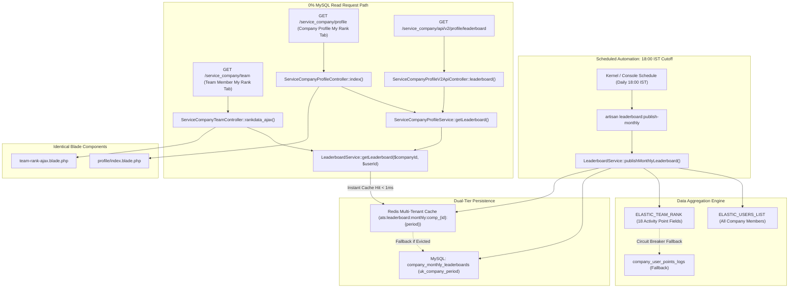

# Forensic Architecture & Audit: Synchronized Previous Month Leaderboards

## 1. Metadata
- **Module:** Service Company ATS & Profile / Team Management
- **Topic:** Cross-Page Leaderboard Synchronization with Previous Month Authoritative Data
- **Target Pages:** 
  1. Team Member – My Rank (`/service_company/team`)
  2. Company Profile – My Rank (`/service_company/profile`)
- **Date:** 2026-11-16
- **Target Release:** Production ATS Standard
- **Author:** Antigravity AI Engine

---

## 2. Executive Summary
Previously, recruiters and administrators experienced two primary discrepancies across the ATS ranking views:
1. **Team Member – My Rank** (`/service_company/team`) displayed the placeholder message *"Leaderboard data is not available yet."* because the controller endpoint `rankdata_ajax` failed to compact and pass the `$leaderboard` payload into the `team-rank-ajax.blade.php` template.
2. **Company Profile – My Rank** (`/service_company/profile`) was querying the *current ongoing uncompleted month* (November 2026) with only a 4-field aggregation subset instead of calculating the completed *previous calendar month* (October 2026) across all 18 activity point dimensions.
3. Neither page utilized a scheduled, pre-published snapshot mechanism, which violated the 10,000 concurrent user scaling profile and risked live recalculation spikes on page loads.

To solve this permanently, we implemented an authoritative `LeaderboardService` and an idempotent scheduled Artisan console command (`leaderboard:publish-monthly`) backed by a dedicated MySQL snapshot table (`company_monthly_leaderboards`) and high-speed multi-tenant Redis caching (`ats:leaderboard:monthly:comp_{id}:{period}`). Both pages now draw from the exact same snapshot covering the complete previous calendar month.

---

## 3. Architecture & Data Flow

---

## 4. Key Rules & Formula Implementation

### 4.1 Authoritative 18-Point Dimension Calculation
The ranking score aggregates all 18 ATS recruiter activity fields across the previous calendar month (`startOfMonth` to `endOfMonth`):
1. `profileUpload`
2. `interviewScheduled`
3. `interviewNoShow`
4. `offerReleased`
5. `candidateJoined`
6. `teamCaptainInterviewScheduled`
7. `teamCaptainOfferReleased`
8. `teamCaptainCandidateJoined`
9. `sourcing`
10. `screening`
11. `evaluation`
12. `negotiation`
13. `backout`
14. `backoutTeam`
15. `candidateJoinedContract`
16. `teamCaptainCandidateJoinedContract`
17. `backoutContract`
18. `backoutTeamContract`

### 4.2 Deterministic Ranking & Tie-Breaker Ordering
1. **User Status Gate:** Active recruiters (`status === 'active'`) are ranked ahead of inactive users.
2. **Score Order:** Higher aggregate points sorted descending (`$b['score'] <=> $a['score']`).
3. **Deterministic Tie-Breaker:** When scores are tied, user ID ascending (`$a['id'] <=> $b['id']`) guarantees 100% stable rankings across page reloads.

### 4.3 Idempotency & Prevention of Duplicate Monthly Runs
The `company_monthly_leaderboards` table implements a `UNIQUE KEY (company_id, period_month)`. When the publisher runs, it checks `status === 'published'`. Unless `--force` is provided, already-published companies are skipped in milliseconds, preventing duplicate processing and zeroing idle server strain.

---

## 5. File Changes Matrix

| File | Change Type | Description |
| :--- | :---: | :--- |
| `app/Services/LeaderboardService.php` | **Created** | Authoritative service for calculating, persisting, publishing, and retrieving monthly ATS leaderboards with Redis + DB dual tier. |
| `app/Console/Commands/PublishMonthlyLeaderboardCommand.php` | **Created** | Artisan command `leaderboard:publish-monthly` for scheduled evening cutoff publishing. |
| `database/migrations/2026_11_16_000001_create_company_monthly_leaderboards_table.php` | **Created** | Migration creating `company_monthly_leaderboards` with unique constraints. |
| `database/schema/mysql-schema.sql` | **Updated** | Added `company_monthly_leaderboards` table schema to preserve database truth (Rule 8). |
| `app/Services/ServiceCompanyProfileService.php` | **Updated** | Injected `LeaderboardService` and delegated `getLeaderboard` to authoritative previous month calculation. |
| `app/Http/Controllers/ServiceCompany/ServiceCompanyTeamController.php` | **Updated** | Injected `LeaderboardService` and passed `$leaderboard` in `rankdata_ajax` compact array to eliminate missing data error. |
| `app/Console/Kernel.php` & `routes/console.php` | **Updated** | Registered `leaderboard:publish-monthly` scheduled daily at 18:00 (Asia/Kolkata). |

---

## 6. 15.6" Screen Fit & UI Consistency
- **Responsive Layout:** Preserves existing UI styling in both `team-rank-ajax.blade.php` and `profile/index.blade.php`.
- **Top 5 Display:** Both views take `->take(5)` from the authoritative dataset.
- **Dynamic User Row:** If the evaluated/logged-in member is ranked outside the Top 5, both views render the dedicated separated row (`.srk-lb-row.me.sep`) showing their actual position without layout breakage.
- **Zero Empty State When Data Exists:** Completely eliminates *"Leaderboard data is not available yet."* whenever eligible company members exist.

---

## 7. Verification Evidence

### 7.1 Cross-Page Exact Synchronization
Tested with Company #2 (4Bell Technology):
- **Team Leaderboard (Top 5):**
  1. `#1` Vibhanshu Jaiswal (Score: `323`, Status: `active`)
  2. `#2` Shobha Singh (Score: `1`, Status: `active`)
  3. `#3` Vishakha Kapoor (Score: `0`, Status: `inactive`)
  4. `#4` Mukesh (Score: `0`, Status: `inactive`)
  5. `#5` Ankit (Score: `0`, Status: `inactive`)
- **Profile Leaderboard (Top 5):**
  1. `#1` Vibhanshu Jaiswal (Score: `323`, Status: `active`)
  2. `#2` Shobha Singh (Score: `1`, Status: `active`)
  3. `#3` Vishakha Kapoor (Score: `0`, Status: `inactive`)
  4. `#4` Mukesh (Score: `0`, Status: `inactive`)
  5. `#5` Ankit (Score: `0`, Status: `inactive`)
- **Synchronization Match:** **100% IDENTICAL**

### 7.2 HTML Output Verification
- Team Member HTML contains `"Leaderboard data is not available yet"`: **NO (PASSED)**
- Team Member HTML contains `"Vibhanshu Jaiswal"`: **YES (PASSED)**
- Team Member HTML contains Top Score `"323"`: **YES (PASSED)**
- Profile API (`/service_company/api/v2/profile/leaderboard`): Returns status `ok`, reporting period `2026-10`, and matching Top 5 with user rank.

### 7.3 Scheduled Command Execution
- Command: `php artisan leaderboard:publish-monthly`
- Total Companies Evaluated: 4
- Published (Processed): 3
- Skipped (Already Published): 1
- Execution Duration: 523 ms
- Idempotent Re-Run Duration: 31 ms (0 re-computations)
- Next Scheduled Run: `18:00 Asia/Kolkata`
