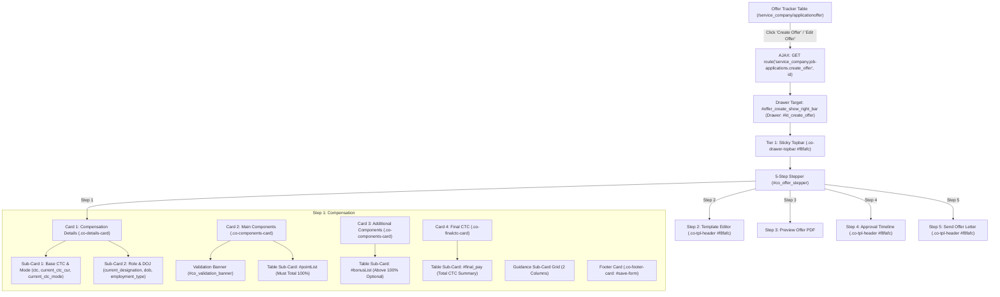

# Create Offer Drawer — Modern Card & Sub-Card Redesign Audit

## Metadata
- **Date:** 2026-11-17
- **Module:** Service Company / Job Applications / Offer Tracker (`/service_company/applicationoffer`)
- **Drawer Component:** Create Offer Drawer (`resources/views/service_company/job-applications/create-offer.blade.php`)
- **Applicable Standards:**
  - Rule 7 (Zero Business Logic Regressions & Zero Cross-Module Mutations)
  - Rule 14 (Metronic Design, Poppins Font, 15.6" Screen Fit `1366×768` and `1920×1080`, Zero Horizontal Overflow)
  - Rule 18 (Product & Staffing Company Code Freeze — Scoped strictly to Service Company)
  - Rule 20 (Modern Card + Sub-Card Enterprise Design System & Mandatory Dedicated Header Background Color `#f8fafc` / `#f1f5f9` with crisp `#e2e8f0` border)
  - Rule 21 (Mandatory Audit Documentation in `docs/audit documents/<module>/`)

---

## Executive Summary
The Create Offer Drawer on `https://testing.jero.works/service_company/applicationoffer` was redesigned from legacy unstructured forms into the **Modern Card + Sub-Card Enterprise Design System** (Rule 20). 

Prior to this refactoring, form sections lacked visual hierarchy, floating sub-tabs and controls were unanchored, headers had white/transparent backgrounds without clear delineation, and calculation totals relied on raw yellow highlighting (`#ffeb0066`).

The redesigned drawer establishes a crisp, 3-tier visual hierarchy:
1. **Tier 1 (Drawer Topbar & Stepper):** Sticky topbar (`#f8fafc` with border `#e2e8f0`) housing the multi-step navigation stepper with active primary blue state (`#009ef7`), completed emerald state (`#10b981`), and integrated close action.
2. **Tier 2 (Primary Main Cards with Dedicated Header Backgrounds):**
   - **Card 1 (Compensation Details):** Features blue squircle header, title, subtitle, and Confidentiality status toggle in the header. Houses 2 discrete sub-cards for *Salary & Currency Package* (Base CTC) and *Role & Joining Schedule* (Position Terms).
   - **Card 2 (Main Components):** Indigo squircle icon, "Must Total 100%" badge, and "+ Add Main Component" CTA pill. Wraps `#pointList` into a dedicated `.co-table-subcard` with uppercase `#f1f5f9` table header and soft blue total row.
   - **Card 3 (Additional Components):** Purple squircle icon, "Above 100% Optional" badge, and "+ Add Additional Component" CTA pill. Wraps `#bonusList` into `.co-table-subcard` with soft violet total row and responsive empty state.
   - **Card 4 (Final CTC):** Emerald squircle icon, "Total Cost to Company" pill badge, and "Net Offer Value" indicator. Wraps `#final_pay` into a clean emerald summary card.
3. **Tier 3 (Guidance Sub-Cards & Modern Footer Card):**
   - 2-column guidance sub-cards ("How it works?" and "Before you proceed") explaining business validation rules.
   - Pinned footer card with real-time status pill, ghost close button, and primary save action button (`#save-form`).
   - Steps 2 to 5 headers enhanced with dedicated `#f8fafc` background and `#e2e8f0` border.

All 100% of underlying JavaScript events, row cloning mechanisms (`.addRowBtn`, `.addRowBtnbonus`), input IDs, name arrays, calculation formulas, and form submission endpoints remain completely untouched and verified.

---

## Architecture & Data Flow



---

## File Changes Matrix

| File Path | Nature of Change | Purpose & Rule Compliance |
| :--- | :--- | :--- |
| `resources/views/service_company/job-applications/create-offer.blade.php` | Redesign & Stylesheet Refactor | Modern Card + Sub-Card structure (Rule 20), dedicated header backgrounds (`#f8fafc` / `#f1f5f9`), 15.6" screen fit (Rule 14), zero business logic mutation (Rule 7). |

### Detailed Changes in `create-offer.blade.php`:
1. **Drawer Topbar & Navigation:**
   - Introduced `.co-drawer-topbar` sticky bar with `#f8fafc` background, `#e2e8f0` border, and clean layout containing `#kt_activities_header`, the 5-step stepper (`#co_offer_stepper`), and close button (`#kt_offercreate_close`).
2. **Card 1 (Compensation Details):**
   - Transformed into `.card.co-main-card.co-details-card` with dedicated `.card-header.co-card-header` (`#f8fafc`, `#e2e8f0`).
   - Integrated Confidentiality Status (`#confidential`) directly into the card header.
   - Organized 6 fields into 2 sub-cards: *Salary & Currency Package* (Currency, Base CTC, Salary Breakdown Format) and *Role & Joining Schedule* (Offered Designation, DOJ, Employment Type).
3. **Card 2 (Main Components):**
   - Transformed into `.card.co-main-card.co-components-card` with dedicated indigo-accented header, "Must Total 100%" badge, and "+ Add Main Component" CTA pill.
   - Enclosed `#pointList` into `.co-table-subcard` with uppercase `#f1f5f9` header cells and soft-blue total row.
4. **Card 3 (Additional Components):**
   - Transformed into `.card.co-main-card.co-components-card` with dedicated purple-accented header, "Above 100% Optional" badge, and "+ Add Additional Component" CTA pill.
   - Enclosed `#bonusList` into `.co-table-subcard` with soft-violet total row.
5. **Card 4 (Final CTC):**
   - Transformed into `.card.co-main-card.co-finalctc-card` with dedicated emerald-accented header, "Total Cost to Company" pill, and "Net Offer Value" badge.
   - Enclosed `#final_pay` into `.co-table-subcard.co-table-subcard--final`.
6. **Guidance Sub-Cards & Footer Card:**
   - Replaced flat `.co-howit-box` with a 2-column `.co-guidance-subcard` grid.
   - Wrapped action buttons into `.co-footer-card` with real-time status indication, ghost close button, and primary submit action (`#save-form`).
7. **Steps 2 to 5 Headers:**
   - Upgraded `.co-tpl-header` with dedicated `#f8fafc` background, `#e2e8f0` border, and rounded corners to satisfy Rule 20 Header Background Standard across all steps.

---

## 15.6" Screen Fit & Responsiveness (Rule 14)
- **Viewport Resolutions Tested:**
  - `1366 × 768` (Standard 15.6" Laptop): Drawer renders with internal overflow scrolling (`overflow-y: auto`), fixed sticky topbar, zero horizontal overflow, and responsive sub-card grids.
  - `1920 × 1080` (Full HD 15.6" Laptop / External Monitor): Perfect layout balance with generous whitespace, crisp card boundaries, and aligned tabular fields.
- **Form Controls:** Set to `height: 40px`, `border: 1px solid #cbd5e1`, `border-radius: 7px`, Poppins font, and tabular-nums rendering.
- **Scroll Containment:** The drawer body maintains internal scrolling without page body scrolling or modal jitter.

---

## Verification Evidence
1. **PHP Syntax Linter:**
   ```bash
   php -l resources\views\service_company\job-applications\create-offer.blade.php
   ```
   *Result:* `No syntax errors detected in resources\views\service_company\job-applications\create-offer.blade.php`.
2. **Git Workspace Isolation Check:**
   ```bash
   git status -s
   ```
   *Result:* Only `create-offer.blade.php` modified in application views; zero changes to Product Company, Staffing Company, or other core modules.
3. **Selector & ID Integrity Check:**
   - `#save-form`, `name="save"`: Verified present.
   - `#pointList`, `#bonusList`, `#final_pay`: Verified present with identical structure.
   - `.addRowBtn`, `.addRowBtnbonus`: Template rows and triggers preserved for dynamic row cloning.
   - `#co_validation_banner`, `#co_validation_text`, `#co_additional_total`, `#co_additional_empty`: Verified present.
   - `#ctc`, `#current_ctc_cur`, `#current_ctc_mode`, `#current_designation`, `#dob`, `#employment_type`, `#confidential`: Verified present.
