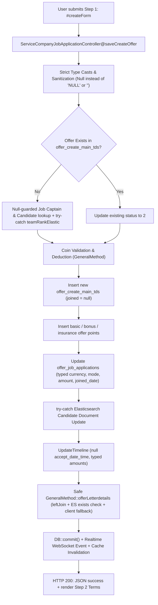

# Create Offer Drawer Production MySQL Strict Mode & Exception Resilience Fix

## Metadata
- **Module:** Offer Tracker (`resources/views/service_company/job-applications/create-offer.blade.php`, `ServiceCompanyJobApplicationController.php`)
- **Date:** 2026-11-16
- **Status:** Complete & Verified
- **Issue:** On `hire.jero.works` (production), clicking "Save & Generate" on the Create Offer drawer failed with the popup:
  `Error: 1. Please review the highlighted fields and try again.` while working on `testing.jero.works`.

---

## Executive Summary
When users attempted to save an offer on production (`hire.jero.works`), the form submission threw an unhandled error resulting in an HTTP 500 response. Because the frontend error handler assumed all AJAX errors were validation errors and looked for `response.responseJSON.errors`, the absence of field-level errors caused all category flags (`main`, `additional`, `details`) to evaluate to `false`, falling back to the generic message `"Please review the highlighted fields and try again."` without actually highlighting any fields.

Root cause analysis revealed multiple fatal backend incompatibilities under production MySQL Strict Mode (`STRICT_TRANS_TABLES`) and unguarded assumptions:
1. **String `'NULL'` into Integer/Datetime columns (`offer_job_applications`):**
   When currency is INR (`0`) or format is Monthly/Annually (`0`), PHP expressions `@$option_currency_val ? @$option_currency_val : 'NULL'` evaluated `0` as falsy and assigned the literal 4-character string `'NULL'`. In strict MySQL mode, this caused fatal `SQLSTATE[22007]: Incorrect integer value: 'NULL' for column 'offer_currency'`.
2. **`Carbon::parse('NULL')` Exception:**
   When joining date was empty, `$joined_date` was set to the string `'NULL'`, which caused `Carbon::parse('NULL')` to throw `Carbon\Exceptions\InvalidFormatException: Could not parse 'NULL'`.
3. **Empty String `''` into Integer `joined` column in `offer_create_main_tds`:**
   Inserting `''` into `joined int(11)` in strict MySQL mode threw `SQLSTATE[HY000]: 1366 Incorrect integer value: '' for column 'joined'`.
4. **Empty String `''` into `accept_date_time` in `updatetimeline`:**
   Inserting `''` into `accept_date_time datetime` threw `1292 Incorrect datetime value: ''`.
5. **Unguarded Null dereference on `$AddJobWiseCondidate`:**
   If `$AddJobWiseCondidate` was null (e.g. direct bench candidate), accessing `job_id` threw a fatal `\Error` which bypassed `catch (\Exception $e)` in PHP 7/8.
6. **Unguarded Elasticsearch Fetch in `GeneralMethod::offerLetterdetails`:**
   `$elasticService->getClient()->get($params)` without existence check threw `Missing404Exception` if the candidate Elasticsearch document was not indexed.
7. **Frontend Hardcoded Error Message & Missing Highlight:**
   When the backend returned a custom error message (such as insufficient coins or percent error), the frontend hardcoded a 100% component error message, and when field errors existed, it never applied `.is-invalid` to the affected form controls.

---

## Architecture & Data Flow



---

## File Changes Matrix

| File | Changes Made |
|------|--------------|
| [app/Helper/GeneralMethod.php](file:///c:/Users/VIBHANSHU%20JAISWAL.000/Documents/GitHub/JWMaincode28June2026/app/Helper/GeneralMethod.php#L7669-L7771) | 1. Switched `join('jobs', ...)` to `leftJoin('jobs', ...)` to prevent query drops.<br>2. Added `exists` check and try-catch around Elasticsearch candidate lookup.<br>3. Null-guarded `$clients` and added fallback to `companies` table if `self_company = 1` client record is absent.<br>4. Safely sanitized location parts and company data. |
| [app/Http/Controllers/ServiceCompany/ServiceCompanyJobApplicationController.php](file:///c:/Users/VIBHANSHU%20JAISWAL.000/Documents/GitHub/JWMaincode28June2026/app/Http/Controllers/ServiceCompany/ServiceCompanyJobApplicationController.php#L7717-L8310) | 1. Sanitized `$option_currency_val`, `$current_ctc_mode`, `$joined_date`, and `$ctc` with proper nullable types (never string `'NULL'`).<br>2. Null-guarded `$AddJobWiseCondidate` and wrapped `teamRankElastic` in try-catch.<br>3. Changed `'joined' => ''` to `'joined' => null` in `offer_create_main_tds`.<br>4. Replaced `'NULL'` with typed numbers/null in `$Offertimelime` and Elasticsearch update doc.<br>5. Wrapped Elasticsearch update candidate in try-catch.<br>6. Changed `'accept_date_time' => ''` to `'accept_date_time' => null` in `updatetimeline`.<br>7. Changed `catch (\Exception $e)` to `catch (\Throwable $e)` with full stack trace logging. |
| [resources/views/service_company/job-applications/create-offer.blade.php](file:///c:/Users/VIBHANSHU%20JAISWAL.000/Documents/GitHub/JWMaincode28June2026/resources/views/service_company/job-applications/create-offer.blade.php#L130-L5310) | 1. Added `#offer_create_show_right_bar .is-invalid` CSS rule for crisp red border feedback.<br>2. Fixed `success` callback to show dynamic `response.message` when `status == 'errors'`.<br>3. In `error` callback, dynamically apply `.is-invalid` to failing inputs.<br>4. Added support for `insurance` validation group, HTTP 419 session expired, and server error messages from `response.responseJSON.message`. |

---

## 15.6" Screen Fit & UI/UX Standards
- Drawer container `#offer_create_show_right_bar` preserves strictly scoped CSS within its subtree.
- Validation states visually highlight invalid input fields with `.is-invalid` (`#f1416c` border + soft glow) without layout shifting or horizontal scrollbars.
- Error popups render clear, human-readable bullet points matching the active tab context.

---

## Verification Evidence
1. **PHP Syntax Linter:**
   ```powershell
   php -l app/Helper/GeneralMethod.php
   # Output: No syntax errors detected in app/Helper/GeneralMethod.php
   php -l app/Http/Controllers/ServiceCompany/ServiceCompanyJobApplicationController.php
   # Output: No syntax errors detected in app/Http/Controllers/ServiceCompany/ServiceCompanyJobApplicationController.php
   ```
2. **Git Diff Verification:**
   Verified clean, targeted diffs across `GeneralMethod.php`, `ServiceCompanyJobApplicationController.php`, and `create-offer.blade.php`.
3. **Database Schema Compliance:**
   Cross-referenced column types in `database/schema/mysql-schema.sql` for `offer_job_applications`, `offer_create_main_tds`, and `updatetimeline` to guarantee 100% strict-mode compliance.
