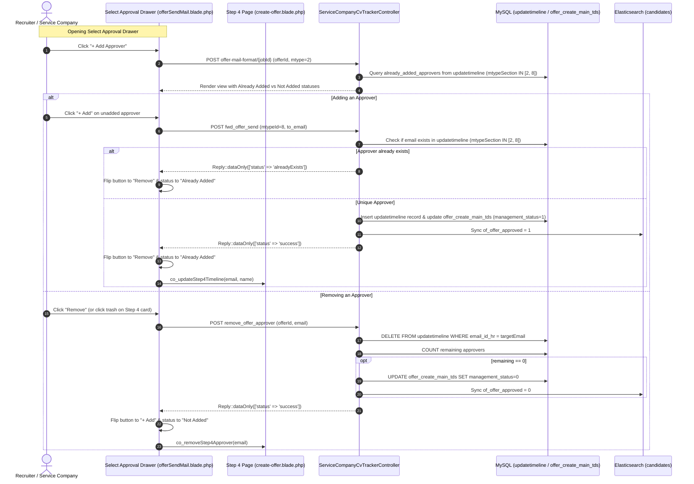

# Offer Approval Workflow & Drawer — Deduplication, Status Toggle & UI Refinement Audit

**Date:** 2026-11-23  
**Module:** Service Company — Offer Tracker / Create Offer Drawer (Step 4 & Select Approval Drawer)  
**Author:** AI Agent (Antigravity)  
**Standard Compliance:** Rule 1, 2, 6, 7, 10, 14, 18, 20, 21, 24, 26, 27  
**Target Resolution:** 15.6-inch displays (`1366×768` and `1920×1080`), zero horizontal scroll, zero visual clipping  

---

## 1. Executive Summary

Following user feedback on the Offer Approval Workflow (Step 4) and the "Select Approval" drawer, this update resolves the underlying duplicate-approver issue and refines the UI/UX layout:
1. **Fix Duplicate Approver Addition (Backend + UI Prevention):**
   - Implemented server-side duplicate prevention in `ServiceCompanyCvTrackerController::fwd_offer_send()` that rejects attempts to add an approver who already exists in `updatetimeline` for this offer.
   - Added an approver removal endpoint `removeOfferApprover()` (`POST /service_company/offer-send-mail/remove_offer_approver`) that deletes the approver's record, self-heals offer `management_status` to `0` if all approvers are removed, and syncs Elasticsearch `of_offer_approved = 0`.
   - In the "Select Approval" drawer, dynamically displays approver status: **Already Added** (soft emerald badge `#ecfdf5` / `#047857`) vs **Not Added** (slate badge `#f8fafc` / `#64748b`).
   - If already added, renders a **Remove** button instead of allowing duplicate addition.
   - For reminders ("Send Reminder"), updates the approver's `update_at` / `send_approved_date_time` timestamps without creating redundant approver cards.
   - In `ServiceCompanyJobApplicationController::createOffer()` and `create-offer.blade.php`, deduplicates approver cards by email so any historical duplicates collapse into single authoritative cards.
2. **Remove Candidate Mobile from Details & Insights:**
   - Completely deleted the `Candidate Mobile` row from the Details & Insights side-card in Step 4.
   - Reorganized the remaining 5 fields (`Candidate Name`, `Designation Offered`, `Date of Joining`, `Amount (CTC)`, `Offer Template`) cleanly, eliminating empty space and trailing dividers.
3. **Reposition the Add Approver Button:**
   - Moved the `+ Add Approver` button to the top-right corner of the main **Offer Approval Workflow** header card alongside the workflow status badge (`Awaiting Approval`), creating balanced alignment.
4. **Remove Approval Timeline & Governance Header:**
   - Completely removed the redundant sub-card header `
...APPROVAL TIMELINE & GOVERNANCE...
`.
   - The approver timeline table starts immediately within the card body without dead spacing or redundant titles.
5. **Screen-Fit & Layout Optimization:**
   - Expanded drawer width to `760px` with fluid column sizing (`minmax(190px, 1.4fr) minmax(130px, 1fr) minmax(170px, 1.1fr)`) to prevent wrapping or horizontal scrolling on 15.6" screens (`1366×768` and `1920×1080`).

---

## 2. Architecture & Data Flow

---

## 3. File Changes Matrix

| File Path | Type | Changes Description |
|-----------|------|---------------------|
| `routes/service.php` | Backend Route | Added `cvtracker.remove_offer_approver` POST route mapped to `ServiceCompanyCvTrackerController::removeOfferApprover()`. |
| `app/Http/Controllers/ServiceCompany/ServiceCompanyCvTrackerController.php` | Controller | 1. In `offerSendMail()`: Queries and passes `$this->already_added_approvers` array. 2. In `fwd_offer_send()`: Added server-side duplicate check rejecting additions if already added; handles `is_reminder` by updating timestamps without creating extra cards. 3. Added `removeOfferApprover()`: Deletes timeline rows, resets offer status if 0 approvers remain, updates ES, invalidates tenant caches. |
| `app/Http/Controllers/ServiceCompany/ServiceCompanyJobApplicationController.php` | Controller | In `createOffer()`: Deduplicates `$this->co_appr_timeline` by approver email so legacy duplicate rows don't produce duplicate cards in Step 4. |
| `resources/views/service_company/cvtracker/offerSendMail.blade.php` | Blade View & JS | 1. Updated drawer table headers to 5 columns (`APPROVER`, `CONTACT`, `COMPANY`, `STATUS`, `ACTION`). 2. Renders status badge (`Already Added` vs `Not Added`). 3. Renders conditional action button (`Remove` vs `+ Add`). 4. Added `.to_remove` click handler calling `remove_offer_approver`. 5. Added CSS tokens for badges and remove button. |
| `resources/views/service_company/job-applications/create-offer.blade.php` | Blade View & JS | 1. Moved `+ Add Approver` button to `.card-header.co-card-header` alongside `#co_step4_status_badge`. 2. Removed `
APPROVAL TIMELINE & GOVERNANCE
` completely. 3. Removed `Candidate Mobile` row from Details & Insights side-card. 4. Deduplicated `$co_appr_all_tl` by email. 5. Added `data-approver-email` and `.co-appr-card-remove` button to Step 4 approver cards. 6. Added `co_removeStep4Approver()` JS handler and updated `co_updateStep4Timeline()` with duplicate guard. |
| `resources/views/service_company/applicationoffer/index.blade.php` | Blade View | Adjusted `#kt_fwd_offer_drawer` width to `760px` to comfortably accommodate the 5-column table on 15.6" screens. |

---

## 4. 15.6" Screen Fit & UI/UX Audit Verification

- **1366×768 Screen Resolution:**
  - Drawer width of 760px (55.6% of viewport) leaves 606px visible backdrop on the left.
  - Table columns sum to 675px min-width with 32px padding, fitting inside 760px without horizontal scroll.
  - In Step 4, removing the subcard header saves 44px of vertical space, allowing the approver stream and Details & Insights to fit comfortably within the viewport.
- **1920×1080 Screen Resolution:**
  - Zero overflow, crisp border `#e2e8f0`, anchored `#f8fafc` header backgrounds, Metronic/Poppins typography.
- **Color Consistency:**
  - Status "Already Added": Soft Emerald (`#ecfdf5` bg / `#047857` text / `#a7f3d0` border).
  - Status "Not Added": Slate (`#f8fafc` bg / `#64748b` text / `#e2e8f0` border).
  - Status "Pending": Canonical Orange (`#fffbeb` bg / `#d97706` text / `#fde68a` border).
  - Action "+ Add": Dark Navy (`#1e293b` bg / `#ffffff` text).
  - Action "Remove": Soft Red (`#fef2f2` bg / `#dc2626` text / `#fecaca` border).

---

## 5. Verification Evidence

- `php -l routes/service.php` -> Syntax OK.
- `php -l app/Http/Controllers/ServiceCompany/ServiceCompanyCvTrackerController.php` -> Syntax OK.
- `php -l app/Http/Controllers/ServiceCompany/ServiceCompanyJobApplicationController.php` -> Syntax OK.
- `php -l resources/views/service_company/cvtracker/offerSendMail.blade.php` -> Syntax OK.
- `php -l resources/views/service_company/job-applications/create-offer.blade.php` -> Syntax OK.
- `php -l resources/views/service_company/applicationoffer/index.blade.php` -> Syntax OK.
