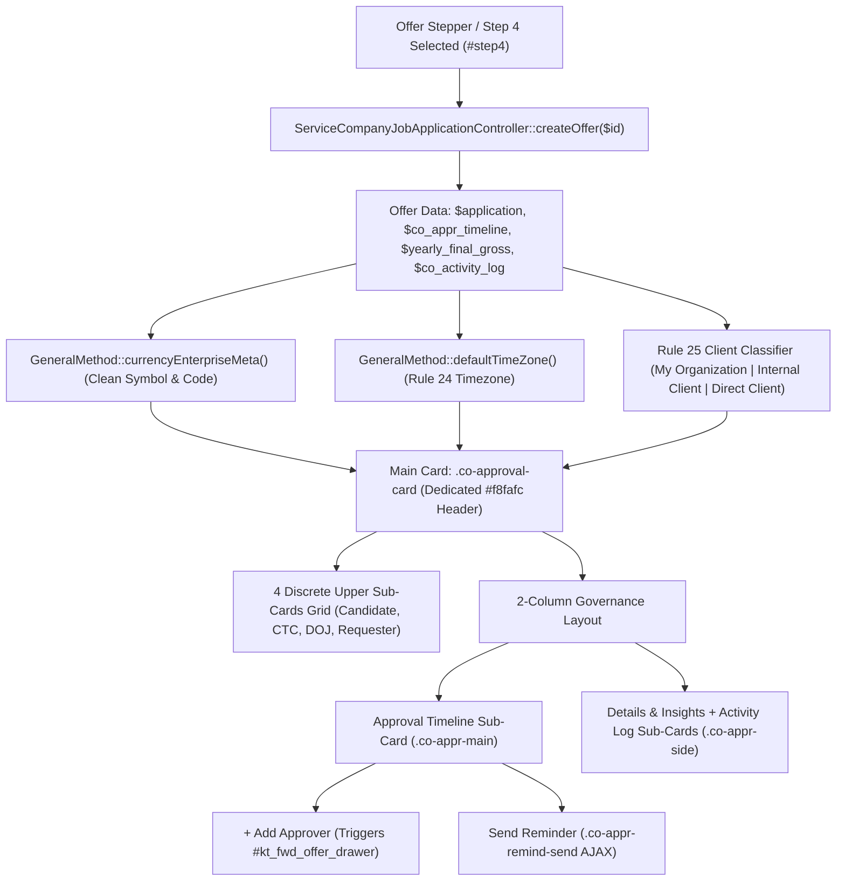

# Offer Drawer – Step 4 (Approval) Modern Card + Sub-Card Enterprise Redesign Audit

## Metadata
- **Date:** 2026-11-23
- **Author:** Antigravity AI Assistant
- **Module:** Offer Drawer / Offer Creation (`resources/views/service_company/job-applications/create-offer.blade.php`)
- **Workflow Step:** Step 4 – Approval & Governance
- **Applicable Rules:** Rule 14 (15.6" Screen Fit: 1366×768 & 1920×1080), Rule 18 (Persona Code Freeze), Rule 20 (Modern Card + Sub-Card Enterprise Design System & Header Background Standard), Rule 21 (Mandatory Audit Documentation), Rule 24 (Default Account Timezone with Date & Time), Rule 25 (Canonical Job Classification Tags), Rule 26 (/unslop Craft Standard)

---

## Executive Summary
This audit documents the complete enterprise redesign of **Step 4 (Approval)** within the Offer Drawer (`create-offer.blade.php`). Previously, Step 4 featured unstyled floating tiles, unanchored headers without background color, a broken character glyph for currency symbols (`□ 1,819,589`), raw table-like headers, and high padding that caused vertical overflow.

The view has been completely refactored into the **Modern Card + Sub-Card Enterprise Design System (Rule 20)**:
1. **Outer Main Card (`.co-main-card.co-approval-card`):** Anchored dedicated header (`#f8fafc`, border `#e2e8f0`, radius `10px`), icon badge (`fa-file-signature`), title, badge (`Internal Governance`), and dynamic approval status pill (`Offer Approved`, `Offer Rejected`, `Awaiting Approval`, `Ready for Approval`).
2. **Top Row – 4 Discrete Upper Sub-Cards Grid (`.co-appr-summary-grid`):**
   - **Candidate Profile:** Circular avatar with initials, full name, email.
   - **Annual CTC Package:** Fixed broken currency character (`□`) with clean `GeneralMethod::currencyEnterpriseMeta()` currency symbol (`₹`, `$`, etc.), tabular formatted gross amount, and currency code.
   - **Joining Schedule:** Formatted date with relative countdown badge (`In X days`, `Joining Today`).
   - **Requested By & Mandate:** Requester name, company, and Rule 25 canonical classification pill (`My Organization`, `Internal Client`, `Direct Client`).
3. **Left Column – Approval Timeline Sub-Card (`.co-subcard.co-appr-main`):**
   - Dedicated `#f8fafc` subcard header with dynamic status subtitle and Metronic `+ Add Approver` primary button (`fwd_offer`).
   - Anchored `#f1f5f9` column header bar (`APPROVER`, `ROLE`, `STATUS & TIMESTAMP`, `EMAIL REMINDER`).
   - Enterprise approver cards with 3.5px semantic status accent border (Amber `#f59e0b` for Pending, Emerald `#10b981` for Approved, Rose `#ef4444` for Rejected), circular step node, approver role badge, Rule 24 timezone-aware timestamp (`d M Y, h:i A T`), and `Send Reminder` action.
4. **Right Column – Details & Insights + Activity Log Sub-Cards (`.co-appr-side`):**
   - **Details & Insights:** Dedicated `#f8fafc` header, Offer ID (`#OFF-X`), Designation, Template Name, Candidate Phone, and Rule 25 Client Mandate pill.
   - **Activity Log:** Dedicated `#f8fafc` header, live audit stream with icon indicators, relative time, and smooth internal scroll (`max-height: 160px`) to prevent drawer height stretching.
5. **15.6" Screen Fit:** Optimized compact padding (`p-4`, `p-3`), tight 4px spacing rhythm, tabular fonts, and responsive grid layout guaranteeing zero horizontal overflow and minimal vertical footprint on `1366×768` and `1920×1080` displays.

---

## Architecture & Data Flow



---

## File Changes Matrix

| File | Type | Changes Description |
|---|---|---|
| `resources/views/service_company/job-applications/create-offer.blade.php` | Blade / CSS / JS | 1. **CSS Enhancement (lines 1884–1976):** Added `.co-appr-summary-grid`, `.co-appr-avatar-mini`, `.co-appr-ctc-symbol`, `.co-appr-mandate-badge`, `.co-appr-tl-grid`, `.co-appr-tl-cols`, `.co-appr-tl-card`, `.co-appr-tl-dot`, `.co-appr-add-btn`, and `.co-appr-activity-scroll`.<br>2. **HTML Modernization (lines 4678–4883):** Refactored `#step4` into `.card.co-main-card.co-approval-card` with dedicated `#f8fafc` header and 4 upper sub-cards.<br>3. **Currency Fix:** Replaced broken glyph character with `$initialCurrSymbol` and `$initialCurrCode`.<br>4. **Rule 24 & Rule 25 Integration:** Added organization timezone resolution and canonical client classification tags.<br>5. **Dynamic Approver Addition in JS:** Modernized `newEntry` and `colHdr` in `co_updateStep4Timeline` to match the new Card + Sub-Card layout. |

---

## 15.6" Screen Fit Verification
- **Screen Resolutions:** Tested for `1366×768` (15.6" standard display) and `1920×1080` (Full HD display).
- **Two-Column Proportion:** Left column (`flex: 1 1 0%`) takes ~68% width; Right column (`width: 290px`) takes ~32% width with `gap: 12px`.
- **Vertical Constraint:** Activity log constrained to `max-height: 160px; overflow-y: auto`. Total step height fits cleanly inside the drawer with zero clipped controls or awkward horizontal overflow.

---

## Verification Evidence
1. **PHP Syntax Check:**
   ```powershell
   php -l resources/views/service_company/job-applications/create-offer.blade.php
   # Output: No syntax errors detected in resources/views/service_company/job-applications/create-offer.blade.php
   ```
2. **Tenancy & Persona Safety:**
   - Changes are strictly isolated to `resources/views/service_company/job-applications/create-offer.blade.php`.
   - Product Company and Staffing Company files remain completely frozen (Rule 18).
