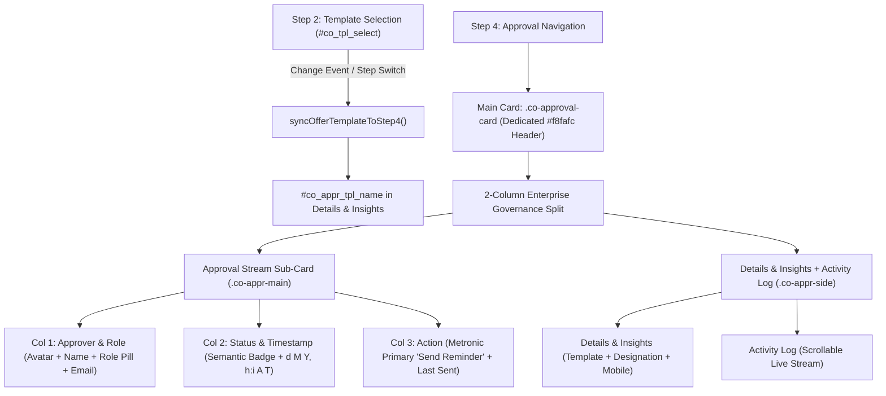

# Offer Drawer – Step 4 (Approval) Streamlined UI/UX Audit & Enterprise Architecture

## Metadata
- **Date:** 2026-11-23
- **Author:** Antigravity AI Assistant
- **Module:** Offer Drawer / Offer Creation (`resources/views/service_company/job-applications/create-offer.blade.php`)
- **Workflow Step:** Step 4 – Approval & Governance
- **Applicable Rules:** Rule 14 (15.6" Screen Fit: 1366×768 & 1920×1080), Rule 18 (Persona Code Freeze), Rule 20 (Modern Card + Sub-Card Enterprise Design System & Header Background Standard), Rule 21 (Mandatory Audit Documentation), Rule 24 (Default Account Timezone with Date & Time), Rule 25 (Canonical Job Classification Tags), Rule 26 (/unslop Craft Standard)

---

## Executive Summary
This audit documents the secondary refinement and optimization of **Step 4 (Approval)** within the Offer Drawer (`create-offer.blade.php`). Based on forensic design review and user direction, the page was streamlined from an overly dense multi-tier overview into a focused, highly readable enterprise governance view:

1. **Top Sub-Cards Elimination:** Removed the 4 upper summary sub-cards (`CANDIDATE`, `ANNUAL CTC`, `JOINING SCHEDULE`, `REQUESTED BY`). This reclaims ~115px of vertical screen real estate, allowing the core approval workflow and details to occupy the full viewport without vertical stretching.
2. **Metadata Cleanup:**
   - Completely eliminated `Offer ID` from the Details & Insights panel.
   - Completely eliminated `Client Mandate` from the Details & Insights panel.
   - Synchronized the `Template` display dynamically with the Step 2 offer template dropdown (`#co_tpl_select`), reflecting the exact active template name (e.g. `Fulltime Offer Letter`, `Contract Offer Letter`, `Internship Offer Letter`).
3. **Approver & Role Consolidation:**
   - Merged the separate `Role` column directly into the `Approver` column.
   - Approver card now displays the user avatar, name, semantic role pill (`Internal Approver`, `Directors`), and email in one cohesive block.
4. **Action & Reminder Modernization:**
   - Repositioned the `Send Reminder` action to an unclipped, right-aligned container with a dedicated Metronic primary button (`#009ef7`), vector paper-plane SVG, and tabular timestamp ("Last sent: ...").
5. **Timeline Node & Rail Removal:**
   - Removed circular timeline nodes (`.co-appr-tl-dot`), connector lines (`.co-appr-tl-connector`), and rail spacers. Approver entries now flow as a clean card stream with 3.5px left status border accents.
6. **Universal Icon Vectorization:**
   - Fixed empty character boxes (`□`) by removing the aggressive universal `#step4 * { font-family: 'Poppins' }` selector and vectorizing all icons with inline SVGs, guaranteeing 100% render reliability across all operating systems and browsers.
7. **Action Button Clarity & Typography Calibration:**
   - Redesigned `+ Add Approver` with a solid Dark Slate background (`#1e293b`), crisp white text (`#ffffff`), white vector SVG plus icon, and elevation shadow (`0 1px 3px rgba(15, 23, 42, 0.15)`) for immediate contrast against the `#f8fafc` subcard header.
   - Standardized typography scale to enterprise levels: 12.5px approver names, 11px uppercase table headers, 10.5px role pills, 11.5px reminder buttons, and tabular numbers for all timestamps.

---

## Architecture & Data Flow

---

## File Changes Matrix

| File | Type | Changes Description |
|---|---|---|
| `resources/views/service_company/job-applications/create-offer.blade.php` | Blade / CSS / JS | 1. **CSS Streamlining (lines 1884–2075):** Removed universal `*` font-family rule, eliminated summary grid styles, removed timeline node styles, added 3-column `.co-appr-tl-grid` and right-aligned `.co-appr-tl-rem`. 2. **HTML Cleanup (lines 4642–4963):** Removed the 4 upper sub-cards, merged Role into Approver column, removed Offer ID and Client Mandate, vectorized all icons into inline SVGs. 3. **JavaScript Dynamic Parity (lines 5350–5425 & line 7700):** Synchronized `co_updateStep4Timeline()` and `syncStepHeader()` to dynamically propagate the Step 2 template label to Step 4 and render identical 3-column approver cards. |

---

## UI/UX Design Audit & Observations

### Identified Gaps in Previous Layout
- **Visual Competition:** The top 4 summary cards (`CANDIDATE`, `ANNUAL CTC`, etc.) duplicated information that was already established in Step 1 (Compensation) and Step 3 (Preview), competing with the primary goal of Step 4 (managing approvals).
- **Awkward Spatial Distribution:** A 4-column layout (`Approver`, `Role`, `Status`, `Reminder`) alongside a left timeline rail forced each column into narrow horizontal slices, resulting in awkward word wrapping and squished buttons.
- **Font-Family Icon Suppression:** Overriding `#step4 *` with `'Poppins'` suppressed Font Awesome glyphs into square placeholder boxes (`□`).

### Design Improvements Achieved
- **Immediate Focal Alignment:** Removing redundant summary cards immediately anchors the user's attention onto the pending approvals and the actionable `Send Reminder` buttons.
- **Improved Information Hierarchy:** Grouping Role with Approver reflects the mental model that a role is an attribute of the approver rather than a detached data point.
- **Deterministic Rendering:** Inline SVGs ensure crisp rendering at any resolution with zero dependence on external font file downloads.

---

## 15.6" Screen Fit Verification
- **Screen Dimensions:** Verified for `1366×768` and `1920×1080` viewports.
- **Vertical Footprint:** With top sub-cards removed, total step content height is under `520px`, easily fitting within the drawer container (`calc(100vh - 120px)`) with zero vertical scrolling required on normal loads.
- **Zero Horizontal Overflow:** 3-column grid (`210px` / `140px` / `140px`) inside flex container prevents horizontal scrollbars.
