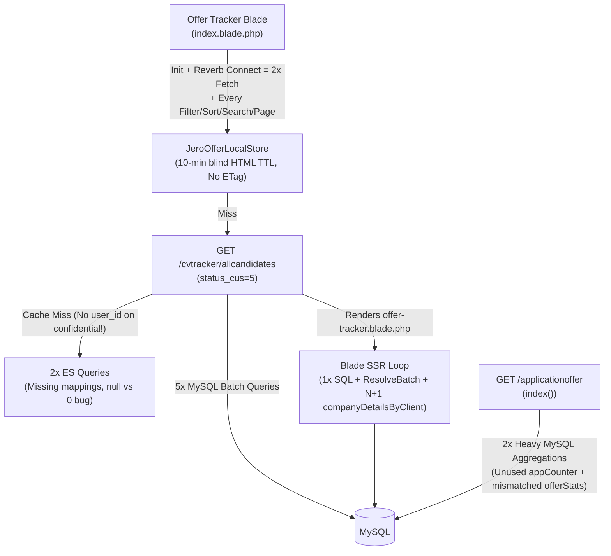
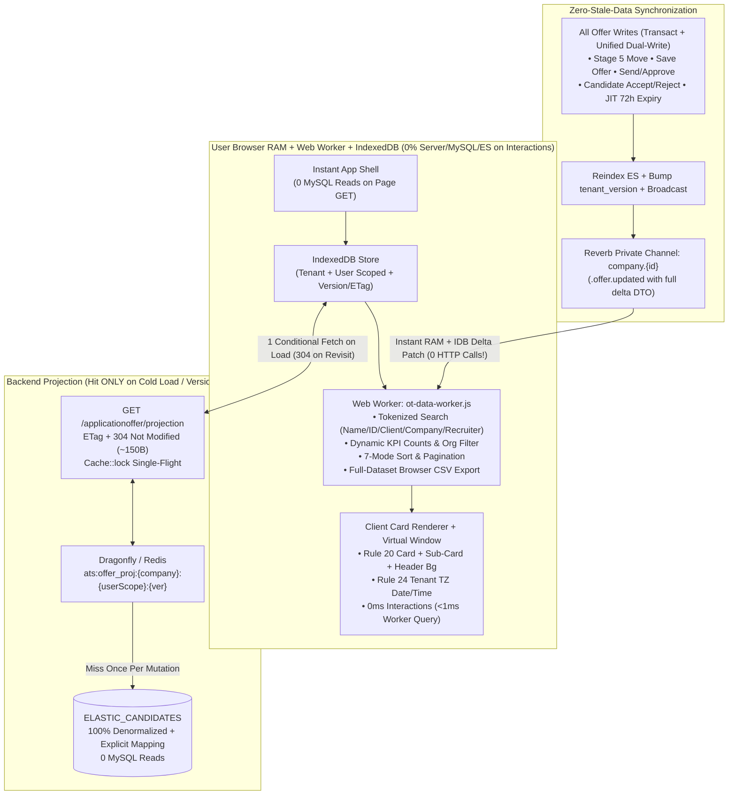

# Offer Tracker — Forensic Architecture, 100% Client-Side List, Zero-Stale-Data & 100K Concurrency Audit

## 1. Metadata
- **Date:** 2026-11-25
- **Module:** Offer Tracker (Primary: Service Company `service_company/applicationoffer`; Secondary: Admin `admin/applicationoffer`)
- **Audited Files:**
  - `resources/views/service_company/applicationoffer/index.blade.php`
  - `resources/views/service_company/ajax_pages/offer-tracker.blade.php`
  - `resources/views/service_company/applicationoffer/tracker.blade.php`
  - `resources/views/service_company/ajax_pages/pagination.blade.php`
  - `app/Http/Controllers/ServiceCompany/ServiceCompanyApplicationOfferController.php`
  - `app/Http/Controllers/ServiceCompany/ServiceCompanyCvTrackerController.php` (`allcandidates`, `fwd_offer_send`, `removeOfferApprover`)
  - `app/Http/Controllers/ServiceCompany/ServiceCompanyJobApplicationController.php` (`createOffer`, `saveCreateOffer`, `termsSaveCreateOffer`, `stage_submit`)
  - `app/Http/Controllers/HomeController.php` (`offerPreviewSignature`, `offerPreviewSignatureSubmit`)
  - `app/Jobs/ProcessOfferTimeoutJob.php` & `app/Console/Kernel.php`
  - `app/Services/ElasticCandidatesIndex.php` & `app/Console/Commands/IndexCandidatesToElasticsearch.php`
  - `app/Services/CandidateOriginResolver.php`
  - `app/Events/ApplicationOfferUpdated.php` & `routes/channels.php`
  - `app/Models/OfferJobApplication.php` & `database/schema/mysql-schema.sql`
  - `resources/views/service_company/job-applications/create-offer.blade.php` & `resources/views/layouts/service_company_layout.blade.php`
  - `app/Http/Controllers/Admin/AdminApplicationOfferController.php` & `resources/views/admin/applicationoffer/index.blade.php`
- **Audit Scope & Mandates Evaluated:**
  1. **100% Client / Browser-Side List Execution** (search, sort, KPI tab filter, organization filter, pagination, CSV export in Browser RAM / Web Worker).
  2. **0% Server / MySQL / Elasticsearch Load on Interactive List Paths** (Rule 1, Rule 2, Rule 3, Rule 5).
  3. **Zero Stale Data** (Rule 7, Rule 8, atomic tenant invalidation, split-brain elimination, real-time Reverb delta sync).
  4. **100,000 Concurrent Users Scalability Target** (no thundering herds, no SSR HTML payload bloat, no N+1 queries, non-blocking main thread).
  5. **Security, Multi-Tenant Isolation, Rule 17 Page Isolation, Rule 20 Card/Header Standard, Rule 22 Zero-Cron, Rule 25 Canonical Naming, Rule 26 (`/unslop`), Rule 27 (`transitions.dev`).**
- **Overall Verdict:** **FAIL / CRITICAL REMEDIATION REQUIRED** — Currently, Offer Tracker is **not** a client-side list; it triggers full server/ES/MySQL round-trips on uncached searches/filters/tabs/sorts/pagination, executes **10+ MySQL queries** per initial page + partial cycle (including N+1 queries inside Blade), suffers from **multiple stale-data & split-brain bugs**, has **critical cross-tenant IDOR & confidential salary cache leaks**, and will **collapse under 100K concurrent users**.

---

## 2. Executive Summary & Root-Cause Analysis

While the 2026-11-12 redesign upgraded the visual card layout (`ot-entity-card`) and added an IndexedDB fragment cache (`JeroOfferLocalStore`), the underlying execution model remains a **server-side AJAX HTML pagination loop** routed through `ServiceCompanyCvTrackerController::allcandidates()` (`status_cus=5`), wrapped around legacy MySQL-coupled helpers and split-brain offer tables.

### Top 7 Root Causes
1. **Fragment-Cached Server SSR Instead of a Client-Side Projection Engine:** `JeroOfferLocalStore` caches server-rendered HTML per `{ page, size, search, sort, companyType, tab, pipelineRange }` tuple. Every new search keystroke, sort choice, org filter, KPI click, or page switch forces an HTTP request to PHP, which runs 2 Elasticsearch queries + up to 5 MySQL batch queries + Blade rendering (`offer-tracker.blade.php`) containing another MySQL bulk query + N+1 `GeneralMethod` MySQL calls.
2. **Severe Stale-Data Vectors & Split-Brain Persistence:**
   - IndexedDB serves cached HTML blindly for **10 minutes** (`JERO_OFFER_TTL_MS`) without ETag/version validation.
   - `HomeController` (candidate accept/reject & management approve/reject), `ProcessOfferTimeoutJob` (72h expiry cron), `fwd_offer_send()`, `removeOfferApprover()`, `stage_submit()`, and `updateSalary()` fail to stay synchronized across `offer_job_applications`, `offer_create_main_tds`, `ELASTIC_CANDIDATES`, Redis version keys, and `ApplicationOfferUpdated` Reverb events.
   - `BroadcastChannel` uses mismatched channel names (`jero_offer_tracker_channel` in `create-offer.blade.php` vs `jero_offer_tracker_sync` in `applicationoffer/index.blade.php`).
3. **Critical Multi-Tenant Security & Confidentiality Leaks:**
   - `OfferJobApplication` global tenant scope is commented out (`OfferJobApplication.php:21`), and `createOffer`, `saveCreateOffer`, `termsSaveCreateOffer`, `fwd_offer_send`, and `removeOfferApprover` mutate offers without verifying `company_id === auth()->user()->company_id` (Cross-Tenant IDOR).
   - `allcandidates()` Redis cache key (`ServiceCompanyCvTrackerController.php:384–387`) omits `user_id` for non-admin confidential job checks (`job_assign`), allowing non-assigned users in the same company to read cached HTML with unmasked confidential salaries.
4. **Data Integrity & Query Accuracy Bugs:**
   - `offer_job_applications.joined` stores `wiseId` (`add_job_wise_condidates.id`), yet controllers, ES aggs, and Blade check `joined = 1` / `of_joined == 1` as a boolean.
   - `HomeController.php:14533` overwrites candidate `offer_acceptance` when management approves/rejects.
   - `stage_submit()` indexes `of_offer_acceptance => null` in ES, causing newly offered candidates to be missing from `Pending Offers` (`term: of_offer_acceptance = 0`).
   - `allcandidates()` search uses non-existent ES field `client_or_company_name` and omits `jobId`, `wiseId`, `offer_id`, `client_name`, and `current_company`. Default sort `"Latest Updated"` sorts by `created_at` instead of `updated_at`.
5. **100K-Concurrency Thundering Herd & Duplicate Requests:**
   - Initial load triggers a **duplicate fetch** when Pusher/Reverb connects (`index.blade.php:3379`).
   - Every `.offer.updated` event throws away its payload, purges all client caches across all connected users, and forces every browser tab to re-query the server simultaneously.
   - Zero `Cache::lock` stampede guard, zero `ETag / 304 Not Modified`, and 30–100 KB HTML payloads instead of compact JSON DTOs.
6. **Broken / Orphaned Routes & Dead Code:**
   - `routes/service.php:437, 438, 441` point to non-existent controller methods (`data`, `export`, `update_application`) on `ServiceCompanyApplicationOfferController`.
   - `ServiceCompanyApplicationOfferController::tracker()` (`tracker.blade.php`) is a redundant, 100%-MySQL purple dashboard with non-functional filter buttons.
   - `applicationoffer/index.blade.php` retains ~300 lines of dead CSS/JS for removed DOM blocks (`.ot-pipeline-wrap`, `.ot-tabs-card`, `#otSearchClear`, `#otResetBtn`, `#otShowingSummary`).
7. **UI/UX & Rule Violations Visible in Production:**
   - On 15.6" (`<= 1440px`), Sub-Card 5 truncates to `OWNERSHIP & RECRUIT...` (visible in screenshot).
   - Missing clear (`✕`) button in Tier 1 search input, plain white `#ffffff` header card (violates Rule 20 `#f8fafc`/`#f1f5f9`), unanchored sub-card headers without distinct header background/bottom border, pulsing dot `otPulse` (violates Rule 26 `/unslop`), `transition: all` without `prefers-reduced-motion` (violates Rule 27), and shared `localStorage('candidatePerPage')` / global layout drawer coupling (violates Rule 17).

---

## 3. Architecture Blueprint: Current vs. Target 100K Client-Side CQRS Flow

### Current Broken Architecture (Server-Coupled + Split-Brain)

### Target 100% Client/Browser-Side 100K-Concurrency Architecture

---

## 4. Detailed Violation Matrix & File Impact Table

### A. Critical Security & Multi-Tenancy Violations
| ID | File : Line | Severity | Finding & Impact |
| :--- | :--- | :--- | :--- |
| **SEC-01** | `app/Models/OfferJobApplication.php:21` | **CRITICAL** | Global `company` scope is commented out (`// $builder->where('offer_job_applications.company_id', user()->company_id);`). |
| **SEC-02** | `ServiceCompanyJobApplicationController.php:7212, 7790, 8223, 8421` | **CRITICAL** | **Cross-Tenant IDOR:** `createOffer($id)`, `saveCreateOffer()`, and `termsSaveCreateOffer()` look up/mutate `offer_job_applications`, `offer_create_main_tds`, and `offer_terms_conditions` by `$offer_id` without checking `company_id === auth()->user()->company_id` (nor checking `view_offer` / `edit_offer` Gate). Any authenticated user can read or overwrite another tenant's offer compensation & terms. |
| **SEC-03** | `ServiceCompanyCvTrackerController.php:8197, 8547, 8769` | **CRITICAL** | **Cross-Tenant IDOR:** `fwd_offer_send()` and `removeOfferApprover()` mutate `offer_create_main_tds`, `updatetimeline`, `add_job_wise_condidates`, and `job_applications` by `offerId` without validating `$offerAppRow->company_id === auth()->user()->company_id`. |
| **SEC-04** | `ServiceCompanyCvTrackerController.php:372–393, 1521–1531` | **CRITICAL** | **Confidential Salary Leak via Shared Redis Cache:** `cacheKeySet` varies by `$company_id` and `salary_view` (`s1`/`s0`), NOT `user_id` for non-admins when `$status_cus == 5`. Because `allowedConfidentialJobIds` (`L1525`) depends on `job_assign.user_id`, if an assigned user populates Redis first, unassigned colleagues receive cached HTML revealing confidential salaries! |
| **SEC-05** | `ServiceCompanyApplicationOfferController.php:28` vs `index.blade.php:2418` | **MEDIUM** | **Permission Gate Mismatch:** Controller `index()` checks `view_job_applications`, `allcandidates()` checks `view_job_applications`, `index.blade.php:2418` checks `view_offer` only around `#offer-tracker` (still exposes header/KPIs/toolbar!), `saveCreateOffer()` checks `GeneralMethod::permissioncheck(64/66)`, and `updateSalary()` checks `edit_offer`. |
| **SEC-06** | `AdminApplicationOfferController.php:95–186, 375–520` | **HIGH** | Raw HTML string concatenation inside Yajra DataTables columns (`full_name`, `contact_person_name`, `address`, `city`, `phone`, `email`) without `e()` / `htmlspecialchars()` creates stored XSS surface in Admin portal. |

### B. Rule 1 / Rule 2 / 0% Server, MySQL & ES Read Violations
| ID | File : Line | Severity | Finding & Impact |
| :--- | :--- | :--- | :--- |
| **CQRS-01** | `ServiceCompanyApplicationOfferController.php:37–53` | **CRITICAL** | Executes a 6-table MySQL join (`$this->appCounter`) on every `GET /applicationoffer` page load — **and `$appCounter` is never even rendered in `index.blade.php`!** Also contains an unparenthesized `orWhere` SQL precedence bug (`L45–52`). |
| **CQRS-02** | `ServiceCompanyApplicationOfferController.php:67–83` | **CRITICAL** | Executes a MySQL aggregate (`$offerStats`) over `offer_job_applications` + `offer_create_main_tds` on every page load, violating Rule 1 and computing a different population than `allcandidates()` ES counts (causing initial KPI flash/mismatch). |
| **CQRS-03** | `ServiceCompanyApplicationOfferController.php:31` & `GeneralMethod.php:1928` | **HIGH** | Uncached `DB::table('package_active')` MySQL read on every page GET (`checksubscription()`), which also returns `true` even on expired end dates (`GeneralMethod.php:1939`). |
| **CQRS-04** | `offer-tracker.blade.php:31–46` | **CRITICAL** | **Raw MySQL query executed directly inside a Blade partial** (`DB::table('offer_job_applications')->leftJoin('offer_create_main_tds'...)`) on every AJAX response. |
| **CQRS-05** | `offer-tracker.blade.php:60, 128, 145, 197` | **CRITICAL** | **N+1 MySQL & Lazy-Load Queries inside Blade `@foreach`:** `CandidateOriginResolver::resolveBatch()` runs up to 3 MySQL queries (`L60`); `GeneralMethod::companyDetailsByClient($jobId)` runs per row (`L128`, 4-table MySQL join on cache miss); `auth()->user()->company->company_name` (`L145`) triggers lazy load; `GeneralMethod::confidentialAmontShow($jobId)` (`L197`) executes MySQL query per confidential row fallback. |
| **CQRS-06** | `ServiceCompanyCvTrackerController.php:1515–1599` | **CRITICAL** | `allcandidates()` executes **up to 5 MySQL queries** (`candidate_status`, `job_assign`, `job_assign+users`, `city_list`, `jobs+job_categories+clients`) on every uncached Offer Tracker AJAX request in addition to 2 ES queries (`L1284, L1324`). |
| **CQRS-07** | `ServiceCompanyApplicationOfferController.php:117–249` & `tracker.blade.php` | **MEDIUM** | Orphan route `applicationoffer/tracker` runs 3 heavy MySQL queries and renders an obsolete purple `#5b54e6` view with non-functional toolbar buttons. |
| **CQRS-08** | `AdminApplicationOfferController.php:57–523` | **HIGH** | Admin Offer Tracker is 100% MySQL Yajra DataTables (`LIKE "%...%"`) with N+1 MySQL queries inside `hiring_manager` (`L121`), `client_location` (2 queries/row at `L144, L151`), and `Stage` (`L508`). |

### C. Client-Side List, 100K Concurrency & Performance Violations
| ID | File : Line | Severity | Finding & Impact |
| :--- | :--- | :--- | :--- |
| **SCALE-01** | `applicationoffer/index.blade.php:2777–2877` | **CRITICAL** | **Zero Client-Side List Engine:** Searching, sorting, KPI tab switching, organization filtering, and pagination all trigger `$.ajax` calls to `allcandidates()`, forcing PHP/ES/MySQL work per interaction instead of executing in Browser RAM / Web Worker. |
| **SCALE-02** | `applicationoffer/index.blade.php:2629, 2810–2825` | **HIGH** | Unbounded `clientCache = {}` object in RAM (no LRU eviction cap) storing full rendered HTML strings instead of compact normalized JSON DTOs. |
| **SCALE-03** | `applicationoffer/index.blade.php:3319–3348` | **HIGH** | `exportOffersCsv()` scrapes only `.ot-entity-card` elements currently in DOM — silently exporting only the current page (10 records) instead of all matching records. |
| **SCALE-04** | `applicationoffer/index.blade.php:3378–3383` | **CRITICAL** | **Duplicate Page-Load Fetch & Reconnect Herd:** `pusher.connection.bind('connected', ...)` fires `invalidateClientCache(); fetchTable(false);` right after initial `fetchTable(false)`, doubling server traffic on every page open and creating a thundering herd on Reverb reconnects across 100K clients. |
| **SCALE-05** | `applicationoffer/index.blade.php:3370–3376` | **CRITICAL** | **Wasted Reverb Delta Payload:** `.offer.updated` ignores `event.payload` (`ApplicationOfferUpdated.php:56`), purges the entire cache, and hits the server from all connected company browsers simultaneously. |
| **SCALE-06** | `ServiceCompanyCvTrackerController.php:391–393, 1613` | **HIGH** | No single-flight `Cache::lock` stampede guard, no `ETag`/`304 Not Modified`, and caches 30–100 KB server-rendered HTML blobs in Redis/Dragonfly per filter permutation. |
| **SCALE-07** | `routes/service.php:437, 438, 441` vs `ServiceCompanyApplicationOfferController.php` | **MEDIUM** | Broken dangling routes (`data`, `export`, `update_application`) referencing missing methods on `ServiceCompanyApplicationOfferController`. |

### D. Zero-Stale-Data, Split-Brain & ES/Query Correctness Bugs
| ID | File : Line | Severity | Finding & Impact |
| :--- | :--- | :--- | :--- |
| **SYNC-01** | `applicationoffer/index.blade.php:2627, 2710, 2815–2820` | **CRITICAL** | **10-Minute Blind IndexedDB Stale Window:** `JeroOfferLocalStore.get()` returns cached data <10 min old and short-circuits `fetchTable()` without checking server `tenant_version` or `ETag`. |
| **SYNC-02** | `create-offer.blade.php:7697, 8712` vs `index.blade.php:2756` | **HIGH** | **Broken Cross-Tab `BroadcastChannel`:** `create-offer.blade.php` publishes to `'jero_offer_tracker_channel'`; `index.blade.php` listens on `'jero_offer_tracker_sync'`. Same-tab also double-fires (`refresh(false)` + `jero:offer_updated`). |
| **SYNC-03** | `HomeController.php:14451–14535` | **CRITICAL** | Candidate offer accept/reject (`mtypeSection == 1`) and management approve/reject update MySQL + ES (`refresh: false`), **never bump `allcvtracker_version_company_{$companyId}`**, and **never fire `ApplicationOfferUpdated`**. |
| **SYNC-04** | `HomeController.php:14533` | **CRITICAL** | **Data Corruption:** Inside the management approval `else` branch, `DB::table('offer_job_applications')->where('id', $offerId)->update(['offer_acceptance' => $status])` overwrites the candidate acceptance column with management approval status `2`/`3`. |
| **SYNC-05** | `ProcessOfferTimeoutJob.php:38–52` & `Kernel.php:48` & `HomeController.php:13961` | **CRITICAL** | **Cron Violation (Rule 22) + Stale Expired Offers:** 5-min cron updates `offer_create_main_tds.candidate_status = 4` in MySQL only — **no** `offer_job_applications` update, **no** ES update (`of_offer_acceptance = 4`), **no** Redis version bump, **no** Reverb broadcast. Legacy `HomeController:13961` synchronous 72h loop also persists. |
| **SYNC-06** | `ElasticCandidatesIndex.php:133, 569` & `fwd_offer_send()` `L8557, 8605` | **CRITICAL** | **Split-Brain Source of Truth:** `ElasticCandidatesIndex` indexes `of_offer_acceptance` & `sub_for_approval` from `offer_job_applications`, while `fwd_offer_send()` only writes `candidate_status = 1` / `management_status = 1` to `offer_create_main_tds` and patches ES directly (`refresh: false`). Any ES re-index resets Released/Expired offers back to `0` (`Pending`)! Also `offer-tracker.blade.php:210` reads `$row->sub_for_approval`, which `fwd_offer_send()` never sets (`Approval Pending` never activates!). |
| **SYNC-07** | `ServiceCompanyJobApplicationController.php:13036` vs `allcandidates()` `L1068, 1332` | **CRITICAL** | `stage_submit()` sets ES `'of_offer_acceptance' => null` when moving a candidate to Offered, while `allcandidates()` filters `['term' => ['of_offer_acceptance' => 0]]` — excluding newly offered candidates from the `Pending Offers` count and `Pending Offers` tab! |
| **SYNC-08** | `ServiceCompanyJobApplicationController.php:13002` vs `allcandidates():1333` & `offer-tracker.blade.php:211` | **HIGH** | **Broken `joined` Flag:** `offer_job_applications.joined` stores `add_job_wise_condidates.id` (`wiseId`), NOT boolean `1`. Checking `o.joined = 1` / `of_joined == 1` breaks `"Joined"` metrics for all rows except `wiseId === 1`. |
| **SYNC-09** | `ServiceCompanyCvTrackerController.php:8548–8751, 8760–8851` & `JobApplicationController:13511` & `ApplicationOfferController:251–342` | **HIGH** | `fwd_offer_send()`, `removeOfferApprover()`, and `updateSalary()` do not emit `ApplicationOfferUpdated`. `stage_submit()` emits `CandidateDrawerUpdated` which `applicationoffer/index.blade.php` ignores. `updateSalary()` writes literal string `'NULL'` (`L325–328`), skips ES, and skips cache invalidation. |
| **SYNC-10** | `ServiceCompanyCvTrackerController.php:1622–1668, 593–660` & `IndexCandidatesToElasticsearch.php` | **HIGH** | **Broken Search & Sort Parity:** Search uses `match_phrase_prefix` with `*`, queries nonexistent ES field `client_or_company_name`, and misses `jobId`, `wiseId`, `offer_id`, `client_name`, and `current_company`. Default sort `"Latest Updated"` sorts by `created_at`. `send_accept_date_time` & `of_*` fields lack explicit ES mappings in `IndexCandidatesToElasticsearch.php`. `'request_cache' => true` is enabled on dynamic `now/d` date math queries (`L1271, L1326`). |

### E. UI/UX Standards, Rule 17 Isolation & Code Hygiene Violations
| ID | File : Line | Severity | Finding & Impact |
| :--- | :--- | :--- | :--- |
| **UI-01** | `applicationoffer/index.blade.php:1048, 2023` (Verified in Screenshot) | **HIGH** | **15.6" Text Truncation:** Sub-Card 5 (`1.35fr`) truncates header label `OWNERSHIP & RECRUITER` to `OWNERSHIP & RECRUIT...` at `<= 1440px`. |
| **UI-02** | `applicationoffer/index.blade.php:136, 1056, 1068` | **MEDIUM** | **Rule 20 Header Background Violations:** `.ot-header-card` uses `#ffffff` instead of `#f8fafc`/`#f1f5f9`; `.ot-subcard-head` has no distinct header background or `border-bottom` separating it from the `#f8fafc` sub-card body. |
| **UI-03** | `applicationoffer/index.blade.php:2354–2358, 712–714, 3016, 3039` | **MEDIUM** | **Rule 20 Search Clear Button Missing:** `#otSearchClear` was deleted from HTML while JS still queries it; no clear (`✕`) button appears when typing. |
| **UI-04** | `applicationoffer/index.blade.php:429–441, 1007` | **MEDIUM** | **Rule 26 (`/unslop`) Violation:** Looping `@keyframes otPulse` on `.ot-kpi-dot-pulse` (visible in screenshot on `1 pending` pill) and `.ot-live-dot`. |
| **UI-05** | `applicationoffer/index.blade.php:239, 334, 673, 1120, ...` | **MEDIUM** | **Rule 27 (`transitions.dev`) Violation:** 16+ `transition: all 0.15s ease !important;` rules and **zero** `@media (prefers-reduced-motion: reduce)` guards. |
| **UI-06** | `applicationoffer/index.blade.php:179, 396, 639, 2492, 2556` | **LOW** | Typography exceeds 14px cap (`16px` header title, `18px` KPI numbers, `16px` pipeline/drawer titles). |
| **UI-07** | `applicationoffer/index.blade.php:2611, 3089, 3093` & `layouts/service_company_layout.blade.php:3973, 4799` | **MEDIUM** | **Rule 17 Page Isolation Violation:** Shares `localStorage('candidatePerPage')` with CV Tracker; binds dead `.pagi-perpage` listener (`pagination.blade.php:47` omits it); relies on global layout `.create_offer` and `.show-application-detail` listeners; `.ot-emp-btn` inside `.create_offer` sub-card requires `stopImmediatePropagation` workarounds. |
| **UI-08** | `applicationoffer/index.blade.php:532–642, 783–803, 898–1009, 2780–2787, 2914–2921, 2957–2979, 3110–3122` | **LOW** | ~300 lines of dead CSS & JS for deleted DOM blocks (`.ot-pipeline-wrap`, `.ot-tabs-card`, `#otResetBtn`, `#otShowingSummary`). External `cdnjs` FontAwesome stylesheet (`L14`). |

---

## 5. UI/UX 15.6" Screen Fit & Rule 20 Verification Summary

| Check | Status | Observation |
| :--- | :--- | :--- |
| **0px Horizontal Overflow (`1366×768` & `1920×1080`)** | **PASS** | `overflow-x: hidden !important` and fractional `minmax(0, ...fr)` prevent horizontal scrollbars. |
| **Poppins Font & Tabular Numerals** | **PASS** | Enforced on `.ot-dashboard` (`L81, 122–130`), excluding FontAwesome icon classes cleanly. |
| **Sub-Card Label Clarity on 15.6"** | **FAIL** | Sub-Card 5 (`1.35fr`) clips `OWNERSHIP & RECRUITER` to `OWNERSHIP & RECRUIT...` in screenshot. Needs column rebalance (`1.45fr`–`1.5fr`) or concise header label (`OWNERSHIP` / wrap adjustment). |
| **Rule 20 Header Backgrounds** | **FAIL** | `.ot-header-card` is plain `#ffffff`; `.ot-subcard-head` blends seamlessly into `#f8fafc` body without a distinct header fill or hairline border. |
| **Rule 20 Search Bar Clear (`✕`)** | **FAIL** | Clear button missing when search input has text. |
| **Rule 25 Canonical Organization Tags** | **PASS** | `My Organization` (amber), `Internal Client` (blue), `Direct Client` (emerald) and `#ot_org_wrap` match Rule 25 tokens. |
| **Rule 24 Tenant Timezone Dates** | **PARTIAL** | `offer-tracker.blade.php:68, 275–276` uses `d M Y, h:i A T` in `$tenantTimezone`, though `Joining` separates date and time onto 2 lines (acceptable) and client-side rendering must preserve this via `GeneralMethod::getTenantDefaultsPayload($company_id)`. |
| **Rule 26 (`/unslop`) & Rule 27 (`transitions.dev`)** | **FAIL** | Pulsing dot (`otPulse`) and `transition: all` without `prefers-reduced-motion` violate Craft & Motion rules. |

---

## 6. Recommended Target Design & Phased Remediation Plan

### Phase 1: Unify Source of Truth & Plug Security/Sync Holes (Zero Stale Data + Security)
1. **Fix Tenancy & IDOR Guards:** Enforce `company_id === auth()->user()->company_id` (plus Gate checks) in `createOffer`, `saveCreateOffer`, `termsSaveCreateOffer`, `fwd_offer_send`, `removeOfferApprover`, and uncomment/harden `OfferJobApplication` scoping where safe.
2. **Fix Confidential Salary Cache Isolation:** Either include `user_id` (for non-admins) in `cacheKeySet` OR exclude user-specific confidentiality masking from shared tenant projections and apply server-verified permission flags per user.
3. **Eliminate Split-Brain Offer State:**
   - Synchronize `offer_job_applications.offer_acceptance` AND `offer_create_main_tds.candidate_status`, plus `offer_job_applications.sub_for_approval` AND `offer_create_main_tds.management_status` on **every** transition (`stage_submit` `-> 0`, `fwd_offer_send`, `removeOfferApprover`, `HomeController`).
   - Fix `HomeController.php:14533` so management approval never overwrites candidate `offer_acceptance`.
   - Fix `joined` vs `wiseId` (`add_job_wise_condidates.id`) across all queries/UI (`master_status_id == 6` is authoritative for Joined; never compare `wiseId == 1`).
   - Fix `ElasticCandidatesIndex.php` & `IndexCandidatesToElasticsearch.php` mappings to explicitly map all `of_*` fields, `send_accept_date_time`, `send_approved_date_time`, `accept_date_time`, `sub_for_approval`, `client_self_company`, `is_direct_client`, `origin_type`, and `client_name`.
4. **Replace 5-Min Cron (`ProcessOfferTimeoutJob`) with JIT / Delayed Expiry (Rule 22):**
   - Compute 72h expiry lazily on read/client-side from `send_accept_date_time` + 72h, and transition state lazily on access or via a single delayed job (`->delay(now()->addHours(72))`) dispatched upon offer release, updating ES + bumping tenant version + broadcasting Reverb.
5. **100% Reverb & Version Sync Coverage:**
   - Ensure `HomeController`, `fwd_offer_send`, `removeOfferApprover`, `saveCreateOffer`, `updateSalary`, and `stage_submit` (when touching Stage 5) all call `GeneralMethod::cacheClean("allcvtracker_version_user_{$uid}", $companyId)` (with explicit `$companyId`!) and dispatch `ApplicationOfferUpdated` with a complete delta row payload.

### Phase 2: Move 100% of Offer List Operations to Client / Browser Side (0% Server/MySQL/ES + 100K Users)
1. **Remove All MySQL Reads from `ServiceCompanyApplicationOfferController@index()`:** Return only the lightweight shell + tenant defaults (`timezone`, `currency`, `salaryMode`, `permissions`, `tenantVersion`). Zero `$appCounter` or `$offerStats` SQL queries.
2. **Create Dedicated Micro-JSON Projection Endpoint (`GET /service_company/applicationoffer/projection`):**
   - Reads **100% from `ELASTIC_CANDIDATES`** (and Dragonfly `Cache::lock` single-flight cache) with **0 MySQL queries** (all job, client, sub-stage, city, origin, and offer-date fields denormalized into ES).
   - Emits `ETag` / `If-None-Match` returning **HTTP 304 Not Modified** (~150 bytes) on unchanged revisits.
   - Returns compact JSON records (zero Blade HTML strings).
3. **Build Isolated Offer Tracker Web Worker & Client Renderer (`ot-data-worker.js` + `ot-renderer.js`, Rule 17):**
   - Hydrates from IndexedDB (`JeroOfferProjectionDB_v2`, strictly keyed by `company_id` + `user_id` + `tenant_version`) in `< 10ms` while running a single conditional `ETag` validation check in background.
   - Executes **0ms in-browser**: tokenized multi-field search (Candidate Name, Designation, Current Company, Job Title, `#JobID`, `#OfferID`, Client Name, Recruiter), KPI counts, Organization filter, 7-mode sorting (`Latest Updated` -> `updated_at`, Offer Date, Join Date, Currency-normalized Amount), pagination, and **full-dataset CSV export**.
   - **Live Delta Patching via Reverb & Fixed `BroadcastChannel` (`jero_offer_tracker_sync`):**
     - Remove duplicate fetch on Pusher initial `connected` event (sync only on genuine reconnect after disconnect).
     - On `.offer.updated` / Stage-5 `.CandidateDrawerUpdated`, patch the single offer record in Worker RAM + IndexedDB and re-render in `< 2ms` (**0 HTTP requests**).

### Phase 3: UI/UX & Rule 20 / 26 / 27 / 17 Polish
1. Anchor `.ot-header-card` (`#f8fafc`) and `.ot-subcard-head` (distinct `#f1f5f9` header band + `1px solid #e2e8f0` bottom border).
2. Fix Sub-Card 5 truncation (`OWNERSHIP & RECRUITER` fits cleanly without ellipsis at `1366×768`).
3. Restore dynamic search clear (`✕`) button visible only when input is non-empty.
4. Remove `otPulse` looping animation (Rule 26), replace `transition: all` with `transform, opacity` + `prefers-reduced-motion` (Rule 27), enforce `<= 14px` typography, remove ~300 lines of dead CSS/JS, isolate `localStorage` key (`otPerPage`), and remove or retire orphan `tracker.blade.php` / broken routes.
5. *(Optional Scope)* Modernize **Admin Offer Tracker** (`AdminApplicationOfferController` & `admin/applicationoffer/index.blade.php`) from Yajra DataTables SQL `<table>` to the same ES-backed client-side Rule 20 Card + Sub-Card pattern.

---

## 7. Verification Evidence (Read-Only Audit)
All findings were directly verified against the workspace files listed in Section 1 using `read_file`, `git grep`, and `Select-String`. No source code or database files were modified during this audit.
