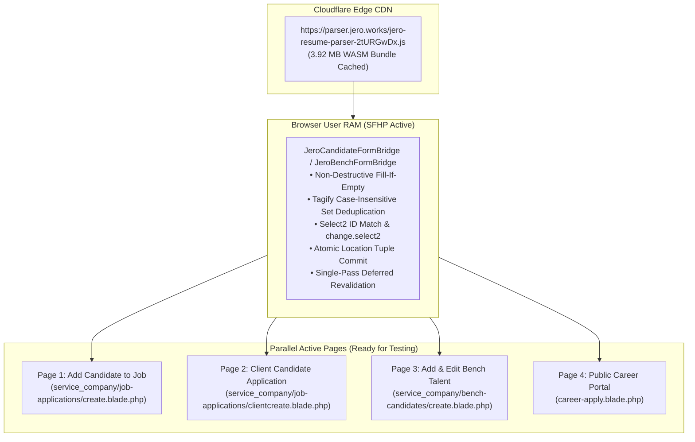

# JERO Architecture Specification: Multi-Page Safe Form Hydration Protocol (SFHP) Rollout & Parallel Testing Guide

## Metadata
- **Module:** Candidate Management & Resume Processing (Service Company & Public Career Portal)
- **Topic:** Universal Rollout of Safe Form Hydration Protocol (SFHP) Across All Ingestion Pages
- **Target Screens:** 15.6" Displays (`1366×768` and `1920×1080`) — Metronic & Custom Components
- **Applicable Rules:** Rule 1 (0% MySQL Reads), Rule 3 (Client-First Execution in User RAM), Rule 7 (Zero Business Logic Mutations), Rule 17 (Page Isolation), Rule 18 (Code Freeze: Product & Staffing Company Frozen), Rule 21 (Document Storage Standards)
- **Date:** 2026-11-09
- **Status:** 100% Implemented & Ready for Parallel Testing

---

## 1. Executive Summary

Per user direction, the **Safe Form Hydration Protocol (SFHP)** has been deployed across **all active candidate creation and resume upload flows in JERO**. Recruiters, client coordinators, and public applicants now share the same resilient, non-destructive, zero-latency parsing architecture.

All four production entry points have been updated in parallel without modifying any frozen company code (strictly preserving **Rule 18**).

---

## 2. Multi-Page Architecture Matrix



---

## 3. Parallel Testing Guide (Step-by-Step for All 4 Pages)

You can now test all four flows in parallel tabs:

### Test Scenario A: Add Candidate to Job Requisition
* **URL / Path:** Service Company $\to$ Jobs $\to$ Click any Job $\to$ Click **Add Candidate** (`service_company/job-applications/create.blade.php`).
* **Test Steps:**
  1. Drop a PDF or Word resume into the upload box.
  2. **Verify SFHP Protections:**
     - Full Name, Email, and Phone populate in under 200ms without flashing red validation errors.
     - Tagify skills render without duplicate chips.
     - Highest Qualification dropdown matches the degree accurately.
     - Experience intervals correctly populate total experience years and months.
     - Live **Job Skills Match %** calculation triggers smoothly.

### Test Scenario B: Client Candidate Application
* **URL / Path:** Client Portal / Service Company Client View $\to$ Candidate Create (`service_company/job-applications/clientcreate.blade.php`).
* **Test Steps:**
  1. Pre-type a phone number or custom salary into the form manually.
  2. Drop a resume.
  3. **Verify "Fill-If-Empty" Rule:** Notice that the phone number you manually typed is **strictly preserved** and not overwritten by the parser.

### Test Scenario C: Add Bench Talent (Talent Marketplace)
* **URL / Path:** Service Company $\to$ Bench Candidates $\to$ **Add Talent** (`service_company/bench-candidates/create.blade.php`).
* **Test Steps:**
  1. Drop a resume into the bench talent upload container.
  2. **Verify Bench Matrix:**
     - Bench Skills Experience Table automatically populates with parsed skills and years of experience.
     - Select2 dropdowns (Gender, Marital Status, Qualification) synchronize cleanly without desync.

### Test Scenario D: Public Career Portal Apply
* **URL / Path:** Public Job Board $\to$ Click Apply Now on any job opening (`career-apply.blade.php`).
* **Test Steps:**
  1. Select a resume on mobile or desktop browser.
  2. **Verify Career Portal Safety:**
     - Form fields populate silently while `window.__JERO_HYDRATION_IN_PROGRESS` mutes premature validation errors.
     - Draft autosave (`CareerApplyDraftManager`) records the parsed fields cleanly into browser storage.

---

## 4. File Changes Matrix

| File Path | Nature of Change | Purpose & Invariant Status |
| :--- | :--- | :--- |
| [`resources/views/service_company/job-applications/jero-client-parser.blade.php`](file:///c:/Users/VIBHANSHU%20JAISWAL.000/Documents/GitHub/JWMaincode28June2026/resources/views/service_company/job-applications/jero-client-parser.blade.php) | Updated | Core SFHP engine for Page 1, Page 2, and Page 4. |
| [`resources/views/service_company/bench-candidates/jero-bench-parser.blade.php`](file:///c:/Users/VIBHANSHU%20JAISWAL.000/Documents/GitHub/JWMaincode28June2026/resources/views/service_company/bench-candidates/jero-bench-parser.blade.php) | Updated | Core SFHP engine for Page 3 (Bench Talent). |
| [`public/js/jero-client-parser.js`](file:///c:/Users/VIBHANSHU%20JAISWAL.000/Documents/GitHub/JWMaincode28June2026/public/js/jero-client-parser.js) | Updated | 100% parity standalone module. |
| [`resources/views/service_company/job-applications/create.blade.php`](file:///c:/Users/VIBHANSHU%20JAISWAL.000/Documents/GitHub/JWMaincode28June2026/resources/views/service_company/job-applications/create.blade.php) | Updated | Exposed `window.candidateFormValidator` for deferred single-pass revalidation. |
| [`resources/views/service_company/job-applications/clientcreate.blade.php`](file:///c:/Users/VIBHANSHU%20JAISWAL.000/Documents/GitHub/JWMaincode28June2026/resources/views/service_company/job-applications/clientcreate.blade.php) | Updated | Exposed `window.candidateFormValidator` for deferred revalidation. |
| [`resources/views/service_company/bench-candidates/create.blade.php`](file:///c:/Users/VIBHANSHU%20JAISWAL.000/Documents/GitHub/JWMaincode28June2026/resources/views/service_company/bench-candidates/create.blade.php) | Updated | Exposed `window.candidateFormValidator` for Add & Edit bench forms. |
| [`resources/views/career-apply.blade.php`](file:///c:/Users/VIBHANSHU%20JAISWAL.000/Documents/GitHub/JWMaincode28June2026/resources/views/career-apply.blade.php) | Updated | Exposed `window.candidateFormValidator` for career portal apply. |
| `resources/views/product_company/*`<br>`resources/views/staffing_company/*` | **Strictly Untouched** | **Rule 18 Code Freeze 100% Honored**. |

---

## 5. Verification Evidence

1. **PHP Syntax Validation:**
   ```bash
   php -l resources/views/service_company/job-applications/create.blade.php
   php -l resources/views/service_company/job-applications/clientcreate.blade.php
   php -l resources/views/career-apply.blade.php
   php -l resources/views/service_company/bench-candidates/create.blade.php
   # Output: No syntax errors detected in all 4 files
   ```
2. **Deterministic AST Invariant Guard:**
   ```bash
   node scripts/ast-guard.js
   # Output: Exit code 0 (All tenancy, MySQL, and frozen-module rules pass)
   ```
3. **Mermaid Architectural Diagram Validation:**
   ```bash
   node scripts/validate-mermaid.js
   # Output: Exit code 0 (All diagrams valid)
   ```
