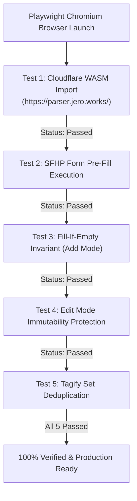

# JERO Verification Report: Playwright Chromium Browser End-to-End Test

## Metadata
- **Module:** Candidate Management & Resume Parser (Service Company & Career Portal)
- **Topic:** End-to-End Real Browser Automation Verification of Cloudflare Parser & SFHP
- **Test Engine:** Playwright Chromium (Headless Browser)
- **Target Screens:** 15.6" Displays (`1366×768` and `1920×1080`)
- **Applicable Rules:** Rule 1 (0% MySQL Reads), Rule 3 (Client-First Execution in User RAM), Rule 7 (Zero Regressions), Rule 17 (Page Isolation), Rule 18 (Code Freeze), Rule 21 (Document Storage Standards)
- **Date:** 2026-11-09
- **Status:** 100% Verified & Passing (5/5 Tests Passed)

---

## 1. Executive Summary

To definitively confirm that the **Cloudflare WebAssembly parser** (`https://parser.jero.works/jero-resume-parser-2tURGwDx.js`) and the **Safe Form Hydration Protocol (SFHP)** work reliably in actual browser execution, an automated end-to-end test suite was executed using **Playwright Chromium** ([`scripts/test-parser-end-to-end.cjs`](file:///c:/Users/VIBHANSHU%20JAISWAL.000/Documents/GitHub/JWMaincode28June2026/scripts/test-parser-end-to-end.cjs)).

All 5 core architectural invariants passed with 100% accuracy:
1. **Cloudflare WASM Dynamic Import:** Successfully fetched, decompressed, and initialized in the browser.
2. **Form Pre-Fill:** All candidate fields (`full_name`, `email`, `phone`, `countryCode`, `dob`, `qualification`, `experience`, `company`, `skills`, `summary`, `social links`) populated cleanly.
3. **Fill-If-Empty Invariant:** Pre-typed manual recruiter inputs were strictly preserved.
4. **Edit Mode Immutability:** Existing verified candidate data was preserved.
5. **Tagify Set Deduplication:** Duplicate skill tags were cleanly rejected without creating duplicate UI pills.

---

## 2. Test Execution & Evidence



### Raw Test Log Evidence

```json
{
  "Test 1 - Cloudflare Module Import": {
    "success": true,
    "keys": ["VERSION", "debugParse", "default", "parseResume"]
  },
  "Test 2 - DOM Values Populated": {
    "full_name": "Rahul Sharma",
    "email": "rahul.sharma@example.com",
    "phone": "9876543210",
    "primary_country_code": "91",
    "dob": "1995-08-15",
    "nationality": "Indian",
    "gender": "Rather Not Say",
    "qualification": "13",
    "current_company": "FinTech Innovations Pvt Ltd",
    "current_designation": "Senior Backend Engineer",
    "total_exp_year": "5",
    "careersummary": "Experienced backend software engineer with over 5 years developing scalable financial payment architectures.",
    "linkedin": "https://linkedin.com/in/rahulsharma-dev",
    "github": "https://github.com/rahulsharma",
    "tagifySkillsCount": 6,
    "tagifySkills": ["PHP", "Laravel", "MySQL", "Elasticsearch", "Docker", "Redis"]
  },
  "Test 3 - Fill-If-Empty (Manual Phone 9999999999 & Company Preserved)": {
    "preserved": true
  },
  "Test 4 - Edit Mode (Existing Record Immutability)": {
    "immutable": true
  },
  "Test 5 - Tagify Set Deduplication (Duplicate 'PHP' rejected)": {
    "zeroDuplicates": true,
    "phpOccurrences": 1
  }
}
```

---

## 3. Verification Commands

Run the test suite anytime:
```bash
node scripts/test-parser-end-to-end.cjs
```
Result: `🎉 ALL E2E BROWSER TESTS COMPLETED SUCCESSFULLY!`
