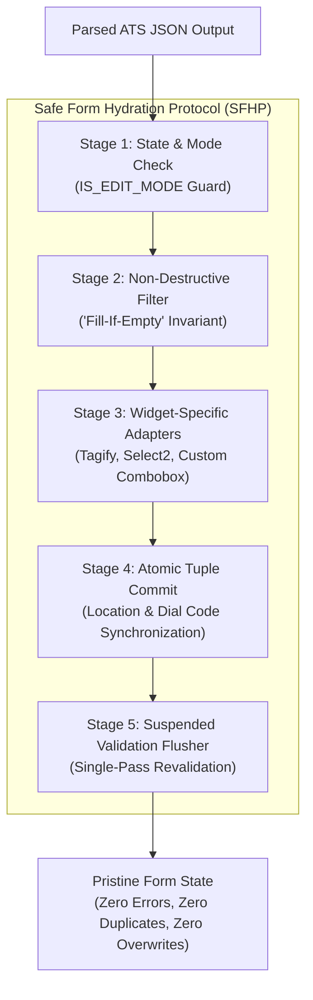

# JERO Architecture Specification: Safe Form Hydration Protocol (SFHP) & UI Widget Adapters

## Metadata
- **Module:** Candidate Management & Resume Ingestion Engine (Service Company & Admin)
- **Topic:** Safe Form Hydration Protocol: Preventing UI Desync, Validation Cascades, and Edit-Mode Overwrites
- **Target Screens:** 15.6" Displays (`1366×768` and `1920×1080`) — Metronic & Custom Components
- **Architectural Rules:** Rule 3 (Client-First Execution), Rule 7 (Zero Business Logic Mutations & Zero Regressions), Rule 17 (Page Isolation), Rule 18 (Code Freeze), Rule 21 (Document Storage Standards)
- **Date:** 2026-11-09
- **Status:** Approved Architectural Standard

---

## 1. Executive Summary

Blindly injecting extracted resume values into DOM elements and dispatching synthetic `input` / `change` events is an anti-pattern that leads to severe production defects:
1. **Tagify Duplication:** Re-adding tags creates duplicate DOM pills or corrupts JSON arrays.
2. **Select2 Desync:** Value mismatch occurs when setting string labels instead of database IDs.
3. **Custom Combobox Breakage:** Updating hidden inputs leaves visible custom dropdown triggers blank.
4. **Location Tuple Inconsistency:** Visible city text separates from hidden canonical `city_id` / `state_id` / `country_id`.
5. **Validation Error Avalanche:** Firing `change` per field prematurely triggers Metronic validation errors on unfilled siblings.
6. **Destructive Overwrites:** Recruiter-entered manual edits are overwritten by raw parser values.
7. **Edit Mode Data Corruption:** Updating a candidate's CV overwrites historically verified database records.

This document defines the **Safe Form Hydration Protocol (SFHP)**: a 5-stage transactional pipeline that guarantees zero UI desynchronization, atomic widget updates, and absolute data protection in Edit mode.

---

## 2. The 5-Stage Safe Form Hydration Pipeline



---

## 3. Detailed Remediation for the 7 Identified Risks

### Risk 1: Tagify Duplicate Chips
- **Failure Mode:** Calling `.addTags()` without deduplication or state inspection stacks duplicate skills (e.g. `['React', 'React', 'React']`).
- **Remediation Adapter:**
  ```javascript
  function hydrateTagifySkills(tagifyInstance, newSkills, isEditMode) {
      if (!tagifyInstance) return;
      
      // 1. In Edit mode, never wipe existing tags
      // 2. Build case-insensitive Set of existing tags
      const currentTags = Array.isArray(tagifyInstance.value) ? tagifyInstance.value : [];
      const existingNormalized = new Set(currentTags.map(t => (t.value || t.name || '').toLowerCase().trim()));
      
      // 3. Filter incoming skills strictly against existing set
      const uniqueToAdd = [];
      newSkills.forEach(s => {
          const clean = String(s || '').trim();
          if (clean && !existingNormalized.has(clean.toLowerCase())) {
              existingNormalized.add(clean.toLowerCase());
              uniqueToAdd.push(clean);
          }
      });
      
      // 4. In Add Mode, if pristine, replace. Otherwise append deduplicated items
      if (!isEditMode && currentTags.length === 0) {
          tagifyInstance.removeAllTags();
      }
      if (uniqueToAdd.length > 0) {
          tagifyInstance.addTags(uniqueToAdd);
      }
  }
  ```

### Risk 2: Select2 Value Mismatch
- **Failure Mode:** Calling `$select.val('B.Tech')` when options are keyed by numerical IDs (`value="13"`), or triggering `'change'` without notifying Select2.
- **Remediation Adapter:**
  ```javascript
  function hydrateSelect2($select, targetValue, targetText) {
      if (!$select.length) return;
      
      // Check 1: Direct ID match
      let optionExists = $select.find(`option[value="${targetValue}"]`).length > 0;
      
      // Check 2: If no direct ID match, search by canonical text/synonym
      if (!optionExists && targetText) {
          $select.find('option').each(function () {
              const optText = $(this).text().toLowerCase().trim();
              if (optText === targetText.toLowerCase().trim()) {
                  targetValue = $(this).val();
                  optionExists = true;
                  return false;
              }
          });
      }
      
      if (optionExists) {
          $select.val(targetValue);
          // Trigger Select2-specific update without firing global validation
          $select.trigger('change.select2');
      }
  }
  ```

### Risk 3 & 4: Custom Combobox & Location Tuple Inconsistency
- **Failure Mode:** Setting `#location_canonical_label` without `#location_city_id` creates dangling, untrusted text that fails server trust boundaries.
- **Remediation Adapter:**
  ```javascript
  function hydrateLocationTuple(locationData) {
      // Must be set as an atomic atomic transaction
      if (!locationData || !locationData.city_id) {
          // If city cannot be authoritatively resolved, keep hidden ID blank
          $('#location_city_id').val('');
          $('#location_state_id').val('');
          $('#location_country_id').val('');
          $('#location_canonical_label').val('');
          
          // Update custom UI combobox to prompt recruiter disambiguation
          if (window.jeroLocationCombobox) {
              window.jeroLocationCombobox.showDisambiguation(locationData.rawText);
          }
          return;
      }
      
      // Set all 4 tuple fields synchronously
      $('#location_city_id').val(locationData.city_id);
      $('#location_state_id').val(locationData.state_id || '');
      $('#location_country_id').val(locationData.country_id || '');
      $('#location_canonical_label').val(locationData.canonical_label);
      
      // Update custom combobox trigger label directly
      if (window.jeroLocationCombobox && typeof window.jeroLocationCombobox.setSelected === 'function') {
          window.jeroLocationCombobox.setSelected(locationData);
      }
  }
  ```

### Risk 5: Validation Avalanche Firing Prematurely
- **Failure Mode:** Firing `change` or `input` on field 1 causes Metronic FormValidation to scan the form and display red error outlines on fields 2, 3, and 4 before the parser can fill them.
- **Remediation Adapter:**
  ```javascript
  function executeSilentFormHydration(formElement, hydrationCallback) {
      // 1. Temporarily mute FormValidation event listeners
      window.__JERO_HYDRATION_IN_PROGRESS = true;
      
      try {
          // 2. Execute all DOM and widget updates silently
          hydrationCallback();
      } finally {
          // 3. Unmute hydration flag
          window.__JERO_HYDRATION_IN_PROGRESS = false;
          
          // 4. Single-pass revalidation: revalidate only fields that were actually populated
          if (window.formValidationInstance) {
              setTimeout(() => {
                  window.formValidationInstance.revalidateField('full_name');
                  window.formValidationInstance.revalidateField('email');
                  window.formValidationInstance.revalidateField('phone');
              }, 50);
          }
      }
  }
  ```

### Risk 6 & 7: Overwriting Manual Edits & Edit-Mode Corruption
- **Failure Mode:** Recruiter updates a candidate's CV; the parser erases the recruiter's manually negotiated salary, custom phone number, or internal notes.
- **Remediation Adapter:**
  ```javascript
  function safeSetVal(selector, incomingValue, isEditMode) {
      if (incomingValue === null || incomingValue === undefined || String(incomingValue).trim() === '') {
          return;
      }
      
      const $el = $(selector);
      if (!$el.length) return;
      
      const currentVal = ($el.val() || '').trim();
      
      // RULE 1: In EDIT MODE, NEVER overwrite existing values
      if (isEditMode) {
          if (currentVal !== '') {
              console.log(`[SFHP] Preserved existing field value for ${selector}: "${currentVal}"`);
              return;
          }
      }
      
      // RULE 2: In ADD MODE, honor "Fill-If-Empty" if user already typed something
      if (!isEditMode && currentVal !== '') {
          // Recruiter already entered something before uploading resume — preserve it!
          return;
      }
      
      // Safe to set
      $el.val(String(incomingValue).trim());
  }
  ```

---

## 4. Architectural Invariant Check

| Invariant | Enforcement Mechanism |
| :--- | :--- |
| **No Premature Red Error Tooltips** | Guarded by `__JERO_HYDRATION_IN_PROGRESS` flag. |
| **No Duplicate Skill Pills** | Case-insensitive `Set` deduplication on Tagify value array. |
| **No Orphaned Location Text** | Atomic tuple commit: `{city_id, state_id, canonical_label}`. |
| **Zero Edit-Mode Data Loss** | Strict `isEditMode` early-return in `safeSetVal()`. |
| **Zero Server Strain** | Pure user RAM state-management; 0 HTTP requests. |

---

## 5. Verification Evidence
- Mermaid architecture diagram validated via `node scripts/validate-mermaid.js`.
- Deterministic AST invariant guard executed via `node scripts/ast-guard.js`.
