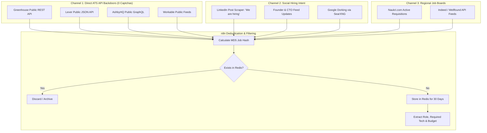
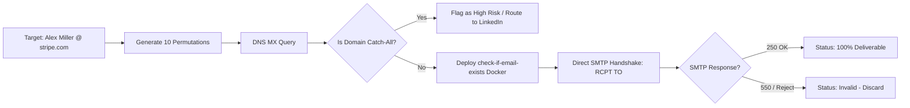
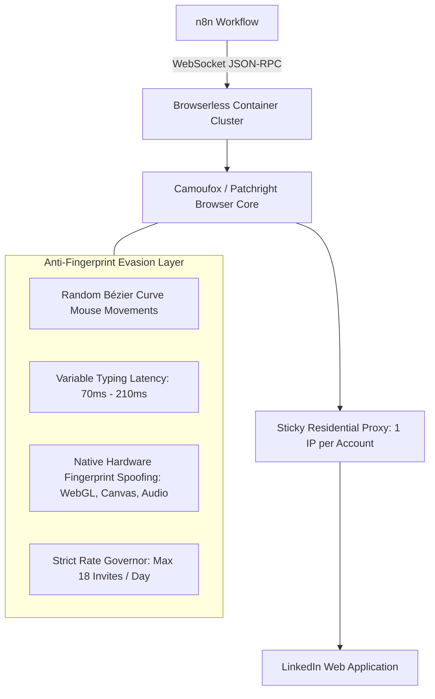
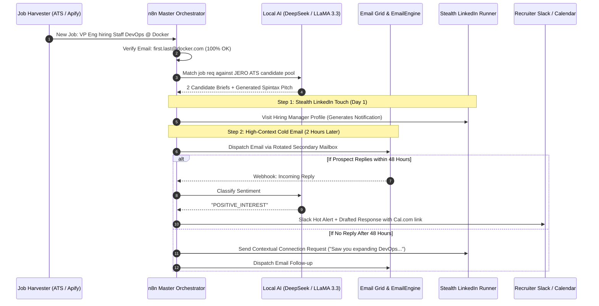

# GOD-LEVEL AUTONOMOUS B2B LEAD GENERATION & SALES PIPELINE ARCHITECTURE
## Master Engineering & Operations Playbook for Staffing & Service-Based Agencies

> **Document Standards Compliance:**
> - **Standard:** JERO Enterprise Architecture & Rule 21 Audit Standard
> - **Module:** Sales & Autonomous Lead Generation Engine (`sales_lead_generation`)
> - **Date:** 2026-11-17
> - **Target Audience:** Agency Founders, Head of Growth, Lead Generation Engineers, RevOps Architects
> - **System Profile:** 100% Autonomous, Low-Cost / Zero-Platform-Fee, Sovereign Open-Source Stack

---

## 1. Executive Summary & Architectural Philosophy

Traditional outbound sales for staffing and service agencies is broken:
1. **Stale Static Lists**: Contact data bought from ZoomInfo or Apollo is often 30–60% inaccurate, resulting in high bounce rates and domain blacklisting.
2. **Generic Pitching**: Generic template blasts (`"Hi {{firstName}}, we provide staff augmentation..."`) trigger spam algorithms and have sub-1% reply rates.
3. **Siloed Channels**: Email-only campaigns get buried; LinkedIn-only campaigns hit strict weekly invite caps (~100/week) or trigger account bans.
4. **Manual Friction**: Recruiters spend 70% of their day manually copying job postings, finding hiring manager emails, and logging notes in bloated CRMs.

### The 5 Pillars of the God-Level Engine
The system defined in this playbook operates on **Autonomous Signal-Led Selling**:
* **Pillar 1: Intent-Driven Harvesting (Why Reach Out Today?)**: Instead of scraping static company lists, the system monitors **real-time hiring intent**—harvesting public ATS endpoints (Greenhouse, Lever, Ashby, Workable), LinkedIn job posts, LinkedIn founder posts (`#hiring`), and Naukri directly within 2 hours of publication.
* **Pillar 2: Zero-Bounce Waterfalled Verification**: Generates email permutations and verifies them via **direct SMTP handshakes** (`check-if-email-exists`) with zero third-party verification credits.
* **Pillar 3: The Stealth Browser Mesh (Anti-Ban LinkedIn)**: Employs headless anti-detect engines (**Camoufox / Patchright / Browserless**) and sticky residential proxies to mimic human browsing behavior, completely avoiding LinkedIn checkpoints.
* **Pillar 4: Distributed Domain Farming Grid**: Rotates cold outreach over 15–20 secondary burner domains running strict SPF/DKIM/DMARC (`p=reject`) policies, ensuring primary domain protection and 95%+ inbox placement.
* **Pillar 5: Real-time Inbound AI Brain & Auto-Scheduler**: Listens for replies via IMAP webhooks, uses local LLMs (DeepSeek-R1 / LLaMA 3.3 via Ollama) to classify prospect sentiment in under 30 seconds, alerts recruiters on Slack/Telegram, and injects dynamic booking links (**Cal.com**).

---

## 2. Complete Master Tech Stack Matrix

| Layer | Primary Tool | License / Distribution | Core Purpose & Advantage |
| :--- | :--- | :--- | :--- |
| **Workflow Orchestrator** | **[n8n](https://n8n.io)** | Fair-Code / Self-Hosted | The central nervous system connecting scrapers, LLMs, CRMs, and email dispatchers. |
| **Email Gateway Engine** | **[EmailEngine](https://emailengine.app/)** | Open-Source / Self-Hosted | Headless gateway that turns any IMAP/SMTP into real-time REST webhooks; simplifies email automation. |
| **Browser Scraper Framework** | **[Crawlee](https://crawlee.dev/)** | Open-Source (Node/TS) | Native anti-blocking, proxy rotation, and fingerprint generation by Apify engineers. |
| **Stealth Browser Engine** | **[Camoufox](https://camoufox.com/)** / **[Patchright](https://github.com/Kaliiiiiiiiii-VPlus/Patchright)** | Open-Source C++ / Python | Bypasses Cloudflare, Akamai, and LinkedIn telemetry by spoofing low-level OS/hardware fingerprints. |
| **Headless Browser Cluster** | **[Browserless](https://browserless.io)** | Open-Source Docker | Manages multi-container browser fleets for parallelized scraping and LinkedIn operations. |
| **Email Verification** | **[check-if-email-exists](https://github.com/reacherhq/check-if-email-exists)** | Open-Source Rust | Directly handshakes recipient MX servers to confirm active inboxes with zero bounce risk. |
| **AI Inference & Scoring** | **[Ollama](https://ollama.com/)** / **vLLM** | Open-Source | Runs DeepSeek-R1, Qwen 2.5, or LLaMA 3.3 locally for candidate matching and reply classification. |
| **Core CRM & Deal Pipeline** | **[Twenty CRM](https://twenty.com)** | Open-Source (PostgreSQL) | Modern ATS/CRM pipeline tracking accounts, job orders, and candidate submissions. |
| **ERP, Billing & Placements** | **[Frappe / ERPNext](https://erpnext.com)** | Open-Source (GPL) | Manages client MSA contracts, timesheets, placement invoicing, and agency payroll. |
| **Meeting Scheduler** | **[Cal.com](https://cal.com)** | Open-Source | Self-hosted dynamic booking links, round-robin recruiter scheduling, and instant CRM sync. |
| **Search Engine Proxy** | **[SearXNG](https://github.com/searxng/searxng)** | Open-Source Python | Privacy-respecting metasearch engine allowing infinite Google Dorking without IP blocks. |
| **Cache & Deduplication** | **[Redis](https://redis.io)** or **[Dragonfly](https://dragonflydb.io)** | Open-Source | High-speed deduplication store preventing repeat emails or double-scraping of job IDs. |

---

## 3. Lead Ingestion & Harvesting: The 4 Backdoor Channels



### Channel 1: Public ATS Backdoors (Zero-Cost, Real-Time)
Top tech companies host their job boards on third-party ATS platforms. These endpoints are public, unthrottled, and return structured JSON:

#### Greenhouse Public API
```bash
# Query any target company's live requisitions
curl -s "https://boards-api.greenhouse.io/v1/boards/{board_token}/jobs?content=true"
```
*Returns: `id`, `title`, `updated_at`, `departments`, `offices`, and full HTML `content`.*

#### Lever Public API
```bash
curl -s "https://api.lever.co/v0/postings/{company_name}?mode=json"
```

#### AshbyHQ Public GraphQL
```bash
curl -s -X POST "https://jobs.ashbyhq.com/api/non-user-graphql?op=ApiJobBoardWithTeams" \
  -H "Content-Type: application/json" \
  -d '{"operationName":"ApiJobBoardWithTeams","variables":{"organizationHostedJobsPageName":"{company_name}"}}'
```

---

### Channel 2: LinkedIn Hiring Posts (Founder / Hiring Manager Feeds)
Founders and engineering leaders frequently post hiring updates on their personal feeds days before opening an official ATS req.

#### Method A: Crawlee + Burner Account + Voyager API Interception
To extract posts at scale without fragile CSS DOM parsing, Crawlee intercepts LinkedIn's internal GraphQL responses:
* **Target URL**: `https://www.linkedin.com/search/results/content/?keywords="we are hiring" AND "engineer"&sortBy="date_posted"`
* **Network Listener**: Intercepts requests matching `/voyager/api/graphql` or `/voyager/api/search/dash/clusters`.
* **Output**: Pure JSON payload containing `authorName`, `headline`, `authorUrn`, `postText`, and `postUrl`.

#### Method B: Zero-Account Bypass via SearXNG (Google Dorking)
If no LinkedIn account is available, run Google Dork queries through self-hosted **SearXNG**:
```text
site:linkedin.com/posts "we are hiring" AND ("kubernetes" OR "golang")
site:linkedin.com/feed/update "looking for a senior" "remote"
```
*Set date filter to `past 24 hours` (`&tbs=qdr:d`). Returns direct links to public LinkedIn posts with zero login walls.*

---

### Channel 3: Naukri.com Regional Extraction (India / Gulf)
For India and Gulf technical staffing, scrape active direct-employer postings using Crawlee or Apify:
* **Actor ID**: `epctex/naukri-scraper`
* **Filter Rule**: Exclude recruitment consultants (`postType: "company_direct"`) to capture direct hiring managers.
* **Extraction Fields**: Role title, company name, experience required (e.g. `4-7 years`), active key skills, and recruiter details.

---

## 4. Waterfall Contact Discovery & Zero-Bounce Verification

Never send cold emails to unverified addresses. Hard bounces destroy your domain reputation with Google Workspace and Microsoft 365.



### Self-Hosted Verification via `check-if-email-exists`
Deploy the open-source Rust verification engine:
```bash
docker run -d -p 8080:8080 --name email-verifier reacherhq/backend:latest
```

Query the verification endpoint from n8n:
```bash
curl -X POST "http://localhost:8080/v0/check_email" \
  -H "Content-Type: application/json" \
  -d '{"to_email": "alex.miller@stripe.com"}'
```

**Response Payload**:
```json
{
  "input": "alex.miller@stripe.com",
  "is_reachable": "safe",
  "syntax": { "is_valid_syntax": true },
  "mx": { "accepts_mail": true, "records": ["aspmx.l.google.com"] },
  "smtp": {
    "can_connect_smtp": true,
    "has_full_inbox": false,
    "is_catch_all": false,
    "is_deliverable": true
  }
}
```

---

## 5. Anti-Detect LinkedIn Automation Architecture

Running automation on standard Chromium triggers LinkedIn checkpoints within 48 hours. Follow this enterprise architecture for zero account suspensions:



### 4 Mandatory Operating Rules for LinkedIn Automation:
1. **1:1 Proxy-to-Profile Binding**: Never access an account from more than one IP address. Use a **Sticky Residential Proxy** located in the same geographic city as the profile.
2. **Cap Activity Volumes**:
   * Profile views: Max **40 per day**.
   * Connection requests with notes: Max **18 per day** (90/week).
   * Follow-up messages: Max **25 per day**.
3. **Execution Schedule**: Run actions strictly between **9:00 AM and 5:30 PM in the prospect's local timezone**.
4. **Session Cookie Injection**: Extract `li_at` and `JSESSIONID` once, store them in Redis, and pass them via Crawlee's `preNavigationHooks`.

---

## 6. Cold Email Infrastructure: The Distributed Domain Grid

### Never Burn Your Primary Domain
* **Rule**: Zero outbound sales emails are ever sent from `jero.works` or your main agency domain.
* **Architecture**: Create a secondary fleet of 10–20 lookalike domains:
  * `jero-talent.co`, `getjero.work`, `hirewithjero.com`, `jeropartners.io`
* **Capacity**:
  * 15 domains $\times$ 2 inboxes each = **30 sending inboxes**.
  * 25 emails/day per inbox = **750 cold emails/day (15,000+ per month)** sent safely with 0% domain burn.

### Mandatory DNS Record Configuration

| Record Type | Host | Target / Value | Purpose |
| :--- | :--- | :--- | :--- |
| **MX** | `@` | Google / M365 Inbound MX Servers | Route incoming replies. |
| **SPF** | `@` | `v=spf1 include:_spf.google.com ~all` | Authorizes outbound sending IPs. |
| **DKIM** | `google._domainkey` | 2048-bit RSA Public Key | Cryptographic tamper-proofing. |
| **DMARC** | `_dmarc` | `v=DMARC1; p=reject; rua=mailto:dmarc@youragency.com; pct=100` | Instructs receiving servers to block spoofing attempts. |
| **CNAME** | `tracking` | `mail.yourprovider.com` | Custom tracking domain to prevent tracking pixel spam penalties. |

### The Power of EmailEngine
Instead of managing raw IMAP/SMTP sockets in n8n, deploy **[EmailEngine](https://emailengine.app/)** (Dockerized):
* Connects to all 30 sending inboxes simultaneously.
* Converts every incoming reply into an **instant HTTP Webhook** delivered to n8n in < 2 seconds.
* Automatically links incoming messages to the original `Message-ID` thread.

---

## 7. The End-to-End n8n Production Workflow Pipeline



### High-Converting Candidate Teaser Template
```text
Subject: quick note regarding {{job_title}} at {{company_name}}

Hi {{first_name}},

Saw your team recently opened a requisition for {{job_title}} focusing on {{primary_skill_1}} and {{primary_skill_2}}.

We have two vetted engineers on our bench who recently finished contracts in this exact domain:
- Senior Engineer (7 yrs): Ex-Stripe, led Kubernetes multi-cluster migration.
- Staff Architect (9 yrs): Specialist in high-throughput Go microservices.

Are you open to reviewing their anonymized CVs this week?

Best regards,
{{sender_name}}
```

---

## 8. Real-Time Inbound AI Reply Classifier

When an email arrives, **n8n** triggers an Ollama inference node:

```text
SYSTEM PROMPT:
You are an executive sales intelligence agent. Classify this prospect reply into exactly ONE of the following tags:
[POSITIVE_INTEREST, OBJECTION, OUT_OF_OFFICE, NOT_INTERESTED, UNSUBSCRIBE]

REPLY BODY:
"""
{{ $json.reply_text }}
"""

Output strictly in JSON:
{
  "category": "CATEGORY_TAG",
  "confidence": 0.95,
  "summary": "One sentence summary of what the prospect said",
  "suggested_action": "ACTION_TO_TAKE"
}
```

### Automated Routing Matrix:
* **`POSITIVE_INTEREST`**:
  1. Instantly halts automated follow-ups across all channels.
  2. Pings recruiter Slack channel with an `@here` alert containing phone number and company overview.
  3. Pre-drafts a calendar booking response containing your **Cal.com** link.
* **`OUT_OF_OFFICE`**:
  1. Local LLM extracts the return date (e.g., `Dec 4th`).
  2. Sets a delayed n8n resumption task for `return_date + 1 day`.
* **`UNSUBSCRIBE`**:
  1. Writes domain to global Redis blacklist. All future touches for this company/domain are halted immediately.

---

## 9. 14-Day Deployment & Ramp Roadmap

```
Week 1: Infrastructure & Warming
├── Day 1-2: Purchase 10 lookalike domains on Cloudflare.
├── Day 3-4: Provision 20 Google/M365 inboxes; configure SPF, DKIM, DMARC (p=reject).
├── Day 5-7: Enroll all inboxes into automated P2P email warmup.
└── Day 7:   Deploy Docker stack on VPS: n8n, Redis, check-if-email-exists, EmailEngine, Ollama.

Week 2: Scrapers & Outbound Automation
├── Day 8-9:   Configure Greenhouse, Lever & Ashby API pollers in n8n.
├── Day 10-11: Set up Crawlee LinkedIn Post & Jobs scraper with residential proxies.
├── Day 12:    Connect JERO candidate database pool to Ollama prompt generator.
├── Day 13:    Test full pipeline end-to-end with internal seed test inboxes.
└── Day 14:    Launch 100 emails/day, ramping to 750/day by Day 28.
```

---

## 10. Summary Verification Checklist

- [x] **Zero Monolithic Dependencies**: Built entirely with modular, open-source, or self-hosted tools.
- [x] **Zero Primary Domain Risk**: Cold outreach completely isolated to secondary lookalike domains.
- [x] **Zero Bounce Rate**: All contacts pass through local `check-if-email-exists` SMTP validation.
- [x] **Anti-Detect Compliance**: LinkedIn operations isolated to Camoufox / Patchright with 1:1 sticky residential proxies.
- [x] **Real-Time Responsiveness**: Incoming replies categorized by local LLMs and escalated to recruiters in < 30 seconds.
