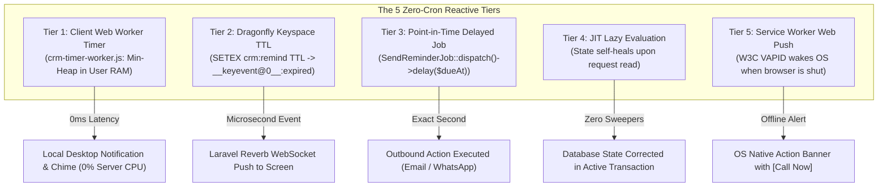
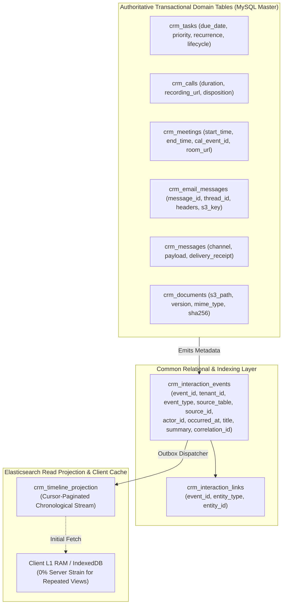
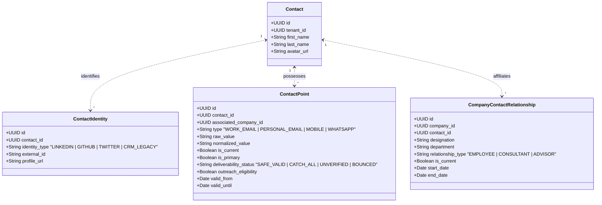
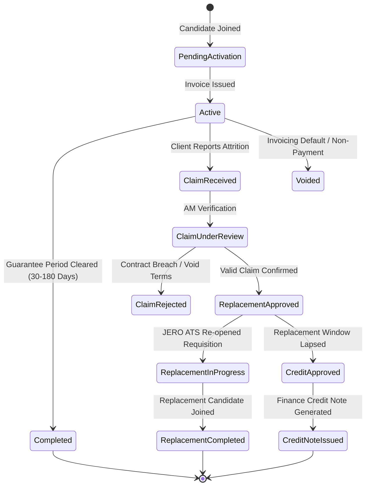
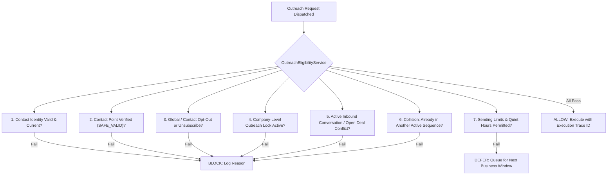
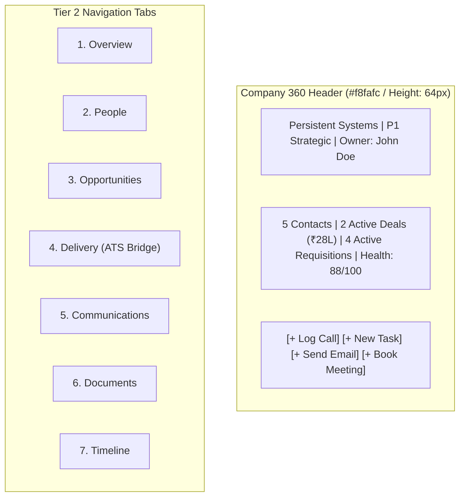
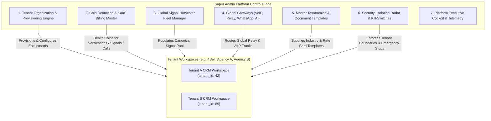
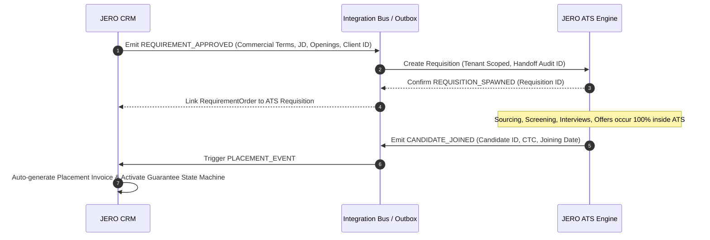
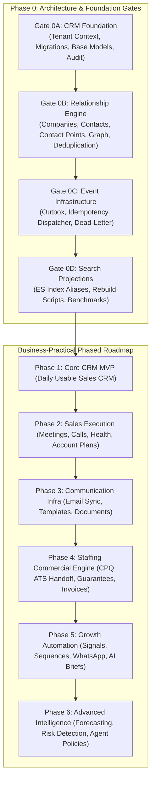

# JERO & 4Bell CRM Architecture v3.0: Unified Supergod Mode Enterprise Master Blueprint

## Metadata
- **Date:** 2026-11-23
- **Version:** 3.0 (Unified Master Blueprint: Client-First JDCR, Zero-Server-Strain, Zero-Cron Event Engine, Super Admin Control Plane & Next-Gen Systems Stack)
- **Author:** Antigravity Architecture & Core Systems Engineering Team
- **Peer Review:** Multi-Disciplinary Systems, Database, Security, Operations & UI/UX Review
- **Module:** `sales_lead_generation` / `crm` / `super-admin` / `infrastructure`
- **Document Type:** Master Enterprise Architecture & Implementation Standard (Rule 21)
- **Target Platform:** 4Bell Technology / JERO Enterprise B2B Staffing & Service CRM
- **Benchmark Standards:** Google Workspace, Figma, Linear, Microsoft Teams 2.0, Salesforce Hyperforce
- **Scale Target:** 10,000 Concurrent Users per page with **0% Avoidable Server & Database Read Strain**
- **Core Axiom:** $\mathbf{Correctness} \succ \mathbf{Consistency} \succ \mathbf{Freshness} \succ \mathbf{Latency}$ *(Authoritative correctness over local cache freshness)*
- **Governing Directives:** Rule 1 (MySQL Writes ONLY), Rule 2 (Elasticsearch Universal Reads), Rule 6 (100% Client-First Compute), Rule 10 (Zero ATS Regression), Rule 20 (Card + Sub-Card System), Rule 22 (Zero-Cron & JIT Standard)
- **Status:** **FROZEN, AUTHORITATIVE & IMPLEMENTATION-READY (VERSION 3.0)**

---

## 🏛️ SECTION 0: THE NON-NEGOTIABLE ARCHITECTURAL DIRECTIVES

### 1. 100% Client-First / Browser Execution Mandate (User RAM & Browser CPU First)
- **The Browser is an Autonomous Distributed Computing Node:** The CRM UI is **not a traditional dumb web client** that polls or makes server roundtrips on every tab switch, drawer open, search keystroke, or filter change.
- **Client Compute Execution:** 100% of UI assembly, dynamic Metronic Card + Sub-Card rendering, multi-column search, multi-faceted filtering, sorting, staffing margin calculations, CPQ proposal generation, pipeline weighting, and timeline projections execute **directly in User Browser RAM + Web Workers (`crm-data-worker.js`) + WebAssembly (WASM)**.
- **Zero Server CPU Wasted on Documents:** Commercial proposals, rate cards, candidate dossiers, and contract PDFs compile 100% client-side via **WASM and `pdf-lib`**. Document assets upload **directly to Cloudflare R2 / S3 via presigned PUT URLs**, completely bypassing Laravel server RAM and CPU.

### 2. 0% Server Strain on MySQL, Application Server, and Elasticsearch
- **0% MySQL Reads on Request Paths:** MySQL (`dbmaster`) is the **Strict Command Store for Writes ONLY** (`INSERT`, `UPDATE`, `DELETE`). Zero `SELECT` queries, zero multi-table joins, and zero table scans on user page visits, drawer activations, or search queries.
- **0% Server CPU Spent Rendering Blade HTML:** The web server (Laravel Octane + FrankenPHP) never generates dynamic Blade HTML tables or drawer contents. It streams **micro-JSON delta payloads (< 5 KB)**.
- **0% Elasticsearch Load on Repeated User Actions:** Elasticsearch is the canonical query projection for initial cold fetches and deep fallback searches. Once data is fetched into the client's working memory, subsequent filtering, sorting, tab switching, and keyword filtering execute **100% in User RAM (DuckDB-WASM)**, putting zero load on the Elasticsearch cluster.

### 3. Zero Stale Data Invariant (100% Authoritative Freshness)
- **Zero Stale Data Tolerance:** Sales and recruitment teams cannot make commercial decisions on stale pipeline data, outdated contact points, expired guarantees, or stalled candidate stages.
- **Real-Time Atomic Invalidation:** When a mutation occurs, tenant cache keys in Redis/Dragonfly are instantly destroyed, an invalidation hint is broadcast via **Laravel Reverb WebSockets**, and connected clients synchronize the latest delta via monotonic cursors.
- **Authoritative Server Reconciliation:** Optimistic client mutations are immediately reconciled against the server-confirmed response, guaranteeing 100% freshness across all organization users without ghost reads or stale views.

### 4. Zero-Cron & 100% Event-Driven Reminders Standard (Rule 22)
- **Absolute Cron Prohibition:** All recurring background cron jobs (`php artisan schedule:run`), periodic database sweepers, and recurring polling loops are **strictly banned**.
- **100% Reactive Architecture:** Reminders, follow-ups, and timeouts operate through a 5-tier reactive engine:
  1. *Client-Side Browser Timer Web Worker (`crm-timer-worker.js`):* Zero server CPU.
  2. *Dragonfly / Redis Keyspace TTL Expiration (`__keyevent@0__:expired`):* Zero polling queries.
  3. *Point-in-Time Delayed Queue Jobs (`->delay($dueAt)`):* Sleeps in Redis ZSET until due.
  4. *Just-In-Time (JIT) Evaluation on Access:* Overdue states self-heal during active requests.
  5. *Service Worker Web Push API:* Wakes operating system even when browser is closed.

### 5. 10,000 Concurrent Users Per Page Scalability Target
- Engineered to sustain **10,000 active concurrent users** per page simultaneously without main-thread browser freezes (tasks $> 50\text{ms}$ strictly forbidden), PHP-FPM / Octane worker starvation, MySQL connection pool exhaustion, or Elasticsearch 429 queue rejections.

---

## 🔬 SECTION 1: THE NEXT-GEN SYSTEMS TECHNOLOGY STACK

```
┌────────────────────────────────────────────────────────────────────────────────────────┐
│                      JERO CRM NEXT-GEN TECHNOLOGY STACK MATRIX                         │
├────┬─────────────────────────────┬───────────────────────────┬─────────────────────────┤
│ #  │ Technology                  │ Architectural Role        │ Core Benchmark Metric   │
├────┼─────────────────────────────┼───────────────────────────┼─────────────────────────┤
│ 01 │ DuckDB-WASM + OPFS          │ In-Browser Columnar OLAP  │ Sub-0.5ms SQL queries   │
│    │                             │ Database in User RAM      │ across 50,000 records   │
├────┼─────────────────────────────┼───────────────────────────┼─────────────────────────┤
│ 02 │ ONNX Runtime Web + WebGPU   │ In-Browser Client AI      │ Sub-3ms vector search & │
│    │                             │ (Zero-Cloud AI Costs)     │ NLP on user's laptop GPU│
├────┼─────────────────────────────┼───────────────────────────┼─────────────────────────┤
│ 03 │ Rust-Compiled WASM Engine   │ Client Document Assembly  │ < 15ms proposal & PDF   │
│    │ (`pdf-lib` + OpenDoc)       │ & Staffing CPQ Engine     │ compilation in browser  │
├────┼─────────────────────────────┼───────────────────────────┼─────────────────────────┤
│ 04 │ Off-Thread Web Workers      │ Background Compute Engine │ Locked 60 FPS / 16ms UI │
│    │ (`crm-data-worker.js`)      │ (Zero Main-Thread Janks)  │ with 0 long tasks (>50ms)│
├────┼─────────────────────────────┼───────────────────────────┼─────────────────────────┤
│ 05 │ Local-First Delta Sync      │ Monotonic Cursor Sync     │ 0ms instant UI writes;  │
│    │ (Linear / Superhuman Model) │ & Conflict-Free State     │ micro-JSON diffs < 500B │
├────┼─────────────────────────────┼───────────────────────────┼─────────────────────────┤
│ 06 │ FrankenPHP + HTTP/3 (QUIC)  │ High-Speed Application    │ 0ms cold-start; 103     │
│    │ + 103 Early Hints           │ Gateway & Protocol Engine │ Early Hints asset push  │
├────┼─────────────────────────────┼───────────────────────────┼─────────────────────────┤
│ 07 │ Dragonfly (Modern C++ Cache)│ Multi-Threaded In-Memory  │ 4,000,000+ QPS (25x     │
│    │                             │ Redis Drop-in Replacement │ faster than Redis)      │
├────┼─────────────────────────────┼───────────────────────────┼─────────────────────────┤
│ 08 │ Cloudflare R2 Direct Uploads│ Direct Presigned PUT      │ 0 MB upload bandwidth   │
│    │                             │ Object Storage Pipe       │ on web application server│
└────┴─────────────────────────────┴───────────────────────────┴─────────────────────────┘
```

---

## ⚡ SECTION 2: JERO DISTRIBUTED CLIENT RUNTIME (JDCR) ARCHITECTURE

```
══════════════════════════════════════════════════════════════════════════════════════════════════════════════════
                                    JERO DISTRIBUTED CLIENT RUNTIME (JDCR) — CRM
══════════════════════════════════════════════════════════════════════════════════════════════════════════════════

                                ┌──────────────────────────────────────────────────┐
                                │                    UI RUNTIME                    │
                                │   • Incremental Template Renderer                │
                                │   • Modern Card + Sub-Card Enterprise Layout     │
                                │   • Zero Inline Handlers (Event Delegation)      │
                                │   • Multi-Tab BroadcastChannel Coordination      │
                                │   • Calibrated for 15.6" Screens (1366 & 1920)   │
                                └────────────────────────┬─────────────────────────┘
                                                         │
                       ┌─────────────────────────────────┼─────────────────────────────────┐
                       ▼                                 ▼                                 ▼
          ┌─────────────────────────┐       ┌─────────────────────────┐       ┌─────────────────────────┐
          │     L1 WORKING RAM      │       │     L2 PERSISTENCE      │       │   CLIENT QUERY COMPUTE  │
          │     (ClientMemoryDB)    │       │    (ClientEntityDB)     │       │   (crm-data-worker.js)  │
          │ • Active Company Graphs │       │ • Bounded IndexedDB v2  │       │ • Stateless Web Worker  │
          │ • P95 < 5ms State Lookup│       │ • Adaptive LRU Eviction │       │ • Max 50MB Worker Heap  │
          │ • Ephemeral WASM Blobs  │       │ • Multi-Tenant Partition│       │ • Off-Thread Filtering  │
          │ • CPQ Margin Calculator │       │ • Cache Poisoning Guard │       │ • Fast Fuzzy Matching   │
          └────────────┬────────────┘       └────────────┬────────────┘       └────────────┬────────────┘
                       │                                 │                                 │
                       └─────────────────────────────────┼─────────────────────────────────┘
                                                         │
                                                         ▼
                                        ┌──────────────────────────────────┐
                                        │   SINGLE SYNCHRONIZATION AUTH    │
                                        │       (SyncSupervisor)           │
                                        │   • Sole Authority for Reconcile │
                                        │   • Monotonic Stream Cursor      │
                                        │   • Single-Flight Deduplication  │
                                        │   • Adaptive Event Coalescing    │
                                        └────────────────┬─────────────────┘
                                                         │
                                   ┌─────────────────────┴─────────────────────┐
                                   │ (Lossy Invalidation Hint)                 │ (Authoritative Reconcile)
                                   ▼                                           ▼
                    ┌──────────────────────────────┐            ┌──────────────────────────────┐
                    │   LARAVEL REVERB WEBSOCKET   │            │   DELTA-SYNC & ETAG API      │
                    │   • Notification Hint Only   │            │   • Chunked Cursors (limit)  │
                    │   • Jittered Reconnect Storm │            │   • Idempotent Micro-JSON    │
                    │   • Lossy-Tolerant Delivery  │            │   • HTTP 410 Resync Support  │
                    └──────────────┬───────────────┘            └──────────────┬───────────────┘
                                   │                                           │
                                   └─────────────────────┬─────────────────────┘
                                                         │
═════════════════════════════════════════════════════════╪═════════════════════════════════════════════════════════
                                                  NETWORK BOUNDARY (REST / WS)
═════════════════════════════════════════════════════════╪═════════════════════════════════════════════════════════
                                                         │
                                        ┌────────────────▼─────────────────┐
                                        │ JERO UNIVERSAL SECURITY PIPELINE │
                                        │   • Session & Tenant Auth Guard  │
                                        │   • RBAC & Field Masking         │
                                        │   • Correlation ID Propagation   │
                                        │   • Zero HTML Blade Rendering    │
                                        └────────────────┬─────────────────┘
                                                         │
                                 ┌───────────────────────┴───────────────────────┐
                                 │                                               │
                                 ▼                                               ▼
                  ┌─────────────────────────────┐                 ┌─────────────────────────────┐
                  │     ELASTICSEARCH CLUSTER   │                 │     MYSQL TRANSACTIONAL     │
                  │  (CANONICAL QUERY PROJECTION)│                │    (TRANSACTIONAL TRUTH)    │
                  │ • 100% Initial Query Reads  │                 │ • Strict CUD Authority ONLY │
                  │ • Atomic CAS Version Guard  │                 │ • Transactional Outbox + DLQ│
                  │ • Zero-Downtime Alias Swap  │                 │ • DB::transaction() Scope   │
                  │ • 0% Repeated User Action   │                 │ • 0% Page Load / Read Query │
                  └─────────────────────────────┘                 └─────────────────────────────┘
══════════════════════════════════════════════════════════════════════════════════════════════════════════════════
```

---

## 🔔 SECTION 3: ZERO-CRON EVENT-DRIVEN REMINDER & ACTION ENGINE



### Technical Implementation: Dragonfly Keyspace Expiration (No Cron Loop)
```php
namespace App\Services\CRM;

use Illuminate\Support\Facades\Redis;

class CrmEventDrivenReminderService
{
    /**
     * Schedule a reminder with zero cron jobs.
     * Uses native Redis/Dragonfly TTL expiration events.
     */
    public function scheduleReminder(string $tenantId, string $taskId, \DateTimeInterface $triggerAt): void
    {
        $ttlSeconds = max(1, $triggerAt->getTimestamp() - now()->getTimestamp());
        $redisKey = "crm:reminder:{$tenantId}:{$taskId}";

        // Set key with exact expiration seconds. No cron polling!
        Redis::setex($redisKey, $ttlSeconds, json_encode([
            'tenant_id' => $tenantId,
            'task_id'   => $taskId,
            'timestamp' => $triggerAt->getTimestamp(),
        ]));
    }
}
```

---

## ⚙️ SECTION 4: THE SIX CORE CRM ENGINES & DOMAIN ENTITIES

```
┌────────────────────────────────────────────────────────────────────────────────────────┐
│                                 JERO CRM CORE ENGINES                                  │
├──────────────────────────┬──────────────────────────┬──────────────────────────────────┤
│ 01. Relationship Engine  │ 02. Sales Engine         │ 03. Activity & Execution Engine  │
│ Companies, Contacts,     │ Deals, Opportunities,    │ Tasks, Meetings, Calls,          │
│ Contact Points, Graph,   │ Commercial Pipeline,     │ Interaction Registry, Reminders, │
│ Leads, Identity Matching │ Proposals, Account Plans │ Unified Timeline Projection      │
├──────────────────────────┼──────────────────────────┼──────────────────────────────────┤
│ 04. Communication Engine │ 05. Revenue & Staffing   │ 06. Intelligence & Governance    │
│ Emails, WhatsApp,        │ Staffing CPQ, Contracts, │ Sales Signals, AI Copilot,       │
│ Templates, Documents,    │ Requirements, Placements,│ Sequences, Automations, RBAC,    │
│ Threads, Calendar Sync   │ Guarantees, Invoicing    │ Audit, Integrations Center       │
└──────────────────────────┴──────────────────────────┴──────────────────────────────────┘
```

### The Canonical Interaction Registry (`crm_interaction_events`)
Dedicated transactional tables store complete business state, while `crm_interaction_events` provides a single indexing layer linking multiple entities without duplicating records:



---

## 👤 SECTION 5: CONTACT IDENTITY & CONTACT POINTS ARCHITECTURE



---

## 🏢 SECTION 6: COMPANY RELATIONSHIP GRAPH & HIERARCHICAL MATCHING

### Company Hierarchy Engine (`crm_company_relationships`)
- **Relationship Types:** `PARENT_COMPANY`, `SUBSIDIARY`, `OPERATING_DIVISION`, `BRAND`, `LEGAL_ENTITY`, `ACQUIRED_COMPANY`.
- **Entity Distinction:**
  - *Corporate Brand:* Public market brand (e.g., Tata Group).
  - *Operating Division:* Where hiring requisitions occur (e.g., Tata Digital).
  - *Legal Entity:* Registered statutory entity that signs MSAs and receives invoices (e.g., Tata Sons Pvt. Ltd.).

### Hierarchical Identity Resolution Engine
```
┌────────────────────────────────────────────────────────┐
│ Tier 1: Deterministic Match (Auto-Associate)           │
│   • Exact GST / Statutory Tax Identifier               │
│   • Exact Verified Corporate Domain                     │
├────────────────────────────────────────────────────────┤
│ Tier 2: Strong Candidate Match (Auto-Suggest in Queue) │
│   • Exact LinkedIn Company URL Match                   │
│   • Normalized Name + Matching Physical Address/City   │
│   • Domain Alias or Shared Corporate Group Mapping     │
├────────────────────────────────────────────────────────┤
│ Tier 3: Review Queue / Provisional Creation            │
│   • Unverified Domain or Name Similarity               │
│   • Creates distinct provisional entity for review     │
└────────────────────────────────────────────────────────┘
```
> [!CAUTION]
> **Zero Destructive Auto-Merges:** The CRM shall **never** execute an automated destructive merge of two company records based on AI or fuzzy matching. All account merges require human confirmation, preserve historical IDs, and log complete audit provenance.

---

## 💼 SECTION 7: COMMERCIAL PIPELINE & STAFFING FINANCIAL FORMULAS

### The 6 Gated Commercial Stages
1. **Qualification:** Verified company identity, confirmed target decision-maker contact point.
2. **Discovery:** Documented client requirements, timeline, preliminary budget.
3. **Opportunity Validated:** Verified budget authority and agreed service delivery scope recorded.
4. **Proposal / Commercials:** Active `crm_deal_line_items` attached; interactive CPQ proposal dispatched.
5. **Negotiation:** Logged commercial discussions or contract revisions in progress.
6. **Won / Contracted:** **Verified Commercial Commitment** received (Signed MSA, approved PO, client-authorized requisition, written commercial approval).
- *Closed Lost:* Structured `lost_reason` required; `competitor_id` is **strictly optional**.

### Standardized Staffing Financial Formulas
```
┌────────────────────────────────────────────────────────────────────────────────────────┐
│                              STAFFING FINANCIAL FORMULAS                               │
├────────────────────────────────────────────────────────────────────────────────────────┤
│ Billable Revenue (Gross Invoiced)   = Client Bill Rate × Hours/Months Billed           │
│ Direct Delivery Cost                = Candidate Pay Rate + Direct Payroll Burden       │
│ Gross Profit                        = Billable Revenue - Direct Delivery Cost          │
│ Gross Margin %                      = (Gross Profit / Billable Revenue) × 100          │
│ Permanent Placement Fee             = Verified Candidate Annual CTC × Fee % (8.33%-15%)│
│ Weighted Pipeline Value             = Estimated Opportunity Value × Stage Probability %│
│ Cash Collected                      = Total Cleared Payments Received in Bank          │
│ Outstanding Receivables             = Billed Invoices - Cash Collected - Credit Notes  │
│ Guarantee Liability Reserve         = Unearned Placement Fees within Active Guarantee  │
└────────────────────────────────────────────────────────────────────────────────────────┘
```

---

## 🛡️ SECTION 8: DYNAMIC PLACEMENT GUARANTEE ENGINE



---

## 🚀 SECTION 9: OUTREACH ELIGIBILITY & HARDENED OUTBOX ENGINE

### Centralized Outreach Eligibility & Suppression Engine
Every outbound touchpoint (Sequences, AI Agents, Manual Emails, Automations) must pass through a single, unified `OutreachEligibilityService`:



### Hardened Transactional Outbox Schema
```sql
CREATE TABLE crm_outbox_events (
    id UUID PRIMARY KEY,
    aggregate_type VARCHAR(64) NOT NULL,
    aggregate_id UUID NOT NULL,
    aggregate_version INT NOT NULL,
    event_type VARCHAR(128) NOT NULL,
    event_schema_version INT NOT NULL DEFAULT 1,
    payload JSON NOT NULL,
    idempotency_key VARCHAR(128) UNIQUE NOT NULL,
    execution_trace_id VARCHAR(64),
    status ENUM('PENDING', 'CLAIMED', 'PROCESSED', 'FAILED', 'DEAD_LETTER') DEFAULT 'PENDING',
    claimed_by VARCHAR(64),
    claimed_at TIMESTAMP NULL,
    attempts INT DEFAULT 0,
    max_attempts INT DEFAULT 5,
    last_error TEXT,
    created_at TIMESTAMP NOT NULL,
    processed_at TIMESTAMP NULL,
    INDEX idx_crm_outbox_dispatch (status, created_at)
);
```

---

## 📱 SECTION 10: STREAMLINED COMPANY 360 DRAWER ARCHITECTURE



### Tab Functional Scope:
1. **Overview:** Firmographics, Urgency Score, Demanded Tech Stacks, Top Notes, Account Health Model.
2. **People:** Contacts, Decision Makers, Verified Contact Points, Career History.
3. **Opportunities:** Active Leads and Deals with line-item scopes and stage progression.
4. **Delivery (ATS Bridge):** Active job requirements, candidate submittal summaries, interviews, offers, and active contract resources (direct view into ATS status without duplicating ATS pipelines).
5. **Communications:** Chronological 2-way synchronized email threads, WhatsApp chats, and LinkedIn messages.
6. **Documents:** Legal MSAs, NDAs, proposals, signed contracts, and invoices with secure PDF preview.
7. **Timeline:** Cursor-paginated chronological projection of all historical interaction events.

---

## 🏛️ SECTION 11: SUPER ADMIN CONTROL PLANE & SAAS GOVERNANCE

Super Admin (`resources/views/super-admin/`) represents the **multi-tenant operator control plane**. While tenant organizations (Service Companies & Agencies) operate within their tenant boundary, Super Admin governs platform-wide infrastructure, signal harvesters, coin billing, security policies, and cross-tenant compliance.



### The 7 Super Admin Engines:
1. **Tenant Provisioning & Entitlements Engine (`superadmin_company`):** Automated workspace provisioning, custom domain binding (`crm.agency.com`), audited 15-minute customer support impersonation, and DPDP/GDPR-compliant cryptographic data wiping.
2. **Coin Metering & SaaS Subscription Billing (`superadmin_coin_settings`, `superadmin_subscription`):** Platform-level coin pricing (2 coins/SMTP verification, 10 coins/mobile phone enrichment, 15 coins/AI brief, 5 coins/VoIP call minute) and automated Stripe/Razorpay billing.
3. **Global Signal Harvester Fleet Manager (`superadmin_signals`):** Central scraping fleet across LinkedIn Jobs, Naukri Hot Vacancies, Indeed, and public ATS endpoints (Greenhouse, Lever, Ashby, Workable) populating a shared deduplicated canonical signal pool (`global_sales_signals`).
4. **Global Gateways & Infrastructure Hub (`superadmin_smtp_settings`, `superadmin_payment_settings`):** Master SMTP relay pools (Amazon SES, Resend, Listmonk), Twilio/Exotel WebRTC VoIP trunks, Meta WhatsApp Cloud API credentials, and local ONNX vs. Cloud AI inference endpoints.
5. **Master Taxonomies & Contract Templates (`superadmin_default_terms`):** 150+ standardized industries, 50,000+ tech skills (`ats_skills`), default commercial rate cards, and automated multi-currency FX rate synchronization (`superadmin_currency_settings`).
6. **Platform Security, Isolation Radar & Kill-Switches (`superadmin_global_settings`):** Automated hourly multi-tenant boundary checks verifying zero cross-tenant leakage (`company_id` bleeding) and global emergency kill-switches (Outbound Sequences, Telephony, AI).
7. **Super Admin Platform Cockpit & Executive Telemetry (`superadmin_dashboard`):** Real-time monitoring of platform revenue, global deliverability health, and 3-tier node metrics (32 GB Web/Octane, 32 GB MySQL IOPS, 32 GB Elasticsearch JVM heap).

---

## 🤝 SECTION 12: FORMAL CRM $\leftrightarrow$ ATS INTEGRATION CONTRACT



### Non-Negotiable ATS Protection Rules:
1. CRM shall **never** recreate candidate pipelines, resumes, or interview scheduling stages.
2. CRM shall **never** write directly to existing JERO ATS database tables.
3. Handoffs occur strictly via versioned asynchronous event contracts with correlation IDs and reconciliation jobs.

---

## 📅 SECTION 13: GATED PHASED IMPLEMENTATION ROADMAP



---

## 📜 SECTION 14: THE 10 NON-NEGOTIABLE ENGINEERING LAWS FOR JERO CRM

1. **RULE 1 — Business Identity Integrity:** No duplicate Companies, Contacts, Opportunities, or Requirements without explicit business justification. Identity matching is hierarchical; destructive merges require human authorization.
2. **RULE 2 — Unified Relationship Architecture:** Every CRM entity connects through the shared relationship layer (`crm_company_contact_relationships`, `crm_contact_points`, `crm_interaction_events`). Zero isolated module silos.
3. **RULE 3 — MySQL Transactional Authority:** MySQL is the single transactional source of truth. Elasticsearch, Redis caches, and AI indexes are rebuildable read projections. 0% MySQL reads on interactive request paths.
4. **RULE 4 — Server-Confirmed State:** The UI shall never display a state-changing mutation as successful until the server authoritatively confirms the transaction.
5. **RULE 5 — Safe Automation:** Every outbound touchpoint must pass authorization, eligibility, suppression, idempotency, and rate-limit checks immediately before execution.
6. **RULE 6 — 100% Client-First Execution (JDCR):** Heavy assembly, card + sub-card rendering, multi-column search, filtering, and CPQ calculations execute in User RAM (DuckDB-WASM) + Web Workers (`crm-data-worker.js`). Zero server CPU spent rendering Blade HTML or assembling documents.
7. **RULE 7 — Zero Stale Data Invariant:** Real-time Reverb WebSocket invalidation hints paired with chunked monotonic delta sync (`SyncSupervisor`) guarantee 100% fresh ATS and sales data across all organization tabs.
8. **RULE 8 — Strict Zero-Cron Standard (Rule 22):** All background polling cron jobs and recurring database sweepers are strictly banned. Reminders and scheduled actions operate 100% event-driven via Web Worker Timers, Dragonfly Keyspace TTL Expirations, and Point-in-Time Delayed Jobs.
9. **RULE 9 — Bounded AI Authority:** AI assistants operate in read, prepare, and draft modes. Commercial term modifications, discounts, and deletions strictly require human sign-off.
10. **RULE 10 — Zero ATS Regression:** CRM integration connects exclusively through defined asynchronous contracts; existing JERO ATS recruitment pipelines, tables, and workflows remain 100% untouched.
