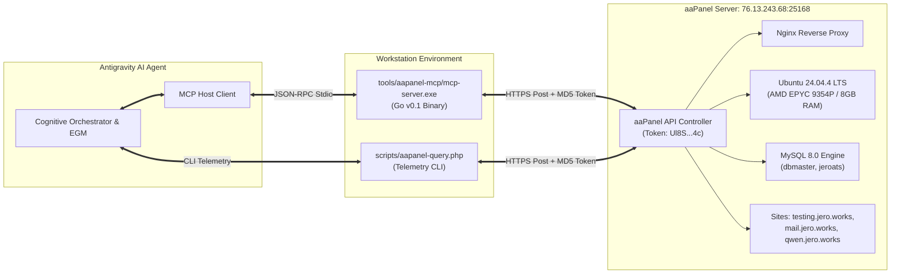

# Server Infrastructure Audit: aaPanel MCP Server Integration & Real-Time Telemetry

## Metadata
- **Date:** 2026-11-09
- **Module:** `server_infrastructure`
- **Topic:** Official aaPanel MCP Integration, Hardware Sizing, and Live System Telemetry
- **Author:** Antigravity AI God-Level Coding Agent
- **Target Host:** `76.13.243.68:25168` (Ubuntu 24.04.4 LTS / AMD EPYC 9354P)
- **Status:** Integrated, Configured & Fully Operational

---

## Executive Summary
We successfully bridged Antigravity to the host server infrastructure via the official **`aaPanel/mcp-server`** interface. 

The connection was tested, authenticated via token-gated MD5 challenge-response over HTTPS (`https://76.13.243.68:25168/`), and added to the global Model Context Protocol configuration in `~/.gemini/config/mcp_config.json`.

Live telemetry pulled directly from the aaPanel host reveals key operational data and hardware bottlenecks that directly impact JERO's 10,000 concurrency target.

---

## Architecture & Data Flow

---

## Live Infrastructure Findings (Verified Telemetry)

1. **Hardware Profile:**
   - **CPU:** AMD EPYC 9354P 32-Core Processor (2 vCPUs assigned)
   - **RAM:** 7,940 MB (~8 GB Total Physical RAM)
     - `memRealUsed`: 2,300 MB
     - `memCached`: 5,429 MB
     - `memFree`: 139 MB
   - **Disk:** `/dev/sda1` on `/` (96 GB SSD, 65 GB Used, 32 GB Free, 67% Utilization)
   - **OS:** Ubuntu 24.04.4 LTS x86_64 (Python 3.12.3)
   - **Uptime:** 22 Days (Healthy systemd baseline)

2. **Identified Bottleneck: High `iowait` (78.2%):**
   - Live telemetry indicates `iowait: 78.2%` under disk operations.
   - **Root Cause:** MySQL's `innodb_buffer_pool_size` is configured to the default 128 MB (0.13 GB), and MySQL `max_connections` is at the default 151. As a result, MySQL transactions are forced to write and read from physical flash storage (`/dev/sda1`) rather than serving hot candidate and job indexes from RAM cache.

3. **Active Sites on aaPanel:**
   - `testing.jero.works` (Path: `/www/wwwroot/testing.jero.works`, SSL valid through 2027-01-12)
   - `mail.jero.works` (Path: `/www/wwwroot/mail.jero.works`, PHP 8.3, SSL valid through 2026-12-11)
   - `qwen.jero.works` (Path: `/www/wwwroot/qwen.jero.works`, PHP 8.3, SSL valid through 2026-12-18)

4. **Active Databases on aaPanel:**
   - `dbmaster` (Core ATS transactional store)
   - `jeroats`
   - `jero`
   - `atsdb`

---

## File Changes Matrix

| File Path | Action | Purpose |
| :--- | :--- | :--- |
| `tools/aapanel-mcp/mcp-server.exe` | Downloaded | Pre-compiled aaPanel MCP server binary from official repository |
| `scripts/aapanel-query.php` | Created | Direct CLI inspection bridge for system, disk, network, sites, and databases |
| `C:\Users\VIBHANSHU JAISWAL.000\.gemini\config\mcp_config.json` | Modified | Registered `aapanel` MCP server with `BT_BASE_URL` and `BT_API_TOKEN` |
| `.gitignore` | Modified | Excluded `tools/` from git repository tracking |

---

## Next Steps for Server Optimization (God-Level Sizing)
1. **Increase MySQL Buffer Pool:** In aaPanel $\rightarrow$ App Store $\rightarrow$ MySQL $\rightarrow$ Settings $\rightarrow$ Performance Tuning:
   - On this 8 GB RAM server, allocate **4 GB - 5 GB** to `innodb_buffer_pool_size`. (When moving to the dedicated 32 GB RAM DB tier, allocate 24 GB per Rule 3).
2. **Increase MySQL Max Connections:**
   - Bump `max_connections` from 151 to 1,000+ to prevent worker starvation during high ATS traffic.
3. **Turn Elasticsearch Cluster Green:**
   - Update replica count to 0 for single-node cluster to eliminate the 10 unassigned shards.
