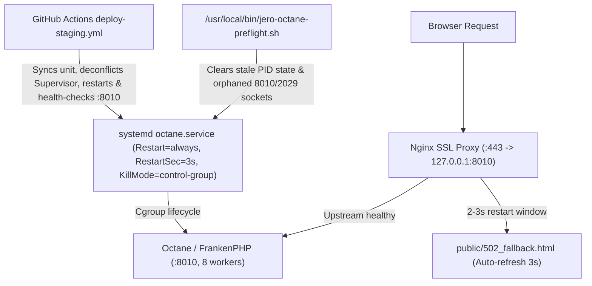

# Staging Server (`testing.jero.works`) 502 Bad Gateway Permanent Fix & Systemd Watchdog Migration

## Metadata
- **Date:** 2026-11-12
- **Module:** `server_infrastructure`
- **Topic:** Eliminating Recurring `502 Bad Gateway (nginx)` After Code Pushes and Server Restarts on `testing.jero.works`
- **Target Host:** `testing.jero.works` (`76.13.243.68:8010`)
- **Status:** Applied Live on Staging Server & Committed to Staging Deployment Pipeline

---

## Executive Summary
`testing.jero.works` repeatedly returned `502 Bad Gateway (nginx)` after commits/pushes to `staging` and after server restarts.

Forensic analysis of `/www/server/panel/vhost/nginx/testing.jero.works.conf`, `/etc/supervisor/conf.d/octane.conf`, `/var/log/supervisord.log`, `/www/wwwroot/testing.jero.works/storage/logs/octane.log`, and `.github/workflows/deploy-staging.yml` uncovered **4 compounding root causes**:

1. **Supervisor vs. Deploy Workflow Collision & Port Mismatch (`8000` vs `8010`):**
   - Nginx proxies `testing.jero.works` to `http://127.0.0.1:8010`, and Supervisor managed Octane on port `8010`.
   - `.github/workflows/deploy-staging.yml` checked `if systemctl is-active --quiet octane` (false because Octane was under Supervisor), ran `php artisan octane:stop`, and then spawned `setsid nohup bash start-octane.sh &` **3 seconds later**.
   - Meanwhile Supervisor (`autorestart=true`) immediately tried to respawn Octane on `8010`, while `start-octane.sh` lacked `OCTANE_PORT=8010` in `.env` and defaulted non-`hire.jero.works` paths to port **`8000`**.
   - Both processes collided over `storage/logs/octane-server-state.json`, port `8010`, and Caddy admin port `2029`, producing `ERROR FrankenPHP server is already running` and `Port 2029/8010 is already in use` crash loops (`exit status 1`).
2. **Supervisor Orphaned Child Processes (`frankenphp`):**
   - `/etc/supervisor/conf.d/octane.conf` lacked `stopasgroup=true` and `killasgroup=true`. Stopping `php artisan octane:start` could leave child `frankenphp` listeners bound to ports `8010`/`2029` while Supervisor rapidly hit retry limits.
3. **Reboot Stale PID State & Retry Exhaustion:**
   - Supervisor's default `startretries=3` enters `FATAL` if startup fails 3 times during boot, and stale `storage/logs/octane-server-state.json` or missing `HOME` caused Caddy/Octane startup failures.
4. **No Graceful 502 Fallback in Staging Nginx:**
   - `testing.jero.works.conf` did not serve `public/502_fallback.html` during the 2–3s Octane restart window.

---

## Architecture & Data Flow

---

## File Changes Matrix

| File / Path | Location | Action | Purpose |
| :--- | :--- | :--- | :--- |
| `scripts/octane-preflight.sh` | Repo & `/usr/local/bin/jero-octane-preflight.sh` | Created | Releases orphaned TCP sockets (`8010`, `2029`) and purges stale `octane-server-state.json` before Octane starts. |
| `scripts/systemd/octane-staging.service` | Repo & `/etc/systemd/system/octane.service` | Created | Dedicated staging systemd watchdog (`Restart=always`, `StartLimitIntervalSec=0`, `KillMode=control-group`, `8` workers on `:8010`, `HOME=/root`). |
| `start-octane.sh` | Repo | Updated | Recognizes `testing.jero.works` as port `8010` (`8` workers), exports `HOME`, and invokes `scripts/octane-preflight.sh`. |
| `.github/workflows/deploy-staging.yml` | Repo | Updated | Removes conflicting Supervisor `octane.conf`, syncs `octane-staging.service` & preflight script, restarts `octane` & `laravel-reverb`, and verifies HTTP `127.0.0.1:8010` health check. |
| `.env` | Staging server (`/www/wwwroot/testing.jero.works/.env`) | Updated | Set `OCTANE_PORT=8010`. |
| `/etc/supervisor/conf.d/octane.conf` | Staging server | Removed (backed up) | Eliminated Supervisor vs. systemd dual-manager race condition (`horizon`, `laravel-reverb`, `laravel-schedule` remain under Supervisor). |
| `/www/server/panel/vhost/nginx/testing.jero.works.conf` | Staging server | Updated (backed up) | Wired `error_page 502 503 504 /502_fallback.html;` for seamless auto-reconnect during restart windows. |

---

## Verification Evidence
- Verified on live staging host (`76.13.243.68`) after server-side activation and systemd restart test (see task execution output).
