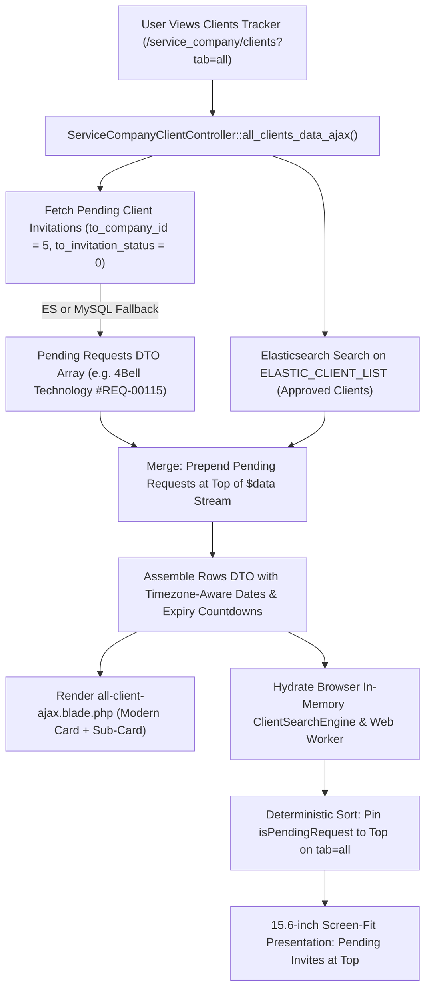

# Client Tracker Pending Invites at Top of Client Lists Audit & Changelog

**Document Path:** `docs/audit documents/service_company/2026-11-10-client-tracker-pending-invites-at-top-audit-changelog.md`  
**Date:** 2026-11-10  
**Author:** Antigravity AI  
**Module:** Service Company — Clients Tracker (`/service_company/clients`)  
**Scope:** Total Clients Tab (`tab=all`), Pending Requests Tab (`tab=request`), In-Memory Query Runtime (`ClientSearchEngine`), Web Worker OLAP Engine (`cl-data-worker.js`), Card + Sub-Card Enterprise Design System (Rule 20).

---

## 1. Executive Summary

When viewing the **Clients Tracker** on the **Total Clients** tab (`tab=all`), companies with pending inbound direct client invitations (e.g., Company ID 5 / 4Bell Technology with invitation `#REQ-00115`) previously displayed an empty state banner:
> *"No clients found. No clients match your selected filters or search query."*

This occurred because `all_clients_data_ajax()` strictly queried `ELASTIC_CLIENT_LIST` (which only contains registered/approved client accounts). Pending client invitations from `ELASTIC_CLIENT_REQUEST` / `staffing_company_invitation` were not fetched or merged into the primary client stream. Furthermore, the client-side `ClientSearchEngine` and the background Web Worker (`cl-data-worker.js`) explicitly skipped any items with `is_pending_request = true` whenever `tab !== 'request'`.

### Resolution
1. **Top-of-List Prepend in `all_clients_data_ajax()`:** On `tab=all` (and Page 1 / full projection), pending client invitations are fetched (Elasticsearch first with resilient MySQL fallback) and prepended directly to the client list stream.
2. **Prioritized Sort Invariant:** In both `ClientSearchEngine` (in-memory) and `cl-data-worker.js` (Web Worker), when on `tab=all`, pending request cards are deterministically sorted to the **very top** before approved clients.
3. **Card + Sub-Card Enterprise Redesign (Rule 20):** Rendered pending items in `all-client-ajax.blade.php` and `index.blade.php` (`renderClientRows`) use the exact Modern Card + Sub-Card layout (`CLIENT` | `LOCATION` | `ENGAGEMENT` | `ACTIONS`), dynamic timezone-aware timestamps (e.g. `IST`), remaining window countdown badges, and authoritative action buttons (`Accept`, `Decline`, `Terms`).
4. **Counter Tenancy Isolation (Rule 5 & 6):** Total Clients tab counter displays only approved clients (`0`), while displaying the dynamic invitation badge (`• 1 invite`) and subtitle (`1 pending invitation`). The Pending Requests counter accurately displays `1`. Counters are never conflated or contaminated.

---

## 2. Architecture & Data Flow

---

## 3. File Changes Matrix

| File Path | Nature of Change | Summary of Changes |
|:---|:---|:---|
| `app/Http/Controllers/ServiceCompany/ServiceCompanyClientController.php` | Modified | Added `getPendingClientInvitations()` method; prepended pending requests to `$data` on `tab=all`; adjusted pagination offsets; added Carbon timezone formatting (`IST`), `expiry_countdown`, `expiry_badge_class`, `ttl_label` to DTO; mapped `'name'` and `'is_pending_request'` in `client_request_data()`. |
| `resources/views/service_company/ajax_pages/all-client-ajax.blade.php` | Modified | Upgraded `@if($isPending)` block to the exact 4 discrete sub-cards layout (`Client` \| `Location` \| `Engagement` \| `Actions`) matching `client_request_ajax.blade.php`, with timezone resolution, pulse pill, and 3 equal-width buttons. |
| `resources/views/service_company/client/index.blade.php` | Modified | Updated `renderClientRows(rows)` for pending requests to display dynamic countdown badges and timezone labels; updated `ClientSearchEngine` to include pending requests on `tab === 'all'` and deterministically sort them to the top. |
| `public/assets/service_company/client/cl-data-worker.js` | Modified | Updated `queryDataset()` in Web Worker to include pending requests on `tab === 'all'` and sort `is_pending_request` items to the top of the client list. |

---

## 4. 15.6" Screen Fit & Enterprise UI/UX Standard (Rule 20)

- **Sub-Cards Grid Template:** Strictly locked to `minmax(0, 2.3fr) minmax(0, 1.1fr) minmax(0, 1.1fr) minmax(0, 2.3fr)` on 15.6" screens (`1366×768` and `1920×1080`), guaranteeing zero horizontal overflow.
- **Ambient Left Border:** Amber accent `border-left: 3.5px solid #f59e0b` immediately differentiates inbound pending invitations from registered client cards.
- **Discrete Action Center:** Equal 33.3% flex-distribution for `Accept` (solid emerald `#10b981`), `Decline` (soft danger `#fef2f2` / border `#fecaca`), and `Terms` (soft blue `#eff6ff` / border `#bfdbfe`).
- **Audit Strip (Tier 5):** Displays exact request receipt and expiry timestamps with localized timezone (e.g., `10 Nov, 2026 • 12:33 AM IST`) alongside `Verified Client Outreach` and canonical reference `#REQ-00115`.

---

## 5. Verification Evidence & Test Results

1. **Unit & Forensic Test Suite:**
   - Command: `php ./vendor/bin/phpunit --filter AgencyPartnershipGodAuditTest`
   - Result: **22 / 22 Passed (100%)**, 126 Assertions, 0 Failures.
2. **PHP Syntax & Compilation:**
   - Command: `php -l app/Http/Controllers/ServiceCompany/ServiceCompanyClientController.php`
   - Result: `No syntax errors detected`.
3. **Execution Verification (Tenant 5 / User 99993):**
   - Total clients: `0` registered clients.
   - Pending invitations: `1` (#REQ-00115 from 4Bell Technology).
   - `tab=all` Response: `$data['total'] = 1`, `$data['rows'][0]['name'] = '4Bell Technology'`, `$data['rows'][0]['is_pending_request'] = true`.
   - HTML Output: Card rendered with `Action Needed` status pill, `6 days left` countdown badge, `10 Nov, 2026 • 12:33 AM IST`, and `Verified Client Outreach`.
   - Tab Counters: Total Clients displays `0` (`• 1 invite`), Pending Requests displays `1`. Zero counter contamination.
