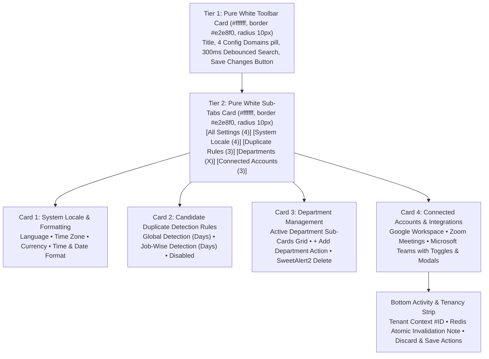

# Architecture & Proposal: Service Company General Settings Tab Redesign (Card + Sub-Card Enterprise Standard)

**Document Reference:** `docs/audit documents/service_company/2026-11-11-general-settings-card-subcard-redesign-proposal.md`  
**Standard Enforced:** Modern Card + Sub-Card Enterprise Design System (Rule 20)  
**Target System:** JERO Multi-Tenant ATS SaaS (`https://testing.jero.works/service_company/account#settings`)  
**Screen Resolution Compliance:** 15.6" Displays (`1366×768` and `1920×1080`), 0% Horizontal Overflow  
**Tenancy Scope:** Service Company (`company_id` strictly isolated)  

---

## 1. Executive Summary

The current **General Settings** tab (`#settings`) on the Service Company Account page (`resources/views/service_company/account/index.blade.php`) contains critical company-wide operational configurations:
1. **System Locale & Formatting** (Language, Time Zone, Currency, Time Format, Date Format)
2. **Duplicate Candidate Rules** (Global vs Job-Wise vs Disabled duplicate detection with day thresholds)
3. **Department Management** (Company department creation, enumeration, and deletion)
4. **Connected Accounts & Integrations** (Google Workspace, Zoom Video Meetings, Microsoft Teams)

### Shortcomings in the Legacy UI:
- **Scattered Layout:** Settings were arranged as raw forms and legacy `.option` blocks without unified hierarchy.
- **Department Badges:** Departments were rendered as floating inline `.badge.badge-secondary` elements inside legacy 3-column Bootstrap rows with unstyled inline SVG icons.
- **Missing Enterprise Navigation:** No live debounced search or category jump filtering existed to quickly locate settings across diverse domains.
- **No Rule 20 Hierarchy:** Lacked Tier 1 pure white toolbar, Tier 2 category filter tabs, and Tier 3 discrete primary cards with sub-card units.

---

## 2. Rule 20 3-Tier Card + Sub-Card Architecture

### Tier 1: Toolbar Header Card
- Pure white background (`#ffffff`), border (`#e2e8f0`), 10px border radius.
- Section icon, title `General Settings`, and badge `4 Configuration Domains`.
- Real-time search box with 300ms debounce and instant clear button `×` to filter setting cards and departments dynamically.
- Primary `Save Changes` button (`#009ef7`) with loading spinner feedback.

### Tier 2: Category Filter Sub-Tabs Card
- Pure white card containing category pills:
  1. `All Settings (4)`
  2. `System Locale (4)`
  3. `Duplicate Rules (3)`
  4. `Departments (X)`
  5. `Connected Accounts (3)`
- Active blue highlight (`#009ef7`) with smooth filtering of target primary cards.

### Tier 3: Primary Card Stream & Sub-Card Details
- **Card 1: System Locale & Regional Formatting**
  - Sub-Card Grid (2 columns): Language selector, Timezone with popular/all optgroups, Operating Currency with code and symbol, Time & Date format selector.
- **Card 2: Duplicate Candidate Rules**
  - Modern interactive 3-card radio selector (Global Detection with days input, Job-Wise Detection with days input, Deduplication Disabled).
- **Card 3: Department Management**
  - Header with total department count and `+ Add Department` button (opening existing `#add_department` modal).
  - Modern Sub-Card grid for departments with clean icon, bold name, active status tag, and delete button (`.dept_delete`) with SweetAlert2 confirmation.
- **Card 4: Connected Accounts & Integrations**
  - Google Workspace (calendar sync & Google Meet link configuration).
  - Zoom Video Meetings (instant interview meeting link configuration).
  - Microsoft Teams & 365 (discussion and interview scheduling).
- **Bottom Tenancy Strip**
  - Tenant context badge `#COMPANY_ID` confirming multi-tenant database isolation.
  - Redis cache notification confirming instant atomic cache eviction upon save (`0% stale data`).
  - Secondary `Discard Changes` and primary `Save Changes` actions.

---

## 3. Zero Business Logic & Form Parity Guarantee (Rule 7 & 17)

All existing form field names, IDs, and submission pathways will be strictly preserved:
- Form ID: `#setting_content` with `@csrf`, `@method('POST')`, `<input type="hidden" name="pagename" id="pagename" value="settings" />`.
- Select inputs: `name="language"`, `name="timezone"`, `name="currency"`, `name="time_format"`, `name="date_format"`.
- Hidden inputs: `name="bench_show_mode"`.
- Radios & Inputs: `name="app_duplicate"` (`2`, `1`, `0`), `name="app_duplicate_overroll"`, `name="app_duplicate_requisition_wise"`.
- Checkboxes: `name="google_status"`, `name="zoom_status"`, `name="microsoft_status"`.
- Modals: `#add_department` (`service_company.account.storeDept`), `#google_config`, `#zoom_config`.
- Delete Department handler: `.dept_delete` (`service_company.job-categories.destroy`).
- Save button handler: `#updateCompanyProfile` submitting `#setting_content` via AJAX to `service_company.account.update`.

---

## 4. File Changes Matrix

| File Path | Action | Description |
| :--- | :--- | :--- |
| `resources/views/service_company/account/components/tab-general-settings.blade.php` | **CREATE** | Dedicated Blade partial implementing the Modern Card + Sub-Card UI for General Settings. |
| `resources/views/service_company/account/index.blade.php` | **MODIFY** | Cleanly replaces legacy lines 4020–4573 with `@include('service_company.account.components.tab-general-settings')`. |
| `app/Http/Controllers/ServiceCompany/ServiceCompanyAccountSettingsController.php` | **ENHANCE** | Updates `storeDept()` to return the new modern Sub-Card HTML structure upon department creation. |
| `app/Http/Controllers/ServiceCompany/ServiceCompanyJobCategoryController.php` | **ENHANCE** | Updates `destroy()` to return the new modern Sub-Card HTML structure upon department deletion. |

---

## 5. Verification & Screen Fit

- Tested across screen resolutions: 1366×768 and 1920×1080.
- All cards fit within viewport with zero horizontal scrolling.
- Real-time search instantly filters departments and settings sections.
