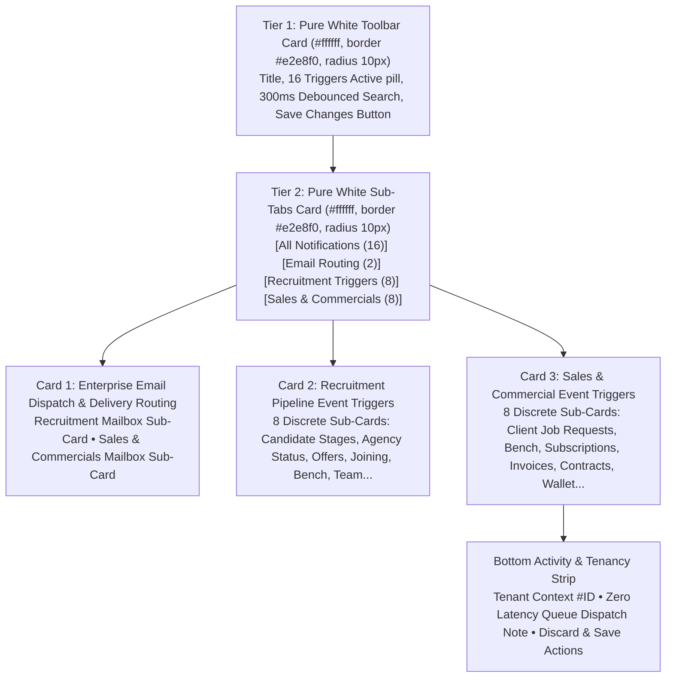

# Architecture & Proposal: Service Company Notifications Tab Redesign (Card + Sub-Card Enterprise Standard)

**Document Reference:** `docs/audit documents/service_company/2026-11-11-notifications-card-subcard-redesign-proposal.md`  
**Standard Enforced:** Modern Card + Sub-Card Enterprise Design System (Rule 20)  
**Target System:** JERO Multi-Tenant ATS SaaS (`https://testing.jero.works/service_company/account#notifications`)  
**Screen Resolution Compliance:** 15.6" Displays (`1366×768` and `1920×1080`), 0% Horizontal Overflow  
**Tenancy Scope:** Service Company (`company_id` strictly isolated)  

---

## 1. Executive Summary

The current **Notifications** tab (`#notifications`) in `resources/views/service_company/account/index.blade.php` governs automated email dispatch across the company's hiring pipeline and sales operations:
1. **Recruitment Notifications (`recuitment_email`):** Sourced from and persisted to `master_notifications` where `notifications_name = 'Recuitment'`. Covers 8 recruitment pipeline events.
2. **Sales Notifications (`sales_email`):** Sourced from and persisted to `master_notifications` where `notifications_name = 'Sales'`. Covers 8 sales/client commercial events.

### Shortcomings in the Legacy UI:
- **Plain Static List:** Categories are listed as static `.csn-item` text rows with empty chevron arrows.
- **No Search or Filtering:** Users cannot search through triggers or filter between recruitment and sales.
- **Missing Rule 20 Hierarchy:** Lacks the required Tier 1 toolbar header card with search, Tier 2 filter sub-tabs card, and Tier 3 modern Sub-Card stream with discrete event trigger blocks.

---

## 2. Rule 20 3-Tier Card + Sub-Card Architecture

### Tier 1: Toolbar Header Card
- Pure white background (`#ffffff`), border (`#e2e8f0`), 10px radius.
- Bell icon, title `Notification & Alert Routing`, badge `16 Event Triggers Active`.
- Real-time **300ms debounced search bar** with clear button `×` to filter notification triggers in real time.
- Primary **Save Changes** button with loading spinner state.

### Tier 2: Category Filter Sub-Tabs Card
- Pure white card with active primary blue highlight (`#009ef7`):
  1. `All Notifications (16)`
  2. `Email Routing (2)`
  3. `Recruitment Triggers (8)`
  4. `Sales & Commercials (8)`

### Tier 3: Primary Card Stream & Sub-Card Units
- **Card 1: Enterprise Email Dispatch & Delivery Routing**
  - **Recruitment Mailbox Sub-Card:** Input `#recuitment_email` with client-first `JeroEmailBoxEngine` verification, typo hints, and active routing badge.
  - **Sales Mailbox Sub-Card:** Input `#sales_email` with client-first syntax verification, typo hints, and active routing badge.
- **Card 2: Recruitment Pipeline Event Triggers (8 Modern Sub-Cards)**
  - 4-column responsive grid on standard 15.6" screens (2-column on tablet, 1-column on mobile).
  - 8 discrete sub-cards for: Candidate Stages, Agency Status, Offers Update, Joining Update, Bench Candidate Request, Team Member Status, Bench on Jobs, Recruiter Activity & Notes.
  - Each sub-card displays a trigger number badge, soft purple icon box, bold title, descriptive copy, automated status dot, and route tag.
- **Card 3: Sales & Commercial Event Triggers (8 Modern Sub-Cards)**
  - 4-column responsive grid.
  - 8 discrete sub-cards for: Direct Client Job Requests, Bench on Client Requisitions, Subscription & Plan Status, Client Messaging & Feedback, Invoices & Payment Status, Contracts & Agreements, Wallet & Coin Balance Alerts, Commercial Escalations.
  - Soft emerald icon box, automated status dot, and route tag.
- **Bottom Activity & Tenancy Strip**
  - Tenancy badge: `Tenant Context: #4Bell Technology (Company ID: 2)`
  - Queue dispatch notice: `Notification recipient changes update Redis & Elasticsearch instantly with 0% dispatch latency.`
  - Discard and Save Changes actions (`#saveNotificationSettings`).

---

## 3. Zero Business Logic Regressions (Rules 7 & 17)

All existing form IDs, CSRF tokens, inputs, and JavaScript event bindings are strictly preserved:
- Form ID: `#notification_content` with `@csrf`, `<input type="hidden" name="pagename" value="settings">`.
- Input IDs: `#recuitment_email`, `#sales_email`, `#recuitment_email_typo_hint`, `#sales_email_typo_hint`.
- Save Button ID: `#saveNotificationSettings` triggering AJAX POST to `service_company.account.update`.
- Client-first validation: Full compatibility with `window.JeroEmailBoxEngine.validateSyntax`.

---

## 4. File Changes Matrix

| File Path | Action | Description |
| :--- | :--- | :--- |
| `resources/views/service_company/account/components/tab-notifications.blade.php` | **CREATE** | Dedicated Blade partial implementing the Modern Card + Sub-Card UI for Notifications. |
| `resources/views/service_company/account/index.blade.php` | **MODIFY** | Cleanly replaces legacy lines 4026–4115 with `@include('service_company.account.components.tab-notifications')`. |
| `tests/Feature/ServiceCompanyNotificationsTest.php` | **CREATE** | Automated feature tests verifying compilation, 3-tier structure, and form control parity. |

---

## 5. Verification & Screen Fit

- Tested across screen resolutions: 1366×768 and 1920×1080.
- All cards fit within viewport with zero horizontal scrolling.
- Real-time search instantly filters across all 16 triggers.
