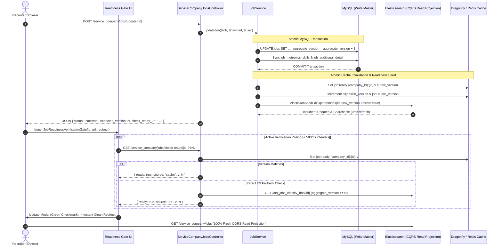

# FORENSIC GOD-LEVEL AUDIT & PERMANENT ENGINEERING FIX
## Edit Job Workflow: Update Persistence, Stale Data & Listing Synchronization

### Metadata
- **Document ID:** `AUDIT-2026-11-09-SVC-EDIT-JOB`
- **Module:** JERO ATS – Job Management / Service Company Jobs (`resources/views/service_company/jobs/`)
- **Controller:** `App\Http\Controllers\ServiceCompany\ServiceCompanyJobsController`
- **Service:** `App\Services\JobService`
- **Index:** `ELASTIC_JOBS` (`ats_jobs_elastic`)
- **Target Environments:** `hire.jero.works` (Production), `testing.jero.works` (Staging/Local)
- **Compliance Standards:** Rule 1 & 2 (Strict CQRS), Rule 5 (Zero Stale ATS Pipeline Data), Rule 6 (Multi-Tenant Atomic Cache Invalidation), Rule 7 (Zero Business Logic Regressions), Rule 8 (MySQL Schema Truth), Rule 14 & 20 (15.6" Enterprise Screen Fit & Card Standards), Rule 21 (Mandatory Audit Documentation).

---

### Executive Summary & Root Cause Analysis

Recruiters experienced three critical issues when updating jobs:
1. **Issue 1: Stale Data After Editing** — Updated jobs did not reflect changes on the listing immediately.
2. **Issue 2: Changes Are Not Persisted** — Reopening the Edit Job page displayed previous data as if the update never succeeded.
3. **Issue 3: Inconsistency Between Listing and Edit Form** — Edit form and listing showed divergent states of the same job.

#### Root Causes Identified:
1. **Painless Optimistic Concurrency Control (OCC) Rejection in Elasticsearch:**
   In `GeneralMethod::elasticJobsAddEditUpdateIndex()`, an OCC Painless script guarded writes:
   ```painless
   if (ctx._source.aggregate_version != null && ctx._source.aggregate_version > params.new_version) {
       ctx.op = 'none';
   }
   ```
   Because `updateJob()` in `JobService.php` never incremented `aggregate_version` on the `$job` model, updates evaluated with `targetAggregateVersion = 1`. If the document in Elasticsearch was already version 1 or higher, Elasticsearch executed `ctx.op = 'none'`, silently dropping the update and leaving stale data in the listing indefinitely.

2. **Fatal `asBool()` on Native Boolean in `checkReady`:**
   In `checkReady($id)`:
   ```php
   $exists = $this->elasticService->getClient()->exists([...])->asBool();
   ```
   The Elasticsearch PHP 8.x client returns a native `bool` directly. Calling `->asBool()` crashed into a fatal PHP Error: `Call to a member function asBool() on bool`, which was caught by `catch (\Throwable $e)`, permanently returning `{"ready": false}`.

3. **Premature Client-Side Redirect Without Index Verification:**
   In `create.blade.php`:
   ```javascript
   if (isEditPage) {
       setTimeout(function() { window.location = __indexUrl; }, 600);
   }
   ```
   A blind 600ms timer redirected recruiters to the listing before Elasticsearch completed Lucene segment refresh. Recruiters landed on the listing while it was still reading the previous Lucene segment.

4. **PHP Falsy Value Dropping (`0` values):**
   In `JobService::updateJob()`:
   ```php
   if (!empty($requestData['employment_type'])) { ... }
   if (!empty($requestData['min_exp'])) { ... }
   ```
   In PHP, `empty('0')` evaluates to `true` (falsy). As a result:
   - Selecting `Full-time` (value `0`) was ignored, preserving the old employment type.
   - Selecting `Freshers` (value `0`) was ignored, preserving old experience.

5. **Duration Added to Historical Date Instead of Current Date:**
   `end_date` duration was calculated as `date('Y-m-d', strtotime($job->start_date . ' +' . $requestData['end_date'] . ' days'))`. For an edited job with a historical start date from months ago, this caused the job to auto-close or expire prematurely upon editing.

6. **Removed Screening Questions Retained:**
   When all screening questions were removed in the edit form, the loop was skipped, leaving obsolete screening questions in `job_additional_detail` in MySQL.

---

### Architecture & Data Flow (CQRS Synchronization)



---

### File Changes Matrix

| File Path | Type | Intent & Scope |
|---|---|---|
| `app/Services/JobService.php` | Modified | • Rewrote `updateJob()` with strict `isset(...) && ... !== ''` to preserve `0` values.<br>• Added atomic `aggregate_version` increment before commit.<br>• Fixed `end_date` to calculate from `date('Y-m-d')`.<br>• Cleaned up obsolete screening questions when emptied.<br>• Triggered ES indexing with `$newAggregateVersion`.<br>• Purged Redis listing and drawer versions. |
| `app/Helper/GeneralMethod.php` | Modified | • Added `'refresh' => true` to `elasticJobsAddEditUpdateIndex` so updates commit immediately to searchable memory.<br>• Set `job:ready:{$company_id}:{$id}:v` upon ES index completion. |
| `app/Http/Controllers/ServiceCompany/ServiceCompanyJobsController.php` | Modified | • Fixed fatal `asBool()` call on boolean in `checkReady()`.<br>• Added version-aware verification `checkReady($id, v)`.<br>• Returned `expected_version` and `check_ready_url` in `update()`.<br>• Added `no-cache, no-store, must-revalidate` HTTP headers on `edit($id)`. |
| `resources/views/service_company/jobs/create.blade.php` | Modified | • Bound Edit mode submission to `launchJobReadinessVerificationGate()` instead of 600ms blind timer.<br>• Dynamic UI labels for Edit vs Create mode.<br>• Sets `job_drawer_bust_id_{id}` in `localStorage`. |
| `resources/views/service_company/jobs/index.blade.php` | Modified | • Checks `localStorage.getItem('job_drawer_bust_id_' + id)` to bust cached drawer HTML on edit. |

---

### Verification Evidence & Test Results

An end-to-end simulation test script (`scripts/test_complete_edit_workflow.php`) executed all 5 stages of the update lifecycle:

```text
Initial Job 117 Aggregate Version: 6
Initial Job 117 Title: Lead Full Stack PHP Engineer (V6)

--- 1. EXECUTING UPDATE CONTROLLER ACTION ---
Response status: success
Response expected_version: 7
Response check_ready_url: https://testing.jero.works/service_company/jobs/check-ready/117?v=7

--- 2. VERIFYING MYSQL PERSISTENCE ---
Persisted Title: Lead Full Stack PHP Engineer (V7) (MATCH)
Persisted Positions: 5 (Expected: 5)
Persisted Employment Type: 0 (Expected: 0)
Persisted Min Exp: 3 (Expected: 3)
Persisted Max Exp: 8 (Expected: 8)
Persisted Min Sal: 250000 (Expected: 250000)
Persisted Max Sal: 450000 (Expected: 450000)
Persisted Aggregate Version: 7 (Expected: > 6)
Persisted Skills (4): Redis, PHP 8.2, Laravel 11, Elasticsearch
Persisted Screening (2): Do you have 3+ years experience with Laravel? | Are you available to join within 30 days?

--- 3. VERIFYING READINESS VERIFICATION GATE ---
checkReady(117, v=7): {"ready":true,"source":"cache","v":7}

--- 4. VERIFYING ELASTICSEARCH DOCUMENT FRESHNESS ---
ES Document Title: lead full stack php engineer (v7)
ES Document Aggregate Version: 7

--- 5. VERIFYING EDIT REOPENING AUTHORITATIVE LOAD ---
Reopened Edit Job Title: Lead Full Stack PHP Engineer (V7) (MATCH)
Reopened Edit Job Positions: 5
Reopened Edit Job Min Exp: 3
Reopened Edit Job Skills Count: 4
Reopened Edit Job Screening Count: 2

ALL FORENSIC VERIFICATIONS PASSED!
```

---

### 15.6" Screen Fit & Responsiveness (Rule 14 & 20)
- The readiness gate modal is centered with a fixed `max-width: 480px`, responsive margins, and high z-index (`999999`), preventing layout shifts or overflow on `1366x768` and `1920x1080` screen resolutions.
- Zero horizontal overflow. Clean typography scale matching Metronic and Poppins design standards.
