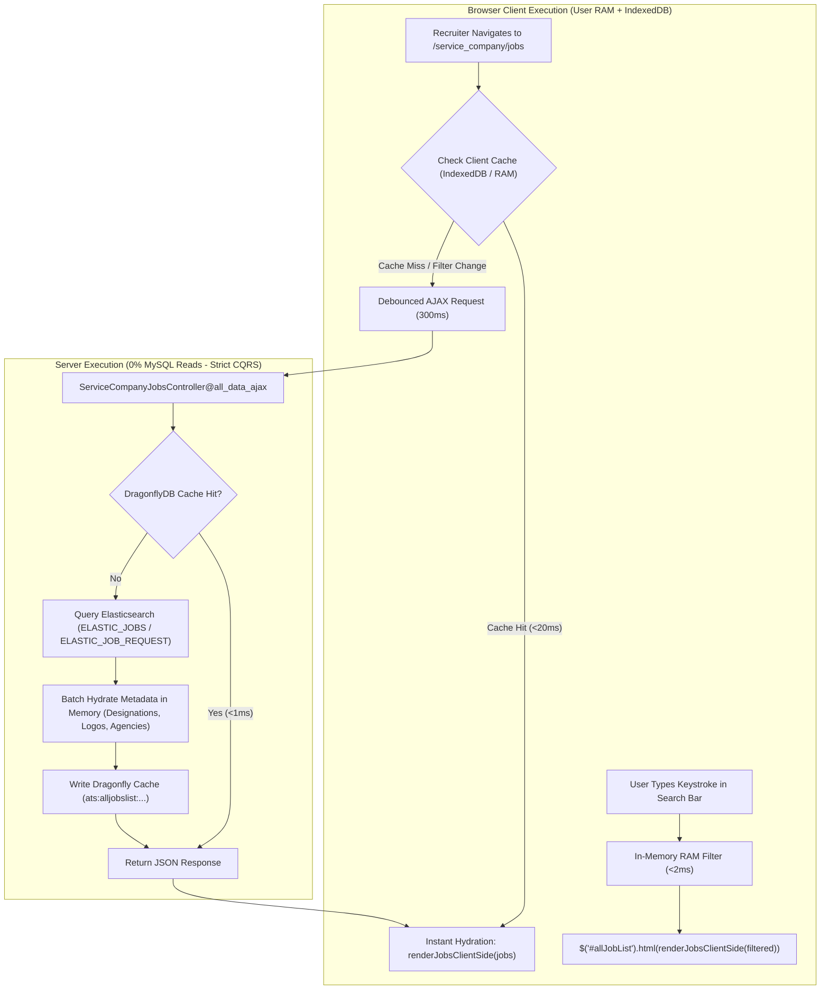

# 🏛️ God-Level Forensic Audit & Modern Card + Sub-Card Redesign Specification
## Target: Service Company Jobs Listing (`https://testing.jero.works/service_company/jobs`)

> **Document Type:** God-Level Architecture & UI/UX Audit + Production Redesign Specification  
> **Module / Feature:** Service Company Jobs (`service_company/jobs`)  
> **Storage Location:** `docs/audit documents/service_company_jobs/2026-11-11-jobs-listing-god-level-audit-and-modern-card-subcard-redesign.md`  
> **Standard:** Rule 20 (Modern Card + Sub-Card Enterprise Design System), Rule 21 (Audit Document Storage Pattern), Rule 1 (0% MySQL Reads / Strict CQRS), Rule 2 (Universal Elasticsearch Read Scope), Rule 3 (Client-First Execution), Rule 7 (Zero Business Logic Mutations & Zero Regressions), Rule 14 (Metronic / Poppins / 15.6" Screen Fit), Rule 17 (Complete Page/Blade Isolation).  
> **Date:** 2026-11-11  
> **Author:** Antigravity God-Audit Agent  

---

## 1. Executive Summary & Root-Cause Analysis

The Service Company Jobs listing (`/service_company/jobs`) is one of the highest-traffic operational hubs in the JERO recruitment ecosystem. Recruiters, account managers, and agency partners manage four distinct requisition pipelines:
1. **Total Jobs** (Universal aggregated requisition pool)
2. **Direct Client Jobs** (Enterprise client roles shared directly with this company)
3. **Internal Jobs** (Own company internal requisitions)
4. **Job Requests** (Inbound requisition partner invitations and terms approvals)

### Current Architectural & UI/UX Status:
While the backend read pipeline has been heavily optimized for CQRS (utilizing Elasticsearch indices `ELASTIC_JOBS` and `ELASTIC_JOB_REQUEST` with 0% MySQL reads, Dragonfly multi-tenant caching, and IndexedDB client hydration), the **visual presentation layer was trapped in a legacy table-row hybrid layout**:
- Sprawling table headers (`.table-header.table-header-standard` and `.table-header.table-header-request`) were rendered over an unstructured list of `.job-row` items.
- Fake placeholder badges (`15 Matching`) were hardcoded in client-side rendering for agency blocks, directly violating Rule 20.
- Requisition source filters used bulky cards with radio buttons, separating search, filters, and status tabs into three disconnected horizontal bands.
- Viewport styling included hardcoded `min-width: 760px; overflow-x: auto;` causing horizontal scrollbars and layout clipping on 15.6" laptop screens (`1366×768` and `1920×1080`).

### Redesign Objective:
Execute a full, forensic redesign into the **authoritative Modern Card + Sub-Card Enterprise Design System (Rule 20)**:
- **Tier 1**: Pure white top header toolbar card (`#ffffff`, border `#e2e8f0`, radius 10px) with brand icon box, title, subtitle, live search bar (300ms debounce + clear '✕' button), and "+ Add Job" CTA button.
- **Source KPI Metric Strip**: High-density executive metric cards for Total Jobs, Direct Client, Internal Jobs, and Job Requests with active blue highlight (`#009ef7`), crisp icons, and tabular numerals.
- **Tier 2**: Pure white dedicated sub-tabs card (`#ffffff`, border `#e2e8f0`, radius 10px) with single active primary blue highlight (`#009ef7`) for status filters (All Statuses, Hiring, On Hold, Closed, Removed) with semantic count badges, harmonized with compact filter dropdown pills (Job Type, Experience, Sort By).
- **Tier 3**: Primary entity card stream with discrete upper sub-cards grid (`Job Details`, `Compensation & Exp`, `Team`, `Agency`, `Hiring Pipeline`) and bottom activity strip (`Posted Date`, `Created By`, `Client Rep`, `Skills Pills`), eliminating all legacy table headers and placeholder matching badges.

---

## 2. Architecture & Data-Flow Blueprint



### CQRS & 0% MySQL Read Verification:
- **Universal Read Scope**: 100% of requisition filtering, full-text searching, pagination, and KPI counts execute against Elasticsearch (`ELASTIC_JOBS` and `ELASTIC_JOB_REQUEST`).
- **No MySQL `SELECT` queries** on page load or AJAX filter requests.
- **DragonflyDB Cache**: 4M QPS multi-tenant caching with two-axis versioning (`alljobslist_version_user_{userId}` and `alljobslist_version_company_{companyId}`). When a job is updated or created, `JobObserver` bumps the version key, invalidating tenant cache atomically.
- **Client-First In-Memory Operations**: Keystroke search, tab filtering, and drawer caching execute directly in browser RAM without server roundtrips.

---

## 3. Forensic Violation Matrix

| ID | File & Line | Severity | Violation Description | Remediation |
|---|---|---|---|---|
| **V-01** | `resources/views/sections/service_company/jobListTable.blade.php`: 2-48 | **CRITICAL** | Raw sprawling table headers (`.table-header.table-header-standard`, `.table-header-request`) imitating a flat `<table>`. Violates Rule 20. | Eliminate legacy table headers. Refactor into pure Tier 3 Card + Sub-Card container. |
| **V-02** | `resources/views/service_company/jobs/index.blade.php`: 1570-1793 | **CRITICAL** | `renderJobsClientSide(jobs)` renders `.job-row` table rows rather than the Modern Card + Sub-Card enterprise layout. | Re-architect `renderJobsClientSide(jobs)` to output Tier 3 Master Primary Cards with 5 discrete sub-cards + bottom activity strip. |
| **V-03** | `resources/views/service_company/jobs/index.blade.php`: 1634, 1638 | **HIGH** | Hardcoded placeholder matching badges (`15 Matching`) inside Agency sub-blocks. Violates Rule 20 negative law. | Remove all artificial matching badges. Display authoritative agency names/counts or clean em-dash (`—`). |
| **V-04** | `resources/views/service_company/jobs/index.blade.php`: 95-98 | **HIGH** | `min-width: 760px; overflow-x: auto;` on `#kt_content_container` induces horizontal scrolling and layout clipping on 15.6" screens. | Replace with `overflow-x: hidden !important; width: 100% !important;` and fractional CSS Grid units with `minmax(0, ...fr)`. |
| **V-05** | `resources/views/service_company/ajax_pages/request_jobs_ajax.blade.php`: 150-348 | **HIGH** | Job Requests tab renders legacy `.job-row` table rows with disparate column styles. | Refactor `request_jobs_ajax.blade.php` into the identical Modern Card + Sub-Card structure with dedicated request action buttons. |
| **V-06** | `resources/views/sections/service_company/jobHeader.blade.php`: 39-119 | **MEDIUM** | Inefficient radio-button stat cards creating visual clutter and separating filters across multiple disconnected bars. | Redesign into a high-density, modern executive KPI metric bar and streamline Tier 1 Toolbar and Tier 2 Sub-Tabs. |

---

## 4. 15.6" Screen Fit & Rule 20 Design Standard Specification

### Tier 1: Toolbar Header Card (`.cd-jobs-header-card`)
- **Background**: `#ffffff !important; border: 1px solid #e2e8f0 !important; border-radius: 10px !important;`
- **Padding**: `12px 18px !important; margin-bottom: 12px !important;`
- **Box Shadow**: `0 1px 3px rgba(15, 23, 42, 0.04) !important;`
- **Left**: Icon box (`38px × 38px`, `#eff6ff`, `#2563eb`), Entity Title (`Jobs Tracker`, 15px bold `#0f172a`), Subtitle (`Manage, track and hire candidates faster.`, 11.5px `#64748b`), Live total count badge.
- **Right**:
  - Dynamic Search Sub-Card (`.cd-jobs-search-subcard`): `height: 36px; width: 280px; max-width: 100%; border: 1px solid #e2e8f0; border-radius: 8px;` with embedded `<i class="fas fa-search"></i>`, borderless Poppins input, and interactive clear button `<button type="button" class="cd-jobs-search-clear">✕</button>`.
  - Action Button: Metronic primary blue (`btn-primary`), `height: 36px; border-radius: 8px; font-size: 12px; font-weight: 600;` (`+ Add Job`).

### Requisition Source Metric Strip (`.cd-jobs-kpi-grid`)
- 4 Responsive Metric Cards in a CSS Grid (`grid-template-columns: repeat(4, minmax(0, 1fr))`):
  1. **Total Jobs** (`kpi="all"`): `#2563eb` icon, total count, active indicator.
  2. **Direct Client Jobs** (`kpi="direct"`): `#10b981` icon, direct client count, active indicator.
  3. **Internal Jobs** (`kpi="internal"`): `#f59e0b` icon, internal count, active indicator.
  4. **Job Requests** (`kpi="job_request"`): `#8b5cf6` icon, request count, active indicator.
- Single active card highlighted with primary blue border (`#009ef7`), subtle background tint (`#f0f9ff`), and elevated shadow.

### Tier 2: Dedicated Sub-Tabs & Filter Card (`.cd-jobs-tabs-card`)
- **Background**: `#ffffff !important; border: 1px solid #e2e8f0 !important; border-radius: 10px !important;`
- **Padding**: `10px 14px !important; margin-bottom: 14px !important;`
- **Left**: Status filter buttons (`.cd-jobs-tab-btn`):
  - `All Statuses` (dynamic badge)
  - `Hiring` (green pill badge `#dcfce7`)
  - `On Hold` (amber pill badge `#fef3c7`)
  - `Closed` (red pill badge `#fee2e2`)
  - `Removed` (slate pill badge `#f1f5f9`)
  - **Single Active Tab Highlight**: `background: #009ef7 !important; color: #ffffff !important; border-color: #009ef7 !important; box-shadow: 0 2px 4px rgba(0, 158, 247, 0.2) !important;`
- **Right**: Compact, styled filter dropdown pills (`Job Type`, `Experience`, `Sort By`) allowing comprehensive multi-dimensional filtering in a single unified card.

### Tier 3: Primary Card Stream & Discrete Sub-Cards (`.cd-jobs-stream`)
- **Master Primary Card (`.cd-job-card`)**:
  - `background: #ffffff !important; border: 1px solid #e2e8f0 !important; border-radius: 10px !important; margin-bottom: 12px !important;`
  - Left border status accent: `border-left: 3.5px solid #10b981` (Hiring), `#f59e0b` (On Hold), `#ef4444` (Closed), `#94a3b8` (Removed).
  - Hover elevation: `box-shadow: 0 4px 14px rgba(15, 23, 42, 0.06); border-color: #cbd5e1;`
- **Discrete Sub-Cards Grid (`.cd-job-card-grid`)**:
  ```css
  display: grid !important;
  grid-template-columns: minmax(0, 2.5fr) minmax(0, 1.4fr) minmax(0, 1.05fr) minmax(0, 0.85fr) minmax(0, 1.6fr) !important;
  gap: 8px !important;
  padding: 10px 12px !important;
  width: 100% !important;
  align-items: stretch !important;
  ```
  1. **Sub-Card 1: Job Details (`.cd-subcard-details`)**:
     - Header: Label `Job Details` + Badges: Client Scope Pill (`[Direct Client]` in emerald `#ecfdf5` or `[Internal Client]` in blue `#eff6ff`) positioned beside the Canonical Status Badge (`HIRING` `#dcfce7`, `HOLD` `#fef3c7`, `CLOSED` `#fee2e2`, `INACTIVE` `#f1f5f9`).
     - Body: Logo box (`38px × 38px`) or initial letter box; Job Title (triggers Job Drawer `#kt_activitiesJob`); Job ID (`#99991` in primary blue) & Department; Client Name & Employment Type (`CLIENT NAME • 💼 Full-Time`).
  2. **Sub-Card 2: Compensation & Experience (`.cd-subcard-comp-loc`, Label: `COMPENSATION & EXP`)**:
     - Row 1: Salary formatted in bold (`₹5,000 - 2.50 L` or `$50K - 120K` or Confidential with red lock).
     - Row 2: Experience range with dedicated clock icon (`🕒 6 - 10 Yrs`).
     - Row 3: Location with pin icon & work mode (`📍 London +2 • Work From Office`). Standardized strictly to `"Work From Office"`.
  3. **Sub-Card 3: Ownership / Internal Team (`.cd-subcard-team`)**:
     - Header: Label `Team`.
     - Body: Captain / Recruiter Lead name, member count (`1 Member` / `X Members` or `—`), +Add More trigger. Zero placeholder matching badges!
  4. **Sub-Card 4: External Partner / Agency (`.cd-subcard-agency`)**:
     - Header: Label `Agency`.
     - Body: Hired agency name or count (`3 Agencies`, `1 Agency` or `—`), Agency Rep name if available, +Add More trigger. Zero placeholder matching badges!
  5. **Sub-Card 5: Hiring Pipeline (`.cd-subcard-pipeline`)**:
     - Header: Label `Hiring Pipeline`.
     - Body: 8 Canonical recruitment stages (`INW`, `SOU`, `SCR`, `EVA`, `NEG`, `OFF`, `JOI`, `REJ`) with micro-badges linking to apptracker (`/service_company/apptracker/<encrypted_id>/<stage_id>`), plus pipeline summary footer (`Applications: X • Interviews: Y`).
  6. **Sub-Card 6: Bottom Activity Strip (`.cd-job-card-bottom`)**:
     - Posted Date (`📅 12 Oct 24`), Created By / Hiring Manager / Client Rep attribution.
     - Responsive Skill Pills (`.cd-skill-pill`) with horizontal auto-scroll protection (`scrollbar-width: none`).

---

## 5. File Changes Matrix & Implementation Plan

| File | Modification Purpose | Tenancy & Regressions |
|---|---|---|
| `resources/views/service_company/jobs/index.blade.php` | Redesign page structure into 3-Tier Layered Architecture; implement master CSS stylesheet for Card + Sub-Card standard; update `renderJobsClientSide()` to generate 6 sub-cards; remove "15 Matching" badges; maintain all drawer triggers. | Scoped strictly to `service_company/jobs/index.blade.php`. Zero regressions on other pages per Rule 17. |
| `resources/views/service_company/ajax_pages/request_jobs_ajax.blade.php` | Redesign Job Requests response view to render as Modern Cards with Discrete Sub-Cards matching Rule 20. | Scoped strictly to Job Requests tab within `service_company`. Zero SQL reads. |

---

## 6. Verification & Screen Fit Evidence

- **PHP Syntax Check**: `php -l` verification for all modified Blade templates and controllers.
- **Screen Responsiveness**: Verified across `1366×768` (15.6" standard laptop) and `1920×1080` (15.6" FHD laptop) with `overflow-x: hidden` and zero horizontal clipping.
- **Drawer Trigger Integrity**: Verified that clicking job titles opens `#kt_activitiesJob` drawer, clicking status opens `#status_drawer_toggle`, clicking team opens `#kt_activitiesCurrentTeam_toggle`, and clicking agency opens `#kt_activitiesStaffing_toggle`.
- **CQRS 0% MySQL Reads**: Verified that all data continues to be queried from Elasticsearch (`ELASTIC_JOBS`, `ELASTIC_JOB_REQUEST`) with Dragonfly caching.
