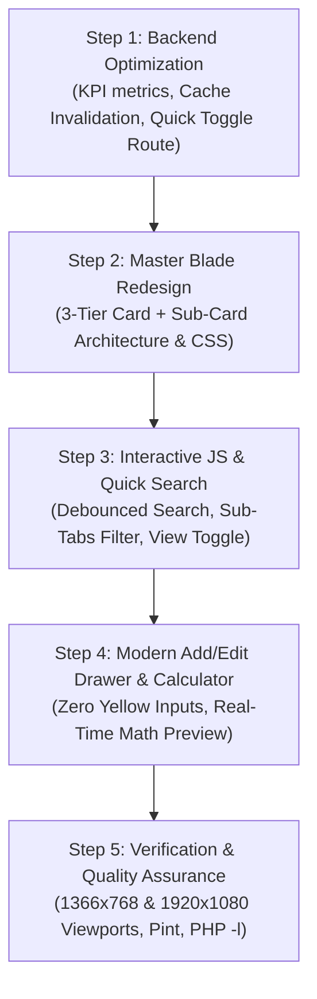

# Architectural Implementation Plan: Super-Admin Top-Up Coin Packages Redesign

> **Target Module:** Super Admin — Top Up Coin Packages (`/super-admin/topup-coin-packages`)  
> **Route Name:** `superadmin.company.topUpCoinPackages`  
> **Controller:** `app/Http/Controllers/SuperAdmin/SuperAdminCompanyController.php`  
> **Primary View:** `resources/views/super-admin/coin-settings/topup-coin-package.blade.php`  
> **Standard:** JERO Enterprise Modern Card + Sub-Card Design System ([docs/UI_UX_CARD_SUB_CARD_DESIGN_STANDARD.md](file:///c:/xampp/htdocs/git/JWMaincode28June2026/docs/UI_UX_CARD_SUB_CARD_DESIGN_STANDARD.md))  
> **Viewport Target:** 15.6" Laptop Screen Responsive (`1366×768` & `1920×1080`), Zero Horizontal Scroll (`overflow-x: hidden`)

---

## 1. Executive Codebase & UX Audit

### 1.1 Existing Flaws in the Current Page
1. **Violation of Modern Card + Sub-Card Standard (Rule 20):**
   - The current view uses a legacy raw HTML table (`<table class="table table-row-dashed...">`) with cramped columns and no visual hierarchy.
   - Lacks the mandatory 3-tier enterprise structure (Toolbar Card + Sub-Tabs Card + Discrete Sub-Cards Stream).
2. **Missing KPI / Analytics Strip:**
   - No high-level visibility on catalog health: total coin packages, active vs inactive count, operational vs sales distribution, or maximum discount offered.
3. **Missing Pagination Controls:**
   - The controller executes `$coinEvents->paginate(20)`, but the Blade view completely omits pagination links (`{{ $coinEvents->links() }}`), leaving multi-page navigation impossible.
4. **Broken Deletion Handler:**
   - The embedded JavaScript (`$('.sa-params').on('click'...)`) references an invalid/unrelated route (`route('superadmin.packages.destroy')`), which targets tenant subscription plans rather than top-up coin records.
5. **Lack of Instant Status Management:**
   - Deactivating or activating a package requires navigating to a separate form page (`add-edit-top-up-coin-package`), manually editing the switch, and submitting. There is no inline AJAX toggle.
6. **Stale Cache Risk (Rule 5 & 6):**
   - `SubscriptionService.php` caches operational and sales top-up packages in Redis (`Cache::remember('top_up_coin_packages_op', 86400, ...)`). Currently, updating a coin package in `topUpCoinPackageStore` does **not** invalidate these cache keys, causing tenants to potentially see stale pricing for up to 24 hours.
7. **Form Ergonomics on Add/Edit:**
   - The existing edit form contains hardcoded yellow background inputs (`#FFFF99`), duplicated click handlers (`$('#save-form').click()` bound twice), and misaligned form columns.

---

## 2. Proposed Architecture & UI/UX Blueprint

```
┌────────────────────────────────────────────────────────────────────────────────────────────────────────┐
│  TIER 0: EXECUTIVE KPI SUMMARY STRIP (4 High-Density Metric Cards)                                     │
│  [ Total Packages: 14 ]    [ Active: 9 | Inactive: 5 ]    [ Operational: 7 ]    [ Sales Packages: 7 ]  │
└────────────────────────────────────────────────────────────────────────────────────────────────────────┘
                                                    ▼
┌────────────────────────────────────────────────────────────────────────────────────────────────────────┐
│  TIER 1: TOP HEADER TOOLBAR CARD (Pure White #ffffff, Border #e2e8f0, Radius 10px)                     │
│  [🪙] Top-Up Coin Packages           [🔍 Search coins, prices, types... ] [✕]  [Stream | Table]  [+ Add]│
└────────────────────────────────────────────────────────────────────────────────────────────────────────┘
                                                    ▼
┌────────────────────────────────────────────────────────────────────────────────────────────────────────┐
│  TIER 2: SUB-TABS FILTER CARD (Pure White #ffffff, Border #e2e8f0, Radius 10px)                        │
│  [All Packages (14) Active Blue]  [Active (9)]  [Inactive (5)]  [Operational (7)]  [Sales (7)]         │
└────────────────────────────────────────────────────────────────────────────────────────────────────────┘
                                                    ▼
┌────────────────────────────────────────────────────────────────────────────────────────────────────────┐
│  TIER 3: MODERN CARD + SUB-CARD STREAM (Hover Elevation, Radius 10px, Border #e2e8f0)                  │
│  ┌──────────────────┬───────────────────┬───────────────────┬──────────────────┬────────────────────┐  │
│  │ SUB-CARD 1:      │ SUB-CARD 2:       │ SUB-CARD 3:       │ SUB-CARD 4:      │ SUB-CARD 5:        │  │
│  │ Package Identity │ Coin Volume       │ Pricing (INR/USD) │ Unit Economics   │ Actions & Status   │  │
│  │ 🪙 1,000 Coins   │ 1,000 Coins       │ INR ₹950.00       │ ₹0.9500 / coin   │ [Active Toggle 🟢] │  │
│  │ #TOP-004         │ Tier: Growth      │ USD $67.00        │ $0.0670 / coin   │ [Edit Drawer ✏️]    │  │
│  │ [Operational]    │ [Standard Pack]   │ [🏷️ 5% Discount]  │ [Best Value]     │ Updated 2 days ago │  │
│  └──────────────────┴───────────────────┴───────────────────┴──────────────────┴────────────────────┘  │
│  ┌──────────────────────────────────────────────────────────────────────────────────────────────────┐  │
│  │ SUB-CARD 6 (BOTTOM STRIP): Created 20 Sep 2024 • Event: Operational Pipeline • ID: #TOP-004      │  │
│  └──────────────────────────────────────────────────────────────────────────────────────────────────┘  │
└────────────────────────────────────────────────────────────────────────────────────────────────────────┘
```

---

## 3. Detailed Component Specifications

### 3.1 Tier 0: Executive KPI Summary Cards
Four compact statistic widgets positioned at the top of the page:
1. **Total Packages:** Total coin packages configured in the catalog.
2. **Active vs Inactive Ratio:** Visual badge indicating live packages available for tenant purchase versus blocked ones.
3. **Operational Coin Packages:** Breakdown of packages scoped for candidate sourcing, pipeline unlock, and ATS actions.
4. **Sales Coin Packages:** Breakdown of packages scoped for marketplace candidate trading and sales operations.

### 3.2 Tier 1: Top Header Toolbar Card (`.cd-topup-header-card`)
- **Left Identity:**
  - Icon Box (`38px × 38px`, soft amber/primary background `#fffbeb`, color `#d97706`).
  - Title: **"Top-Up Coin Packages"** (`15px`, bold, `#0f172a`).
  - Subtitle: **"Configure global coin bundles, multi-currency rates (INR / USD), and tenant discounts."** (`11.5px`, `#64748b`).
- **Right Action Suite:**
  - **Dynamic Search Sub-Card:** `36px` height, `280px` width, live client-side filtering on package title, coins, price, and event type with `300ms` debounce and instant clear button `✕`.
  - **View Mode Switcher:** Dual buttons to toggle between **Card Stream View** (modern visual sub-cards) and **High-Density Table View** (compact tabular mode for rapid scanning).
  - **Primary Action Button:** `+ Add Top Up Package` (Metronic primary blue `#009ef7`, radius `8px`), triggering the seamless slide-over drawer / quick-entry modal.

### 3.3 Tier 2: Sub-Tabs Filter Card (`.cd-topup-tabs-card`)
- Pure white container (`#ffffff`, border `#e2e8f0`, radius `10px`).
- Tabs with dynamic count pills:
  - `All Packages` (count)
  - `Active` (count, emerald pill)
  - `Inactive` (count, slate pill)
  - `Operational Coins` (count, amber pill)
  - `Sales Coins` (count, indigo pill)
  - `Custom Bundles` (count, purple pill)
- Single active highlight with vibrant primary blue (`#009ef7`) and inverted white counter pill.

### 3.4 Tier 3: Primary Card Stream & 5 Discrete Sub-Cards
Each package record is rendered as an enterprise Primary Card (`.cd-topup-card`) containing:
1. **Sub-Card 1: Package Identity & Type (`.cd-subcard-identity`)**
   - Icon badge indicating bundle size or type.
   - Bundle Name: e.g., `1,000 Coins Pack` (or `Custom Amount Pack`).
   - Catalog ID chip: `#TOP-004`.
   - Event Scope Pill: `[Operational Coins]` (amber `#fffbeb`, `#b45309`) or `[Sales Coins]` (teal `#f0fdf4`, `#15803d`).
   - Status Badge: `Active` (green) or `Inactive` (gray/red).
2. **Sub-Card 2: Coin Volume & Tier (`.cd-subcard-volume`)**
   - Large bold coin metric: `1,000 Coins` (or `Custom Input`).
   - Volume tier badge: `Starter` (< 500), `Growth` (500–2,000), `Enterprise` (5,000+).
   - Package Type: `Fixed Bundle` vs `Custom Price Calculator`.
3. **Sub-Card 3: Dual-Currency Financials (`.cd-subcard-pricing`)**
   - **INR Row:** Formatted currency (`₹950.00`). If discounted, displays original base price strikethrough (`₹1,000.00`).
   - **USD Row:** Formatted USD (`$67.00`).
   - **Discount Pill:** E.g., `🏷️ 5% OFF` in high-visibility badge.
4. **Sub-Card 4: Unit Economics & Rate (`.cd-subcard-economics`)**
   - **INR Rate:** `₹0.9500 / coin`.
   - **USD Rate:** `$0.0670 / coin`.
   - **Value Rating:** Automatically flags best-value offerings for cost efficiency.
5. **Sub-Card 5: Instant Control & Actions (`.cd-subcard-actions`)**
   - **AJAX Active Toggle:** Fast toggle switch to immediately activate/deactivate the package without page reload.
   - **Edit Button:** Direct link / drawer trigger with pre-filled inputs.
   - **Timestamp:** Formatted last-updated info (`Updated 24 Sep 2024`).
6. **Sub-Card 6: Bottom Activity Strip (`.cd-topup-card-bottom`)**
   - Hairline border `#f1f5f9`.
   - Creation date with calendar icon.
   - Event type details and custom flag indicators.

### 3.5 High-Density Tabular Mode (Alternate View)
- A streamlined, modern Metronic table view available via the Tier 1 View Mode toggle.
- Properly formatted cells with Poppins typography, rounded currency badges, status pills, and inline status switches.
- Ideal for super-admins who occasionally want a 1-page condensed ledger view.

### 3.6 Interactive Add / Edit Drawer Component
- Slide-over drawer (or modal) embedded seamlessly in the page to eliminate disruptive page reloads.
- Replaces ugly yellow inputs (`#FFFF99`) with clean Metronic solid input fields (`form-control form-control-solid`).
- **Real-Time Interactive Calculator:**
  - Modifying `Total Coins`, `Price (INR)`, `Price (USD)`, or `Discount (%)` instantly computes and renders:
    - Final Discounted Price
    - INR Per Coin Rate (`total_price / total_coins`)
    - USD Per Coin Rate (`total_price_usd / total_coins`)
    - Error prevention: handles `0` coins cleanly without `NaN` or `Infinity`.
- Form submission via AJAX with SweetAlert2 confirmation, instant feedback, and automatic DOM row update.

---

## 4. Backend & Cache Synchronization

### 4.1 Controller Updates (`SuperAdminCompanyController.php`)
1. **Enhance `topUpCoinPackages()`:**
   - Order packages logically (e.g., `ORDER BY event_type ASC, coins ASC`).
   - Compute KPI metrics (`totalCount`, `activeCount`, `inactiveCount`, `operationalCount`, `salesCount`, `maxDiscount`) and pass them to `$this->data`.
2. **Add Dedicated Quick Toggle Method (`toggleTopUpCoinPackageStatus`):**
   - Route: `POST super-admin/topup-coin-package/toggle-status`
   - Validates `id` and flips `status = 1 - status`.
   - Invalidates caches atomically.
3. **Atomic Multi-Tenant Cache Invalidation (Rules 5 & 6):**
   - In both `topUpCoinPackageStore` and `toggleTopUpCoinPackageStatus`, add:
     ```php
     \Illuminate\Support\Facades\Cache::forget('top_up_coin_packages_op');
     \Illuminate\Support\Facades\Cache::forget('top_up_coin_packages_sal');
     ```
   - Guarantees immediate real-time sync across all tenant companies purchasing top-up coins.

---

## 5. Implementation Phases & Step-by-Step Execution



| Phase | Tasks & Deliverables | Verification Criteria |
| :--- | :--- | :--- |
| **Phase 1: Backend & Cache** | • Add KPI computations in `topUpCoinPackages()`<br>• Add `toggleTopUpCoinPackageStatus()` method & route<br>• Add `Cache::forget` calls in `topUpCoinPackageStore` | `php -l` clean, route registered, cache cleared on write. |
| **Phase 2: Master Blade & CSS** | • Rewrite `resources/views/super-admin/coin-settings/topup-coin-package.blade.php`<br>• Implement Tier 0 (KPIs), Tier 1 (Toolbar), Tier 2 (Sub-tabs), Tier 3 (Sub-cards grid)<br>• Add High-Density Table alternative view | Zero horizontal scroll on 1366×768 & 1920×1080. Valid Metronic styling. |
| **Phase 3: Client Search & Filter** | • Instant 300ms debounced search with clear button `✕`<br>• Sub-tab status/event filtering with live count badges<br>• AJAX status toggle with optimistic UI feedback | Search responds instantly without page reloads. |
| **Phase 4: Add/Edit Drawer** | • Add Slide-over Drawer / Modal for creating & editing packages<br>• Real-time Per Coin Rate & Discount math calculation<br>• Modern Metronic input fields (no `#FFFF99`) | Accurate per-coin rate to 4 decimal places, clean SweetAlert2 alerts. |
| **Phase 5: Testing & Audit** | • Verify against all 14 existing database records<br>• Verify 15.6" screen responsiveness<br>• Pint styling format check | 100% adherence to JERO AI rules and UI/UX Card standard. |

---

## 6. Review & Approval Request

This plan strictly preserves 100% of the existing database schema, pricing calculations, and business logic while upgrading the interface to a world-class, 10-year senior developer enterprise standard.
