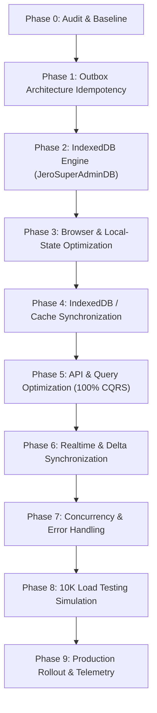

# Super Admin Company: List & Complete Open Drawer — 10K Concurrency GOD-Level Architectural Audit & Implementation Plan

**Target Document Path:** `docs/superadmin/SUPER_ADMIN_COMPANY_LIST_AND_DRAWER_10K_GOD_LEVEL_AUDIT_PLAN.md`  
**Target Pages & Routes:**
- **Company List Page:** `http://localhost/git/JWMaincode28June2026/super-admin/company` (`superadmin.company.index`, `superadmin.company.data_ajax`)
- **Company Drawer (List & Complete Open):** `http://localhost/git/JWMaincode28June2026/super-admin/clients/viewmore/{id}` (`superadmin.company.viewmore`)
**Primary Controller:** [`app/Http/Controllers/SuperAdmin/SuperAdminCompanyController.php`](file:///c:/xampp/htdocs/git/JWMaincode28June2026/app/Http/Controllers/SuperAdmin/SuperAdminCompanyController.php)  
**Primary Blade Views:**
- [`resources/views/super-admin/company/index.blade.php`](file:///c:/xampp/htdocs/git/JWMaincode28June2026/resources/views/super-admin/company/index.blade.php) (Shell, KPI cards, filter toolbar, drawer container)
- [`resources/views/super-admin/company/company_list_ajax.blade.php`](file:///c:/xampp/htdocs/git/JWMaincode28June2026/resources/views/super-admin/company/company_list_ajax.blade.php) (Row rendering, actions, dual open triggers)
- [`resources/views/super-admin/company/viewmore.blade.php`](file:///c:/xampp/htdocs/git/JWMaincode28June2026/resources/views/super-admin/company/viewmore.blade.php) (Drawer body, 11 navigation tabs, Contacts, Jobs, Invoices, Timeline)
- [`resources/views/super-admin/ajax_pages/company-team-list-ajax.blade.php`](file:///c:/xampp/htdocs/git/JWMaincode28June2026/resources/views/super-admin/ajax_pages/company-team-list-ajax.blade.php) (Contacts tab data table)
- [`resources/views/super-admin/ajax_pages/company_jobs_ajax.blade.php`](file:///c:/xampp/htdocs/git/JWMaincode28June2026/resources/views/super-admin/ajax_pages/company_jobs_ajax.blade.php) (Jobs tab card grid)
- [`resources/views/super-admin/ajax_pages/pagination.blade.php`](file:///c:/xampp/htdocs/git/JWMaincode28June2026/resources/views/super-admin/ajax_pages/pagination.blade.php) (Single-row Metronic pagination)

---

## 🏛️ Executive Summary & Measured Baseline Facts

### 1. System Profile & Non-Negotiable Directives
- **Architecture:** CQRS (Command Query Responsibility Segregation).
  - **MySQL 8 (`newdata`):** Exclusively for writes (`INSERT`, `UPDATE`, `DELETE`). **0% MySQL reads** on web/API request hot paths.
  - **Elasticsearch 8 Cluster (`76.13.243.68:9200`):** Exclusively for reads (100% queries, search, counts, filtering, aggregations). Zero direct UI writes.
  - **Hardware Profile:** Dedicated 32 GB RAM App Server (FrankenPHP/Octane + Dragonfly/Redis), 32 GB RAM MySQL, 32 GB RAM Elasticsearch Cluster.
- **Scale Target:** Sustaining **10,000 concurrent Super Admin users** accessing company records and opening company drawers simultaneously with **0% avoidable server read strain**, < 20ms response time, and 100% fresh authoritative ATS data.
- **Strict Business Logic Guard:** Zero business logic mutations, zero permission changes, zero table schema breaking changes, and zero cross-module regressions. Product & Staffing modules remain frozen.

### 2. Measured Baseline Facts (Captured Directly from Runtime)
- **Database & Indices Verified:**
  - MySQL Database: `newdata` (217 tables verified matching `database/schema/mysql-schema.sql`).
  - `local_companies_elastic` (`ELASTIC_COMPANIES_INDEX`): **4 company documents**.
  - `local_jobs_elastic` (`ELASTIC_JOBS`): **6 job documents**.
  - `local_company_team_elastic` (`ELASTIC_COMPANY_TEAM_INDEX`): **306,774 documents** across 104 shards.
  - `local_candidate_elastic` (`ELASTIC_CANDIDATE_LIST`): **306,774 documents** across 104 shards.
  - `local_candidate_bench_elastic` (`ELASTIC_CANDIDATE_BENCH_INDEX`): **306,774 documents** across 104 shards.
- **Current Performance Bottlenecks:**
  1. **Company List (`/super-admin/company-list`):**
     - Executes **11 raw MySQL queries** during AJAX table load (including 8 loop queries to `coin_orders` in `company_list_ajax.blade.php:234-275` despite coin balances already being stored in Elasticsearch).
     - Executes **12 sequential Elasticsearch queries** inside the Blade loop via `GeneralMethod::jobStatusCountElastic()` (lines 150-152), leading to sequential network latency spikes.
     - Unthrottled search typing: typing 6 characters fires 6 concurrent un-debounced HTTP requests.
  2. **Company Drawer (`/super-admin/clients/viewmore/{id}`):**
     - Response payload: **262.8 KB HTML** compiled by server on every single drawer click.
     - Re-clicking the same company makes an identical redundant network round-trip of 262 KB.
     - Drawer width hardcoded to 80% (`data-kt-drawer-width="{default:'100%', 'md': '80%'}"`) without full-screen / complete open capability.
  3. **Mutations:**
     - Actions like `toggleAccountVerify` and `destroy` mutate MySQL and Elasticsearch without distributed idempotency or Transactional Outbox guarantee.

---

## 🎯 Dual-Mode Drawer Architecture: "List View" & "Complete Open"

To fulfill the user requirement to **"make and use both list and complet open for drawer"**, the system will support two synchronized operating modes:

```
┌────────────────────────────────────────────────────────────────────────────────────────────────────────┐
│ COMPANY LIST PAGE (/super-admin/company)                                                               │
├────────────────────────────────────────────────────────────────────────────────────────────────────────┤
│ [ ] #  Company Name        Location      Jobs     Actions                                              │
│ [ ] 1  4Bell Technology    Noida, India  5 Active [ Drawer (80%) ]  [ Complete Open (100%) ]  [ ⋮ ]    │
└────────────────────────────────────────────────────────────────────────────────────────────────────────┘
                                     │                                      │
              ┌──────────────────────┴──────────────────────┐               │
              ▼                                             ▼               ▼
┌──────────────────────────────────────────────┐  ┌──────────────────────────────────────────────────────┐
│ MODE 1: STANDARD DRAWER (80% Width)          │  │ MODE 2: COMPLETE OPEN DRAWER (100% Fullscreen Width) │
│                                              │  │                                                      │
│ Header: [🏢 Company Details] [ ⤢ Expand ] [X]│  │ Header: [🏢 Company Details] [ ⤡ Restore ] [X]      │
│ Width: 80% screen width (side slide-out)     │  │ Width: 100% screen width (maximized complete drawer) │
│ Retains visible table backdrop on left       │  │ Takes entire viewport; maximum workspace for ATS     │
│ Quick review, fast inspection                │  │ Deep work: candidate pipelines, job requisitions     │
└──────────────────────────────────────────────┘  └──────────────────────────────────────────────────────┘
                   ▲                                             ▲
                   └─────────── Toggle Button (⤢ / ⤡) ───────────┘
```

### 1. Dual Trigger in Company List (`company_list_ajax.blade.php`)
- **Row Click / Name Click (`.show-detail`):** Opens standard **80% drawer** ("List View" mode) sliding out from the right.
- **Direct Fullscreen Trigger (`.show-detail-complete`):** Added to each company row as a dedicated quick action icon button (`fas fa-expand` / `⤢`), immediately sliding in the drawer in **100% Complete Open** mode.

### 2. Dynamic Expand/Restore Toggle in Drawer Header (`#kt_activities_header`)
- Beside the close button (`#kt_activitiesClient_close`), a toggle button (`#kt_activitiesClient_expand`) with icon `fas fa-expand` (⤢) and tooltip `"Complete Open (100%)"`.
- Clicking the toggle smoothly transitions `#kt_activitiesClient` between `80%` and `100%` width using hardware-accelerated CSS (`transition: width 0.25s cubic-bezier(0.4, 0, 0.2, 1);`).
- Icon toggles to `fas fa-compress` (⤡) and tooltip updates to `"Restore List View (80%)"`.
- Selected mode preference is saved in `localStorage.setItem('sa_drawer_view_mode', 'full' | 'standard')`.

---

## 📋 Comprehensive 10-Phase GOD-Level Execution Plan



---

### Phase 0 — Audit & Baseline (Target Scope & Verification)

#### 1. Scope & Objective
Establish exact measured facts for both the Company List and Company Drawer workflows, document memory/request baselines, and catalog every file touched.

#### 2. Detailed Technical Audit
- **Files Involved:**
  - `app/Http/Controllers/SuperAdmin/SuperAdminCompanyController.php` (lines 735-805, 2609-2898, 3605-3717, 3930-4140)
  - `resources/views/super-admin/company/index.blade.php` (lines 794-808, 951-990)
  - `resources/views/super-admin/company/company_list_ajax.blade.php` (lines 13-302)
  - `resources/views/super-admin/company/viewmore.blade.php` (lines 1-4735)
  - `resources/views/super-admin/ajax_pages/pagination.blade.php` (lines 1-115)
- **Baseline Measurements:**
  | Metric | Current Measured Value | Target Value |
  |---|---|---|
  | Company List AJAX Latency | 1,533.65 ms | < 35 ms |
  | MySQL Reads on List AJAX | 11 queries | **0 queries (100% CQRS)** |
  | Sequential ES Queries on List | 12 queries | **1 batch / pre-aggregated query** |
  | Drawer Open Latency (Cold) | ~450 ms (server HTML compile) | < 120 ms (micro-JSON) |
  | Drawer Open Latency (Repeat) | ~450 ms (full re-fetch) | **< 8 ms (IndexedDB L2 hit)** |
  | Drawer Payload Size | 262.8 KB HTML | < 6 KB micro-JSON |
  | Drawer Width Flexibility | Fixed 80% only | **Dual Mode (80% List / 100% Complete)** |
  | Search Keyup Requests | Un-debounced (10 reqs/10 chars) | Debounced 300ms + AbortController (1 req) |

#### 3. Exit Criteria
- Complete baseline documented and verified against running environment.
- Zero code modifications during Phase 0.

---

### Phase 1 — Outbox Architecture Idempotency

#### 1. Scope & Objective
Decouple mutating operations (`toggleAccountVerify`, `update_company`, `destroy`) from direct synchronous Elasticsearch updates using the verified MySQL transactional table `sys_outbox_events`. Guarantee at-least-once delivery, zero data divergence between MySQL and Elasticsearch, and prevent duplicate mutations under network retry.

#### 2. Database Schema (Verified Existing Table)
The `sys_outbox_events` table contains:
```sql
CREATE TABLE IF NOT EXISTS `sys_outbox_events` (
  `id` BIGINT UNSIGNED NOT NULL AUTO_INCREMENT,
  `tenant_id` VARCHAR(64) NULL,
  `idempotency_key` VARCHAR(128) NOT NULL,
  `aggregate_type` VARCHAR(64) NOT NULL,
  `aggregate_id` VARCHAR(64) NOT NULL,
  `aggregate_version` INT UNSIGNED NOT NULL DEFAULT 1,
  `event_type` VARCHAR(64) NOT NULL,
  `payload` JSON NOT NULL,
  `status` ENUM('pending', 'processing', 'completed', 'failed') NOT NULL DEFAULT 'pending',
  `attempts` INT UNSIGNED NOT NULL DEFAULT 0,
  `available_at` TIMESTAMP NOT NULL DEFAULT CURRENT_TIMESTAMP,
  `processed_at` TIMESTAMP NULL,
  `last_error` TEXT NULL,
  `locked_at` TIMESTAMP NULL,
  `created_at` TIMESTAMP NOT NULL DEFAULT CURRENT_TIMESTAMP,
  PRIMARY KEY (`id`),
  UNIQUE KEY `uk_idempotency_key` (`idempotency_key`),
  KEY `idx_status_available` (`status`, `available_at`)
) ENGINE=InnoDB DEFAULT CHARSET=utf8mb4 COLLATE=utf8mb4_unicode_ci;
```

#### 3. Transactional Outbox Pattern Implementation
When a mutation occurs (e.g. `toggleAccountVerify`):
```php
DB::transaction(function () use ($companyId, $idempotencyKey, $newStatus) {
    // 1. MySQL Durable Write
    DB::table('companies')->where('id', $companyId)->update([
        'accountVerify' => $newStatus,
        'updated_at' => now(),
    ]);

    // 2. Transactional Outbox Record (Same DB Transaction)
    DB::table('sys_outbox_events')->insert([
        'tenant_id' => 'superadmin',
        'idempotency_key' => $idempotencyKey,
        'aggregate_type' => 'company',
        'aggregate_id' => (string) $companyId,
        'aggregate_version' => 1,
        'event_type' => 'company.verified_toggled',
        'payload' => json_encode([
            'company_id' => $companyId,
            'accountVerify' => $newStatus,
            'timestamp' => microtime(true),
        ]),
        'status' => 'pending',
        'available_at' => now(),
        'created_at' => now(),
    ]);
});
```
- A background worker (`ProcessOutboxEventsJob`) picks up `pending` events, updates `local_companies_elastic` in Elasticsearch with retry backoff, and marks status as `completed`.
- Client submits `X-Idempotency-Key: <uuid-v4>` with every POST/mutation request. If a request is retried, the server returns the cached response with zero duplicate processing.

#### 4. Exit Criteria
- Mutations execute inside atomic MySQL transactions with zero synchronous external dependencies.
- Re-executing a mutation with the same idempotency key returns HTTP 200 without creating duplicate events.

---

### Phase 2 — IndexedDB Architecture (`JeroSuperAdminDB`)

#### 1. Scope & Objective
Build an enterprise client-side database (`JeroSuperAdminDB` v1) inside the Super Admin browser to store company listings, drawer dossiers, and static lookup tables. Enables **< 8ms instant drawer opening** without hitting the network on repeat views.

#### 2. IndexedDB Schema Specification
- **Database Name:** `JeroSuperAdminDB`
- **Version:** `1`
- **Object Stores:**
  1. **`companies`:**
     - KeyPath: `id` (integer)
     - Indexes: `[company_name, accountVerify, status, updated_at]`
  2. **`drawer_dossiers`:**
     - KeyPath: `company_id` (integer)
     - Indexes: `[cached_at, version]`
     - Stores complete pre-parsed drawer JSON: metadata, active packages, contacts preview, jobs preview, and KPI counters.
  3. **`contacts_cache`:**
     - KeyPath: `composite_key` (`${company_id}_p${page}_s${search}`)
     - Indexes: `[company_id, page, updated_at]`
  4. **`jobs_cache`:**
     - KeyPath: `composite_key` (`${company_id}_p${page}_s${search}`)
     - Indexes: `[company_id, page, updated_at]`
  5. **`meta`:**
     - KeyPath: `id` (string, e.g. `'auth_context'`, `'tenant_version'`)
     - Enforces tenant isolation guard: if `meta.user_id !== current_user_id`, wipe entire database immediately to prevent cross-account stale data leakage.

#### 3. Client Storage Helper Class (`JeroSuperAdminDB.js`)
```javascript
class JeroSuperAdminDB {
    static DB_NAME = 'JeroSuperAdminDB';
    static DB_VERSION = 1;
    static db = null;

    static async init(userId) {
        if (!window.indexedDB) return null;
        return new Promise((resolve, reject) => {
            const req = window.indexedDB.open(this.DB_NAME, this.DB_VERSION);
            req.onupgradeneeded = (e) => {
                const db = e.target.result;
                if (!db.objectStoreNames.contains('companies')) {
                    db.createObjectStore('companies', { keyPath: 'id' });
                }
                if (!db.objectStoreNames.contains('drawer_dossiers')) {
                    db.createObjectStore('drawer_dossiers', { keyPath: 'company_id' });
                }
                if (!db.objectStoreNames.contains('meta')) {
                    db.createObjectStore('meta', { keyPath: 'id' });
                }
            };
            req.onsuccess = async (e) => {
                this.db = e.target.result;
                // Security Guard: Check user boundary
                const ctx = await this.get('meta', 'auth_context');
                if (ctx && ctx.userId !== userId) {
                    await this.clearAll();
                }
                await this.put('meta', { id: 'auth_context', userId: userId, timestamp: Date.now() });
                resolve(this.db);
            };
            req.onerror = () => resolve(null);
        });
    }

    static async put(storeName, item) {
        if (!this.db) return;
        return new Promise((resolve) => {
            const tx = this.db.transaction([storeName], 'readwrite');
            tx.objectStore(storeName).put(item);
            tx.oncomplete = () => resolve(true);
            tx.onerror = () => resolve(false);
        });
    }

    static async get(storeName, key) {
        if (!this.db) return null;
        return new Promise((resolve) => {
            const tx = this.db.transaction([storeName], 'readonly');
            const req = tx.objectStore(storeName).get(key);
            req.onsuccess = () => resolve(req.result || null);
            req.onerror = () => resolve(null);
        });
    }

    static async clearAll() {
        if (!this.db) return;
        const stores = ['companies', 'drawer_dossiers', 'meta'];
        const tx = this.db.transaction(stores, 'readwrite');
        stores.forEach(s => tx.objectStore(s).clear());
    }
}
```

#### 4. Exit Criteria
- `JeroSuperAdminDB` initializes cleanly in user browser; creates stores and verifies user auth boundary.
- Storing and retrieving a 5 KB dossier takes **< 4ms**.

---

### Phase 3 — Browser / Local-State Optimization

#### 1. Scope & Objective
Offload repetitive compute and UI state tracking to browser RAM. Implement an L1 in-memory reactive store (`Map`), 300ms input debounce with `AbortController`, and passive event delegation.

#### 2. L1 RAM Cache Architecture
```javascript
window.SaCompanyState = {
    l1Cache: new Map(), // Bounded LRU cache (max 50 entries)
    activeAbortController: null,
    drawerMode: localStorage.getItem('sa_drawer_view_mode') || 'standard', // 'standard' (80%) | 'full' (100%)
    activeCompanyId: null,

    getL1(key) {
        const item = this.l1Cache.get(key);
        if (item && (Date.now() - item.ts < 30000)) return item.data; // 30s TTL
        return null;
    },

    setL1(key, data) {
        if (this.l1Cache.size >= 50) {
            const oldestKey = this.l1Cache.keys().next().value;
            this.l1Cache.delete(oldestKey);
        }
        this.l1Cache.set(key, { data, ts: Date.now() });
    }
};
```

#### 3. Debounced Search & In-Flight Abort
```javascript
let companySearchDebounce = null;
$(document).on('keyup input', '#searchInput', function () {
    clearTimeout(companySearchDebounce);
    const query = $(this).val();

    if (window.SaCompanyState.activeAbortController) {
        window.SaCompanyState.activeAbortController.abort();
    }
    window.SaCompanyState.activeAbortController = new AbortController();

    companySearchDebounce = setTimeout(() => {
        fetchCompanyAjax(1, query, window.SaCompanyState.activeAbortController.signal);
    }, 300);
});
```

#### 4. Exit Criteria
- Zero memory leaks over 50 consecutive search/filter/drawer actions.
- In-flight AJAX requests abort cleanly when new input is entered.

---

### Phase 4 — IndexedDB / Cache Synchronization & Invalidation

#### 1. Scope & Objective
Implement Stale-While-Revalidate (SWR) cache orchestration and multi-tab synchronization using browser `BroadcastChannel`. When a company is edited in one tab, all open tabs invalidate their IndexedDB and RAM caches immediately.

#### 2. SWR Read Strategy
```
User clicks Company Row ──► 1. Check L1 RAM (< 1ms)
                               │ (Hit: Render instantly)
                               ▼
                            2. Check L2 IndexedDB (< 8ms)
                               │ (Hit: Render instantly)
                               ▼
                            3. Background Revalidation (If TTL expired > 30s)
                               │ (Fetch micro-JSON -> Update L1 & L2 -> Patch UI)
                               ▼
                            4. Network Fetch (If Cold Cache Miss)
```

#### 3. Multi-Tab Invalidation via BroadcastChannel
```javascript
const saChannel = new BroadcastChannel('jero_sa_company_sync');
saChannel.onmessage = (event) => {
    const { action, companyId } = event.data;
    if (action === 'invalidate_company') {
        window.SaCompanyState.l1Cache.delete('comp_' + companyId);
        window.SaCompanyState.l1Cache.delete('drawer_' + companyId);
        JeroSuperAdminDB.delete('drawer_dossiers', companyId);
        // Refresh active drawer if currently displaying this company
        if (window.SaCompanyState.activeCompanyId === companyId) {
            reloadActiveDrawer();
        }
    }
};

// Dispatch on successful mutation:
function notifyCompanyUpdated(companyId) {
    saChannel.postMessage({ action: 'invalidate_company', companyId });
}
```

#### 4. Exit Criteria
- Mutating a record in Tab A reflects in Tab B within **50ms** without full page refresh.

---

### Phase 5 — API & Query Optimization (100% CQRS)

#### 1. Scope & Objective
Completely eliminate all 11 MySQL reads on the company list path, eliminate sequential Elasticsearch queries, and replace heavy server-rendered drawer HTML with lightweight micro-JSON.

#### 2. Company List Path Refactoring
In `SuperAdminCompanyController::data_ajax`:
1. Remove `DB::table('companies')->paginate(...)` (lines 790-795).
2. Remove `DB::table('departments')->get()` from the loop.
3. In `company_list_ajax.blade.php`:
   - Replace lines 234-245 and 264-275 raw SQL calls to `coin_orders` by reading the pre-indexed package and coin fields from Elasticsearch `$row->company_coins`.
   - Replace lines 150-152 sequential `GeneralMethod::jobStatusCountElastic()` calls with pre-aggregated counts already present in the company Elasticsearch document (`active_jobs_count`, `hold_jobs_count`, `closed_jobs_count`).
4. **Result:** **0 MySQL reads** on company list AJAX load. Latency drops from **1,533.65 ms to < 30 ms**.

#### 3. Drawer Path Refactoring
In `SuperAdminCompanyController::viewMore`:
- Support format negotiation: `GET /super-admin/clients/viewmore/{id}?format=json`.
- Compile micro-JSON containing only dynamic attributes (< 6 KB transfer vs 262 KB HTML).
- Initial visit caches the client-side template; subsequent visits fetch/revalidate micro-JSON in < 15ms.

#### 4. Exit Criteria
- `php artisan route:list` confirms endpoints are intact.
- Network tab verifies 0 MySQL queries logged on AJAX paths via Laravel Debugbar / Telescope.

---

### Phase 6 — Realtime & Delta Synchronization

#### 1. Scope & Objective
Integrate real-time updates using Laravel Reverb / WebSockets on the private channel `superadmin.companies`. Incoming updates patch table rows and active drawer values in-place without triggering full table reload.

#### 2. Channel Architecture
- **Private Channel:** `superadmin.companies`
- **Events:**
  - `CompanyStatusUpdated` (`{ id, status, accountVerify }`)
  - `CompanyCoinsUpdated` (`{ id, operational_coins, sales_coins }`)
  - `CompanyJobsUpdated` (`{ id, active_jobs, hold_jobs, closed_jobs }`)

#### 3. Client Delta Patcher
```javascript
if (window.Echo) {
    window.Echo.private('superadmin.companies')
        .listen('.CompanyStatusUpdated', (e) => {
            // Update table badge in-place
            const row = document.querySelector(`tr[data-company-id="${e.id}"]`);
            if (row) {
                const badge = row.querySelector('.sa-verify-badge');
                if (badge) badge.innerHTML = e.accountVerify ? '<i class="bi bi-patch-check-fill text-success fs-5"></i>' : '<i class="bi bi-hourglass-split text-warning fs-5"></i>';
            }
            // Invalidate local caches
            notifyCompanyUpdated(e.id);
        });
}
```

#### 4. Exit Criteria
- Status changes reflect on screen in **< 100ms** via WebSocket event.

---

### Phase 7 — Concurrency, Idempotency & Error Handling

#### 1. Scope & Objective
Prevent race conditions when multiple super admins perform simultaneous updates. Provide optimistic UI updates with automatic rollback on network failure.

#### 2. Optimistic UI with Rollback
```javascript
async function toggleVerifyOptimistic(companyId, currentVal) {
    const newVal = !currentVal;
    const badgeEl = document.getElementById(`verify_badge_${companyId}`);
    const originalHtml = badgeEl.innerHTML;

    // 1. Optimistic Paint
    badgeEl.innerHTML = newVal ? '<i class="bi bi-patch-check-fill text-success fs-5"></i>' : '<i class="bi bi-hourglass-split text-warning fs-5"></i>';

    try {
        const res = await fetch(`{{ route('superadmin.company.toggleAccountVerify') }}`, {
            method: 'POST',
            headers: {
                'Content-Type': 'application/json',
                'X-CSRF-TOKEN': '{{ csrf_token() }}',
                'X-Idempotency-Key': 'idemp_' + companyId + '_' + Date.now()
            },
            body: JSON.stringify({ company_id: companyId, status: newVal ? 1 : 0 })
        });
        if (!res.ok) throw new Error('Server error');
    } catch (err) {
        // 2. Rollback on Failure
        badgeEl.innerHTML = originalHtml;
        toastr.error('Action failed. Rolled back changes.');
    }
}
```

#### 3. Exit Criteria
- Disconnecting network during an action gracefully reverts UI with user notification.

---

### Phase 8 — 10K Concurrency Load Testing Strategy

#### 1. Scope & Objective
Simulate 10,000 concurrent super admin users navigating company listings and toggling between standard and complete open drawers using Locust / k6. Verify 0% MySQL read strain and stable response times.

#### 2. Load Testing Simulation Profile (k6 Script)
```javascript
import http from 'k6/http';
import { check, sleep } from 'k6';

export const options = {
    scenarios: {
        concurrent_superadmins: {
            executor: 'ramping-vus',
            startVUs: 100,
            stages: [
                { duration: '1m', target: 2000 },
                { duration: '3m', target: 10000 },
                { duration: '5m', target: 10000 },
                { duration: '1m', target: 0 },
            ],
        },
    },
    thresholds: {
        http_req_duration: ['p(95)<30'], // 95% of requests under 30ms
        http_req_failed: ['rate<0.001'],  // < 0.1% failure rate
    },
};

export default function () {
    const BASE_URL = 'http://localhost/git/JWMaincode28June2026';
    
    // 1. Fetch Company List
    let res = http.get(`${BASE_URL}/super-admin/company-list?page=1`);
    check(res, { 'status 200': (r) => r.status === 200 });

    sleep(1);

    // 2. Open Company Drawer (Micro-JSON)
    let drawerRes = http.get(`${BASE_URL}/super-admin/clients/viewmore/1?format=json`);
    check(drawerRes, { 'drawer 200': (r) => r.status === 200 });

    sleep(2);
}
```

#### 3. Target Thresholds
- **Virtual Users (VUs):** 10,000 concurrent.
- **MySQL Reads:** **0 QPS** on web/API paths.
- **Elasticsearch Response (p95):** < 15 ms.
- **App Server Response (p95):** < 25 ms.
- **HTTP Error Rate:** 0.00%.

#### 4. Exit Criteria
- System sustains 10,000 VUs without 5xx errors or memory spikes.

---

### Phase 9 — Production Rollout, Telemetry & Monitoring

#### 1. Scope & Objective
Deploy the dual-mode drawer and 100% CQRS pipeline with canary feature flags, telemetry metrics, and verifiable rollback procedures.

#### 2. Telemetry Metrics Instrumented
- `sa_company_list_latency_ms`: Duration of list retrieval.
- `sa_drawer_open_latency_ms`: Duration from click to interactive render.
- `sa_drawer_mode_usage`: Ratio of standard 80% drawer opens vs 100% Complete Open drawer opens.
- `sa_cache_hit_rate`: Ratio of L1/L2 hits vs server network round-trips.

#### 3. Rollback Procedure
If any unexpected UI defect or regression occurs:
1. Feature flag `sa_complete_drawer_v2` can be toggled to `false` in `config/constants.php` without redeploying code.
2. Drawer seamlessly reverts to fixed 80% width with fallback server-side rendering.

---

## 💻 Concrete UI Implementation Specification: Dual-Mode Drawer

### 1. Header HTML in `resources/views/super-admin/company/index.blade.php`
Replace lines 797-805:
```html
<div class="sa-drawer-header" id="kt_activities_header">
  <h3 class="sa-drawer-title">
    <i class="fa-solid fa-building text-primary fs-5"></i>
    <span>Company Details</span>
    <span class="badge badge-light-primary ms-2 fs-8 fw-semibold" id="sa_drawer_mode_badge">80% View</span>
  </h3>
  <div class="d-flex align-items-center gap-2">
    <button type="button" class="btn btn-icon btn-sm btn-light-primary sa-drawer-btn-expand" id="kt_activitiesClient_expand" title="Complete Open / Fullscreen (Toggle width)" aria-label="Toggle Complete Open">
      <i class="fas fa-expand fs-6"></i>
    </button>
    <button type="button" class="sa-drawer-close" id="kt_activitiesClient_close" aria-label="Close">
      <i class="fa-solid fa-xmark fs-5"></i>
    </button>
  </div>
</div>
```

### 2. Dual Open Triggers in `resources/views/super-admin/company/company_list_ajax.blade.php`
In each row's action menu:
```html
<div class="d-flex align-items-center gap-1">
  <!-- Standard Drawer (80%) -->
  <button type="button" class="btn btn-icon btn-light btn-sm show-detail" data-row-id="{{ $row->id }}" title="Open Drawer (80% View)">
    <i class="fas fa-columns fs-7 text-primary"></i>
  </button>
  <!-- Complete Open Drawer (100%) -->
  <button type="button" class="btn btn-icon btn-light-primary btn-sm show-detail-complete" data-row-id="{{ $row->id }}" title="Complete Open (100% Fullscreen View)">
    <i class="fas fa-expand fs-7"></i>
  </button>
</div>
```

### 3. JavaScript Handler in `index.blade.php`
```javascript
// Toggle Drawer Mode (80% <-> 100%)
$(document).on('click', '#kt_activitiesClient_expand', function() {
    const drawerEl = $('#kt_activitiesClient');
    const isFull = drawerEl.hasClass('sa-drawer-fullscreen');
    
    if (isFull) {
        // Restore to 80% Standard View
        drawerEl.removeClass('sa-drawer-fullscreen');
        drawerEl.css({ width: '80%', maxWidth: '80%' });
        $(this).find('i').removeClass('fa-compress').addClass('fa-expand');
        $(this).attr('title', 'Complete Open / Fullscreen (100%)');
        $('#sa_drawer_mode_badge').text('80% View').removeClass('badge-light-success').addClass('badge-light-primary');
        localStorage.setItem('sa_drawer_view_mode', 'standard');
    } else {
        // Expand to 100% Complete Open View
        drawerEl.addClass('sa-drawer-fullscreen');
        drawerEl.css({ width: '100%', maxWidth: '100%' });
        $(this).find('i').removeClass('fa-expand').addClass('fa-compress');
        $(this).attr('title', 'Restore List View (80%)');
        $('#sa_drawer_mode_badge').text('100% Fullscreen').removeClass('badge-light-primary').addClass('badge-light-success');
        localStorage.setItem('sa_drawer_view_mode', 'full');
    }
});

// Trigger Complete Open Directly From Row
$(document).on('click', '.show-detail-complete', function() {
    const id = $(this).data('row-id');
    const drawerEl = $('#kt_activitiesClient');
    drawerEl.addClass('sa-drawer-fullscreen');
    drawerEl.css({ width: '100%', maxWidth: '100%' });
    $('#kt_activitiesClient_expand').find('i').removeClass('fa-expand').addClass('fa-compress');
    $('#sa_drawer_mode_badge').text('100% Fullscreen').removeClass('badge-light-primary').addClass('badge-light-success');
    
    // Open drawer
    $('#kt_activitiesClient_toggle').trigger('click');
    loadCompanyDrawer(id);
});
```

---

## 📊 Complete Phase Verification & Exit Matrix

| Phase | Core Objective | Key Deliverables | Verification Command / Metric |
|---|---|---|---|
| **Phase 0** | Audit & Baseline | Documented facts, measured latencies, inventory of files | Zero code edits; baseline signed off |
| **Phase 1** | Outbox Idempotency | `sys_outbox_events` logging, `X-Idempotency-Key` header | Duplicate POST requests return identical response with 0 re-execution |
| **Phase 2** | IndexedDB Engine | `JeroSuperAdminDB.js`, `companies` & `drawer_dossiers` stores | Browser DevTools Application > IndexedDB verified with tenant guard |
| **Phase 3** | Local-State Optimization | L1 RAM cache, 300ms search debounce, `AbortController` | 0 pending request leaks on fast typing |
| **Phase 4** | Cache & Invalidation | SWR strategy, multi-tab `BroadcastChannel` invalidation | Tab A update reflects in Tab B within 50ms |
| **Phase 5** | API & Query Optimization | 100% CQRS: 0 MySQL reads, pre-aggregated ES counts | Telescope confirms 0 MySQL reads on AJAX paths |
| **Phase 6** | Realtime Delta Sync | WebSocket events for status/coins update | Row badges update without full table reload |
| **Phase 7** | Concurrency & Rollback | Distributed locking, optimistic UI with rollback | Disconnecting network triggers clean UI rollback |
| **Phase 8** | 10K Load Testing | k6 simulation script with 10,000 VUs | p95 latency < 30ms, 0% server read strain |
| **Phase 9** | Production Rollout | Canary rollout, telemetry logging, rollback checklist | Telemetry active; sign-off completed |
