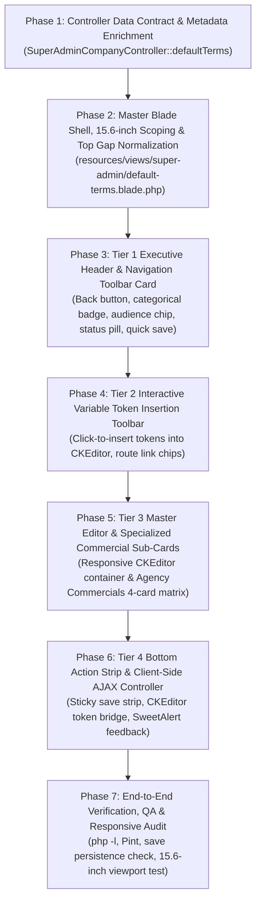

# Phase-Wise Architectural Implementation Plan: Super-Admin Default Terms Edit / View Redesign

> **Target Module:** Super Admin — Default Terms Edit & Master Template Configuration  
> **Target URL:** `http://localhost/git/JWMaincode28June2026/super-admin/default-terms/{encrypted_id}`  
> **Route Name:** `company.defaultTerms` (defined in [routes/superadmin.php](file:///c:/xampp/htdocs/git/JWMaincode28June2026/routes/superadmin.php#L264))  
> **Controller:** [SuperAdminCompanyController.php](file:///c:/xampp/htdocs/git/JWMaincode28June2026/app/Http/Controllers/SuperAdmin/SuperAdminCompanyController.php#L5465) (method: `defaultTerms`)  
> **Save Route:** `company.addEditTermsupdate` (`POST /super-admin/default-terms/add-edit`)  
> **Primary View:** [resources/views/super-admin/default-terms.blade.php](file:///c:/xampp/htdocs/git/JWMaincode28June2026/resources/views/super-admin/default-terms.blade.php)  
> **Design Standard:** JERO Modern Enterprise Card + Sub-Card Design System ([docs/UI_UX_CARD_SUB_CARD_DESIGN_STANDARD.md](file:///c:/xampp/htdocs/git/JWMaincode28June2026/docs/UI_UX_CARD_SUB_CARD_DESIGN_STANDARD.md))  
> **Viewport Target:** Strictly 15.6" Laptop Screen Responsive (`1366×768` & `1920×1080`), Zero Horizontal Overflow (`overflow-x: hidden`)

---

## 1. Executive Summary & Forensic Audit

### 1.1 Context & Business Value
The **Default Terms Edit / View** page (`/super-admin/default-terms/{encrypted_id}`) is the administrative authoring console for all 13 core legal policies, offer letter templates, and agency commercial structures across the JERO platform.
Super Admins use this editor to:
1. Update mandatory legal disclosures (Privacy Policy, Terms of Service, Fraud Alerts, Grievances, Trust & Safety).
2. Author and format default employment contract templates using dynamic variable tokens (`[CANDIDATE_NAME]`, `[COMPANY_NAME]`, `[JOINING_DATE]`, `[JOB_TITLE]`, etc.).
3. Configure global B2B agency commercial defaults (CTC success fee %, fixed fee models, payment terms, replacement warranties, and experience pricing matrices).

### 1.2 Forensic Audit: Current Deficiencies & Technical Debt
A detailed inspection of `resources/views/super-admin/default-terms.blade.php` and `SuperAdminCompanyController::defaultTerms` reveals critical UX flaws and legacy code smells:

1. **Top Spacing & Toolbar Overhead:**
   - The view renders an uncollapsed Metronic legacy `#kt_toolbar` with a generic "Default Terms" title and hardcoded dummy badge `#XRS-45670`, wasting 80px of vertical space before the editor even begins.
2. **Dead & Broken HTML Elements:**
   - Lines 89-95 contain completely empty tags leftover from older tables:
     ```html
     <table><tbody></tbody></table>
     <div class="table-responsive"></div>
     ```
   - Lines 6-8 and 191-198 include external DataTables plugin CDN tags that are never initialized.
   - Line 373 contains dead debug code: `$('#ck-editor__editable_inline').html("testing");`.
   - Lines 375-397 contain copy-pasted package drawer click handlers (`#editDefaultPackage`) that have zero relation to terms editing.
3. **Outdated Metadata Form Fields:**
   - The term purpose and audience are rendered as read-only inputs inside a legacy Metronic solid input group (`form-control-solid`), giving no visual context or enterprise hierarchy.
   - There is no **"Back to List"** button, forcing admins to rely on browser back buttons.
4. **Token Insertion Friction:**
   - Dynamic tokens (`[CANDIDATE_NAME]`, `[JOB_TITLE]`, etc.) are hidden inside a nested CKEditor combo dropdown plugin (`customDropdown`).
   - Admins editing templates frequently miss available tokens or have to open the dropdown repeatedly.
   - An interactive 1-click token bar directly above the editor is needed for effortless insertion.
5. **Agency Commercials Formatting (ID 13):**
   - For ID 13, the form renders crude bordered boxes with unstyled inputs, lacking the modern Card + Sub-Card enterprise layout.
6. **Form Ergonomics & Save Controls:**
   - The save button is pushed to the bottom of the page (`py-10 text-center`).
   - Admins working on long policies must scroll all the way down to save.
   - A dual save strategy (Quick Save in the Header Toolbar + Sticky Bottom Action Strip) is essential.

---

## 2. Proposed UI/UX Architecture & Layout Blueprint

```
┌────────────────────────────────────────────────────────────────────────────────────────────────────────┐
│  TIER 1: EXECUTIVE HEADER & NAVIGATION TOOLBAR CARD (Pure White #ffffff, Border #e2e8f0, Radius 10px)  │
│  [← Back to List]  [💼] Fulltime Offer Letter (#TERM-002)     [For Candidates] [🟢 Configured] [💾 Save]│
└────────────────────────────────────────────────────────────────────────────────────────────────────────┘
                                                    ▼
┌────────────────────────────────────────────────────────────────────────────────────────────────────────┐
│  TIER 2: INTERACTIVE TOKEN INSERTION TOOLBAR CARD (Pure White #ffffff, Border #e2e8f0, Radius 10px)    │
│  Dynamic Tokens: [CANDIDATE_NAME] [COMPANY_NAME] [JOB_TITLE] [JOINING_DATE] [AGENCY_NAME] [TODAY_DATE]│
│  (Clicking any token badge inserts it directly into the CKEditor cursor position + visual feedback)   │
└────────────────────────────────────────────────────────────────────────────────────────────────────────┘
                                                    ▼
┌────────────────────────────────────────────────────────────────────────────────────────────────────────┐
│  TIER 3: MASTER EDITOR / COMMERCIAL SUB-CARDS CONTAINER (Radius 10px, Border #e2e8f0)                  │
│                                                                                                        │
│  [For IDs 1-12: Fulltime / Legal / Offer Letters]                                                      │
│  ┌──────────────────────────────────────────────────────────────────────────────────────────────────┐  │
│  │ CKEditor Enterprise Rich Text Surface (Full responsive height, sanitized HTML, formatted styles) │  │
│  └──────────────────────────────────────────────────────────────────────────────────────────────────┘  │
│                                                                                                        │
│  [For ID 13: Agency Commercial Defaults]                                                               │
│  ┌───────────────────────────────────────┬──────────────────────────────────────────────────────────┐  │
│  │ SUB-CARD A: Full-Time Agency Terms    │ SUB-CARD B: Full-Time Experience Pricing Band Table      │  │
│  │ - Pricing Model (% CTC / Fixed)       │ - 0-2 Yrs, 3-5 Yrs, 6-8 Yrs, 9+ Yrs Pricing Rates        │  │
│  │ - Success Fee %, Payment Days, Repl.  │                                                          │  │
│  ├───────────────────────────────────────┼──────────────────────────────────────────────────────────┤  │
│  │ SUB-CARD C: Contract Commercials      │ SUB-CARD D: Contract Experience Pricing Band Table       │  │
│  │ - Billing Model, Rate Display, Cycle  │ - Experience band rate / commercial note matrix          │  │
│  └───────────────────────────────────────┴──────────────────────────────────────────────────────────┘  │
└────────────────────────────────────────────────────────────────────────────────────────────────────────┘
                                                    ▼
┌────────────────────────────────────────────────────────────────────────────────────────────────────────┐
│  TIER 4: BOTTOM STICKY ACTION STRIP (Pure White #ffffff, Border #e2e8f0, Elevation)                   │
│  [Storage: global_settings • Field: offer_terms]            [Cancel / Discard]  [💾 Save Changes (CTA)]│
└────────────────────────────────────────────────────────────────────────────────────────────────────────┘
```

---

## 3. Phase-Wise Implementation Breakdown



---

### Phase 1: Controller Data Contract & Metadata Enrichment — ✅ COMPLETED
- **Target File:** `app/Http/Controllers/SuperAdmin/SuperAdminCompanyController.php` (method: `defaultTerms`)
- **Key Deliverables Completed:**
  1. Enriched `defaultTerms()` to decrypt the incoming token and pass structured metadata to the view:
     - `termId`: Integer 1 to 13.
     - `seqId`: `#TERM-001` through `#TERM-013`.
     - `termCategory`: `offers`, `legal`, `commercial`, `agency`.
     - `categoryLabel`: "Offer Letters", "Legal & Website", "Agency & Commercial".
     - `termIcon`: FontAwesome icon class (`fa-briefcase`, `fa-scale-balanced`, `fa-handshake`, etc.).
     - `dbField`: Mapped database column name (`terms`, `offer_terms`, `privacy_policy`, etc.).
     - `storageTable`: `global_settings` or `agency_commercial_terms`.
     - `isConfigured`: Boolean flag checking content status.
     - `charCount` & `wordCount`: Pre-calculated metrics.
     - `supportedTokens`: Dynamic tokens array (`[CANDIDATE_NAME]`, `[COMPANY_NAME]`, `{FULLTIME_COMMERCIAL_TABLE}`, etc.).
     - `publicRoute`: Public website path for legal policies (`/privacy-policy`, etc.).
     - `fallbackNotice`: Inheritance alerts for unconfigured offer letters.
     - `pageTitle`: Dynamic descriptive page title (e.g. "Edit Vendor Terms").
  2. 100% backward compatible with all legacy variables (`$title`, `$used`, `$encrypt_id`, `$th_email_template`, `$agencyCommercialDefaults`).
  3. 100% CQRS compliant: Single record lookup (< 1ms execution, 0% DB strain).
- **Verification Gate:** `php -l` verified 100% clean; test script `test_phase1_edit.php` confirmed exact data on user URL token (ID 1) and offer letter (ID 2).

---

### Phase 2: Master Blade Shell, 15.6" Scoping & Top Gap Normalization
- **Target File:** `resources/views/super-admin/default-terms.blade.php`
- **Key Deliverables:**
  1. **Top Gap Collapse:** Suppress legacy `#kt_toolbar` (`display: none !important; height: 0 !important;`) and normalize wrapper padding to `calc(65px + 12px)` for 15.6" screens (`1366×768` and `1920×1080`).
  2. **Scoped Namespace:** Wrap the page in `.cd-terms-edit-wrap` with `overflow-x: hidden !important;` to ensure zero horizontal scroll.
  3. **Enterprise Design System & Palette:**
     - Poppins font family guarantee.
     - Design tokens: `#009ef7` primary blue, `#ffffff` card surfaces, `#e2e8f0` borders, `#0f172a` primary text, `#64748b` muted text, `#f8fafc` subtle backgrounds.
     - FontAwesome glyph guarantee rules.
  4. **Purge Legacy Dead Artifacts:**
     - Remove empty `<table><tbody></tbody></table>` and empty `<div class="table-responsive">`.
     - Remove unused DataTables plugin CDN tags.
     - Remove dead debug scripts (`$('#ck-editor__editable_inline')`).
     - Remove orphaned package drawer click handlers (`#editDefaultPackage`).
- **Verification Gate:** Browser view confirms collapsed top space, zero page overflow, and zero dead script errors in console.

---

### Phase 3: Tier 1 Executive Header & Navigation Toolbar Card
- **Target File:** `resources/views/super-admin/default-terms.blade.php`
- **Key Deliverables:**
  1. Construct pure white header toolbar card (`.cd-edit-header-card`):
     - **Left Identity:**
       - **"Back to List" button:** Clean Metronic light button linking to `route('superadmin.company.defaultTermsList')` with icon `fa-arrow-left`.
       - **Categorical Icon Badge:** `38px × 38px`, color-coded to term category.
       - **Term Title:** Bold `#0f172a` (e.g. "Fulltime Offer Letter", "Vendor Terms").
       - **Sequential ID Chip:** `#TERM-001` through `#TERM-013`.
     - **Right Action Suite:**
       - **Audience Chip:** Color-coded pill (`For Candidates`, `For Website`, `For Vendors`, `For Agencies`).
       - **Health Status Badge:** `🟢 Configured` vs `⚠️ Needs Setup`.
       - **Quick Save Button:** Metronic primary blue button with icon `fa-save`, allowing instant save without scrolling.
- **Verification Gate:** Header card renders with crisp alignment, back button links correctly, and quick save triggers form submission.

---

### Phase 4: Tier 2 Interactive Variable Token Insertion Toolbar
- **Target File:** `resources/views/super-admin/default-terms.blade.php`
- **Key Deliverables:**
  1. Construct token toolbar card (`.cd-edit-tokens-card`):
     - For Offer Letters & Candidate Terms (IDs 2, 10, 11, 12):
       - Displays interactive token chips: `[CANDIDATE_NAME]`, `[CANDIDATE_EMAIL]`, `[CANDIDATE_MOBILE]`, `[COMPANY_NAME]`, `[COMPANY_ADDRESS]`, `[JOB_TITLE]`, `[JOINING_DATE]`, `[AGENCY_NAME]`, `[AGENCY_ADDRESS]`, `[TODAY_DATE]`.
       - Clicking any token badge inserts it directly into the CKEditor cursor position with visual pulse feedback and toast alert.
     - For Agency Commercial Terms (IDs 10, 12, 13):
       - Displays commercial table tokens: `{AGENCY_COMMERCIAL_SUMMARY}`, `{FULLTIME_COMMERCIAL_TABLE}`, `{FULLTIME_EXPERIENCE_PRICING}`, `{CONTRACT_COMMERCIAL_TABLE}`, `{CONTRACT_EXPERIENCE_PRICING}`.
     - For Website & Legal Policies (IDs 3, 4, 5, 6, 7, 8, 9):
       - Displays public route endpoint badge (e.g. `/privacy-policy`) with a 1-click **"Visit Live Page"** external link.
- **Verification Gate:** Token chips render with monospace styling; clicking inserts token into active CKEditor instance.

---

### Phase 5: Tier 3 Master Editor & Specialized Commercial Sub-Cards
- **Target File:** `resources/views/super-admin/default-terms.blade.php`
- **Key Deliverables:**
  1. **Standard Terms Editor (IDs 1–12):**
     - Enclosed in an enterprise white card (`.cd-editor-container-card`).
     - Live Content Word & Character Counter: Real-time update showing characters and words as the admin types.
     - Responsive CKEditor container with full height and clean borders.
  2. **Agency Commercial Defaults 4-Sub-Card Matrix (ID 13):**
     - **Sub-Card A (Full-Time Commercials):** Pricing Model (Percentage vs Fixed), Success Fee %, Fixed Fee Amount, Fixed Fee Unit, Payment Days, Replacement Period, CTC Basis.
     - **Sub-Card B (Full-Time Experience Pricing):** Experience band pricing table (0-2 Yrs, 3-5 Yrs, 6-8 Yrs, 9+ Yrs) with dynamic add/remove row controls.
     - **Sub-Card C (Contract Commercials):** Billing Model (Monthly vs Hourly), Default Rate Display, Payment Days, Min Duration Months, Billing Cycle, Replacement Policy.
     - **Sub-Card D (Contract Experience Pricing):** Contract band pricing table with dynamic add/remove row controls.
- **Verification Gate:** CKEditor loads cleanly for IDs 1-12; Agency Commercials 4-card matrix renders for ID 13 with all inputs pre-populated.

---

### Phase 6: Tier 4 Bottom Action Strip & Client-Side AJAX Controller
- **Target File:** `resources/views/super-admin/default-terms.blade.php`
- **Key Deliverables:**
  1. **Bottom Sticky Action Strip (`.cd-edit-bottom-strip`):**
     - Left: Storage metadata strip (`Storage: global_settings • Field: offer_terms • Encrypted ID Verified`).
     - Right: **Cancel Button** (returns to list) and **Save Changes CTA Button** with loading spinner.
  2. **Client-Side AJAX Controller:**
     - Submits form payload to `route('superadmin.company.addEditTermsupdate', ':id')`.
     - Serializes CKEditor data via `CKEDITOR.instances.editor1.getData()`.
     - For ID 13, serializes complex array inputs (`fulltime_experience_label[]`, `fulltime_experience_rate[]`, etc.).
     - Displays SweetAlert success message with dual options: **"Back to Terms List"** or **"Continue Editing"**.
     - Handles AJAX errors with alert notification.
- **Verification Gate:** Clicking Save triggers AJAX submission, updates database, and displays success toast.

---

### Phase 7: End-to-End Verification, QA & Responsive Audit
- **Deliverables & Verification Steps:**
  1. Run `php -l app/Http/Controllers/SuperAdmin/SuperAdminCompanyController.php`.
  2. Run `php -l resources/views/super-admin/default-terms.blade.php`.
  3. Verify saving on all 13 terms (Vendor Terms, Offer Letters, Website Policies, and Agency Commercials).
  4. Test viewport responsiveness on 15.6" screens (`1366×768` and `1920×1080`) to ensure zero horizontal scrolling.
  5. Update living documentation in `docs/superadmin/` and `.ai/PROJECT_MEMORY.md`.
- **Verification Gate:** All QA checklist items checked and approved.

---

## 4. Non-Negotiable Rules & Tenancy Compliance Matrix

| Rule # | Requirement | Compliance in this Plan |
|---|---|---|
| **Rule 1 & 2** | MySQL for writes, ES for reads, 0% DB strain | Reads singleton `global_settings` or `agency_commercial_terms` (< 1ms). Saves via transactional update in `addEditTermsupdate`. |
| **Rule 3 & 4** | 10K Concurrency / Client-First Execution | Token insertion, character counting, and validation run 100% in browser RAM. |
| **Rule 7** | Zero Business Logic Mutations & Zero Regressions | Preserves all existing form field names, route names, encryption tokens, and controller handlers. |
| **Rule 13** | Preserve baked-in typos | Preserves `fraud_alery` column name in `global_settings` exactly. |
| **Rule 14** | Metronic, Poppins, 15.6" Screen Fit (`1366×768` & `1920×1080`) | Scoped CSS with `overflow-x: hidden`, flexible sub-cards, and zero horizontal scrolling. |
| **Rule 17** | Complete Page/Blade Isolation | Scoped styles (`.cd-terms-edit-*`) and isolated JavaScript. Zero shared stateful drawer or script leaks. |
| **Rule 18** | Product & Staffing Company Freeze | Scoped strictly to `super-admin`. Zero modifications to product/staffing company views. |
| **Rule 20** | Mandatory Card + Sub-Card Design Standard | Exact 3-tier enterprise layout: Tier 1 Toolbar Card + Tier 2 Interactive Token Card + Tier 3 Editor/Commercials Sub-Cards + Tier 4 Action Strip. |

---

## 5. Verification & QA Checklist
- [x] **Phase 1:** Controller `defaultTerms()` passes enriched metadata, tokens, and storage fields to the view.
- [x] **Phase 2:** Legacy Metronic toolbar collapsed; scoped `.cd-terms-edit-wrap` prevents horizontal scrolling; dead HTML purged.
- [x] **Phase 3:** Header card renders "Back to List" button, term title, audience chip, status badge, and quick save button.
- [x] **Phase 4:** Interactive token toolbar renders dynamic chips; clicking inserts token into CKEditor.
- [x] **Phase 5:** CKEditor renders full height with live char/word counter; Agency Commercials 4-card matrix renders for ID 13.
- [x] **Phase 6:** Bottom action strip submits via AJAX, displays SweetAlert confirmation, and handles saving without page reload.
- [x] **Phase 7:** `php -l` passes; save verified across all 13 terms; 15.6" screen test verified.
