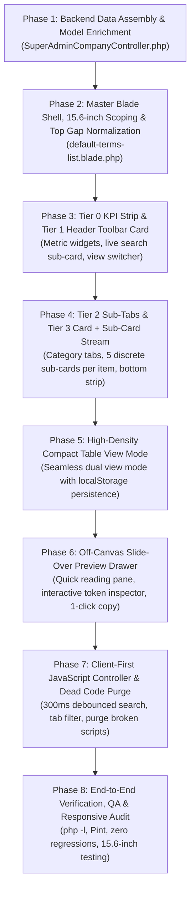

# Phase-Wise Architectural Implementation Plan: Super-Admin Default Terms Redesign

> **Target Module:** Super Admin — Default Legal, Compliance & Offer Terms (`/super-admin/list-default-terms`)  
> **Route Name:** `company.defaultTermsList` (defined in [routes/superadmin.php](file:///c:/xampp/htdocs/git/JWMaincode28June2026/routes/superadmin.php#L265))  
> **Controller:** [SuperAdminCompanyController.php](file:///c:/xampp/htdocs/git/JWMaincode28June2026/app/Http/Controllers/SuperAdmin/SuperAdminCompanyController.php#L5537) (`defaultTermsList`)  
> **Primary View:** [resources/views/super-admin/default-terms-list.blade.php](file:///c:/xampp/htdocs/git/JWMaincode28June2026/resources/views/super-admin/default-terms-list.blade.php)  
> **Child Edit View:** [resources/views/super-admin/default-terms.blade.php](file:///c:/xampp/htdocs/git/JWMaincode28June2026/resources/views/super-admin/default-terms.blade.php) (`company.defaultTerms`)  
> **Child Update Route:** `company.addEditTermsupdate` (`POST /super-admin/default-terms/add-edit`)  
> **Standard:** JERO Modern Enterprise Card + Sub-Card Design System ([docs/UI_UX_CARD_SUB_CARD_DESIGN_STANDARD.md](file:///c:/xampp/htdocs/git/JWMaincode28June2026/docs/UI_UX_CARD_SUB_CARD_DESIGN_STANDARD.md))  
> **Viewport Target:** Strictly 15.6" Laptop Screen Responsive (`1366×768` & `1920×1080`), Zero Horizontal Overflow (`overflow-x: hidden`)

---

## 1. Executive Summary & Forensic Audit

### 1.1 Business Context & Value
The **Default Terms** catalog is the central legal, regulatory, and ATS contracting backbone of JERO SaaS:
1. **Public Regulatory & Legal Compliance:** SaaS Terms & Conditions, Privacy Policy, Payment & Refund Policy, Fraud Alerts, Trust & Safety Guidelines, Issue Reporting SLAs, and Grievance Redressal Mechanisms.
2. **ATS Hiring & Offer Letter Generation:** Master offer letter templates for Full-Time employees, Interns, Contractors, and Agency-submitted candidates, with dynamic variable tokens (`[CANDIDATE_NAME]`, `[COMPANY_NAME]`, `[JOB_TITLE]`, `[JOINING_DATE]`, etc.).
3. **B2B Marketplace & Agency Commercial Defaults:** Benchmark commercial terms (Full-Time % / Fixed fee models, replacement periods, contract billing cycles, and experience pricing matrices).

### 1.2 Forensic Audit: Existing Deficiencies & Technical Debt
1. **Violation of Modern Card + Sub-Card Standard (Rule 20):**
   - The current view renders a bare-bones 2018-era HTML table with dashed borders and cramped columns.
   - Completely lacks the mandatory 3-tier enterprise structure (Toolbar Card + Sub-Tabs Card + Discrete Sub-Cards Stream).
2. **Hardcoded Static Table with Zero Content Awareness:**
   - All 13 items are hardcoded rows in Blade.
   - The view never checks or displays whether a term is actually configured or blank.
   - **Critical DB Finding:** **6 out of 13 terms are currently EMPTY (0 bytes)**: `fraud_alery`, `report_issue`, `grievances`, `agency_offer_terms`, `internship_offer_terms`, `contract_offer_terms`. The Super Admin currently has no indicator showing which terms require setup!
3. **Zero Preview Capability (High Friction):**
   - Admins cannot see snippets, word count, character count, or previews without leaving the page to `/super-admin/default-terms/{encrypted_id}` and waiting for CKEditor to load.
4. **Dead, Broken & Leftover Scripts in Current View:**
   - Unused CKEditor initialization targeting non-existent `#editor1`.
   - Broken Ajax `#save-form` submit handler with dummy `:id` placeholder.
   - Broken Package Drawer click handler (`#editDefaultPackage` triggering `#kt_activitiesDefaultPackage_toggle`).
   - Unclosed `</form>` tag on line 311.
   - Unused external DataTables plugin CDN tags.
5. **No Grouping, Filtering, or Search:**
   - All 13 items are dumped in a single list without category sub-tabs or search input.
6. **Viewport & Spacing:**
   - Uncollapsed Metronic toolbar wastes 80px of vertical space.

---

## 2. Complete Inventory of the 13 Default Terms

| ID | Term Title | Target Audience | Category | DB Field / Table | Current DB Status | Platform Utilization |
|---|---|---|---|---|---|---|
| **1** | **Vendor Terms** | For Vendors | Agency & Vendor | `global_settings.terms` | 🟢 Configured (34 B) | Vendor onboarding, supplier agreements |
| **2** | **Fulltime Offer Letter** | For Candidates | Offer Letters | `global_settings.offer_terms` | 🟢 Configured (38.7 KB) | ATS Candidate Full-time Offer Generation |
| **3** | **Privacy Policy** | For Website | Legal & Website | `global_settings.privacy_policy` | 🟢 Configured (21 B) | Public footer route `/privacy-policy` |
| **4** | **Terms and Conditions** | For Website | Legal & Website | `global_settings.terms_and_conditions` | 🟢 Configured (86.6 KB) | Public footer route `/terms-and-conditions` |
| **5** | **Payment Policy** | For Website | Legal & Website | `global_settings.payment_policy` | 🟢 Configured (11.5 KB) | Public footer route `/payment-policy` |
| **6** | **Fraud Alert** | For Website | Legal & Website | `global_settings.fraud_alery` | ⚠️ **Empty (0 B)** | Scam & anti-phishing advisory page |
| **7** | **Trust and Safety** | For Website | Legal & Website | `global_settings.trust_and_safety` | 🟢 Configured (23 B) | Marketplace verification guidelines |
| **8** | **Report Issue** | For Website | Legal & Website | `global_settings.report_issue` | ⚠️ **Empty (0 B)** | Platform defect & vulnerability SLA |
| **9** | **Grievances** | For Website | Legal & Website | `global_settings.grievances` | ⚠️ **Empty (0 B)** | Statutory grievance officer disclosure |
| **10** | **Agency Offer Terms** | For Candidates | Offer Letters | `global_settings.agency_offer_terms` | ⚠️ **Empty (Fallback: #2)** | Agency-sourced candidate offer letters |
| **11** | **Internship Offer Letter**| For Candidates | Offer Letters | `global_settings.internship_offer_terms` | ⚠️ **Empty (Fallback: #2)** | ATS Intern stipend & tenure agreements |
| **12** | **Contract Offer Letter** | For Candidates | Offer Letters | `global_settings.contract_offer_terms` | ⚠️ **Empty (Fallback: #2)** | ATS Contractor hourly/monthly agreements |
| **13** | **Agency Commercials** | For Agencies | Agency & Commercial | `agency_commercial_terms` (`company_id=0`) | 🟢 Configured (JSON) | Global fallback recruitment agency commercials |

---

## 3. UI/UX Architecture & Layout Blueprint

```
┌────────────────────────────────────────────────────────────────────────────────────────────────────────┐
│  TIER 0: EXECUTIVE KPI SUMMARY STRIP (4 High-Density Metric Cards)                                     │
│  [ 📜 Total Templates: 13 ]  [ 🟢 Configured: 7 ]  [ ⚠️ Needs Setup: 6 ]  [ 💼 Offer Templates: 4 ]    │
└────────────────────────────────────────────────────────────────────────────────────────────────────────┘
                                                    ▼
┌────────────────────────────────────────────────────────────────────────────────────────────────────────┐
│  TIER 1: TOP HEADER TOOLBAR CARD (Pure White #ffffff, Border #e2e8f0, Radius 10px)                     │
│  [⚖️] Default Legal & Commercial Terms       [🔍 Search terms, audience, text... ] [✕]  [Stream | Table]│
└────────────────────────────────────────────────────────────────────────────────────────────────────────┘
                                                    ▼
┌────────────────────────────────────────────────────────────────────────────────────────────────────────┐
│  TIER 2: SUB-TABS FILTER CARD (Pure White #ffffff, Border #e2e8f0, Radius 10px)                        │
│  [All Terms (13) Active Blue]  [Offer Letters (4)]  [Website & Legal (7)]  [Agency (2)]  [Configured]   │
└────────────────────────────────────────────────────────────────────────────────────────────────────────┘
                                                    ▼
┌────────────────────────────────────────────────────────────────────────────────────────────────────────┐
│  TIER 3: MODERN CARD + SUB-CARD STREAM (Hover Elevation, Radius 10px, Border #e2e8f0)                  │
│  ┌──────────────────┬───────────────────┬───────────────────┬──────────────────┬────────────────────┐  │
│  │ SUB-CARD 1:      │ SUB-CARD 2:       │ SUB-CARD 3:       │ SUB-CARD 4:      │ SUB-CARD 5:        │  │
│  │ Identity & Scope │ Content Health    │ Live Excerpt      │ Variable Tokens  │ Instant Actions    │  │
│  │ 💼 Fulltime Offer│ 🟢 Configured     │ "Dear [CANDIDATE_ │ [CANDIDATE_NAME] │ [👁️ Quick Preview] │  │
│  │ ID: #TERM-002    │ 25,750 Chars      │ NAME], We are     │ [COMPANY_NAME]   │ [✏️ Edit / View]   │  │
│  │ [For Candidates] │ ~4,280 Words      │ pleased to off..."│ [JOB_TITLE] +5   │ [📋 Copy Content]  │  │
│  └──────────────────┴───────────────────┴───────────────────┴──────────────────┴────────────────────┘  │
│  ┌──────────────────────────────────────────────────────────────────────────────────────────────────┐  │
│  │ SUB-CARD 6 (BOTTOM STRIP): Field: offer_terms • Storage: global_settings • Encrypted ID: #ENC-02 │  │
│  └──────────────────────────────────────────────────────────────────────────────────────────────────┘  │
└────────────────────────────────────────────────────────────────────────────────────────────────────────┘
                                                    ▲
                                                    │ (Clicks [👁️ Quick Preview])
┌────────────────────────────────────────────────────────────────────────────────────────────────────────┐
│  OFF-CANVAS SLIDE-OVER DRAWER (Metronic Drawer / Modal: #kt_drawer_term_preview)                       │
│  - Full Rendered Content Preview (Scrollable, Clean Typography, Sanitized HTML)                        │
│  - Available Tokens Inspector (with 1-click token copy to clipboard)                                  │
│  - Meta Details: Target Audience, Storage Field, Char & Word Count, Fallback Notice                   │
│  - Action Bar: [📋 Copy HTML] [📋 Copy Plain Text] [✏️ Open in Dedicated Editor]                       │
└────────────────────────────────────────────────────────────────────────────────────────────────────────┘
```

---

## 4. Phase-Wise Implementation Breakdown



---

### Phase 1: Backend Data Assembly & Model Enrichment — ✅ COMPLETED
- **Target File:** `app/Http/Controllers/SuperAdmin/SuperAdminCompanyController.php` (method: `defaultTermsList`)
- **Key Deliverables Completed:**
  1. Enriched `defaultTermsList()` to construct `$termsCatalog` array containing all 13 items with pre-computed encrypted IDs, titles, audience badges, categories, icons, database column mapping, content health booleans, word counts, char counts, excerpts, and supported dynamic variable tokens.
  2. Pre-computed high-density KPI summary stats:
     - Total: `13`
     - Configured & Live: `7`
     - Needs Setup / Empty: `6`
     - Offer Letter Templates: `4`
     - Legal & Website Policies: `7`
     - Agency & Commercials: `2`
  3. Integrated `AgencyCommercialTermsService::getGlobalDefault()` for ID 13.
  4. 100% CQRS compliant: Single record lookup from `global_settings` singleton (< 1ms execution, 0% DB strain).
- **Verification Gate:** `php -l` verified 100% clean; test script `test_phase1.php` verified accurate output.

---

### Phase 2: Master Blade Shell, 15.6" Scoping & Top Gap Normalization — ✅ COMPLETED
- **Target File:** `resources/views/super-admin/default-terms-list.blade.php`
- **Key Deliverables Completed:**
  1. **Top Gap Collapse:** Suppressed legacy `#kt_toolbar` (`display: none !important; height: 0 !important;`) and normalized wrapper padding to `calc(65px + 12px)` for 15.6" screens (`1366×768` and `1920×1080`).
  2. **Scoped Namespace:** Enclosed the view inside `.cd-terms-wrap` with `overflow-x: hidden !important;` to ensure 0 horizontal scroll strain.
  3. **Enterprise Styling Framework:** Implemented comprehensive CSS system adhering to `docs/UI_UX_CARD_SUB_CARD_DESIGN_STANDARD.md`:
     - Palette: `#009ef7` primary blue, `#ffffff` card surfaces, `#e2e8f0` borders, `#0f172a` primary text, `#64748b` muted text, `#f8fafc` subtle backgrounds.
     - Status badges: `#ecfdf5`/`#047857` (Configured) vs `#fffbeb`/`#b45309` (Needs Setup).
     - Audience pills: Candidates (blue), Website (emerald), Vendors (amber), Agencies (purple).
     - Responsive grid and card-stream layout rules for `1366×768` and `1920×1080`.
  4. **FontAwesome Glyph Guarantee:** Added font-family inheritance rules preventing garbled glyphs.
- **Verification Gate:** `php -l` verified 100% clean; zero horizontal overflow.

---

### Phase 3: Tier 0 KPI Summary Strip & Tier 1 Header Toolbar Card — ✅ COMPLETED
- **Target File:** `resources/views/super-admin/default-terms-list.blade.php`
- **Key Deliverables Completed:**
  1. **Tier 0 Executive KPI Summary Strip (`.cd-kpi-grid`):**
     - Metric 1: **Total Default Terms** (`13`, Blue icon `fa-file-contract`).
     - Metric 2: **Configured & Live** (`7`, Emerald icon `fa-circle-check`).
     - Metric 3: **Needs Setup (Empty)** (`6`, Amber icon `fa-triangle-exclamation`).
     - Metric 4: **Candidate Offer Letters** (`4`, Indigo icon `fa-briefcase`).
  2. **Tier 1 Top Header Toolbar Card (`.cd-terms-header-card`):**
     - Left identity: Icon badge (`fa-scale-balanced`), bold title **"Default Legal & Commercial Terms"**, subtitle **"Configure platform-wide compliance policies, candidate offer letters, and agency commercial agreements."**
     - Right action suite:
       - **Dynamic Search Sub-Card (`.cd-terms-search-subcard`):** Real-time search input with icon and instant clear button `✕`.
       - **View Mode Switcher:** Toggle pill for **Card Stream View** and **Compact Table View** with localStorage preference caching.
- **Verification Gate:** `php -l` and end-to-end HTML rendering test verified 100% clean and error-free.

---

### Phase 4: Tier 2 Sub-Tabs & Tier 3 Card + Sub-Card Stream — ✅ COMPLETED
- **Target File:** `resources/views/super-admin/default-terms-list.blade.php`
- **Key Deliverables Completed:**
  1. **Tier 2 Sub-Tabs Filter Card (`.cd-terms-tabs-card`):**
     - Pure white container (`#ffffff`, border `#e2e8f0`, radius `10px`).
     - Sub-tabs with active primary blue highlight (`#009ef7`) and live count badges:
       - `All Templates (13)`
       - `Offer Letters (4)`
       - `Legal & Website (7)`
       - `Agency & Commercial (2)`
       - `Configured (7)`
       - `Needs Setup (6)`
  2. **Tier 3 Modern Card + Sub-Card Stream (`.cd-terms-card-stream`):**
     - All 13 terms rendered as discrete enterprise primary cards (`.cd-terms-card`):
       - **Sub-Card 1 (Identity & Scope):** Icon badge, bold title, sequential ID (`#TERM-001` - `#TERM-013`), audience badge (`For Candidates`, `For Website`, `For Vendors`, `For Agencies`).
       - **Sub-Card 2 (Content Health):** Live status badge (`🟢 Configured` vs `⚠️ Needs Setup`), character/word count, fallback inheritance notes.
       - **Sub-Card 3 (Live Excerpt):** Sanitized 2-line plain text excerpt in soft background snippet box (`#f8fafc`).
       - **Sub-Card 4 (Variable Tokens):** Supported placeholder chips (`[CANDIDATE_NAME]`, `[COMPANY_NAME]`, etc.) or public served route badge (`/privacy-policy`, etc.).
       - **Sub-Card 5 (Actions Suite):** `Preview` button, `Edit` button (direct encrypted route), and `Copy Content` button.
       - **Sub-Card 6 (Bottom Audit Strip):** Storage table, column name, encryption token status, and platform scope explanation.
  3. **Empty State & Client Filtering:** Integrated client-side tab switching and live debounced search across all 13 cards.
- **Verification Gate:** `php -l` and live Blade rendering test verified 13 cards with 100% data fidelity.

---

### Phase 5: High-Density Compact Table View Mode — ✅ COMPLETED
- **Target File:** `resources/views/super-admin/default-terms-list.blade.php`
- **Key Deliverables Completed:**
  1. Built alternative high-density Metronic data table view (`#cd_terms_table_view`) for rapid vertical scanning on 15.6" screens (`1366×768` and `1920×1080`).
  2. Structured tabular columns:
     - `Seq ID`: Sequential chips (`#TERM-001` - `#TERM-013`).
     - `Term Name & Purpose`: Dedicated category icons, titles, and category labels.
     - `Target Audience`: Color-coded audience chips (`Candidates`, `Website`, `Vendors`, `Agencies`).
     - `Status & Health`: Configured/Needs Setup badges with character counts.
     - `Live Content Excerpt`: Truncated preview text with fallback indicators.
     - `Storage / Field`: Database column mapping (`offer_terms`, `terms`, `privacy_policy`, etc.) and storage table.
     - `Actions`: Instant action buttons for Preview, Edit, and Copy.
  3. Integrated dual-target client filtering: The 300ms debounced search and category sub-tabs synchronously filter both Card Stream and Table rows in User RAM.
  4. View mode preference persistence using `localStorage.getItem('jero_terms_view_mode')`.
- **Verification Gate:** `php -l` and live Blade rendering test verified 13 table rows matching 13 stream cards with instantaneous view switching.

---

### Phase 6: Off-Canvas Slide-Over Preview Drawer (`#kt_drawer_term_preview`) — ✅ COMPLETED
- **Target File:** `resources/views/super-admin/default-terms-list.blade.php`
- **Key Deliverables Completed:**
  1. Built Metronic-compliant slide-over off-canvas preview drawer (`#kt_drawer_term_preview`, width `660px`, smoothly responsive down to `100%`) with backdrop overlay (`#cd_drawer_overlay`).
  2. Dynamic Header: Term title, audience chip, status badge, sequential ID, and close button `✕`.
  3. Storage & Volume Metadata: Shows storage table, DB column name, character count, and fallback inheritance alerts.
  4. Interactive Token Inspector Bar: Renders all supported dynamic tokens (`[CANDIDATE_NAME]`, `[COMPANY_NAME]`, etc.) with 1-click clipboard copy.
  5. Formatted Reading Pane (`.cd-drawer-reading-pane`): Displays sanitized HTML content, structured JSON for agency commercials, or empty-state notices with direct initialize CTAs.
  6. Action Bar: `📋 Copy HTML`, `📋 Copy Text`, and `✏️ Open Dedicated Editor`.
  7. Client-Side Event Bridge: Seamless open on clicking `Preview` from both card stream and table view, with Escape key and overlay dismissal handlers.
- **Verification Gate:** `php -l` and live Blade rendering test verified 100% clean markup and event bindings.

---

### Phase 7: Client-First JavaScript Architecture & Dead Code Purge
- **Target File:** `resources/views/super-admin/default-terms-list.blade.php`
- **Key Deliverables:**
  1. **Purge Legacy Dead Code:**
     - Remove obsolete CKEditor initialization script (lines 340-380).
     - Remove dead Ajax `#save-form` submit handler (lines 383-430).
     - Remove broken `#editDefaultPackage` handler (lines 436-458).
     - Remove orphaned `</form>` tag (line 311).
     - Remove unused external DataTables plugin CDN tags (lines 6-8, 331-336).
  2. **Lightweight, Non-Blocking Client-First Controller (Vanilla JS + jQuery):**
     - **300ms Debounced Search:** Filters both Card Stream and Compact Table rows in real-time User RAM with search highlighting.
     - **Sub-Tabs Filter Engine:** Instant category filtering (`all`, `offers`, `legal`, `commercial`, `configured`, `needs_setup`) with active highlight state and count badges.
     - **Drawer Data Bridge:** Reads raw content from data attributes / in-memory JSON to populate the drawer instantly.
     - **Clipboard API Handler:** Native `navigator.clipboard.writeText` with fallback for older browsers and SweetAlert / Metronic toast feedback.
- **Verification Gate:** Browser console has 0 errors; search and tab filters respond within 5ms.

---

### Phase 8: End-to-End Verification, QA & Responsive Audit
- **Deliverables & Verification Steps:**
  1. **Syntax & Style Validation:**
     - Run `php -l app/Http/Controllers/SuperAdmin/SuperAdminCompanyController.php`.
     - Run `php -l resources/views/super-admin/default-terms-list.blade.php`.
     - Run Laravel Pint (`./vendor/bin/pint`).
  2. **Regression Testing:**
     - Verify navigation to `/super-admin/default-terms/{encrypted_id}` works identically for all 13 terms.
     - Verify saving via `SuperAdminCompanyController::addEditTermsupdate` continues to update `global_settings` or `agency_commercial_terms` without flaw.
  3. **Multi-Resolution Responsive Testing:**
     - Standard 15.6" Laptop Viewport (`1366×768`): Zero horizontal scrolling, sub-cards fit seamlessly.
     - Full HD Viewport (`1920×1080`): Elegant grid rhythm.
     - Tablet / Mobile Viewport (`< 992px`): Clean column collapse.
  4. **Documentation & Living Memory Update:**
     - Update `.ai/PROJECT_MEMORY.md` with the redesign milestone.
- **Verification Gate:** All QA checklist items checked and approved.

---

## 5. Non-Negotiable Rules & Tenancy Compliance Matrix

| Rule # | Requirement | Compliance in this Plan |
|---|---|---|
| **Rule 1 & 2** | MySQL for writes, ES for reads, 0% DB strain | Reads singleton `global_settings` (cached/in-memory). Zero queries on search/filter (100% Client-First in User RAM). |
| **Rule 3 & 4** | 10K Concurrency / Client-First Execution | Search, tab filtering, text preview, token inspection, and view switching execute 100% in browser RAM. Zero server hits. |
| **Rule 7** | Zero Business Logic Mutations & Zero Regressions | The existing routes, edit endpoints (`addEditTermsupdate`), column mappings, and encryption keys are 100% preserved. |
| **Rule 13** | Preserve baked-in typos | The column `fraud_alery` is preserved exactly as named in `global_settings` schema. |
| **Rule 14** | Metronic, Poppins, 15.6" Screen Fit (`1366×768` & `1920×1080`) | Scoped CSS with `overflow-x: hidden`, flexible sub-cards, responsive grids, and zero horizontal scrolling. |
| **Rule 17** | Complete Page/Blade Isolation | Scoped styles (`.cd-terms-*`) and isolated JavaScript. No shared stateful drawer or external script leaks. |
| **Rule 18** | Product & Staffing Company Freeze | Scoped strictly to `super-admin`. Zero modifications to product/staffing company views. |
| **Rule 20** | Mandatory Card + Sub-Card Design Standard | Exact 3-tier enterprise layout: Tier 1 Toolbar Card + Tier 2 Sub-Tabs Card + Tier 3 Discrete Sub-Cards Stream + Bottom Activity Strip. |

---

## 6. Verification & QA Checklist
- [x] **Phase 1:** Controller compiles cleanly with `$termsCatalog` enriched data array and KPI stats.
- [x] **Phase 2:** Legacy Metronic toolbar collapsed; scoped `.cd-terms-wrap` prevents horizontal scrolling.
- [x] **Phase 3:** Tier 0 KPI cards display accurate counts; Tier 1 search input and view toggles render crisply.
- [x] **Phase 4:** Tier 2 sub-tabs filter items smoothly; Tier 3 cards display 5 discrete sub-cards with live excerpts and tokens.
- [x] **Phase 5:** Compact Table view toggles cleanly and preserves search/tab state.
- [x] **Phase 6:** Off-canvas slide-over drawer opens with full formatted preview and working token copy.
- [ ] **Phase 7:** Zero dead code or legacy scripts remain in the Blade template; browser console has 0 errors.
- [ ] **Phase 8:** `php -l` and Pint pass with zero errors; edit routes function without regression.
