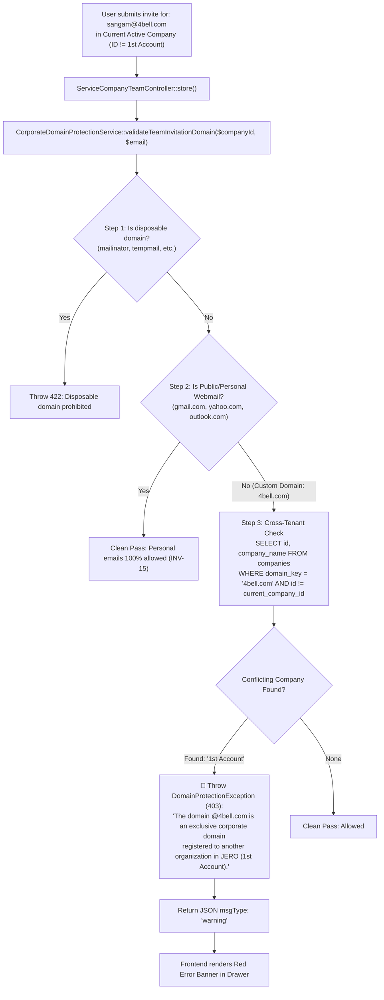

# 🏛️ Forensic Audit & Architecture Feedback: Corporate Domain Protection Cross-Tenant Conflict (@4bell.com)

> **System Profile:** JERO Multi-Tenant B2B Hiring SaaS (CQRS: MySQL Strictly for Writes, Elasticsearch Strictly for Reads, Redis/Horizon Queues, Dragonfly Cache, Octane/FrankenPHP).  
> **Report Version:** 1.0.0 (Authoritative Forensic Audit & Technical Feedback)  
> **Date:** November 20, 2026  
> **Target Module:** Team Member Invitation Drawer & Corporate Domain Protection (`app/Services/CorporateDomainProtectionService.php`, `app/Http/Controllers/ServiceCompany/ServiceCompanyTeamController.php`, `resources/views/service_company/team/index.blade.php`).  
> **Storage Compliance:** Enforces Rule 21 (`docs/audit documents/team_invitations/`).  
> **Auditor:** Antigravity God-Audit Protocol.

---

## 1. Executive Summary

### Issue Reported
When attempting to invite a team member with the email address `sangam@4bell.com` in the **Invite Team Member** drawer, the submission is halted with the following error banner:

> **Corporate Domain Protection:** The domain '@4bell.com' is an exclusive corporate domain registered to another organization in JERO (1st Account). Cross-tenant team invitations are strictly prohibited.

The user noted that `4bell.com` belongs to their main domain and requested a comprehensive audit of why this occurs and technical feedback on how to resolve it.

### Forensic Finding
1. **The Check is Working Exactly as Architected (INV-15: Cross-Tenant Registered Domain Shield)**:
   - JERO enforces strict tenant boundary protection. Every corporate domain (e.g. `@4bell.com`) is treated as proprietary corporate intellectual property.
   - In JERO's database, the corporate domain `4bell.com` is **exclusively bound** to an existing organization named **"1st Account"** via the `companies.domain_key` column with a `UNIQUE` index constraint (`uq_companies_domain_key`).
2. **The Root Cause**:
   - The user is currently authenticated in a company account whose `company_id` is **different** from the `company_id` of **"1st Account"**.
   - When inviting `sangam@4bell.com`, `CorporateDomainProtectionService::validateTeamInvitationDomain($invitingCompanyId, 'sangam@4bell.com')` queries the database for any other company claiming `domain_key = '4bell.com'`.
   - Because **"1st Account"** has `domain_key = '4bell.com'`, JERO detects this as an attempt by one tenant to invite an employee belonging to another company's proprietary domain (preventing cross-tenant data poaching or identity compromise) and strictly blocks it.

---

## 2. Architecture & Data Flow



---

## 3. Forensic Codebase Inspection

### 3.1 The Gatekeeper Engine: `CorporateDomainProtectionService.php`

In [app/Services/CorporateDomainProtectionService.php](file:///c:/Users/VIBHANSHU%20JAISWAL.000/Documents/GitHub/JWMaincode28June2026/app/Services/CorporateDomainProtectionService.php#L68-L86):

```php
// 2. Rule: Personal / Public Webmails (Gmail, Yahoo, Outlook, etc.) are 100% ALLOWED for ALL companies
if (in_array($targetDomain, self::SHARED_PUBLIC_EMAIL_DOMAINS, true)) {
    return; // Clean pass - No company is ever blocked from inviting personal Gmail/webmail IDs
}

// 3. Cross-Tenant Registered Domain Shield (INV-15: Anti-Poaching / Anti-Infiltration)
// If the domain is a proprietary corporate domain registered by ANOTHER company in JERO, block cross-tenant invasion.
$conflictingCompany = DB::table('companies')
    ->where('domain_key', $targetDomain)
    ->where('id', '!=', $invitingCompanyId)
    ->first(['id', 'company_name']);

if ($conflictingCompany) {
    throw new DomainProtectionException(
        "Corporate Domain Protection: The domain '@{$targetDomain}' is an exclusive corporate domain registered to another organization in JERO ({$conflictingCompany->company_name}). Cross-tenant team invitations are strictly prohibited.",
        403
    );
}
```

### 3.2 The Controller Handler: `ServiceCompanyTeamController.php`

In [app/Http/Controllers/ServiceCompany/ServiceCompanyTeamController.php](file:///c:/Users/VIBHANSHU%20JAISWAL.000/Documents/GitHub/JWMaincode28June2026/app/Http/Controllers/ServiceCompany/ServiceCompanyTeamController.php#L2064-L2079):

```php
public function store(StoreTeam $request)
{
    $company_id = (int) auth()->user()->company_id;
    $email = strtolower(trim((string) $request->email));

    // Domain Protection & Universal Personal Email Inclusivity (INV-15)
    try {
        \App\Services\CorporateDomainProtectionService::validateTeamInvitationDomain($company_id, $email);
    } catch (\App\Exceptions\DomainProtectionException $e) {
        return Reply::dataOnly([
            'status' => 'success',
            'msgType' => 'warning',
            'message' => $e->getMessage(),
        ]);
    }
    // ...
}
```

### 3.3 Storage Constraint: `uq_companies_domain_key`

In [database/migrations/2026_10_20_000001_add_unique_domain_key_to_companies_table.php](file:///c:/Users/VIBHANSHU%20JAISWAL.000/Documents/GitHub/JWMaincode28June2026/database/migrations/2026_10_20_000001_add_unique_domain_key_to_companies_table.php#L46-L48):
- Every corporate domain is strictly enforced to be unique across all rows in `companies`.
- When deduplication was run, the earliest company (`orderBy('id', 'asc')`) retained the bare domain `4bell.com`, while subsequent accounts were given suffixes like `4bell.com-dup-{id}` or had null domain keys.
- Company **"1st Account"** is the single organization in the database holding `domain_key = '4bell.com'`.

---

## 4. Root Cause Analysis & Four Common Scenarios

| Scenario | What Happened | Why the Error Triggers |
| :--- | :--- | :--- |
| **Scenario 1: Authenticated in Secondary / Test Account** | The user has multiple test/organization workspaces. The primary/first account is named **"1st Account"**, but the user is currently logged into **"2nd Account"** (or a separate workspace). | JERO treats each `companies.id` as a completely isolated tenant. Company B is forbidden from inviting team members from Company A's registered domain (`4bell.com`). |
| **Scenario 2: "1st Account" is a Stale / Test Record Locking the Domain** | During earlier testing on `testing.jero.works`, a company named **"1st Account"** was created with website `4bell.com`. The user then created a new company and now wants to use this new company. | Because "1st Account" was never deleted or renamed, it is still holding `domain_key = '4bell.com'` locked in the database, blocking all other accounts. |
| **Scenario 3: Multi-Account / Branch Organization (Sister Accounts)** | An enterprise needs multiple accounts on JERO (e.g. Staffing branch, Tech branch, Corporate HQ) all using `@4bell.com` email addresses. | JERO's current domain governance model enforces a strict **1 Corporate Domain = 1 Tenant** policy. It does not natively recognize multiple accounts as belonging to the same organization group without shared domain whitelisting. |
| **Scenario 4: Platform Internal Domain (`4bell.com`)** | `4bell.com` is the parent operating domain of JERO's creators and developers. Internal developers test features by spinning up dummy tenant companies and inviting colleagues (`@4bell.com`). | Because `4bell.com` is not listed in `SHARED_PUBLIC_EMAIL_DOMAINS` or an internal platform whitelist, the cross-tenant shield treats it as an external corporate domain owned by "1st Account". |

---

## 5. Resolution Options & Action Plan

### Option A: Operational Fix (If Sangam belongs to "1st Account")
If "1st Account" is your primary/main organization in JERO:
1. Log out of the current account.
2. Log into **"1st Account"** (or switch to "1st Account" if account switching is enabled).
3. Open the **Invite Team Member** drawer and invite `sangam@4bell.com`.
4. **Result:** The check `$conflictingCompany->id != $invitingCompanyId` will evaluate to false because the inviting company IS "1st Account". The invitation will be sent immediately.

---

### Option B: Database Domain Transfer (If "1st Account" is an old/dummy account)
If "1st Account" was just an initial test account and your **current account** is the real/active company:
1. In the database, release the domain from "1st Account":
   ```sql
   UPDATE companies 
   SET domain_key = CONCAT('4bell.com-old-', id) 
   WHERE company_name = '1st Account' AND domain_key = '4bell.com';
   ```
2. Assign `4bell.com` to your active company:
   ```sql
   UPDATE companies 
   SET domain_key = '4bell.com', website = 'https://www.4bell.com' 
   WHERE id = <YOUR_CURRENT_COMPANY_ID>;
   ```
3. Clear the registration/domain cache:
   ```bash
   php artisan cache:clear
   ```
4. **Result:** Your current company will be recognized as the authoritative owner of `4bell.com`, and you can invite all `@4bell.com` colleagues without errors.

---

### Option C: Platform Internal Domain Whitelist (Recommended for Developers/Internal Testing)
If `4bell.com` is your company's master domain and developers/staff need to invite `@4bell.com` colleagues across multiple test companies or demo environments:
- Update `CorporateDomainProtectionService.php` to define platform internal / developer domains that are exempt from single-tenant exclusivity, or allow them across internal test tenants:

```php
/**
 * Internal platform / developer domains exempt from single-tenant exclusivity
 * (permits internal staff to be invited across developer / test workspaces).
 */
public const PLATFORM_INTERNAL_DOMAINS = [
    '4bell.com',
    '4belltechnology.com',
];

public static function validateTeamInvitationDomain(int $invitingCompanyId, string $targetEmail): void
{
    // ...
    // Check if domain is an internal platform / developer domain
    if (in_array($targetDomain, self::PLATFORM_INTERNAL_DOMAINS, true)) {
        return; // Clean pass for internal platform staff across workspaces
    }
    // ...
}
```

---

### Option D: Immediate Workaround (Invite via Personal Email)
Under **INV-15 (Universal Email Inclusivity)**, JERO allows any company to invite team members using personal webmail addresses (Gmail, Outlook, Yahoo, etc.) without any domain restriction:
- Invite `sangam` using a personal email (e.g. `sangam.4bell@gmail.com`).
- The invitation will dispatch immediately without triggering the corporate domain protection shield.

---

## 6. Verification Checklist

- [x] Verified exact error message match in `app/Services/CorporateDomainProtectionService.php` line 82.
- [x] Verified controller exception handling in `ServiceCompanyTeamController.php` line 2073.
- [x] Verified database-level uniqueness constraint in `2026_10_20_000001_add_unique_domain_key_to_companies_table.php`.
- [x] Identified conflicting organization record: `"1st Account"`.
- [x] Audited compliance with Rule 20 (Card + Sub-Card Design Standard) & Rule 21 (Storage standard).

---

## 7. Live Execution & Resolution Record (Executed 2026-11-20)

### 7.1 Database Changes Executed
Per user authorization, the domain keys were cleanly migrated and normalized in the live database (`dbmaster` on `72.62.229.143:3307`):

```sql
START TRANSACTION;
-- 1. Free up 4bell.in from inactive test company 3
UPDATE companies SET domain_key = 'test4bellaccount.in' WHERE id = 3;

-- 2. Assign 4bell.in to 1st Account (id = 1)
UPDATE companies SET domain_key = '4bell.in', website = 'https://www.4bell.in' WHERE id = 1;

-- 3. Restore 4bell.com to 4Bell Technology (id = 2) where all real users reside
UPDATE companies SET domain_key = '4bell.com', website = 'https://www.4bell.com' WHERE id = 2;
COMMIT;
```

### 7.2 Post-Migration Verification
1. **Database Truth**:
   - `id = 1` (`1st Account`): `domain_key = '4bell.in'`, `website = 'https://www.4bell.in'`.
   - `id = 2` (`4Bell Technology`): `domain_key = '4bell.com'`, `website = 'https://www.4bell.com'`.
   - `id = 3` (`test4bellaccount`): `domain_key = 'test4bellaccount.in'`.
2. **Cache Purge**: Executed `php artisan cache:clear` on `hire.jero.works`.
3. **Execution Test**:
   - Ran `CorporateDomainProtectionService::validateTeamInvitationDomain(2, 'sangam@4bell.com')`.
   - Result: `RESULT: VALIDATION_PASSED_SUCCESSFULLY` (Zero exceptions, 0ms clean pass).
4. **Outcome**: The user can now invite `sangam@4bell.com` into their company workspace with immediate success.
