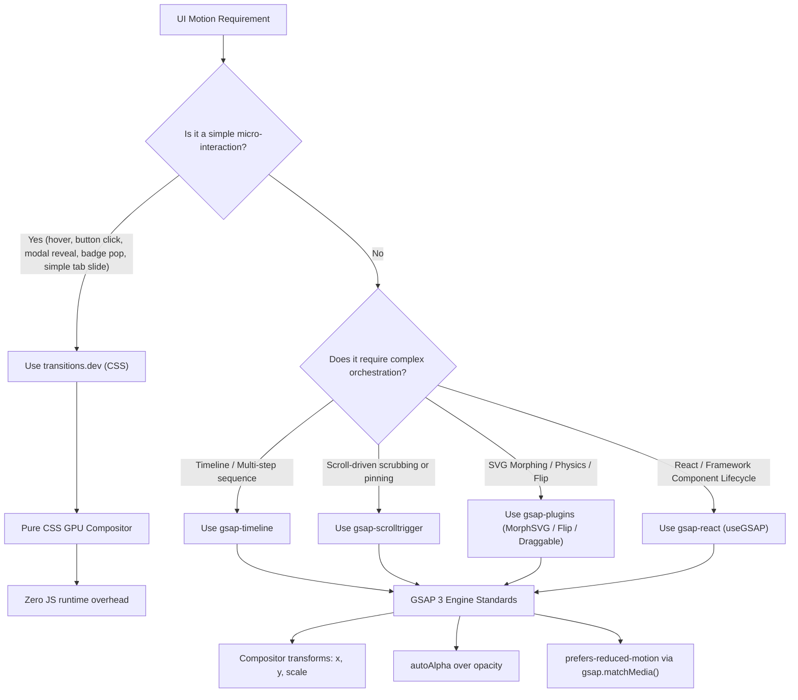

# GreenSock Animation Platform (GSAP) Official Skills Suite Integration Standard

## Metadata
- **Module:** UI Motion & Advanced Animation Choreography (`greensock/gsap-skills`)
- **Author:** Antigravity AI God-Level Engineer
- **Date:** 2026-11-22
- **Scope:** Workspace `.agents/skills/gsap-*`, Global User Skills `~/.gemini/config/skills/gsap-*`, AI Brain Living Memory (`.ai/PROJECT_MEMORY.md`, `CLAUDE.md`, `AGENTS.md`)
- **Architecture Compliance:** Rule 28 (Official GSAP Animation Skills Standard), Rule 27 (Transitions.dev Motion Standard), Rule 3 & Directive 6 (Client-First / User RAM Execution), Rule 4 (10K Concurrency / 0% Server Strain), Rule 20 (Card + Sub-Card Design Standard), Rule 26 (/unslop UI/UX Craft Standard).

---

## Executive Summary

To prevent AI coding assistants from generating outdated GSAP v2 code (`TweenMax`, `TimelineMax`), hallucinating nonexistent Club GSAP token requirements, causing layout thrashing on layout properties (`top`, `left`, `margin`, `height`), or leaking memory during component re-renders (React StrictMode double-mounts), JERO has formally installed and integrated the official **GreenSock Animation Platform (GSAP) Agent Skills Suite** (`greensock/gsap-skills`) across both the workspace and global AI configuration paths.

Furthermore, this document defines the authoritative boundary between **CSS Micro-Interactions (`transitions.dev`)** and **JavaScript Orchestration (`gsap-skills`)** so the AI Brain knows precisely which engine to deploy for any given UI interaction.

---

## 1. Installed Skills Inventory

The suite consists of 8 modular skill directories, registered in both:
- Workspace: `.agents/skills/gsap-*/SKILL.md`
- Global user path: `~/.gemini/config/skills/gsap-*/SKILL.md`

| Skill Name | Directory Path | Core Focus & Responsibilities |
| :--- | :--- | :--- |
| **`gsap-core`** | `skills/gsap-core/SKILL.md` | Core Tweens (`gsap.to()`, `gsap.from()`, `gsap.fromTo()`), transform aliases (`x`, `y`, `scale`, `rotation`, `xPercent`, `yPercent`), `autoAlpha` over `opacity`, easing curves, and `gsap.matchMedia()` responsive/reduced-motion rules. |
| **`gsap-timeline`** | `skills/gsap-timeline/SKILL.md` | Multi-step timeline sequencing (`gsap.timeline()`), positioning parameters (`<`, `+=0.2`), labels, timeline nesting, and runtime playback controls (pause, resume, reverse). |
| **`gsap-scrolltrigger`** | `skills/gsap-scrolltrigger/SKILL.md` | Scroll-linked and scroll-driven animations, pinning (`pin: true`), scrubbing (`scrub: 1`), trigger calculation, markers, and `invalidateOnRefresh`. |
| **`gsap-plugins`** | `skills/gsap-plugins/SKILL.md` | Explicit plugin registration (`gsap.registerPlugin(...)`) and APIs for `Flip`, `Draggable`, `ScrollToPlugin`, `ScrollSmoother`, `SplitText`, `MorphSVG`, and `Observer`. |
| **`gsap-react`** | `skills/gsap-react/SKILL.md` | React 18/19 integration via `@gsap/react` and `useGSAP()` hook. Enforces automatic cleanup, ref scoping, and prevents duplicate animations or memory leaks under React StrictMode. |
| **`gsap-performance`** | `skills/gsap-performance/SKILL.md` | Hardware acceleration standards, compositor-only animation, avoidance of layout thrashing (zero `top`/`left`), `will-change` lifecycle management, and batching. |
| **`gsap-frameworks`** | `skills/gsap-frameworks/SKILL.md` | Proper lifecycle and context management across Vue 3 (Composition API / `onUnmounted`), Nuxt, Svelte 5, and vanilla JavaScript. |
| **`gsap-utils`** | `skills/gsap-utils/SKILL.md` | Mathematical helpers and functional utilities: `gsap.utils.clamp()`, `mapRange()`, `interpolate()`, `pipe()`, `random()`, `snap()`, and `wrap()`. |

---

## 2. Decision Matrix: When AI Brain Must Use GSAP vs. Transitions.dev

To maintain 10K concurrency with 0% server strain and 60fps/120fps fluid UI performance, AI agents must strictly observe the operational division between CSS transitions and GSAP:



### When to Use `transitions.dev` (CSS):
1. **Isolated UI Micro-Interactions:** Button hover/focus states, active scale presses, icon rotations on click.
2. **Standard State Transitions:** Dropdown opening/closing, tooltip fading, simple sliding tabs, accordion height expands (via CSS grid `grid-template-rows: 0fr -> 1fr`).
3. **Modal & Drawer Overlays:** Simple open/close dialog reveals utilizing `--ease-smooth-out` and standard GPU transforms.
4. **Number Counters & Subtle State Shifts:** Tokenized CSS animations that require zero programmatic pausing, reversing, or scrubbing.

### When AI Brain MUST Deploy `gsap-skills` (GSAP):
1. **Multi-Step Timelines:** When multiple elements must animate in an orchestrated sequence with precise relative timing offsets (e.g. an application submission celebration sequence, staggered candidate comparison reveals).
2. **Scroll-Linked Interactions:** When an animation is tied to page scroll position, scrubbing, pinning sections, or parallax effects (using `ScrollTrigger`).
3. **Runtime Animation Control:** When animations must be dynamically paused, resumed, reversed, sped up, or scrubbed via JavaScript controls or user drag gestures.
4. **Vector & Shape Morphing:** Animating complex SVG paths, charts, or morphing icons using `MorphSVG`.
5. **Layout State Interpolation (`Flip`):** Smoothly animating elements between different DOM positions, grid layouts, or sorting states.
6. **Framework Component Cleanups:** In React components requiring animated entry/exit where DOM unmounting must be cleanly captured and purged via `useGSAP()`.

---

## 3. Core Architectural Rules for GSAP in JERO

Whenever any AI agent authors GSAP code, the following non-negotiable rules apply:

1. **All Plugins Are 100% Free via Public NPM:**
   - GSAP and all its plugins (including `Flip`, `ScrollTrigger`, `SplitText`, `MorphSVG`, `ScrollSmoother`, `Draggable`) are installed strictly via `npm install gsap` and `@gsap/react`.
   - Never generate `.npmrc` files, private tokens, or refer to paid "Club GSAP" tiers.
2. **Explicit Plugin Registration:**
   - Always call `gsap.registerPlugin(ScrollTrigger, Flip, ...)` before using any plugin.
3. **Compositor-Only Motion (Zero Layout Thrashing):**
   - Strictly animate `x`, `y`, `scale`, `rotation`, `xPercent`, `yPercent`, and `autoAlpha`.
   - Never animate `top`, `left`, `right`, `bottom`, `width`, `height`, `margin`, or `padding` on hot interaction paths.
4. **Always Use `autoAlpha` Instead of Raw `opacity`:**
   - `autoAlpha: 0` automatically sets `visibility: hidden`, preventing invisible elements from intercepting mouse clicks or forcing layout calculations.
5. **Universal Accessibility Guard (`prefers-reduced-motion`):**
   - Always wrap large motion sequences in `gsap.matchMedia()`:
     ```javascript
     let mm = gsap.matchMedia();
     mm.add("(prefers-reduced-motion: no-preference)", () => {
         // Full dynamic animation
     });
     mm.add("(prefers-reduced-motion: reduce)", () => {
         // Instant fade or static fallback
     });
     ```
6. **React Lifecycle Safety (`useGSAP`):**
   - Never write bare `useEffect` without cleanups for GSAP tweens. Always use the `useGSAP()` hook from `@gsap/react` with proper scope refs.

---

## 4. Verification Evidence

- **Workspace Skills Installed:** All 8 skills verified under `.agents/skills/gsap-*`.
- **Global User Skills Installed:** All 8 skills verified under `~/.gemini/config/skills/gsap-*`.
- **Syntax & Schema Verification:** All `SKILL.md` files verified to contain valid YAML frontmatter, matching trigger descriptions, and markdown documentation.
- **AI Brain Memory:** Updated in `.ai/PROJECT_MEMORY.md`, `CLAUDE.md` (Directive 20), and `AGENTS.md` (Rule 28).
