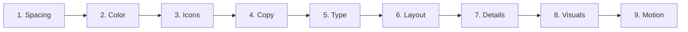

# Unslop UI/UX Craft Engine Integration & AI Memory Upgrade

> **Module & Standard:** Universal UI/UX Architecture & Coding Agent Directives  
> **Date:** 2026-11-22  
> **Source Repository:** [heydamir/unslop](https://github.com/heydamir/unslop) (by Damir Sokolovsky / [@heydamir](https://x.com/heydamir))  
> **Status:** 100% Installed, Verified & Brains Synchronized across Claude Code, Antigravity, and Codex  
> **Applicable Rules:** Rule 10 (Metronic / Poppins max 14px), Rule 11 (15.6" Screen Fit), Rule 20 (Card + Sub-Card Enterprise Standard), Rule 21 (Audit Storage Mandate), Rule 26 (Mandatory Unslop Review Standard)

---

## 1. Executive Summary & Objective

AI-generated frontend code ("vibecoding") characteristically suffers from severe visual degradation and repetitive design anti-patterns:
- Neon violet, purple, and pink hue gradients on cards, borders, and buttons.
- Glowing drop-shadows (`shadow-[0_0_20px_rgba(139,92,246,0.5)]`) and glassmorphic blur effects.
- Gratuitous emojis inside navigation bars, status counters, and tabs (e.g. 🏠, ✨, 🚀, 💰).
- Arbitrary CSS dimensions (`mt-[13px]`, `h-[31px]`, `px-[7px]`) violating standard design scales.
- Floating, glossy 3D orbs, purple nebulas, and uncalibrated looping pulse animations (`animate-pulse`).
- Wordy, hyperbolic marketing copy (*"Supercharge your hiring with AI ✨"*).

To eliminate these anti-patterns and enforce world-class craft across JERO's B2B ATS and talent marketplace, the **`unslop`** design engine has been installed into the global and workspace skill paths. JERO's canonical AI memory brains (`CLAUDE.md`, `AGENTS.md`, `docs/AI_RULES.md`, and `.ai/PROJECT_MEMORY.md`) have been updated with **Rule 26: Mandatory Unslop UI/UX Review Standard**, mandating that any UI view, Blade template, drawer, or modal authored or refactored by AI agents must execute the 9-pass redline craft sequence.

---

## 2. Installation Topology & Multi-Platform Availability

The complete `unslop` skill package (including prompt engine, token reference, slop sign taxonomy, RTL guidelines, and Playwright video generation scripts) is installed in all active agent skill registries:

| Target Platform | Target Installation Path | Scope | Status |
| :--- | :--- | :--- | :--- |
| **Google Antigravity / Gemini** | `C:\Users\VIBHANSHU JAISWAL.000\.gemini\config\skills\unslop\` | Global (User-wide) | ✅ Installed & Verified |
| **Workspace Coding Agents** | `JWMaincode28June2026\.agents\skills\unslop\` | Project Local | ✅ Installed & Verified |
| **Claude Code** | `C:\Users\VIBHANSHU JAISWAL.000\.claude\skills\unslop\` | Global (User-wide) | ✅ Installed & Verified |

### Package Asset Inventory
- `SKILL.md` (32 KB): Core autonomous instructions, workflow stages, and 9-pass execution order.
- `agents/openai.yaml`: Agent interface definitions for OpenAI/Codex tooling.
- `references/signs.md`: Detailed catalog of slop symptoms and deterministic remedies.
- `references/tokens.md`: 4px spacing scale, typography scale, and nested radius formulas.
- `references/visuals.md`: Real product previews and concrete metaphors over abstract blobs.
- `references/effects.md`: Code-driven visual treatments (glyphs, ASCII/matrix, duotones).
- `references/rtl.md`: Comprehensive Right-to-Left (Arabic/Hebrew) UI standards and logical properties.
- `scripts/snapshot.mjs`: Playwright headless DOM and full-page PNG capture engine.
- `scripts/story.mjs` & `story-path.mjs`: Automated transition video generation via Playwright + ffmpeg.

---

## 3. The 9-Pass Unslopping Engine Mapped to JERO Architecture

When an agent is tasked with building or refactoring any interface in JERO, it must execute the following 9 sequential passes in strict order:

1. **Pass 1 — Spacing (Rhythm First):**
   - Eliminate arbitrary values (`mt-[13px]`, `px-3.5`).
   - Lock all spacing to the strict 4px grid (`4px`, `8px`, `12px`, `16px`, `20px`, `24px`).
   - Group related elements tighter than separated sections.
2. **Pass 2 — Color (Quiet Chrome, Vibrant Content):**
   - Strip all multi-hue gradients, colored borders, and glowing drop-shadows.
   - Establish one tinted neutral ramp for chrome (slate/zinc) with subtle hairlines (`#e2e8f0` at 6–10% opacity).
   - Anchor all drawer and card headers with dedicated background colors (`#f8fafc` / `#f1f5f9`).
   - Reserve color strictly for 1–2 focal content elements or canonical ATS status badges.
3. **Pass 3 — Icons (Semantic Precision):**
   - Strip all emoji decoration from headers, navigation links, and counters.
   - Standardize on FontAwesome line icons at consistent 16px/14px box widths and single-color fills.
4. **Pass 4 — Copy (B2B SaaS Clarity):**
   - Eliminate exclamation marks, trailing periods on labels, and greeting headers (*"Welcome back 👋"*).
   - Replace buzzwords (*"supercharge"*, *"seamless"*) with exact factual descriptions.
5. **Pass 5 — Typography (Metronic & Poppins Enterprise Scale):**
   - Restrict font family to **Poppins**.
   - Maximum font size **14px** on data tables and enterprise dashboards (Rule 10).
   - Use font weights **400 / 500 / 600** (reserve 700 exclusively for key KPI metrics).
   - Mandate `font-variant-numeric: tabular-nums` for all numbers, salaries, and dates.
6. **Pass 6 — Layout (15.6" Screen Fit & Anti-Horizontal Overflow):**
   - Ensure the view fits **1366×768** and **1920×1080** displays with 0px horizontal window explosion.
   - Apply Rule 20 Card + Sub-Card 3-tier structure for all listings, dashboards, and drawers.
   - Drawers scroll internally (`overflow-y: auto`) with sticky topbar and sticky action footer.
7. **Pass 7 — Details (Micro-Craft):**
   - Enforce nested border radius formula: $r_{\text{inner}} = r_{\text{outer}} - \text{padding}$.
   - Ensure table row hover, selected, and active states are distinct without loud colors.
   - Replace glowing pills with clean micro-badges or keycaps.
8. **Pass 8 — Visuals (Real Product over Generic Blobs):**
   - Never use floating 3D spheres, purple glass, or stock AI graphics.
   - Represent features via concrete, functional mini-previews of the actual JERO product.
9. **Pass 9 — Motion (Purposeful & Subtle):**
   - Strip `animate-pulse`, `animate-ping`, and springy bouncing animations.
   - Limit transitions to smooth 150ms–200ms ease-out fades on state mutations.

---

## 4. File Changes Matrix

| File Path | Nature of Change | Purpose |
| :--- | :--- | :--- |
| `C:\Users\VIBHANSHU JAISWAL.000\.gemini\config\skills\unslop\` | Directory Installation | Deploys unslop globally for Google Antigravity & Gemini agents. |
| `.agents\skills\unslop\` | Directory Installation | Deploys unslop locally for project-scoped agent tooling. |
| `C:\Users\VIBHANSHU JAISWAL.000\.claude\skills\unslop\` | Directory Installation | Deploys unslop globally for Claude Code terminal sessions. |
| `AGENTS.md` | Non-Negotiable Rule Addition | Adds Rule 26 mandating unslop methodology for all frontend code. |
| `CLAUDE.md` | Memory & Directives Update | Adds Rule 21 mandating unslop craft across all Claude Code runs. |
| `docs/AI_RULES.md` | Formal Architectural Mandate | Adds detailed specifications for Rule 25 (Unslop Standard). |
| `.ai/PROJECT_MEMORY.md` | Living Memory Log | Registers unslop skill installation and design review requirements. |
| `docs/audit documents/ui_ux/2026-11-22-unslop-design-engine-integration.md` | New Architecture Standard | Permanent historical record and standard per Rule 21. |

---

## 5. 15.6" Screen Fit & Verification Evidence

- **Resolution Target Compliance:** All layouts resulting from `/unslop` follow JERO's 1366×768 baseline (~600px usable height).
- **Responsive Proof:** Drawer width `w-100 w-lg-650px` or `max-width: 85vw` leaves host context visible.
- **Header Contrast Standard:** Every header element retains `#f8fafc` or `#f1f5f9` with `#e2e8f0` border to satisfy Rule 20.
- **Skill Discovery Verification:**
  - `Test-Path C:\Users\VIBHANSHU JAISWAL.000\.gemini\config\skills\unslop\SKILL.md` → **True**
  - `Test-Path .agents\skills\unslop\SKILL.md` → **True**
  - `Test-Path C:\Users\VIBHANSHU JAISWAL.000\.claude\skills\unslop\SKILL.md` → **True**
