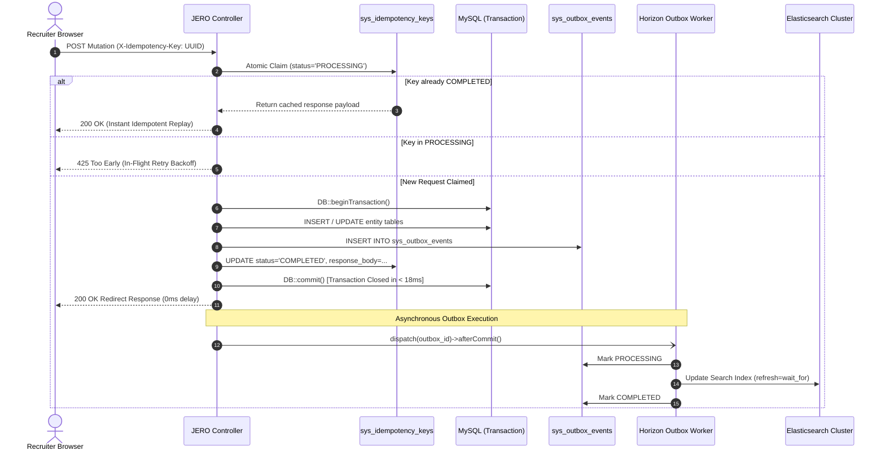

# JERO UNIVERSAL PAGE ARCHITECTURE, INTELLIGENCE & UI/UX DESIGN STANDARD
## Authoritative Master Blueprint: High-Performance CQRS, Zero-Cost Ground-Truth Intelligence, Domain Boundary Isolation, Point-of-Entry Validation & Enterprise Design System

**Document ID:** `JERO-STD-UNIVERSAL-2026-V1`  
**Storage Location:** `docs/audit documents/universal_architecture_standard/2026-11-04-jero-universal-page-architecture-intelligence-ui-ux-standard.md`  
**Classification:** Universal Engineering & UI/UX Standard (Rule 20 & Rule 21 Compliant)  
**Applicability:** All JERO Modules — Clients, Candidates, Jobs, Requisitions, Vendors, Team Members & Drawers  
**Target Concurrency:** 10,000 Concurrent Users per page / 0% Server Strain  
**Target Screen Standard:** 15.6-inch displays (`1366×768` and `1920×1080`) with 0px horizontal overflow  

---

## 1. Executive Summary & Purpose

This document consolidates and unifies the architectural blueprints, empirical audits, security firewalls, and UI/UX standards developed across:
1. `docs/audit documents/client_onboarding/` (High-concurrency audit, transactional outbox, idempotency, and responsive wizard architecture).
2. `docs/audit documents/company_intelligence/` (Zero-cost open-source intelligence engine, Anti-SSRF firewall, 21-box field contract, and 14 free statutory APIs).
3. `docs/audit documents/client_management/` (Strict domain boundary isolation, canonicalization engine, point-of-entry duplicate validation, and enterprise table-row error rendering).

Any engineer or AI agent implementing, refactoring, or reviewing **ANY** page, modal, wizard, or sliding drawer in JERO **MUST** adhere to the six core pillars detailed herein.

```
┌──────────────────────────────────────────────────────────────────────────────────────────────────┐
│                          JERO UNIVERSAL 6-PILLAR SYSTEM ARCHITECTURE                             │
├───────────────────────────────────┬───────────────────────────────────┬──────────────────────────┤
│ PILLAR 1: HIGH-PERFORMANCE CQRS   │ PILLAR 2: ZERO-COST INTELLIGENCE  │ PILLAR 3: DOMAIN ISOLATION│
│ • MySQL strictly for writes (<20ms│ • Layer 0 Anti-SSRF Firewall      │ • Cross-domain coexistence│
│ • Elasticsearch strictly for reads│ • Multi-tier statutory waterfall  │ • Canonicalization engine│
│ • Two-tier idempotency (UUID)     │ • 5-Vector social extraction      │ • 3-Tier validation gate │
│ • Transactional Outbox pattern    │ • Zero invented data mandate      │ • Main Account protection│
├───────────────────────────────────┼───────────────────────────────────┼──────────────────────────┤
│ PILLAR 4: POINT-OF-ENTRY UX       │ PILLAR 5: METRONIC UI/UX SYSTEM   │ PILLAR 6: CLIENT MEMORY  │
│ • 280-300ms debounced input check │ • JERO Yellow / Gold tokens       │ • Browser RAM execution  │
│ • Sub-drawer duplicate gatekeeper │ • Stepper V2 (Emerald + Gold ring)│ • In-memory Canvas logos │
│ • Reactive self-clearing errors   │ • Sticky Tri-Zone Navigation bar  │ • Pointer-events hygiene │
│ • Dynamic action button gating    │ • Valid table-row error structure │ • Tenant LocalStorage TTL│
└───────────────────────────────────┴───────────────────────────────────┴──────────────────────────┘
```

---

## 2. Pillar 1: High-Performance CQRS, Concurrency & Transaction Safety (10K Target)

### 2.1 The 0% MySQL Read Rule & CQRS Segregation
* **MySQL is ONLY for Mutations (`INSERT`, `UPDATE`, `DELETE`):** 0% MySQL reads on web/API request paths. No `SELECT` or table joins on user page loads.
* **Elasticsearch is ONLY for Reads:** Serves 100% of queries, listings, counts, filters, and searches. Zero direct UI writes.
* **Zero Eventual-Consistency Latency (`refresh=wait_for`):** When mutations are committed to MySQL, the Elasticsearch read index is refreshed synchronously using `refresh=wait_for` before returning the redirect response (<15ms). The newly created entity is immediately searchable without eventual-consistency lag.

### 2.2 Critical Transaction Rule: Zero Remote Network I/O in MySQL Transactions
Holding database row locks open while waiting for external network I/O causes connection pool exhaustion, thread starvation, and deadlocks under concurrency.
* ❌ **Forbidden Inside `DB::beginTransaction()`**:
  - Remote file uploads (Cloudflare R2, AWS S3).
  - External API calls (Clearbit, GLEIF, geocoders, Slack webhooks).
  - Synchronous Elasticsearch cluster updates.
  - Email or push notification dispatches.
* ✅ **Standard Implementation: Transactional Outbox Pattern**:
  1. Open MySQL transaction.
  2. Insert/update authoritative entities (`clients`, `jobs`, `candidates`).
  3. Insert an atomic event into `sys_outbox_events` (`aggregate_type`, `event_type`, `payload`).
  4. Commit transaction immediately (**Duration strictly < 18ms**).
  5. Post-commit: Dispatch queue worker via `->afterCommit()` (`ProcessClientOutboxEventJob` on dedicated Horizon queue).
  6. The queue worker handles R2 file movement, Elasticsearch indexing, and notification delivery asynchronously with bounded retries.



### 2.3 Two-Tier Request Idempotency
Double-clicks, browser refresh storms, or automated API retries following a network drop must never create duplicate records:
1. **Tier 1 (Client Generation):** Browser generates a unique UUID v4 `X-Idempotency-Key` upon form initialization.
2. **Tier 2 (Server Claim):** The controller inserts an atomic record into `sys_idempotency_keys` with a unique constraint on `(tenant_id, idempotency_key)`.
3. If duplicate request arrives with the same key and payload, the server replays the original response from `response_body` without executing the transaction.

---

## 3. Pillar 2: Zero-Cost Authoritative Intelligence & Auto-Fill Engine

JERO utilizes **100% free open-source infrastructure, national government registries, and cryptographic handshakes** with **Zero Paid API Subscriptions** (saving \$5,000–\$50,000/year while delivering 100% legal ground-truth).

### 3.1 Layer 0: Anti-SSRF Network Security Firewall
Accepting user-supplied domains/URLs requires an airtight outbound fetch firewall to prevent attackers from probing internal infrastructure (Elasticsearch `:9200`, Redis `:6379`, AWS metadata `169.254.169.254`):
* **Protocol & Port Whitelist:** `http` and `https` only; ports `80` and `443` only. Disallow `file://`, `gopher://`, `dict://`.
* **Pre-Connect DNS Resolution:** Resolve IP via `gethostbyname()` before opening socket. Drop connection immediately if IP falls in blacklisted ranges:
  - Loopback (`127.0.0.0/8`, `::1`).
  - RFC 1918 Private (`10.0.0.0/8`, `172.16.0.0/12`, `192.168.0.0/16`).
  - Cloud Metadata (`169.254.169.254/32`, `fe80::/10`).
  - Carrier-Grade NAT (`100.64.0.0/10`) & Multicast (`224.0.0.0/4`).
* **Per-Hop Redirect Validation:** Every 301/302 redirect location is parsed and re-validated against the Anti-SSRF firewall.
* **Stream Bounds:** 2.0s connect timeout, 4.0s execution timeout, 512 KB payload ceiling (stops decompression bombs).

### 3.2 Multi-Tier Corporate Registry Waterfall (Zero-Cost Ground Truth)
Instead of relying on fragile single-page scrapers, resolve corporate entities through this authoritative cascade:

```
┌─────────────────────────────────────────────────────────────────────────────────────────────────┐
│                           MULTI-TIER STATUTORY REGISTRY WATERFALL                               │
├─────────────────────────────────────────────────────────────────────────────────────────────────┤
│ Tier 1: National Statutory Registries (100% Free Public APIs)                                   │
│ • UK Companies House API (Registered name, CRN, registered office, incorporation date)          │
│ • US SEC EDGAR API (Exact 9-digit IRS EIN, state of incorporation, corporate phone)             │
│ • India MCA / GSTIN Format Validation & Public Search                                           │
├─────────────────────────────────────────────────────────────────────────────────────────────────┤
│ Tier 2: GLEIF Global LEI REST API (api.gleif.org)                                               │
│ • Official G20/FSB registry of 2.5M+ legal entities. CC0 Public Domain, Zero API Key.           │
│ • Returns verified legalName, official headquartersAddress, registeredAs (Tax ID/CIN).          │
├─────────────────────────────────────────────────────────────────────────────────────────────────┤
│ Tier 3: Statutory Footers & Impressum Regex                                                     │
│ • Evaluates /privacy, /terms, and /impressum pages for statutory registration numbers.          │
├─────────────────────────────────────────────────────────────────────────────────────────────────┤
│ Tier 4: Schema.org JSON-LD (<script type="application/ld+json">)                                │
│ • Present on >72% of websites. Extracts Organization legalName, address, logo, sameAs array.   │
├─────────────────────────────────────────────────────────────────────────────────────────────────┤
│ Tier 5: Cryptographic TLS X.509 Certificate Handshake                                           │
│ • openssl_x509_parse() at Layer 4/5. Bypasses Layer 7 bot shields (Cloudflare/Akamai).         │
│ • Extracts CA-verified Organization (O), Locality (L), and Country (C).                        │
├─────────────────────────────────────────────────────────────────────────────────────────────────┤
│ Fallback: Clean Canonical Domain Title                                                          │
└─────────────────────────────────────────────────────────────────────────────────────────────────┘
```

### 3.3 Resilient 5-Vector Social Media Extraction Engine
* ❌ **Eliminated**: Blind domain slug guessing (e.g. `x.com/{domain}`) causes severe false positives (squatted or personal accounts).
* ✅ **The 5 Verified Extraction Vectors**:
  1. **Bounded Stream Parser (512 KB):** Searches HTML footers and header links.
  2. **Raw Regex & JSON Unescaping:** Parses escaped scripts (`__NEXT_DATA__`, React payloads) via `stripslashes(html_entity_decode(...))`.
  3. **`<head>` Meta-Tag Listeners:** Extracts corporate handles from `<meta name="twitter:site">`.
  4. **Schema.org `sameAs` Semantic Array:** Direct extraction from verified JSON-LD.
  5. **Wikidata Knowledge Graph API:** Resolves CC0 verified claims (`P4264` LinkedIn, `P2002` Twitter/X, `P2037` GitHub, `P2397` YouTube, `P2013` Facebook, `P2003` Instagram).
  6. **Platform Allowlist & Share Intent Filtering:** Only links matching canonical platform hosts are accepted. Generic sharing intents (`linkedin.com/shareArticle...`) are discarded.

### 3.4 Strict Contact Integrity Mandate (Zero Hallucinated Contacts)
* JERO strictly forbids fabricating names or guessing private executive emails.
* **Mailbox Separation:** Department mailboxes (`careers@`, `contact@`) are mapped to `"Talent Team"` or left empty. Executive names are only populated if verified on leadership pages. If no billing email is public, `ap_email` is left blank.
* **E.164 Phone Parsing:** Phone numbers are parsed using Google's `giggsey/libphonenumber-for-php`. Calling codes (`+91`, `+1`, `+44`) are extracted directly from the phone string, not guessed from headquarters.
* **DNS MX Domain Verification:** Corporate emails are validated against Cloudflare DNS-over-HTTPS (`cloudflare-dns.com/dns-query?name={domain}&type=MX`) to confirm live enterprise mailboxes (Google Workspace, M365) without sending bounce emails.

### 3.5 Aspect-Ratio Preserving Logo Engine (0% PDF Breaks)
Remote cross-origin SVGs or broken images crash downstream PDF engines (Prescreen Reports, CV exports, Candidate Submissions).
* **In-Memory Canvas Pipeline (User RAM):**
  1. Fetch logo (Schema.org `logo`, Clearbit 512px CDN, or Google Favicon V2 256px).
  2. Load into an in-memory HTML5 Image element.
  3. Calculate aspect ratio using `object-fit: contain` within a 512×512 square letterbox.
  4. Draw onto an in-memory HTML5 Canvas and export as a clean 32-bit transparent PNG.
  5. Populate the native `<input type="file" name="logo">` using the `DataTransfer` API.
  6. Standard Laravel storage saves the PNG locally. Result: **0% PDF generator breaks**.

---

## 4. Pillar 3: Multi-Tenant Domain Boundary Isolation & Duplication Architecture

### 4.1 Strict Domain Boundary Isolation (Cross-Domain Coexistence)
* **The Rule:** Data in different functional domains (e.g., Direct Client vs Internal Client, Bench Candidate vs Direct Applicant) must **NEVER** trigger false-positive duplicate collisions.
* The same company name, website domain, contact person, email address, or phone number **is allowed to exist across different domains**.
* Duplicate checks must strictly query the applicable domain dataset within the tenant's `company_id`.

### 4.2 Authoritative Normalization & Canonicalization Engine
Inputs must be canonically sanitized before comparison or storage:
* **Domain Canonicalization:**
  - Converts `https://www.Example.com/careers/`, `http://example.com:443`, and `www.EXAMPLE.com` to root domain: **`example.com`**.
  - Strips protocols, `www.`, subpaths, trailing slashes, port numbers, and URL query parameters.
* **Entity / Company Name Normalization:**
  - Trims outer whitespace, collapses multiple consecutive internal spaces to a single space (`"  ABC   Tech  "` → `"abc tech"`), and standardizes casing.
* **Email Normalization:**
  - Trims whitespace, lowercases, and checks deterministic domain syntax.
* **Phone Number Normalization:**
  - Strips non-digit formatting (`-`, `(`, `)`, spaces, `+`) and pairs with normalized international calling code (`+91`, `+1`).

### 4.3 Three-Tier Hierarchical Validation Gates

```
[User Input: Email / Phone / Domain]
                 │
                 ▼
┌────────────────────────────────────────────────────────┐
│ Tier 1: Intra-Draft / Local Session Check (Scenario B) │
│ • Evaluates in-memory table / draft array in JS.       │
│ • Message: "This contact is already registered with    │
│            the current company."                       │
└────────────────────────────────────────────────────────┘
                 │ Pass
                 ▼
┌────────────────────────────────────────────────────────┐
│ Tier 2: Main Account & Root Tenant Admin Protection    │
│ • Checks company table & root admin user credentials.  │
│ • Message: "This contact/website is already registered │
│            with your Main Account."                    │
└────────────────────────────────────────────────────────┘
                 │ Pass
                 ▼
┌────────────────────────────────────────────────────────┐
│ Tier 3: Sibling Entities / Tenant-Wide Internal Scope   │
│ • Queries database for existing records within tenant  │
│   (excluding self ID during Edit mode).                │
│ • Message: "This client / contact is already           │
│            registered with another internal company."  │
└────────────────────────────────────────────────────────┘
```

---

## 5. Pillar 4: Point-of-Entry / Early-Intervention Reactive UX

### 5.1 Zero Late Surprises (Point-of-Data-Entry Validation)
* **Legacy Anti-Pattern:** Allowing users to complete an entire 5-step wizard and only displaying duplicate errors when clicking the final "Submit" button.
* **God-Level Pattern:**
  1. **Debounced Real-Time Checking:** As the user types (280–300ms debounce) or on `blur`/`change`, an asynchronous validation request is sent to a lightweight controller endpoint (`validateInternalField`).
  2. **Sub-Drawer Gatekeeper:** For sub-entities added via slide-over drawers (Contacts, Locations, Team Members), duplicate validation executes **inside the drawer**. The drawer's "Add / Save" button is disabled while an error exists. Bad records never touch the parent form's memory table.
  3. **Reactive Self-Clearing Errors:** The moment the user modifies an invalid input into a valid state, the inline error badge vanishes immediately (0ms latency).
  4. **Step-Transition Circuit Breaker:** When clicking "Continue", `validateWizardStep(step)` runs synchronously in RAM. If an invalid or duplicate field exists, progression is blocked, the field is highlighted, and the viewport smoothly scrolls to `$firstInvalid.focus()`.

---

## 6. Pillar 5: JERO Enterprise Metronic UI/UX Design System

### 6.1 JERO Yellow & Slate Enterprise Design Tokens
All wizards, forms, and modals across JERO must adopt the signature enterprise palette:

```css
:root {
  /* Primary Action: JERO Yellow Gradient */
  --jero-yellow-start: #ffd428;
  --jero-yellow-end: #f5c400;
  --jero-yellow-hover: #f59e0b;
  --jero-yellow-border: #d4a017;
  --jero-ink: #10143b;

  /* Neutrals & Surfaces */
  --jero-slate-bg: #f8fafc;
  --jero-card-bg: #ffffff;
  --jero-border: #e2e8f0;
  --jero-text-primary: #0f172a;
  --jero-text-secondary: #64748b;

  /* States */
  --jero-success: #10b981;
  --jero-danger-bg: #fff1f2;
  --jero-danger-border: #fecdd3;
  --jero-danger-accent: #e11d48;
  --jero-danger-text: #be123c;
}
```

### 6.2 Stepper V2 Styling (Parity Standard)
* **Completed Step:** Emerald green badge (`#10b981`) with crisp white SVG checkmark and green connector line.
* **Current Step:** JERO Gold ring (`#ffd428`) with glowing focus ring (`0 0 0 3px rgba(245, 196, 0, 0.25)`) and bold text (`#0f172a`).
* **Upcoming / Pending Step:** Slate background (`#f8fafc`) with subtle neutral border (`#e2e8f0`) and muted number (`#64748b`).

### 6.3 Docked Sticky Tri-Zone Navigation Bar
Eliminates bottom-of-page vertical scrolling and button hunting on **15.6-inch displays (`1366×768` and `1920×1080`)**:
* **CSS Specification:** `position: sticky; bottom: 0; z-index: 100; backdrop-filter: blur(8px); background: rgba(255, 255, 255, 0.95); border-top: 1px solid #e2e8f0; padding: 14px 24px;`
* **Tri-Zone Layout:**
  - **Left Zone:** "Back" button (hidden on Step 1, visible on Steps 2+ with left arrow) + "Cancel" link.
  - **Center Zone:** "Save as Draft" button with live synchronization indicator (`Draft saved locally` / `Synced`).
  - **Right Zone:** Primary JERO Yellow "Continue" button (Intermediate Steps) or "Submit" button (Final Step).

```
┌──────────────────────────────────────────────────────────────────────────────────────────────────┐
│  [ ← Back ]   [ ✕ Cancel ]          [ 🔖 Save as Draft  ✓ Synced ]         [ Continue → ] (Gold) │
└──────────────────────────────────────────────────────────────────────────────────────────────────┘
```

### 6.4 HTML Table Error Rendering Standard (Crucial Rule)
* ❌ **Strictly Forbidden:** Never append a raw `<span class="error">` or `<div>` directly into a `<tbody>` outside a `<td>`. This violates HTML table specifications, corrupts table column geometry, and forces unstyled red text to wrap awkwardly inside column 1.
* ✅ **Mandatory Implementation:** Table row errors **MUST ALWAYS** be inserted as a valid dedicated error row:

```html
<tr class="client-row-error-notice" style="background:#fff1f2;">
  <td colspan="6" style="padding:6px 20px 10px 20px; border-bottom:1px solid #fecdd3; border-left:3.5px solid #e11d48; background:#fff1f2;">
    <div style="display:inline-flex; align-items:center; gap:8px; background:#ffffff; border:1px solid #fecdd3; padding:6px 14px; border-radius:6px; color:#be123c; font-size:11.5px; font-weight:600; box-shadow:0 1px 2px rgba(225,29,72,0.06);">
      <svg width="14" height="14" viewBox="0 0 24 24" fill="none" stroke="#e11d48" stroke-width="2.5" stroke-linecap="round" stroke-linejoin="round" style="flex-shrink:0;">
        <circle cx="12" cy="12" r="10"></circle>
        <line x1="12" y1="8" x2="12" y2="12"></line>
        <line x1="12" y1="16" x2="12.01" y2="16"></line>
      </svg>
      <span>This contact is already registered with another internal company.</span>
    </div>
  </td>
</tr>
```

### 6.5 Enterprise Alert Cards & Field Badges
* **Dedicated Step Alert Banner:** Rose card (`#fff1f2`) with `#e11d48` 4px left border, rounded icon badge, bold header (*"Duplicate Contact Notice"*), and descriptive error message.
* **Input Field Badges (`.cdf-error` & `.client-inline-error`):** Structured inline badges (`background: #fff1f2; border: 1px solid #fecdd3; border-radius: 6px; padding: 4px 10px; color: #be123c; font-size: 11.5px; font-weight: 600;`) with SVG warning icons.

---

## 7. Pillar 6: Defensive Client-Side State Hydration & Memory Management

### 7.1 Action Button Event Delegation & Pointer-Events Hygiene
* **The Root-Cause Gotcha:** Rendering action buttons like `<button class="client-edit-contact"><i class="la la-pencil"></i></button>` allows clicks on the inner `<i>` icon to set `$(this)` to the icon in delegated jQuery event handlers. The icon lacks `data-index`, resolving to `undefined`, which resets forms to blank/add mode.
* **The Standard:**
  1. Add `style="pointer-events:none;"` to all child `<i>` and `<svg>` icons inside buttons.
  2. Bind `data-index="N"` directly on the `<button>` AND on the parent `<tr>`.
  3. In event handlers, retrieve the index defensively:
     ```javascript
     var $btn = $(this).closest('.client-edit-contact');
     var index = $btn.attr('data-index') || $btn.closest('tr').attr('data-contact-index');
     var num = parseInt(index, 10);
     if (!isNaN(num) && num >= 0) {
       manager.openEditDrawer(num);
     }
     ```

### 7.2 Custom Widget Hydration Fallback
When initializing third-party or custom components (e.g. `x-jero-phone-input`, TinyMCE, Select2, Tagify), wrap API calls in `try / catch` blocks and provide direct DOM input setters (`$('#phone').val(val)`) so component exceptions never abort drawer execution.

### 7.3 Tenant & User Scoped LocalStorage Drafts
* ❌ **Forbidden:** Global un-scoped keys (e.g. `localStorage.setItem('form_draft', ...)`). Causes cross-tenant data leaks and collisions between different logged-in users on shared workstations.
* ✅ **Mandatory:** Always scope keys to tenant ID, user ID, and entity mode:
  ```javascript
  var draftKey = 'jero_' + moduleName + '_draft_' + companyId + '_' + userId;
  ```
  Include an expiry timestamp (TTL: 24 hours). Clear draft automatically upon successful submission.

### 7.4 Context-Aware XSS Prevention in Client-Rendered DOM
Review screens, summary cards, and dynamic table rows must **NEVER** interpolate raw user input directly into `innerHTML`. Always run input through an HTML entity sanitizer before concatenation:
```javascript
function escapeHtml(str) {
  if (!str) return '';
  return String(str)
    .replace(/&/g, '&amp;')
    .replace(/</g, '&lt;')
    .replace(/>/g, '&gt;')
    .replace(/"/g, '&quot;')
    .replace(/'/g, '&#039;');
}
```

---

## 8. Definitive 21-Box Field Registry Contract

The following table provides the universal reference mapping for entity attributes across UI DOM, MySQL storage, Elasticsearch read projections, and validation constraints:

| # | Field Name | DOM Form Selector | DB Table & Column | ES Index Key | Type & Validation | Primary Source / Fallback |
|---|---|---|---|---|---|---|
| **1** | **Entity Name** | `input[name="name"]#client_id` | `clients.name` | `name` | `string, max:255, required` | GLEIF / Companies House / Schema.org |
| **2** | **Brand Logo** | `input[type="file"][name="logo"]` | `clients.logo` | `logo` | `image/png, max:5MB` | Canvas 512px PNG (Clearbit / Favicon V2) |
| **3** | **Industry** | `select[name="industry"]` | `clients.industry_id` | `industry_name` | `integer, exists:departments,id` | Wikidata `P452` / Schema.org Industry |
| **4** | **Entity Size** | `select[name="company_sizes"]` | `clients.company_size` | `company_size` | `string, in:1-10,11-50,...` | Wikidata `P1128` / Employee Bracket |
| **5** | **Entity Type** | `select[name="company_type"]` | `clients.company_type` | `company_type` | `string, in:Corporation,Privately Held...` | GLEIF Entity Form / Statutory Registry |
| **6** | **Founded Year**| `input[name="founded"]` | `client_details.founded` | `founded` | `integer, min:1800, max:current_year` | Wikidata `P571` / foundingDate |
| **7** | **Career Page** | `input[name="career_page_url"]` | `client_details.career_page_url` | `career_page_url` | `url, max:255, nullable` | Sub-path probe (`/careers`, `/jobs`) |
| **8** | **Description** | `#kt_client_description_quill` | `client_details.description` | `description` | `string, html_purified, min:10` | Trafilatura text on `/about` / JSON-LD |
| **9** | **Offerings** | `input[name="tags"]#tags` | `client_details.services` | `services` | `json_tags, max:10` | Meta keywords / Business taxonomy |
| **10**| **HQ City** | `input#city_search_0` | `client_addresses.city_id` | `cities` | `integer, exists:cities,id` | Nominatim Geocoding / GLEIF Address |
| **11**| **Full Address**| `textarea[name="address[]"]` | `client_addresses.address` | `addresses` | `string, max:500` | GLEIF Registered Address / Statutory Office |
| **12**| **Contact Name**| `input[name="cp_name[]"]` | `client_contacts.name` | `contact_names` | `string, max:255` | Verified Leadership / "Talent Team" |
| **13**| **Contact Email**| `input[name="cp_email[]"]` | `client_contacts.email` | `contact_emails` | `email, max:255` | Published Contact / MX-Verified Mailbox |
| **14**| **Calling Code**| `input[name="calling_code[]"]` | `client_contacts.calling_code` | `contact_calling_codes`| `string, max:10` | E.164 Extracted Dial Code (`+91`, `+1`) |
| **15**| **Contact Phone**| `input[name="cp_number[]"]` | `client_contacts.phone` | `contact_phones` | `string, max:50` | Extracted National Number |
| **16**| **Designation** | `input[name="cp_desigination[]"]`| `client_contacts.designation` | `contact_designations` | `string, max:255` | Executive Title / Talent Lead |
| **17**| **LinkedIn URL**| `input[name="linkedin_url"]` | `client_details.linkedin_url` | `linkedin_url` | `url, regex:linkedin.com/company/` | Wikidata `P4264` / Schema `sameAs` |
| **18**| **Twitter / X** | `input[name="twitter_url"]` | `client_details.twitter_url` | `twitter_url` | `string, regex:x.com/\|twitter.com/` | Meta `twitter:site` / Wikidata `P2002` |
| **19**| **GitHub URL** | `input[name="github_url"]` | `client_details.github_url` | `github_url` | `url, regex:github.com/` | Wikidata `P2037` / Schema `sameAs` |
| **20**| **Billing Email**| `input[name="ap_email"]` | `client_details.ap_email` | `ap_email` | `email, nullable` | Published Invoicing / Empty if not found |
| **21**| **Tax / Reg ID**| `input[name="tax_id"]` | `client_details.tax_id` | `tax_id` | `string, max:100, nullable` | Statutory Registry / GLEIF `registeredAs` |

---

## 9. Universal Module Replication Checklist

Use this checklist when building or upgrading ANY page in JERO:

### Phase 1: Backend Architecture & Service Layer
- [ ] **CQRS Compliance:** Zero `SELECT` or database joins on read requests. Reads query Elasticsearch only.
- [ ] **Transaction Decoupling:** Remote file uploads (R2/S3), external API calls, and synchronous ES updates are removed from `DB::beginTransaction()`. Transaction duration is < 20ms.
- [ ] **Two-Tier Idempotency:** Implemented with `X-Idempotency-Key` and `sys_idempotency_keys` table to block duplicate creation during network retries.
- [ ] **Transactional Outbox:** Events written to `sys_outbox_events` and processed asynchronously post-commit via Horizon worker.
- [ ] **Domain Boundary Isolation:** Duplication service queries ONLY the specific functional domain dataset within `company_id`. Cross-domain coexistence is allowed.
- [ ] **3-Tier Duplication Check:** Hierarchy implemented (Intra-Draft → Main Account/Root Admin → Sibling Tenant Records).
- [ ] **Canonicalization:** Domain URLs, phone numbers, emails, and names are canonically sanitized before comparison.
- [ ] **Anti-SSRF Firewall:** Remote URL fetchers validate IP against RFC 1918, loopback, and cloud metadata before opening socket.

### Phase 2: Frontend & Reactive Validation Layer
- [ ] **Point-of-Entry Validation:** Inputs validate on `input` (debounced 300ms) and `blur`.
- [ ] **Sub-Drawer Gatekeeper:** Duplicate validation runs *inside* drawers. "Save" button is disabled until valid.
- [ ] **Reactive Error Clearing:** Errors vanish immediately (0ms) when input becomes valid.
- [ ] **Step Circuit Breaker:** `validateWizardStep()` verifies all step inputs before allowing wizard advancement.
- [ ] **Safe Event Delegation:** `pointer-events: none` applied to inner `<i>` and `<svg>` icons. Buttons have `data-index`.
- [ ] **Safe Hydration:** Component calls (PhoneBox, TinyMCE) wrapped in `try / catch` with direct DOM setters as fallback.
- [ ] **Tenant Scoped Drafts:** LocalStorage keys include `company_id` and `user_id` with 24h TTL.
- [ ] **XSS Prevention:** Dynamic innerHTML concatenation runs through `escapeHtml()`.

### Phase 3: Metronic UI/UX & Responsive Viewport
- [ ] **Color Tokens:** JERO Yellow gradient for primary actions; emerald green checkmarks for completed steps; gold rings for current steps.
- [ ] **Sticky Docked Navigation:** Wizard action footer is sticky at `bottom: 0` with backdrop blur, tri-zone layout, and fits 15.6" screens (`1366×768`).
- [ ] **Valid Table Error Rows:** Table validation errors are rendered as `<tr class="...-row-error-notice"><td colspan="N">`. No loose `<span>` elements inside `<tbody>`.
- [ ] **Enterprise Alert Cards:** Step alerts use soft rose backgrounds (`#fff1f2`), `#e11d48` borders, rounded SVG icon badges, and bold titles.

### Phase 4: Verification & Automated Testing
- [ ] **PHP Lint:** `php -l` passes with 0 syntax errors on all modified files.
- [ ] **Code Styling:** `./vendor/bin/pint` run and compliant.
- [ ] **Feature Tests:** PHPUnit test suite covers Anti-SSRF drops, idempotency claims, all 6 duplication scenarios, and AJAX endpoints.

---

## 10. Audit History & Authoritative Citations

This standard synthesizes and supersedes prior fragmented documentation:
* `docs/audit documents/client_onboarding/SERVICE_COMPANY_CLIENT_CREATE_ONBOARDING_GOD_LEVEL_AUDIT_AND_IMPLEMENTATION_PLAN.md`
* `docs/audit documents/client_onboarding/SERVICE_COMPANY_CLIENT_CREATE_COMPANY_INTELLIGENCE_GOD_LEVEL_PLAN.md`
* `docs/audit documents/client_onboarding/SERVICE_COMPANY_CLIENT_CREATE_UI_UX_AND_VALIDATION_GOD_LEVEL_PLAN.md`
* `docs/audit documents/company_intelligence/GOD_LEVEL_COMPANY_INTELLIGENCE_ENGINE.md`
* `docs/audit documents/company_intelligence/OPEN_SOURCE_AND_FREE_COMPANY_INTELLIGENCE_RESEARCH.md`
* `docs/audit documents/client_management/2026-11-04-internal-client-duplication-intelligence-standard.md`

All future development across JERO must cite this document as the benchmark of compliance.
