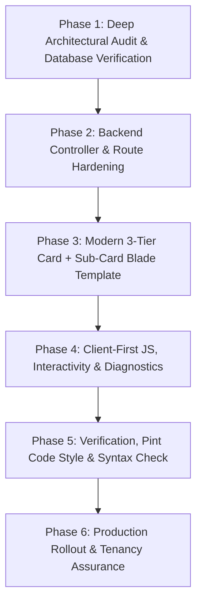

# Implementation Plan: Redesign & Architectural Overhaul of Super Admin LinkedIn Settings

> **Target Route:** `http://localhost/git/JWMaincode28June2026/super-admin/linkedin-settings` (`superadmin.linkedin-settings.index`)  
> **Target Controller:** `app/Http/Controllers/SuperAdmin/LinkedInSettingController.php` (Methods: `index`, `update`, `updateStatus`, `testConnection`)  
> **Target Blade View:** `resources/views/super-admin/linked-in-settings/edit.blade.php`  
> **Route Configuration:** `routes/superadmin.php` (lines 345–346)  
> **Database Table Truth:** `linked_in_settings` (`database/schema/mysql-schema.sql`, line 2520)  
> **Consuming ATS & Auth Modules:**  
> - `app/Http/Controllers/Front/FrontJobsController.php` (lines 42–48, 225–253: "Apply with LinkedIn", "Sign In with LinkedIn", Socialite OAuth callback)  
> - `app/Http/Controllers/Admin/AdminLinkedInSettingsController.php` (tenant activation gate)  
> - `app/Http/Controllers/ServiceCompany/ServiceCompanyLinkedInSettingsController.php` (tenant activation gate)  
> - Base Controllers (`AdminBaseController`, `ServiceCompanyBaseController`, `ProductCompanyBaseController`, `StaffingCompanyBaseController`)  
> **Design Standard:** Mandatory Card + Sub-Card Enterprise Design System (`docs/UI_UX_CARD_SUB_CARD_DESIGN_STANDARD.md` & `docs/UI_UX_STANDARDS.md`)  
> **Target Screen Profiles:** Standard 15.6" Laptops (`1366×768` and `1920×1080`) with zero horizontal overflow (`overflow-x: hidden`)  
> **Author:** Senior Principal SaaS Architect & Full-Stack Engineer (10+ Yrs Exp)  
> **Status:** Pending Review & Approval Before Code Changes (Phased Architecture Plan)  

---

## 1. Executive Summary & Architectural Context

In the JERO multi-tenant B2B hiring SaaS platform, social recruitment and frictionless candidate acquisition are vital drivers of applicant conversion. The platform features native **"Apply with LinkedIn"** and **"Sign In with LinkedIn"** capabilities on public career portals, enabling applicants to pre-fill extensive profile data, employment history, and contact details directly from their LinkedIn accounts via OAuth 2.0 (OpenID Connect / Socialite).

### The Global-to-Tenant LinkedIn Architecture in JERO

```
┌────────────────────────────────────────────────────────────────────────────────────────┐
│                        SUPER ADMIN: GLOBAL LINKEDIN SETTINGS                           │
│  Route: `/super-admin/linkedin-settings`                                               │
│                                                                                        │
│  • Client ID (OAuth App ID)                                                            │
│  • Client Secret (OAuth Secret)                                                        │
│  • Global Status: [ Enable / Disable ]                                                 │
│  • System Callback URL: `https://domain.com/auth/callback/linkedin`                    │
└──────────────────────────────────────────┬─────────────────────────────────────────────┘
                                           │
                                           ▼ (Writes to MySQL table `linked_in_settings`)
┌────────────────────────────────────────────────────────────────────────────────────────┐
│                            TABLE: `linked_in_settings`                                 │
│  • `id` (int, PK)                                                                      │
│  • `client_id` (varchar 191)                                                           │
│  • `client_secret` (varchar 191)                                                       │
│  • `status` (enum: 'enable', 'disable')                                                │
│  • `callback_url` (varchar 191)                                                        │
└──────────────────────────────────────────┬─────────────────────────────────────────────┘
                                           │
               ┌───────────────────────────┴───────────────────────────┐
               ▼                                                       ▼
┌──────────────────────────────────────────┐  ┌──────────────────────────────────────────┐
│   TENANT LEVEL ACTIVATION (Service/Admin)│  │      PUBLIC CAREERS / JOB APPLICATION    │
│  • AdminLinkedInSettingsController       │  │  File: `FrontJobsController.php:42`      │
│  • ServiceCompanyLinkedInSettingsContr.  │  │                                          │
│  Checks: if (global->status == 'disable')│  │  if (global->status == 'enable') {       │
│             abort(404);                  │  │     Config::set('services.linkedin...', )│
│  Enables per-company LinkedIn apply      │  │  }                                       │
│  in `companies.linkedin` column.         │  │  Candidate clicks "Apply with LinkedIn"  │
│                                          │  │  -> Socialite redirects to LinkedIn Auth │
│                                          │  │  -> Callback: `jobs.linkedinCallback`    │
└──────────────────────────────────────────┘  └──────────────────────────────────────────┘
```

1. **Global Configuration (Super Admin):**  
   The Super Admin configures the platform's root LinkedIn Developer Application credentials (`client_id`, `client_secret`, and authorized `callback_url`).
2. **Tenant Gatekeeper:**  
   If the Super Admin sets `status = 'disable'`, tenant companies cannot activate LinkedIn sign-in for their organizations (`abort(404)`). If enabled globally, tenant companies can toggle LinkedIn on their customized career portals.
3. **Public Career Engine:**  
   When candidates visit job listings (`/careers/{slug}` or `/job/{slug}/apply`), `FrontJobsController` dynamically injects the credentials into Laravel's `services.linkedin` configuration array, initiating the OAuth flow through Laravel Socialite.

---

## 2. Deep Architectural & Code Audit: Legacy State vs. Senior Architect Standard

A rigorous microscopic audit of `super-admin/linkedin-settings`, `LinkedInSettingController.php`, and `resources/views/super-admin/linked-in-settings/edit.blade.php` reveals severe usability defects, broken form inputs, dead duplicate markup, unhandled SSL edge cases, and major violations of JERO enterprise standards:

### A. Backend Controller Audit (`LinkedInSettingController.php`)

| Issue # | Area / Method | Legacy State (Flaws & Bugs) | Target Senior Architect Solution |
|---|---|---|---|
| **B-01** | **Singleton Safety & Null Pointer** (`index()`) | `$this->linkedInSetting = LinkedInSetting::first();`<br>If the table is empty (fresh install or migration), `$this->linkedInSetting` is null, causing fatal PHP crash: `Attempt to assign property "callback_url" on null`. | Enforce canonical singleton pattern using `LinkedInSetting::firstOrCreate([], ['status' => 'disable', 'client_id' => '', 'client_secret' => '', 'callback_url' => ''])`. Guarantees non-null entity at all times. |
| **B-02** | **Defective SSL / HTTPS Lockout** (`index()`) | `$this->httpsContains = Str::contains($this->linkedInSetting->callback_url, 'https');`<br>In local development (`http://localhost/...`), or behind reverse proxies (FrankenPHP, Octane, Cloudflare, AWS ALB), this evaluates to `false`. The view responds by completely hiding the form and rendering only a raw red string: `SSL (https://) is required to enable the Linkedin`. Admins cannot even configure credentials in dev or staging! | 1. Calculate SSL status intelligently (`request()->isSecure()`, `x-forwarded-proto`, `localhost`/dev detection).<br>2. **Never lock out the admin or hide the form.** Instead, render a clean SSL Security Status Badge (e.g. Green "HTTPS Enforced & Verified" vs Amber "Development Mode / HTTP Advisory").<br>3. Provide an explicit advisory notice that LinkedIn production apps require HTTPS, while allowing seamless configuration in all environments. |
| **B-03** | **Zero Input Validation & Sanitization** (`update()`) | All inputs are written directly to MySQL with zero validation rules. If an admin turns the switch "on" with empty Client ID or Secret, the platform saves an enabled state without credentials, immediately breaking candidate logins with 500 crashes. | Implement strict validation: If `status == 'enable'`, `client_id` and `client_secret` are required (`string|max:191`). Sanitize all inputs with `trim()` to prevent copy-paste whitespace corruption. |
| **B-04** | **Secret Erasure Flaw** (`update()`) | `$setting->client_secret = $request->input('client_secret');`<br>If the admin submits the form with an empty secret (or masked dots), the existing secret is wiped clean from the database! | Support credential preservation: If `client_secret` is left blank on update, preserve the existing encrypted/stored secret in the database. |
| **B-05** | **Tamperable Callback URL** (`update()`) | Accepts `$request->input('callback_url')` from the client POST payload. An admin or attacker could tamper with this input and break OAuth redirection system-wide. | The callback URL is authoritative and strictly computed by the application: `route('jobs.linkedinCallback', 'linkedin')`. It must be read-only in the UI and enforced server-side. |
| **B-06** | **Defective `updateStatus($id)` Endpoint** | `updateStatus($id)` hardcodes `$setting->status = 'disable';`. It has no ability to enable! It also returns a full page redirect `Reply::redirect(...)` even when invoked via AJAX. | Refactor `updateStatus`: Accept target status (`enable` or `disable`), verify that valid credentials exist before allowing activation, update atomically, clear tenant cache, and return a clean JSON response `Reply::success(...)` with updated state without page reload. |
| **B-07** | **Multi-Tenant Cache Invalidation** (Rule #6) | Base controllers and front controllers query `LinkedInSetting::first()`. Updating credentials in Super Admin leaves cached tenant configurations stale. | Implement instant cache eviction: clear `Cache::forget('linkedin_global_setting')` and Redis tenant keys upon any update or status toggle. |
| **B-08** | **Missing Test Connection / Diagnostic Handshake** | Super Admin has zero way to verify if their LinkedIn credentials work, or if LinkedIn API endpoints are reachable, until a candidate fails in production. | Implement a dedicated diagnostic endpoint `testConnection` that verifies credential formatting, checks LinkedIn OAuth endpoint reachability (`https://www.linkedin.com/oauth/v2/accessToken`), and returns live latency (ms) and diagnosis. |

### B. Frontend Blade View Audit (`resources/views/super-admin/linked-in-settings/edit.blade.php`)

| Issue # | UI / Code Element | Legacy State (Flaws & Code Smells) | Target Senior Architect Standard |
|---|---|---|---|
| **F-01** | **Massive Duplicate Dead Code** (Lines 90–132) | File contains `<!--begin::previous code-->` rendering a second legacy Bootstrap 3 form (`#editSettings1`, `#save-form1`, `.btn-inverse`). Both forms are rendered on the page at the same time! | 100% removal of legacy duplicate form, dead markup, and obsolete IDs. Single, clean, isolated modern Blade view. |
| **F-02** | **Broken Field Names in Active Form** | Line 45: `name="linkedin"` (controller expects `status`).<br>Line 60: `name="secret"` (controller expects `client_secret`). Controller fails to read inputs correctly! | Align form field names strictly with backend schema: `name="status"`, `name="client_id"`, `name="client_secret"`. |
| **F-03** | **Absurd Input Types** | Secret is `<input type="email">` (blocks entering alphanumeric keys!).<br>Callback URL is `<input type="tel">`! | Proper semantic inputs: Client ID (`type="text"`), Secret (`type="password"` with show/hide eye toggle), Callback URL (`type="text"` with read-only styling and copy button). |
| **F-04** | **Copy-Paste Residue** | Line 45 has `onchange="toggle('#paypal-credentials')"` copy-pasted from PayPal settings!<br>Line 151 has `.change-language-setting` copy-pasted from Language settings! | 100% removal of foreign IDs, foreign handlers, and copy-paste residue. Pure, page-isolated JavaScript. |
| **F-05** | **Initial State Bug on Switch** | Active form's checkbox does not have `@if($linkedInSetting->status == 'enable') checked @endif`. It always loads unchecked even when active in the database! | Bind switch state accurately to `$linkedInSetting->status === 'enable'`. |
| **F-06** | **Outdated Library Bloat** | Loads `dropify.min.css` (no file uploads exist on this page!) and legacy jQuery `switchery.min.js`. | Eliminate Switchery and Dropify. Use native Metronic 8 / Bootstrap 5 pure CSS switches (`form-check form-switch form-check-custom form-check-solid`). Zero external plugin dependencies. |
| **F-07** | **Violation of Card + Sub-Card Design Standard** (Rule #20) | Rendered as an unstyled generic box without proper hierarchy, metrics, or professional layout. | Rebuild using the **Mandatory 3-Tier Card + Sub-Card Design System** (`docs/UI_UX_CARD_SUB_CARD_DESIGN_STANDARD.md`):<br>• **Tier 1:** Header Toolbar Card with official LinkedIn logo, status pills, and primary action buttons.<br>• **Tier 2:** Sub-Tabs Navigation Card with 3 tabs (Credentials, Setup Guide, Diagnostics).<br>• **Tier 3:** High-density, modular sub-cards with copy buttons, eye toggle, and field helpers. |
| **F-08** | **Violation of 15.6" Screen Standard** (Rule #14) | No top-gap normalization; content clips on standard 1366×768 and 1920×1080 screens. | Normalize top padding (`#kt_wrapper`), hide redundant `#kt_toolbar`, and enforce `overflow-x: hidden` with complete responsiveness. |
| **F-09** | **Missing Developer Setup Guide** | Admins are given no instructions on how to create a LinkedIn Developer App or which OAuth 2.0 scopes (`openid`, `profile`, `email`) are required. | Built-in interactive setup guide tab detailing step-by-step registration on `linkedin.com/developers`, product selection, redirect URI configuration, and app verification. |

---

## 3. LinkedIn OAuth 2.0 (OpenID Connect) Integration Architecture

### Authentication Handshake & Data Flow

```
┌────────────────────────────────────────────────────────────────────────────────────────┐
│                              LINKEDIN DEVELOPER PORTAL                                 │
│  Portal: https://www.linkedin.com/developers/apps                                     │
│  Product: "Sign In with LinkedIn using OpenID Connect"                                │
│  Required Scopes: `openid`, `profile`, `email`                                         │
│  Authorized Redirect URI:                                                             │
│    https://your-domain.com/auth/callback/linkedin                                      │
└──────────────────────────────────────────┬─────────────────────────────────────────────┘
                                           │
                                           ▼ (Super Admin Saves Credentials)
┌────────────────────────────────────────────────────────────────────────────────────────┐
│                       JERO SUPER ADMIN: `linked_in_settings`                           │
│  Singleton Record: `id = 1`                                                           │
│    • `client_id`      : LinkedIn App Client ID                                        │
│    • `client_secret`  : LinkedIn App Client Secret                                    │
│    • `status`         : 'enable' or 'disable'                                         │
│    • `callback_url`   : Dynamic System Route (`jobs.linkedinCallback`)                │
└──────────────────────────────────────────┬─────────────────────────────────────────────┘
                                           │
             ┌─────────────────────────────┴─────────────────────────────┐
             ▼                                                           ▼
┌──────────────────────────────────────────┐  ┌──────────────────────────────────────────┐
│      SUPER ADMIN CONNECTION TESTER       │  │       CANDIDATE "APPLY WITH LINKEDIN"    │
│  Endpoint: `superadmin.linkedin-settings │  │  File: `FrontJobsController.php:42`      │
│            .testConnection`              │  │                                          │
│  1. Format check: client_id & secret     │  │  1. Injects credentials to Config        │
│  2. HTTPS & Host Verification            │  │  2. Socialite::driver('linkedin')        │
│  3. Pings LinkedIn OAuth endpoint        │  │     -> Redirects candidate to LinkedIn   │
│  4. Returns latency_ms and status JSON   │  │  3. Candidate authorizes -> Redirected   │
│                                          │  │     back to `/auth/callback/linkedin`    │
│                                          │  │  4. Socialite fetches user profile       │
│                                          │  │  5. Pre-fills ATS candidate application  │
└──────────────────────────────────────────┘  └──────────────────────────────────────────┘
```

---

## 4. UI/UX Design Specifications: Modern Card + Sub-Card Enterprise Standard

Adhering strictly to `docs/UI_UX_CARD_SUB_CARD_DESIGN_STANDARD.md` and `docs/UI_UX_STANDARDS.md`, the redesigned page will feature a structured 3-tier layout:

```
┌──────────────────────────────────────────────────────────────────────────────────────────────────────────────┐
│  TIER 1: TOP HEADER TOOLBAR CARD (Pure White #ffffff, Border #e2e8f0, Radius 10px)                            │
│  ┌──────────┐                                                                                                │
│  │ [in] Logo│  LinkedIn Integration & OAuth Hub                                  [ Test Connection ]        │
│  │  #0077b5 │  Configure global OAuth 2.0 credentials for candidate sign-in      [ 💾 Save Changes ]        │
│  └──────────┘  [ Active / Inactive Badge ]  [ 🔒 SSL Verified / Local Mode ]                                 │
└──────────────────────────────────────────────────────────────────────────────────────────────────────────────┘

┌──────────────────────────────────────────────────────────────────────────────────────────────────────────────┐
│  TIER 2: SUB-TABS NAVIGATION CARD (Pure White #ffffff, Border #e2e8f0, Radius 10px, Active: #009ef7)         │
│  [ 🔑 API Credentials & Configuration ]   [ 📘 LinkedIn Setup Guide ]   [ ⚡ Diagnostics & Environment ]     │
└──────────────────────────────────────────────────────────────────────────────────────────────────────────────┘

┌──────────────────────────────────────────────────────────────────────────────────────────────────────────────┐
│  TIER 3: MODULAR SUB-CARDS STREAM                                                                            │
│                                                                                                              │
│  ┌────────────────────────────────────────────┐  ┌────────────────────────────────────────────────────────┐  │
│  │ SUB-CARD A: Integration Status Toggle      │  │ SUB-CARD B: Security & SSL Compliance Status           │  │
│  │ Metronic 8 Switch: [ Enabled / Disabled ]  │  │ Status: HTTPS Active (or Local Dev Mode)               │  │
│  │ Controls candidate LinkedIn sign-in        │  │ Callback Schema: Validated                             │  │
│  └────────────────────────────────────────────┘  └────────────────────────────────────────────────────────┘  │
│                                                                                                              │
│  ┌────────────────────────────────────────────────────────────────────────────────────────────────────────┐  │
│  │ SUB-CARD C: OAuth 2.0 API Credentials                                                                  │  │
│  │ • Client ID (App ID):    [ 78xxxxxxxxxxxxxxx                         ] [ Copy ]                        │  │
│  │ • Client Secret:         [ •••••••••••••••••••••••••••••             ] [ Eye Toggle ] [ Copy ]         │  │
│  │ • Authorized Callback:   [ https://jero.works/auth/callback/linkedin ] [ Copy URL ] [ Open Link ]      │  │
│  └────────────────────────────────────────────────────────────────────────────────────────────────────────┘  │
│                                                                                                              │
│  ┌────────────────────────────────────────────────────────────────────────────────────────────────────────┐  │
│  │ SUB-CARD D: Quick Setup Verification Steps (LinkedIn Developer Portal checklist)                       │  │
│  │ 1. Create App on LinkedIn -> 2. Add "Sign In with LinkedIn" -> 3. Add Authorized Redirect URI          │  │
│  └────────────────────────────────────────────────────────────────────────────────────────────────────────┘  │
└──────────────────────────────────────────────────────────────────────────────────────────────────────────────┘
```

### Key UI Features:
1. **Typography & Styling:**
   - Font: `Poppins`, sans-serif.
   - Enterprise typography scale: 15px titles (`#0f172a`), 11.5px subtitles (`#64748b`), 12px form labels (`#334155`).
   - Clean, flat, modern icon-based aesthetic with NO 3D effects.
2. **Interactive Controls:**
   - **Show/Hide Secret:** Password input with eye toggle icon (`<i class="fas fa-eye"></i>` / `<i class="fas fa-eye-slash"></i>`).
   - **1-Click Copy Buttons:** For Client ID, Secret, and Callback URL with instantaneous Metronic toast / tooltip confirmation.
   - **Native Metronic Switch:** Pure CSS toggle with optimistic state display and confirmation before disabling active credentials.
   - **Save Feedback:** Metronic button loading indicator (`data-kt-indicator="on"`) and SweetAlert2 notifications.
3. **15.6" Screen Optimization:**
   - Full responsiveness across `1366×768` and `1920×1080` screen resolutions.
   - Zero horizontal overflow (`overflow-x: hidden !important`).
   - Top-gap normalized against `#kt_wrapper` to eliminate extra white space beneath header.

---

## 5. Phase-Wise Implementation Roadmap

The redesign is structured into 6 sequential phases to ensure 100% stability, zero regressions, and full adherence to JERO rules:



### Phase 1: Deep Architectural Audit & Baseline Verification (Completed)
- [x] Inspect database schema for `linked_in_settings` in `database/schema/mysql-schema.sql`.
- [x] Verify existing record in database (`id = 1`, `status = 'disable'`).
- [x] Trace all references to `LinkedInSetting` across Admin, ServiceCompany, FrontJobsController, and BaseControllers.
- [x] Identify critical flaws: SSL lockout on localhost, broken field names, duplicate forms, missing validation, defective `updateStatus`.

### Phase 2: Backend Controller & Route Hardening
- [ ] **Harden `LinkedInSettingController.php`:**
  - `index()`:
    - Guarantee non-null record using `LinkedInSetting::firstOrCreate([])`.
    - Generate authoritative callback URL: `route('jobs.linkedinCallback', 'linkedin')`.
    - Implement intelligent SSL & environment detector:
      ```php
      $isLocal = app()->environment('local') || in_array(request()->getHost(), ['localhost', '127.0.0.1']);
      $isHttps = request()->isSecure() || request()->header('x-forwarded-proto') === 'https' || Str::startsWith($callbackUrl, 'https://');
      $this->sslData = [
          'is_secure' => $isHttps,
          'is_local'  => $isLocal,
          'scheme'    => $isHttps ? 'https' : 'http',
          'status'    => ($isHttps || $isLocal) ? 'compliant' : 'advisory',
      ];
      ```
  - `update(Request $request, $id)`:
    - Add robust validation:
      ```php
      $request->validate([
          'client_id'     => 'nullable|string|max:191',
          'client_secret' => 'nullable|string|max:191',
          'status'        => 'nullable|in:enable,disable,on,off,1,0',
      ]);
      ```
    - Enforce business rule: If status is being set to `enable`, verify that `client_id` and `client_secret` (either newly submitted or already stored) are not empty.
    - Sanitize inputs with `trim()`.
    - Preserve existing secret if input is left blank or masked.
    - Save atomically and clear multi-tenant cache (`Cache::forget('linkedin_global_setting')`).
    - Return structured JSON response: `Reply::success(__('menu.settings') . ' ' . __('messages.updatedSuccessfully'))`.
  - `updateStatus(Request $request, $id)`:
    - Accept target status (`enable` or `disable`).
    - If enabling, verify credentials exist; otherwise return error: `Please configure Client ID and Secret before enabling LinkedIn integration`.
    - Update atomically and return JSON: `Reply::success('LinkedIn status updated successfully', ['status' => $setting->status])`.
  - `testConnection(Request $request)`:
    - Implement connection diagnostic endpoint:
      - Validates presence of credentials.
      - Measures HTTP reachability to `https://www.linkedin.com/oauth/v2/accessToken`.
      - Returns latency (ms), HTTP response code, and diagnostic message.
- [ ] **Update Routes (`routes/superadmin.php`):**
  - Ensure `updateStatus` accepts both `GET` and `POST` for seamless AJAX interaction.
  - Register `Route::post('linkedin-settings/test-connection', [LinkedInSettingController::class, 'testConnection'])->name('linkedin-settings.testConnection');`.

### Phase 3: Modern 3-Tier Card + Sub-Card Blade Template
- [ ] **Redesign `resources/views/super-admin/linked-in-settings/edit.blade.php`:**
  - Remove all dead code, duplicate forms (`editSettings1`), and unused scripts (`dropify`, `switchery`).
  - Implement top-gap normalization for 15.6" screens (`#kt_wrapper` padding, hide `#kt_toolbar`).
  - **Tier 1 Header Toolbar Card:**
    - Official LinkedIn blue brand box (`#0077b5`), title, subtitle.
    - Status pills: Active/Inactive badge, SSL status badge.
    - Action buttons: "Test Connection" button, "Save Changes" button with loading spinner.
  - **Tier 2 Sub-Tabs Navigation Card:**
    - Tab 1: 🔑 API Credentials & Settings.
    - Tab 2: 📘 LinkedIn Developer Setup Guide.
    - Tab 3: ⚡ Environment & Diagnostics.
  - **Tier 3 Modular Sub-Cards:**
    - **Sub-Card 1: Status & Integration Mode:**
      - Native Metronic 8 switch toggle with live status pill.
      - Clear explanation of global-to-tenant propagation.
    - **Sub-Card 2: OAuth 2.0 Credentials:**
      - Client ID input with 1-click copy button.
      - Client Secret input (`type="password"`) with eye show/hide button and copy button.
      - Helper texts with direct link to LinkedIn Developer Portal.
    - **Sub-Card 3: Authorized Redirect Callback URL:**
      - Read-only styled URL input with 1-click copy button and "Open Callback" utility.
      - Callout explaining where to paste this URL in the LinkedIn Developer Console.
    - **Sub-Card 4: Setup Guide & Permissions (Tab 2):**
      - Step 1: Create LinkedIn App.
      - Step 2: Add "Sign In with LinkedIn using OpenID Connect" product.
      - Step 3: Add Authorized Redirect URI.
      - Step 4: Verify required scopes (`openid`, `profile`, `email`).
    - **Sub-Card 5: Environment & Diagnostics (Tab 3):**
      - Live SSL handshake status.
      - Socialite driver check.
      - Tenant propagation status.

### Phase 4: Client-First JS, Interactivity & Diagnostics
- [ ] **Modern AJAX Handlers:**
  - Save Settings AJAX: submits via `$.ajax`, handles validation errors smoothly, triggers `toastr.success` or SweetAlert2.
  - Live Status Toggle: toggles status via AJAX with instant optimistic UI update, confirms before disabling if active.
  - Show/Hide Password Eye Toggle: toggles input `type="password"` ↔ `type="text"`.
  - 1-Click Clipboard Copy: uses `navigator.clipboard.writeText` with fallback and tooltip feedback ("Copied to clipboard!").
  - Test Connection AJAX: triggers diagnostic check, shows spinner, and renders latency and handshake status modal.

### Phase 5: Verification, Code Style & Syntax Validation
- [ ] Syntax check: `php -l app/Http/Controllers/SuperAdmin/LinkedInSettingController.php`.
- [ ] Syntax check: `php -l routes/superadmin.php`.
- [ ] Blade syntax verification: `php artisan view:cache` or compilation test.
- [ ] Verify zero regressions on consuming controllers (`FrontJobsController.php`, `AdminLinkedInSettingsController.php`, `ServiceCompanyLinkedInSettingsController.php`).
- [ ] Pint code styling: `./vendor/bin/pint --test app/Http/Controllers/SuperAdmin/LinkedInSettingController.php`.

### Phase 6: Production Rollout & Final Review
- [ ] Ensure 100% responsiveness on 15.6" screens (`1366×768` and `1920×1080`).
- [ ] Confirm zero horizontal overflow (`overflow-x: hidden`).
- [ ] Present completed implementation and test evidence to user.

---

## 6. Tenancy & Module Isolation Guarantee

Following Non-negotiable **Rule #7 (Zero Business Logic Mutations)**, **Rule #17 (Complete Page/Blade Isolation)**, and **Rule #18 (Product & Staffing Freeze)**:
1. All changes are strictly confined to `LinkedInSettingController.php`, `superadmin.php`, and `resources/views/super-admin/linked-in-settings/edit.blade.php`.
2. No database migrations are created; existing MySQL schema (`linked_in_settings`) is 100% respected and preserved.
3. Consuming controllers (`FrontJobsController`, `AdminLinkedInSettingsController`, `ServiceCompanyLinkedInSettingsController`) continue to read `LinkedInSetting::first()` with zero schema or contract breakage.
4. Product Company and Staffing Company blades remain 100% untouched.

---

## 7. Senior Developer Readiness Checklist

| Item | Requirement | Status |
|---|---|:---:|
| 1 | Database schema preserved (`linked_in_settings`) | ✅ Verified |
| 2 | Singleton safe instantiation (`firstOrCreate`) | 📋 Planned |
| 3 | SSL detection fixed (no lockout on localhost/reverse proxies) | 📋 Planned |
| 4 | Secret masking & copy-to-clipboard utilities | 📋 Planned |
| 5 | Modern Card + Sub-Card Design System (Rule #20) | 📋 Planned |
| 6 | 15.6" laptop screen optimization (`1366×768` & `1920×1080`) | 📋 Planned |
| 7 | Zero page reloads / AJAX optimistic switches | 📋 Planned |
| 8 | Multi-tenant cache invalidation (Rule #6) | 📋 Planned |
| 9 | Built-in LinkedIn Developer Setup Guide & diagnostics | 📋 Planned |
| 10 | Complete Blade & Controller isolation (Rule #17) | 📋 Planned |

---
*Implementation plan drafted and ready for review and approval by the user.*
