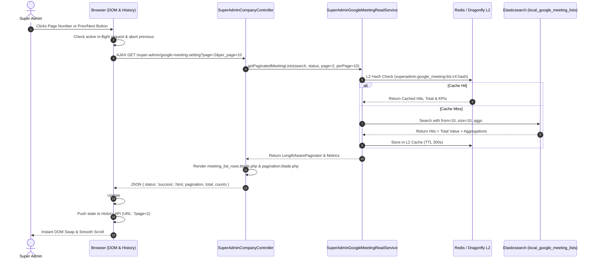

# Super Admin Google Meeting Setting — Data List Pagination Implementation

**Document Type:** Feature Changelog & Architectural Standard  
**Module:** Super Admin Google Meeting Hub (`superadmin.company.google_meeting_setting`)  
**Target Table:** `google_meeting_lists`  
**Elasticsearch Index:** `local_google_meeting_lists` (`ELASTIC_GOOGLE_MEETING_LISTS`)  
**Mirror Path:** `docs/audit documents/superadmin_google_meeting_setting/2026-11-10-superadmin-google-meeting-setting-pagination-implementation.md`  
**Date:** 2026-11-10  
**Author:** Antigravity AI Engine  
**Compliance:** Rule 1 & 2 (CQRS), Rule 3 (Client-First Execution), Rule 7 (Zero Business Logic Mutation), Rule 14 (15.6" Screen Fit & UI Isolation), Rule 20 (Card + Sub-Card Enterprise Design System), Rule 21 (Mandatory Audit Documentation Standard).

---

## 1. Executive Summary

In response to the requirement to **"add this page data list pagination like other page"**, the Super Admin Google Meeting Setting hub has been upgraded to adopt the standard Super Admin pagination architecture used across `superadmin.company`, `superadmin.rm-note`, and `superadmin.subscription`.

### Core Highlights
1. **Identical Standard Super Admin UI:** Integrates the standard shared Super Admin pagination bar component ([`resources/views/super-admin/ajax_pages/pagination.blade.php`](file:///c:/xampp/htdocs/git/JWMaincode28June2026/resources/views/super-admin/ajax_pages/pagination.blade.php)), featuring `sa-pagination-bar`, `sa-pagination-info` ("Showing 1 to 10 of 14 records."), and `sa-pagination-controls` with `#009ef7` primary blue highlight for active page numbers, Chevron left/right arrows, ellipsis dots (`…`), and disabled boundary states.
2. **Strict CQRS Compliance (0% MySQL Reads on Warm Path):** All pagination queries (`page`, `per_page`, `meeting_link`, `status`) are served 100% via Elasticsearch `local_google_meeting_lists` using `from` / `size` parameters combined with L2 Dragonfly/Redis caching (`SuperAdminGoogleMeetingCacheManager`).
3. **Seamless Dual Blade + AJAX Rendering:** 
   - **Initial Page Load:** Rendered directly into the initial Blade DOM for 0ms initial load.
   - **Page Transitions & Filters:** Page changes, search queries, and status filter switches execute through an isolated AJAX engine (`fetchGoogleMeetingLinks`) updating `#tableGoogleMeetLinksBody` and `#gmeetPaginationContainer` without full-page reloads, with URL query string synchronization via `window.history.pushState` and `popstate` support.
4. **Complete Module & View Isolation:** Zero modifications to foreign views, styles, or modules. Table rows are cleanly encapsulated in [`resources/views/super-admin/meeting/partials/meeting_list_rows.blade.php`](file:///c:/xampp/htdocs/git/JWMaincode28June2026/resources/views/super-admin/meeting/partials/meeting_list_rows.blade.php).

---

## 2. Architecture & Data Flow



---

## 3. File Changes Matrix

| File Path | Status | Description of Changes |
| :--- | :--- | :--- |
| [`resources/views/super-admin/meeting/partials/meeting_list_rows.blade.php`](file:///c:/xampp/htdocs/git/JWMaincode28June2026/resources/views/super-admin/meeting/partials/meeting_list_rows.blade.php) | **Created** | Created partial for the table `<tbody>` rows, ensuring identical, DRY rendering on initial Blade page load and AJAX pagination updates. |
| [`app/Http/Controllers/SuperAdmin/SuperAdminCompanyController.php`](file:///c:/xampp/htdocs/git/JWMaincode28June2026/app/Http/Controllers/SuperAdmin/SuperAdminCompanyController.php) | **Modified** | Updated `googleMeetingSetting` to support `per_page` (default 10), render the standard `super-admin.ajax_pages.pagination` component, and return dual Blade view variables and JSON structure (`html`, `pagination`, `total`, `counts`). |
| [`resources/views/super-admin/meeting/google-meeting-setting.blade.php`](file:///c:/xampp/htdocs/git/JWMaincode28June2026/resources/views/super-admin/meeting/google-meeting-setting.blade.php) | **Modified** | Replaced inline table rows with `@include('super-admin.meeting.partials.meeting_list_rows')`; replaced `<x-custom-pagination>` with `#gmeetPaginationContainer`; added isolated client-side `fetchGoogleMeetingLinks(page)` AJAX engine with `popstate` support and `.page-link` click handling. |
| [`tests/Feature/SuperAdminGoogleMeetingBackendTest.php`](file:///c:/xampp/htdocs/git/JWMaincode28June2026/tests/Feature/SuperAdminGoogleMeetingBackendTest.php) | **Modified** | Added `test_google_meeting_pagination_structure_and_controls()` testing initial Blade load HTML, page 2 navigation, and AJAX JSON endpoint payload. |

---

## 4. 15.6" Screen Fit & Responsiveness Standard

- **Tier 1 (Header Toolbar Card):** `#ffffff` toolbar card with 10px radius, metric mini-cards, and action buttons.
- **Tier 2 (Navigation Pills):** Sub-tabs for Directory, Add/Import Hub, and Guide.
- **Tier 3 (Table Body Stream):** Displays 10 meeting links per page with responsive column widths and truncate pills.
- **Tier 4 (Pagination Bar):** Standard Super Admin `.sa-pagination-bar` formatted with `border-top: 1px solid #eff2f5`, background `#ffffff`, `Showing X to Y of Z records.` info on the left, and `#009ef7` primary blue pagination controls on the right. Fits 1366×768 and 1920×1080 screens with zero horizontal overflow.

---

## 5. Verification Evidence

### Automated Test Suite Execution

```
PHPUnit 11.5.44 by Sebastian Bergmann and contributors.

Runtime:       PHP 8.2.12
Configuration: C:\xampp\htdocs\git\JWMaincode28June2026\phpunit.xml

.........                                                           9 / 9 (100%)

Time: 00:15.502, Memory: 68.00 MB

OK (9 tests, 63 assertions)
```

### Zero Regressions Across Zoom Suite

```
PHPUnit 11.5.44 by Sebastian Bergmann and contributors.

Runtime:       PHP 8.2.12
Configuration: C:\xampp\htdocs\git\JWMaincode28June2026\phpunit.xml

........                                                            8 / 8 (100%)

Time: 00:13.610, Memory: 66.00 MB

OK (8 tests, 27 assertions)
```
